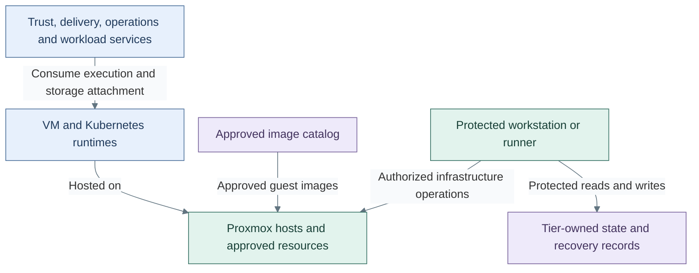

# Hosting and orchestration

Hosting supplies the capacity and isolation needed to execute services. Orchestration
places and maintains those services within authorized resources. The capability applies
to a homelab, private cloud or externally managed runtime; its purpose does not depend
on a particular hypervisor, operating system or scheduler.

This capability expands the [platform overview](../README.md#foundational-capabilities).
[Data and storage](../12-data/README.md) supplies persistence; [Operations](../24-operations/README.md)
owns backup/recovery policy and evidence. Consuming a runtime grants neither host
administration nor ownership of its underlying storage.
The [runtime relationships](../07-runtime-flows.md) connect these interfaces to access,
software changes and recovery across the platform.
Read [bootstrap execution](02-bootstrap.md) after the runtime overview to see how
the first changes and independent recovery are performed.

## Table of contents

- [Components and interfaces](#components-and-interfaces)
- [Supplied and consumed interfaces](#supplied-and-consumed-interfaces)
- [Design choices](#design-choices)
- [Design constraints](#design-constraints)
- [Realization](#realization)

## Components and interfaces

| Component | Function and boundary |
| --- | --- |
| Execution capacity | Processor, memory and device resources on physical, virtual or managed hosts |
| Runtime isolation | Separation of service processes, guests or tenants under an explicit security contract |
| Placement and scheduling | Allocate resources, enforce eligibility/affinity and account for surviving capacity |
| Orchestration and lifecycle | Maintain accepted runtime definitions and coordinate replacement, update and retirement |
| Runtime artifacts | Identify approved images and retain the inputs needed to reproduce the selected runtime |
| Infrastructure control | Authorize privileged lifecycle operations separately from ordinary service use |

A scheduler's placement decision does not establish independent failure domains.
Rescheduling, host restart, service replication and application recovery are distinct
mechanisms. Each realization records which mechanisms it supplies and what they depend on.

## Supplied and consumed interfaces

| Direction | Interface | Connected capability | Contract |
| --- | --- | --- | --- |
| Provides | Service execution | Identity, cryptography, software, operations and applications | Named owner, isolated resources, capacity and lifecycle |
| Provides | Placement/lifecycle control | Authorized resource definitions | Scoped acceptance, credentials and exclusive ownership of control state |
| Provides | Runtime image references | Guest and workload lifecycle | Known artifact identity and retained build/publication inputs |
| Consumes | Network attachments | [Networking](../11-networking/README.md) | Approved reachability and enforcement; runtime placement grants no network access |
| Consumes | Persistent datasets | [Data and storage](../12-data/README.md) | Explicit interface, attachment semantics, data owner and service-level access |
| Consumes | Administrative identity/trust | [Identity](../18-identity/README.md), [cryptography](../16-cryptography/README.md) | Authenticated scoped access plus independent recovery authority |
| Exchanges | Inventory, health and audit records | [Operations](../24-operations/README.md) | Resource identity and evidence usable when hosted management is unavailable |

[Infrastructure control](03-provisioning.md) defines the protected execution boundary.
Resource definitions, inventory and lifecycle state remain with their owning tier;
shared execution code does not become another owner. Hosting consumes persistent
storage rather than defining one backup policy for every hosted service.

## Design choices

Runtime alternatives can be combined; they are not a mandatory upgrade ladder.

| Realization | Execution boundary | Design obligation |
| --- | --- | --- |
| Bare metal | Service or operating system on an assigned physical host | Explicit device ownership, isolation, replacement and independent control access |
| Virtual machines | Guest operating systems on authorized hypervisor capacity | Guest/host authority separation, images, eligible placement and accessible disks |
| Containers | Processes scheduled on selected hosts or a cluster | Runtime isolation policy, resource limits, service lifecycle and persistent-data attachments |
| Managed runtime | Provider-operated execution or orchestration behind a service API | Explicit provider/consumer responsibilities, credentials, dependencies and recovery/export contract |

A container image alone is not a supported service deployment. A managed API does
not remove the consumer's responsibility for application configuration, authorization
or data. These are architectural alternatives, not a claim that every option has
an installer in this repository.

| Independent choice | Contract that remains stable |
| --- | --- |
| One host or clustered capacity | Defined failure tolerance, placement eligibility and recovery access |
| Mutable or image-based operating systems | Approved versions and a deliberate update/replacement lifecycle |
| Dedicated service or shared orchestrator | Explicit service authority, resource and data boundaries |
| Network/storage attachment mechanism | The same agreed reachability, dataset access and persistence requirements |

The [variant model](../08-variants.md) records selected combinations and consequences.
Physical uplinks, storage fabrics and host configuration belong to their selected
realization rather than the definition of this capability.

## Design constraints

| Concern | Required property |
| --- | --- |
| Isolation | Host/runtime administration is separate from service consumption; labels alone do not prove isolation |
| Availability | Declared host, scheduler, network and storage failure domains; replica count alone is not HA |
| Mobility | Replacement or relocation preserves the service's network, dataset and ownership contracts |
| Lifecycle | Accepted images, definitions and privileged control state are retained independently of hosted delivery |
| Recovery | Recovery authority and inputs survive loss of the runtime and hosted management services |
| Data | Application datasets and infrastructure/cluster state are identified separately; persistence and backup are explicit contracts |

## Realization

**Selected repository realization:** Proxmox hosts supply VM execution and Kubernetes
supplies orchestration. These are the current implementation choices, not interchangeable
provider switches. Talos is the supplied Kubernetes node OS. Conceptual alternatives
require their own validated integration; see [implementation support](../../08-reference/implementation-support.md).

*Figure: Services consume VM and Kubernetes runtimes on Proxmox; approved images and protected execution
support hosting and tier-owned state.*

This **reference view** shows hosting and privileged control relationships, not
network rules or an installation sequence. Tier 0 owns host control and VM template
publication; each consuming tier retains its definitions, inventory and state.
A template is an input, not a configured cluster or application.

The [runtime view](01-runtime.md) expands the selected placement.
[Kubernetes topology](04-kubernetes.md) owns the independent tier clusters and worker choices;
[provisioning](03-provisioning.md) owns execution authority. The [VMID convention](../../02-conventions/vmid-convention.md)
is a reference allocation, independent of network policy.

Selected implementation details live in the [reference platform](../06-reference-platform.md),
[host/image prerequisites](../../03-deployment/foundation/README.md) and
[cluster deployment guide](../../03-deployment/stage-4-kubernetes/README.md).
The [HA realization](../../03-deployment/foundation/proxmox/step-1b-cluster-ha.md) distinguishes
failure recovery, placement rules and rebalancing; guest restart is not uninterrupted
application service or recovery from lost data.
