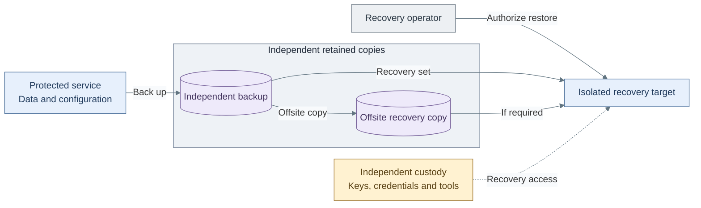

# Backup and recovery design

Backups preserve recoverable data and authority outside the systems being protected.
Availability keeps a service running; recovery restores its accepted identity and data
after loss or compromise. Both need explicit owners and independently usable credentials.

## Contents

- [Recovery boundaries](#recovery-boundaries)
- [Copy and retention model](#copy-and-retention-model)
- [Storage interfaces](#storage-interfaces)
- [Authority and consistency](#authority-and-consistency)
- [Recovery objectives and evidence](#recovery-objectives-and-evidence)
- [Operational procedures](#operational-procedures)
- [References](#references)

*Figure: An isolated target is restored from the selected independent or offsite copy.
Recovery also requires operator authority and separately held keys, credentials and tools.*

The figure shows recovery dependencies. Product-aware capture creates the selected
recovery set; the independent and offsite paths preserve copies
under their own custody. Restoration needs both a usable copy and independent access
to the tools and keys that make it readable. Those inputs must remain accessible when
the protected service or its normal identity path is unavailable.

## Recovery boundaries

| Protected boundary | Recovery material that must survive it |
| --- | --- |
| Guest or application | Product-aware data copy, configuration, version and decryption inputs |
| Hypervisor or cluster | Original Terraform state, ignored inputs, inventory, cluster secrets and independently accessible guest/application backups |
| Identity, secrets or delivery service | Recovery access, keys, tools and records available without that service |
| Storage system or site | Verified independent/offsite copy and its independently held recovery keys |
| Compromised producer or query identity | Evidence and recovery history outside that identity's deletion authority |

Tier 0 recovery remains independent of Tier 1 source control, normal SSO and the secret
service being restored. A bootstrap VM on the affected cluster is insufficient as its
only recovery environment. Product dependency order belongs to the
[recovery contract](../../05-operations/06-resilience/README.md#recovery-order).

## Copy and retention model

Critical data follows **3-2-1**: three copies including the primary, two media types,
and one offsite copy. Offline or independently immutable custody addresses compromise
of connected systems. [1] Accepted exceptions are recorded with their failure limits.

| Mechanism | Property supplied | Remaining obligation |
| --- | --- | --- |
| Replicas, RAID or HA restart | Availability within selected failure domains | Independent history, keys and tested restoration |
| Same-storage snapshots | Convenient historical recovery points | Protection against loss or compromise of that storage |
| NAS snapshots and separate credentials | Trusted-custodian recovery history | Independent/offsite copy; NAS administrators remain trusted |
| Storage-enforced retention locks | Retention under the selected lock policy | Independent access, copy integrity and tested restoration |
| Encryption | Confidentiality of the copy | Separately recoverable keys, availability and retention |

Retention expiry is a separately authorized custody operation. Ordinary producers and
application/query users do not receive backup deletion rights. Supplied scheduled file
backup jobs do not prune, but their writable repositories still trust backup-host root
and storage administrators; lack of a prune command is not a write-once guarantee.
The [logging retention design](02-log-retention.md) distinguishes trusted-administrator
snapshots from enforceable WORM protection. A homelab may assign several roles to one
person while keeping their credentials and recovery copies separate.

## Storage interfaces

Live databases remain on qualified Proxmox/Ceph-backed block storage. A NAS can receive
backup files through its native NFS/SMB interface or supported file-transfer tooling.
An existing native object endpoint is used only where the selected product requires
that API; a file share is not presented as an object service or a retention lock.
The [runtime storage model](../06-data/README.md#storage-interfaces) owns those interfaces.

VM backups cover the disks included in the selected job. External PVCs, application
object areas and NAS shares need their own backup contracts. An offsite copy must
retain the data and access needed for recovery, rather than only reference its source.

## Authority and consistency

| Authority | Scope |
| --- | --- |
| Backup executor | Read selected source data and create/verify its authorized backups |
| Recovery operator | Read the selected backup and restore into an approved isolated target |
| Retention custodian | Review expiry and prune only the selected repository/namespace under its policy |
| Security reader | Read authorized evidence views without altering original evidence or retention |

PBS client backup rights and pruning rights are separate. [2] Absence of a prune step
in a writable file-backup job does not make its repository immutable.

Database, media, configuration, keys and application objects must form a compatible
recovery set. Independent successful jobs do not prove an atomic recovery point.
The selected product contract defines quiescing, version matching and validation.
Scheduled full backups recover to the last accepted completed copy; point-in-time
recovery additionally requires the selected continuous archive mechanism.

## Recovery objectives and evidence

The **recovery point objective (RPO)** states the accepted data age/loss;
the **recovery time objective (RTO)** states the accepted recovery duration.
The schedule, transfer lag, failure behavior, keys and offsite access must support both.
Job success alone does not establish either objective.

Acceptance records identify the backup/recovery set, clean target, retained credentials,
data and service checks, measured time, missing records and actual failure limits.
Loss of the source, identity and normal dashboards must not prevent the selected test.
Review the design when team access, retention requirements, capacity or failure domains change.

## Operational procedures

[Backup and restore tasks](../../05-operations/06-resilience/backups/virtual-machines.md) own execution.
The [recovery-set checklist](../../05-operations/06-resilience/backups/recovery-set.md) connects those routines to
[bootstrap, guest, host and platform recovery](../../05-operations/06-resilience/README.md).
The [administration index](../../05-operations/README.md) leads to the selected product's
backup, rotation and clean-target recovery runbooks.

## References

1. [HHS backup guidance: 3-2-1, offsite and offline copies](https://www.hhs.gov/hipaa/for-professionals/security/guidance/cybersecurity-newsletter-october-2022/index.html).
2. [Proxmox Backup Server roles, privileges and namespaces](https://pbs.proxmox.com/docs/user-management.html).
