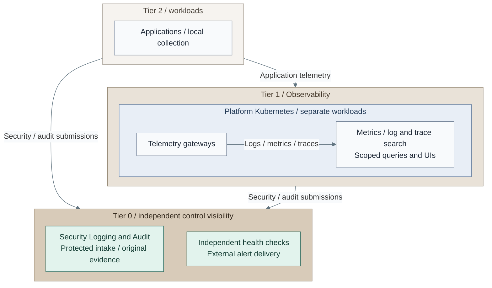

# Operations and resilience

Operations supplies independent visibility, inventory documentation, maintenance,
incident response and recovery. Every stateful resource has a recovery owner, regardless
of whether its monitoring is local or supplied by shared operational services.
Visibility explains what happened; protected evidence preserves what must survive;
recovery restores accepted service identity and data. Their access and failure boundaries
remain distinct even when one operator is responsible for all three.

## Table of contents

- [Completed design](#completed-design)
- [Components and interfaces](#components-and-interfaces)
- [Design choices](#design-choices)
- [Design constraints](#design-constraints)
- [Independent operation](#independent-operation)
- [Detailed views](#detailed-views)
- [Realization](#realization)

## Completed design

The map separates routine telemetry from protected security evidence. Follow the
application telemetry through Tier 1, then the security submissions into Tier 0.

*Figure: Application telemetry reaches Tier 1 query services through gateways. Security
submissions reach Tier 0 directly; critical visibility has a path outside Tier 1 Kubernetes.*

Tier 1 collectors normalize and route operational logs, metrics and distributed traces
to their query backends. Operators use those signals to understand service behavior.
System, security and audit records from every tier follow restricted intake into
Tier 0 custody. Approved projections can be searchable in Tier 1 without giving
query users or analytics administrators authority over the originals.

## Components and interfaces

### From a producer to a reader

A producer receives approved telemetry and security-event endpoints, not archive
administration credentials. Telemetry queries, application-log views and raw security
investigation have separate reader scopes. Authentication identifies a reader;
the receiving service enforces that reader's permitted sources and operations.

Collectors consume runtime signals and enforce routing policy. Query backends and
UIs consume the permitted outputs. Protected intake instead creates independently
recoverable evidence, with retention and recovery authority held outside producer
and ordinary query identities.

### From an operator to a system

NetBox documents approved inventory; Headlamp supplies scoped cluster operations.
These interfaces help operators understand and change the deployed system, while
tier-local inputs remain the bootstrap authority. Neither tool replaces independent
recovery records or grants blanket infrastructure administration.

Tier owners supply infrastructure records, workload scope and recovery responsibilities.
Operators use approved cluster APIs, service-local authorization and owned alert
delivery. Workload governance isolates consumers and authorizes changes without
transferring Tier 0 control; the [service-boundary design](../02-organization/README.md)
explains shared versus isolated operation.

### From retained data to recovery

Recovery owners need backups, archives and restoration evidence outside the service
being recovered. Data services supply [qualified storage interfaces](../06-data/README.md);
operations defines retention, recovery objectives and the checks that demonstrate a
usable restore. Hardware custody and application-state recovery have separate owners.
Storage availability or a successful copy does not establish recoverability.

## Design choices

The reference places routine observability in Tier 1 Kubernetes, with separate
collection, storage and UI workloads. Separate-role VMs or an existing accepted
service are alternatives. Shared or project-isolated collectors and backends follow
source sensitivity, access and retention requirements; resource budgets remain separate.

For retained evidence, choose NAS snapshots and independent backups when storage
administrators remain trusted, or qualified retention locks when the threat model
requires stronger privileged-deletion protection. [Archive choices](02-log-retention.md)
explains those boundaries. Recovery can use a dedicated backup service, an accepted
external target and protected offsite copies according to its selected contract.

Workloads can run in Linux VMs, image-based Linux or Kubernetes. Their definitions,
inventory and lifecycle ownership remain tier-local. Bounded self-service needs the
[authorized request contract](../04-hosting/02-provisioning.md); reviewed operator action
and unrestricted CI credentials are different authority models.

NetBox, Headlamp and monitoring are reference implementations, not prerequisites
for creating the infrastructure on which they run.

## Design constraints

| Concern | Required property |
| --- | --- |
| Visibility | Failure detection remains available outside the observed cluster |
| Access and retention | Signal stores enforce the sensitivity and retention requirements of their sources |
| Recovery | Backups, custodians and recovery targets remain independent of the protected service |
| Governance | Workload requests cannot bypass tier ownership or infrastructure authorization |

A central dashboard alone is insufficient for independent failure detection.

## Independent operation

Tier 0 failure detection and critical alert delivery remain usable without Tier 1,
its Kubernetes cluster or normal SSO. General telemetry can be Tier 1-owned; control
visibility has an independently recoverable path. A lost shared dashboard must not
remove critical alerts, original evidence or recovery authority.

Inventory and monitoring services are reference implementations, not prerequisites
for creating the infrastructure on which they run. Backups, credentials and tools
must be accessible without the service being restored. Recovery therefore depends
on retained restoration inputs as well as on an available target.

## Detailed views

Read this chapter in the order of the responsibility being examined:

- [Protected logging](01-protected-logging.md): submission, investigation and original evidence.
- [Log retention](02-log-retention.md): custody, deletion authority and checkpoint limits.
- [Observability](03-observability.md): signal routing, infrastructure coverage and independent diagnostics.
- [Backup and recovery](04-backup-recovery.md): independent copies and compatible restoration inputs.

The [reference platform](../03-reference-platform.md#service-placement) locates the
selected inventory, cluster interfaces and supporting services.

## Realization

Implementation procedures: [foundational logging](../../03-deployment/stage-2-logging/README.md),
[independent monitoring](../../03-deployment/stage-8-observability/step-13-infrastructure-monitoring.md),
[Observability](../../03-deployment/stage-8-observability/README.md),
[operational tools](../../03-deployment/stage-6-secrets/README.md#step-2-add-operational-tools)
and [operational acceptance](../../03-deployment/stage-6-secrets/README.md#step-3-integrate-access-and-recovery).
Recurring work belongs in [administration](../../05-operations/README.md).
