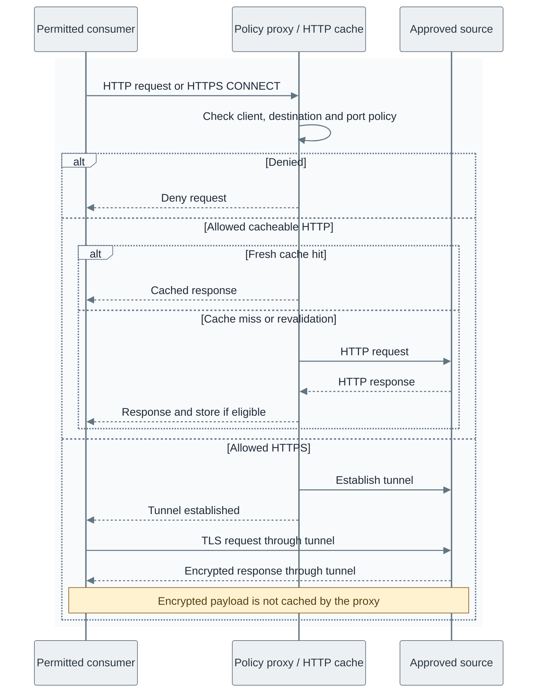

# Software intake

Software intake supplies selected software sources to consumers in every tier.
It is part of the broader [software lifecycle](../05-software-lifecycle.md), which also
covers source control, builds, artifacts and delivery.

The request sequence applies to any permitted consumer. Cache hits require a fresh,
eligible HTTP response; a miss may populate the cache if the response permits it.

*Figure: A consumer’s request is denied or served according to policy; only eligible HTTP responses can be
cached.*

**Architecture:** the [proxy design](01-design.md#transport-and-integrity) describes
transport limits and the [Squid configuration](../../../tier-2/ansible/roles/cache_proxy/templates/squid.conf.j2)
defines the reference listener and access policy.

| View | Guide |
| --- | --- |
| Placement, flows and supply choices | [Controlled software intake](01-design.md) |
| Quarantine, verification and publication | [Artifact verification](02-verification.md) |
| Approved images and registries | [Artifact supply](../20-delivery/01-artifact-supply.md) |
| Build the selected path | [Software intake deployment](../../03-deployment/stage-1-software-intake/README.md) |
| Maintain the deployed services | [Software intake operations](../../05-operations/software-intake/README.md) |
