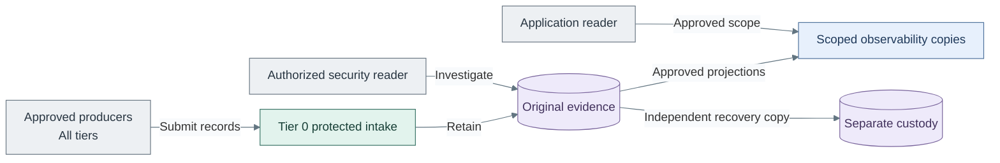

# Protected logging

Protected logging preserves security and audit evidence under independent Tier 0
custody. Operational diagnosis and scoped queries belong to [Observability](../21-observability/README.md);
that capability does not control the original evidence.

*Figure: Approved producers send records to Tier 0 custody; security readers access originals, while
application readers use scoped copies and a separate recovery copy is retained.*

| View | Guide |
| --- | --- |
| Evidence custody, intake and read boundaries | [Security logging design](../24-operations/01-security-logging.md) |
| Retention and deletion authority | [Log archive choices](../24-operations/02-log-retention.md) |
| Recovery and independent copies | [Backup and recovery](../24-operations/04-backup-recovery.md) |
| Deploy the selected path | [Protected logging deployment](../../03-deployment/stage-2-logging/README.md) |
| Operate and investigate | [Protected logging operations](../../05-operations/protected-logging/README.md) |
