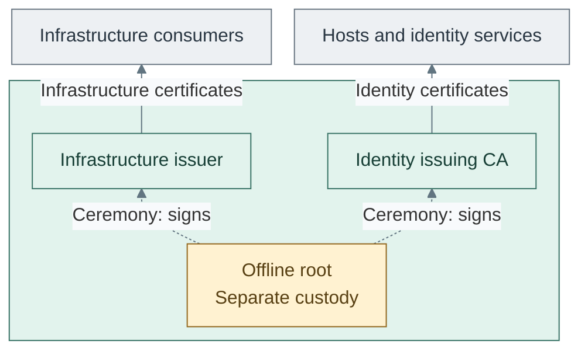

# Cryptographic trust

Cryptographic trust covers offline root custody, online issuance and certificate
consumption. Key-protection choices and verified publication are distinct selections;
the latter is an optional Stage 3 extension of [Software intake](../13-software-intake/README.md).

**Tier 0 trust authority:**

*Figure: An offline root signs certificates for two separately administered Tier 0 issuers, which serve
infrastructure and identity consumers.*

Dashed links are offline signing ceremonies, not network routes. Issuers retain separate administration.

| View | Guide |
| --- | --- |
| Root, issuers, enrollment and publication | [Certificate authority](../16-cryptography/01-certificate-authority.md) |
| Custody choices and constraints | [Key protection](../16-cryptography/03-hsm-selection.md) and [cryptography domain](../16-cryptography/README.md) |
| Verified repository and artifact publication | [Artifact verification](../13-software-intake/02-verification.md) |
| Deploy the selected path and optional verified intake | [Cryptographic trust deployment](../../03-deployment/stage-3-trust/README.md) |
| Operate the selected trust services | [Cryptographic trust operations](../../05-operations/cryptographic-trust/README.md) |
