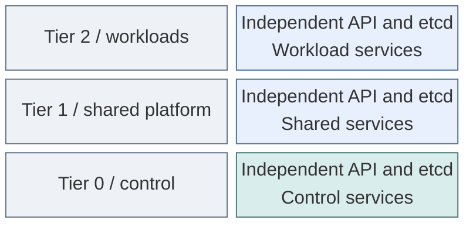

# Kubernetes

Kubernetes provides orchestration within independently owned tier runtimes. The
cluster design, platform services and workload isolation are separate decisions.

*Figure: Each tier owns a cluster with its own API and etcd; the view does not establish physical isolation or
application availability.*

| View | Guide |
| --- | --- |
| Cluster topology, scheduling and ownership | [Kubernetes design](../10-hosting/04-kubernetes.md) |
| Hosting and recovery boundaries | [Hosting and orchestration](../10-hosting/README.md) |
| Workload isolation | [Lab isolation](../10-hosting/05-workload-isolation.md) |
| Deploy the control cluster and basic platform | [Kubernetes deployment](../../03-deployment/stage-4-kubernetes/README.md) |
| Operate clusters and worker capacity | [Kubernetes operations](../../05-operations/kubernetes/README.md) |
