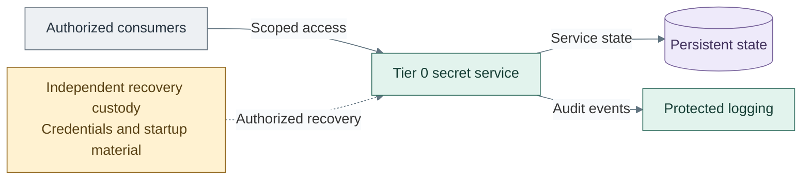

# Secrets

Secrets provides scoped credential storage, access, audit and independent recovery.
Its deployment also adds control tools and independent monitoring; those services
have their own operational and recovery boundaries.

*Figure: Authorized consumers access the Tier 0 secret service, which retains state and emits protected audit
events; independent custody supports recovery.*

Seal and recovery choices are separate from certificate-signing key custody.

| View | Guide |
| --- | --- |
| Secret-service interfaces and custody | [Cryptography and secrets](../16-cryptography/README.md) |
| Seal choices and independent recovery | [Secret-service seals](../16-cryptography/06-vault-seal.md) |
| Control visibility, inventory and recovery | [Operations and resilience](../24-operations/README.md) |
| Deploy secrets and supporting control services | [Secrets deployment](../../03-deployment/stage-6-secrets/README.md) |
| Operate secret and control services | [Secrets operations](../../05-operations/secrets/README.md) |
