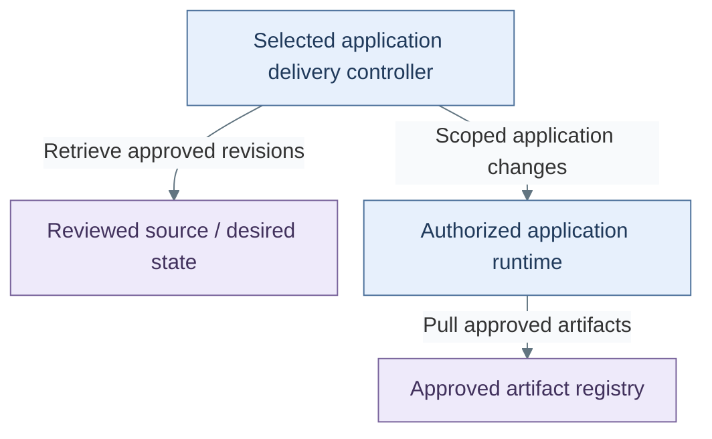

# Delivery

Delivery applies approved releases to their authorized runtimes. It forms part of the
[software lifecycle](../05-software-lifecycle.md), alongside intake, source and builds.

*Figure: The delivery controller retrieves reviewed definitions and changes authorized applications, whose
runtimes pull approved artifacts from the registry.*

**Architecture:** delivery access is scoped to application resources; controller
choices and Tier 0 authority are detailed in [delivery controllers](02-controllers.md).

| View | Guide |
| --- | --- |
| Reconciliation, release orchestration and authority | [Delivery controllers](02-controllers.md) |
| Registries and artifact distribution | [Artifact supply](01-artifact-supply.md) |
| Build the selected path | [Delivery deployment](../../03-deployment/stage-7-delivery/README.md) |
| Maintain deployed services | [Delivery operations](../../05-operations/delivery/README.md) |
