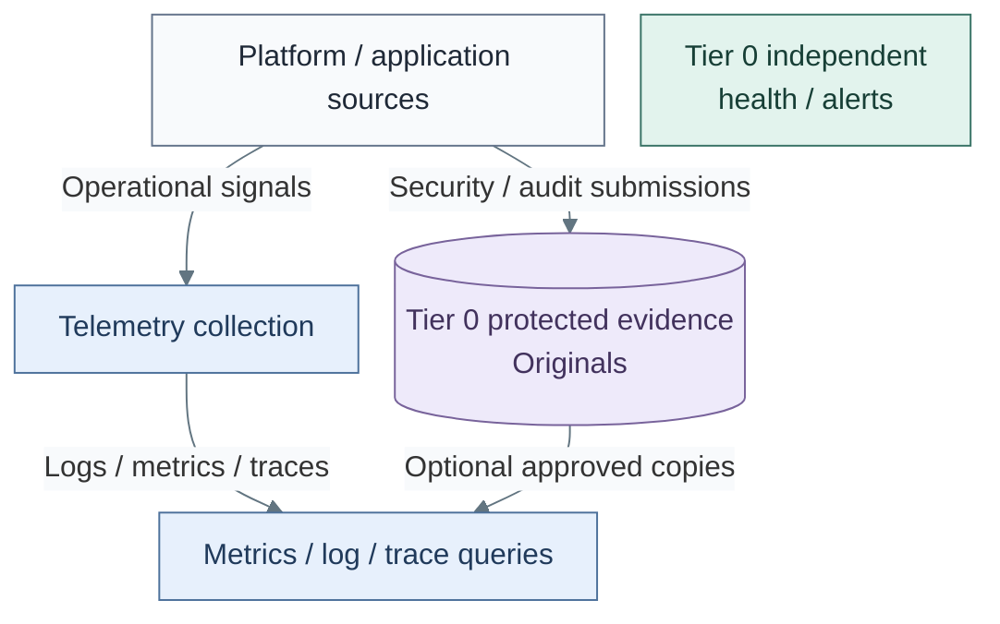

# Observability

Observability supports operational diagnosis through logs, metrics, traces and scoped
queries. It can consume approved evidence copies; [Protected logging](../14-protected-logging/README.md)
retains authority over Tier 0 originals. Independent control monitoring is established
with [Secrets](../19-secrets/README.md).

*Figure: Operational signals feed shared queries, while Tier 0 retains original security evidence and
independent health monitoring; only approved copies may reach shared queries.*

See [telemetry design](../24-operations/03-telemetry.md) for signal paths and boundaries.

| View | Guide |
| --- | --- |
| Signals, collection, queries and infrastructure coverage | [Telemetry design](../24-operations/03-telemetry.md) |
| Independent visibility and recovery | [Operations and resilience](../24-operations/README.md) |
| Protected evidence boundaries | [Security logging design](../24-operations/01-security-logging.md) |
| Deploy the selected visibility path | [Observability deployment](../../03-deployment/stage-8-observability/README.md) |
| Maintain deployed services | [Observability operations](../../05-operations/observability/README.md) |
