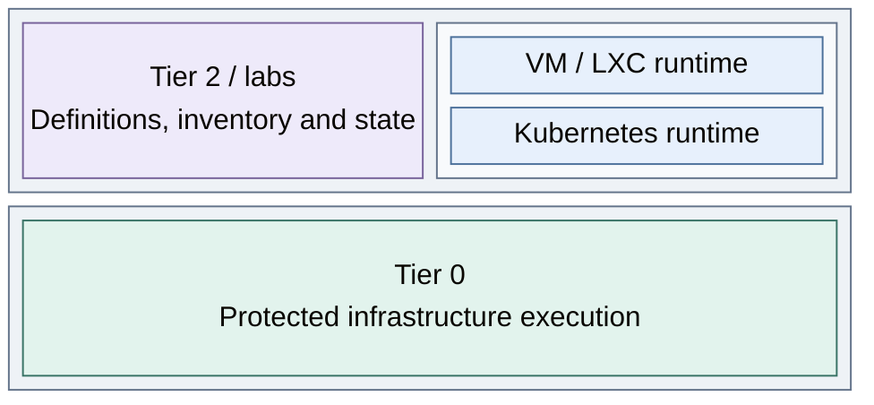

# Lab environments

Lab environments provide scoped Tier 2 runtimes and applications for experiments,
without transferring infrastructure authority to workload users. Operator deployment
and a future bounded request interface are separate choices.

This view shows the operator-controlled paths to selected lab runtimes. The
Kubernetes and VM/LXC paths can be selected independently or together.

*Figure: Tier 2 owns lab definitions and selected VM/LXC or Kubernetes runtimes; Tier 0 provides protected
execution.*

An operator approves and runs the selected path.

| View | Guide |
| --- | --- |
| Runtime and tenant boundaries | [Workload lab isolation](../10-hosting/05-workload-isolation.md) |
| Authorized infrastructure requests | [Infrastructure control](../10-hosting/03-provisioning.md) |
| Shared and isolated services | [Service boundaries](../04-service-boundaries.md) |
| Deploy selected lab runtimes and applications | [Lab environments deployment](../../03-deployment/stage-10-lab-environments/README.md) |
| Operate and recover lab environments | [Lab operations](../../05-operations/lab-environments/README.md) |
