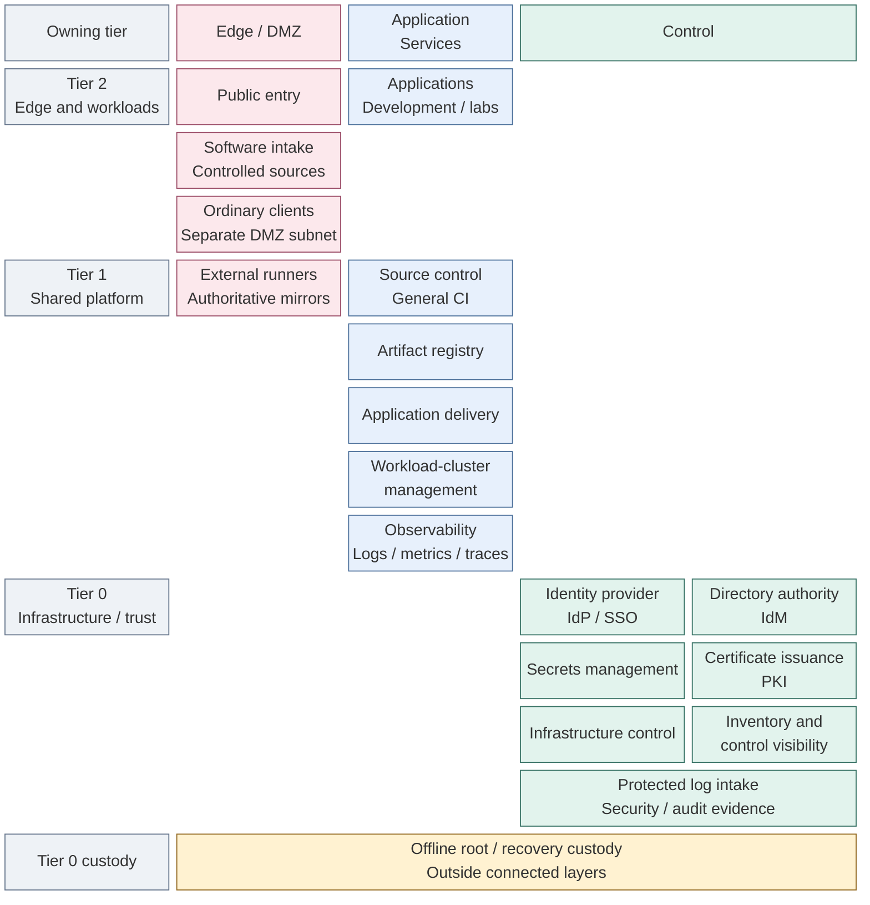
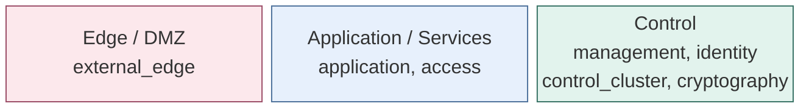
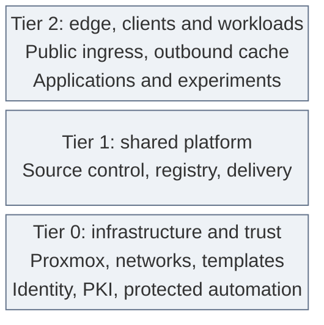

# Platform architecture

The private cloud provides shared services and isolated project runtimes on a
locally controlled infrastructure and trust foundation. Users consume published
applications; teams deliver reviewed changes; platform operators retain control
of infrastructure, identity, keys and recovery.

Explore the ten [capabilities](#capabilities) through their architecture, deployment
and operating guides. Shared [foundation and domain views](#foundational-capabilities)
explain the infrastructure and responsibilities that support them. The
[integrated reference design](06-reference-platform.md) selects components and hosting
boundaries; it does not establish that those choices are installed. Selected site
designs and acceptance evidence belong in project-owned records.

## Table of contents

- [Functional structure](#functional-structure)
- [Capabilities](#capabilities)
- [Read from overview to detail](#read-from-overview-to-detail)
- [Foundation and related domains](#foundational-capabilities)
- [How the platform works together](#how-the-platform-works-together)
- [Layered model](#layered-model)
- [Tiered model](#tiered-model)
- [Tier and zone view](#tier-and-zone-view)
- [Automation responsibilities](#automation-responsibilities)
- [Continue reading](#continue-reading)

## Functional structure

The capability map places services by **owning tier** vertically and **security
layer** horizontally. Boxes name capabilities, not products, VMs or clusters.
Capability views expand those boxes into their components and hosting arrangements.
These names remain valid across implementation choices: protected log services stay
Tier 0-owned whether a site selects one receiver, redundant intake or existing storage.
Instance names, counts and commands belong to the selected deployment, not this map.

*Figure: The reference capabilities are arranged by owning tier and protection layer; empty cells do not imply
missing services.*

Empty cells do not require additional services or networks. The map shows the
reference placement; project services and isolated variants retain their actual
owner and exposure. Infrastructure control owns the hosts, networks and storage
supporting every layer, not only services in its own cell.

**Identity and access management (IAM)** spans directory authority, the identity
provider and service-local authorization. It is not one VM. The
[identity view](18-identity/README.md) defines the terms and shows IdM on dedicated
VMs and the IdP in the Tier 0 cluster, consumed by services in all three tiers.

Both identity services remain in Control in this reference. An application-facing
login endpoint is a permitted service interface, not a move into the Services
zone. Control is a security layer; `management` is one network within it.
Offline custody is outside the connected layers, not another routed zone.

Ordinary clients belong to Tier 2 / Edge, on their own DMZ subnet. Protected
operator workstations belong to the tier they administer, not the ordinary client
network. Approved software sources and offsite recovery targets are external peers.
Existing services can fulfill a capability through explicit consumer, ownership
and recovery contracts. The
[runtime views](07-runtime-flows.md) show interactions; the
[reference platform](06-reference-platform.md) shows hosting; the
[network map](11-networking/README.md) owns attachments and firewall zones.

## Capabilities

These architecture routes use the same names as the deployment stages. They group
related design, installation and operating material; they do not prescribe deployment
order or imply every design option is installed. See the [support map](../08-reference/implementation-support.md#stage-coverage)
for supplied workflows and integration boundaries.

| Capability | Architecture route |
| --- | --- |
| Software intake | [Software intake](13-software-intake/README.md) |
| Protected logging | [Protected logging](14-protected-logging/README.md) |
| Cryptographic trust | [Cryptographic trust](15-cryptographic-trust/README.md) |
| Kubernetes | [Kubernetes](17-kubernetes/README.md) |
| Identity | [Identity](18-identity/README.md) |
| Secrets | [Secrets](19-secrets/README.md) |
| Delivery | [Delivery](20-delivery/README.md) |
| Observability | [Observability](21-observability/README.md) |
| Development platform | [Development platform](22-development-platform/README.md) |
| Lab environments | [Lab environments](23-lab-environments/README.md) |

The [deployment overview](../03-deployment/README.md) owns the installation sequence;
the [capability index](../06-paths/capabilities.md) also maps design to deployment and operations.

## Read from overview to detail

| View | Question answered | Design |
| --- | --- | --- |
| Whole platform | Which capabilities form the environment, and where do they belong by tier and layer? | This page |
| Integrated reference | What components coexist in one complete realization, and where do they run? | [Reference platform](06-reference-platform.md) |
| System interactions | How do access, changes, certificates, data and recovery cross domain boundaries? | [Runtime relationships](07-runtime-flows.md) |
| Capability | What function is provided, and what does it consume and expose? | [Capabilities](#capabilities) |
| Detailed design | How does a component or alternative fulfill its contract? | Detail pages linked from each capability |
| Selected instance | Which alternatives are combined for a particular site or environment? | [Variant selection](08-variants.md) and project-owned designs |

Folders and detail pages follow a foundation-first reading order. The order helps
explain dependencies; the [deployment stages](../03-deployment/README.md) remain
the authority for actual installation and option order. A child diagram expands
a named part of its parent and keeps the same outward interfaces. Networking,
ownership and runtime placement are complementary views of those components.

| Read next | Foundation or capability |
| --- | --- |
| 1 | [Hosting](10-hosting/README.md), including [bootstrap execution](10-hosting/02-bootstrap.md) |
| 2 | [Networking](11-networking/README.md) and [data and storage](12-data/README.md) |
| 3 | [Software intake](13-software-intake/README.md) and [protected logging](14-protected-logging/README.md) |
| 4 | [Cryptographic trust](15-cryptographic-trust/README.md), [key custody](16-cryptography/README.md) and [Kubernetes](17-kubernetes/README.md) |
| 5 | [Identity](18-identity/README.md), [secrets](19-secrets/README.md) and [delivery](20-delivery/README.md) |
| 6 | [Observability](21-observability/README.md), [development](22-development-platform/README.md) and [lab environments](23-lab-environments/README.md) |
| 7 | [Operations and resilience](24-operations/README.md) across the completed system |

## Foundation and related domains

These shared design views support the capabilities above. Foundation infrastructure
can be prepared or accepted independently; see [foundation deployment](../03-deployment/foundation/README.md)
and [host operations](../05-operations/hosts/management.md). These domain functions are
design responsibilities, not required products, repositories or deployment stages.
One installation may combine several; a larger environment can separate them while
preserving their interfaces and authority boundaries.

| Domain | Function supplied to the platform | Detailed designs |
| --- | --- | --- |
| [Hosting and orchestration](10-hosting/README.md) | Isolated execution, resource provisioning and scheduling | [VM and cluster runtimes](10-hosting/01-runtime.md), [Kubernetes](10-hosting/04-kubernetes.md), [protected infrastructure control](10-hosting/03-provisioning.md) |
| [Networking and connectivity](11-networking/README.md) | Addressing, name resolution, reachability, segmentation and service publication | Attachments, zones and [traffic policy](11-networking/01-firewall-policy.md) |
| [Data and storage](12-data/README.md) | Persistent data services and qualified block, file and object interfaces | Data ownership, live storage and backup interfaces |
| [Identity and access](18-identity/README.md) | Human and machine identities, authentication and scoped authorization | Directory authority, federation and service-local policy |
| [Cryptography and secrets](16-cryptography/README.md) | Trust anchors, certificate issuance, key custody and scoped secret delivery | [Key protection](16-cryptography/03-hsm-selection.md) and [service seals](16-cryptography/06-vault-seal.md) |
| Software intake, development and delivery | Controlled intake, source, builds, artifacts and approved releases | [Software lifecycle](05-software-lifecycle.md), [intake](13-software-intake/README.md), [development platform](22-development-platform/README.md) and [delivery](20-delivery/README.md) |
| [Operations and resilience](24-operations/README.md) | Inventory, observability, protected evidence, maintenance and recovery | Health, retention and [backup/recovery contracts](24-operations/04-backup-recovery.md) |

**Zero trust and scalability apply across every capability.** Identity establishes
the subject; each resource enforces its own access policy; networking constrains
reachable paths; cryptography protects exchanges; operations retains evidence.
Capacity, failure domains and recovery requirements are explicit design inputs.
The [design principles](01-principles.md) define these shared constraints.

The same capability questions apply to a small homelab, a datacenter or a public
cloud. Managed services change who implements and operates a function, rather than
removing the need for its access, data and recovery contract. This repository's
implemented reference remains Proxmox-based; cloud-provider alternatives require
their own implementation and acceptance.

## How the platform works together

| Relationship | Completed behavior | Expanded view |
| --- | --- | --- |
| Service access | Clients reach named endpoints; the IdP uses directory authority; each service applies its own authorization | [Access](07-runtime-flows.md#service-access) |
| Application delivery | General builds produce candidates; approved source and artifacts are delivered into the owning runtime | [Application delivery](07-runtime-flows.md#application-delivery) |
| Infrastructure change | Proposed resource changes pass Tier 0 acceptance before protected execution; inventory and state remain tier-owned | [Infrastructure changes](07-runtime-flows.md#infrastructure-changes) |
| Certificate trust | An offline root authorizes intermediates; online issuers serve routine certificate consumers | [Trust](06-reference-platform.md#certificate-trust) |
| Data and recovery | Each stateful service owns its data and restoration contract; recovery inputs and failure detection survive hosted-service loss | [Data and recovery](07-runtime-flows.md#data-visibility-and-recovery) |

These relationships coexist after deployment. A deployment stage may contribute
to several functions, and one function may be realized across several stages.

## Layered model

Network protection runs **left to right**, from exposed entry points to control
systems. The network names describe what runs there; firewall zones group
networks with similar policy.

*Figure: Protection layers group network purposes from exposed entry to control; placement does not grant
access.*

Columns show placement, not allowed traffic. Only named service connections are
permitted. Control is a layer; `management` is one network within it.
Host storage/quorum fabrics and offline `ceremony` are separate from this
routed service path. The [network map](11-networking/README.md) owns VLANs and attachments.

## Tiered model

Repositories divide responsibility by potential impact. **Tier 2 is at the
top; Tier 0 is at the bottom**, supporting the systems above it.

*Figure: Tier 0 supplies the infrastructure and trust foundation beneath the shared platform and workloads.*

These are ownership boundaries, not network routes. Each tier owns its
inventory, Terraform resources, and state. Shared holds reusable automation,
size data, and common platform references, never resource ownership or host
inventory. See [tier ownership](03-tier-ownership.md) for the contract.

## Tier and zone view

| Service | Repository | Network | Firewall zone |
| --- | --- | --- | --- |
| Public edge load balancer and ordinary cache | Tier 2 | `external_edge` | DMZ |
| Ordinary clients | Tier 2 | separate `client` subnet | DMZ |
| External VM runner / authoritative mirror | Tier 1 | `delivery_edge` | DMZ |
| Kubernetes general CI | Tier 1 | platform cluster `application` attachment | Services |
| Source control | Tier 1 | `application` | Services |
| Project application | Tier 2 | `application` or a project subnet | Services or a dedicated policy |
| Directory authority | Tier 0 | `identity` | Control |
| Protected infrastructure runner | Tier 0 | `management` | Control |
| Offline root CA | Tier 0 | isolated `ceremony` fabric | none |

A repository split does not require new network names or one VLAN per tier.
A shared zone does not permit unrestricted traffic between its subnets.
Classify by actual privileges: an ordinary runner and a runner holding
hypervisor credentials do not have the same owner.

## Automation responsibilities

| Tool or workflow | Responsibility |
| --- | --- |
| Template publication; optional Packer builds | Tier 0 prepares approved images before VMs exist |
| Terraform / OpenTofu design | Provision resources from tier-owned definitions and inputs |
| Ansible | Configure supported Linux hosts from the same tier-local inventory |
| Kubernetes bootstrap | Create the cluster; Talos is the current OS implementation |
| Application delivery | Tier 0 uses Flux; Tier 1 selects GitOps or release-pipeline orchestration separately |

The current wrappers execute Terraform. A protected workstation and protected
runner are alternative execution contexts within Tier 0's authority. Source
control coordinates changes; Tier 0 retains authorization and independent recovery.

## Continue reading

| Question | Authoritative guide |
| --- | --- |
| Which networks, VLANs, and firewall rules? | [Network map](11-networking/README.md), [firewall policy](11-networking/01-firewall-policy.md) |
| Which names, tags, IDs and allocation rules? | [Conventions](../02-conventions/README.md) |
| What belongs in each repo? | [Tier ownership](03-tier-ownership.md) |
| Which implementation choices are available? | [Capabilities](#capabilities), [variant selection](08-variants.md) |
| What does the complete platform look like? | [Integrated reference design](06-reference-platform.md) |
| How do its parts cooperate? | [Runtime relationships](07-runtime-flows.md) |
| What is deployed first? | [Deployment checklist](../06-paths/tier-0/README.md) |
| How are privileged changes accepted? | [Infrastructure control](10-hosting/03-provisioning.md) |
| What is the wider platform scope? | [Private cloud](02-private-cloud.md), [shared services](04-service-boundaries.md) |

Routing, switching, and firewall rules remain operator-managed prerequisites.
The generator creates repositories, not running infrastructure.
