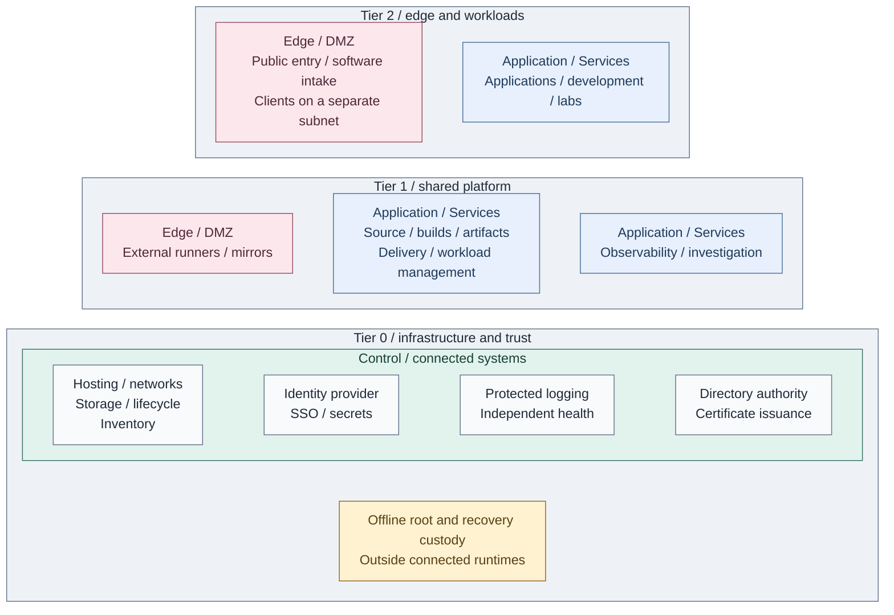

# Platform architecture

The platform gives applications a common foundation for hosting, software supply,
identity, trust and recovery. This chapter explains how those capabilities work
together, from the infrastructure underneath a service to the users who consume it.

## Functional structure

*Figure 1 - The platform at a glance. Each enclosing tier owns its services;
Edge, Services and Control identify protection layers. Tier 0 supplies the
foundation below the shared platform and workloads. Boxes group capabilities,
not individual servers, network routes or granted permissions.*

Start at the bottom of Figure 1. Hosts, networks and storage provide a runtime.
Identity and cryptographic trust let services recognize callers and protect their
exchanges. Shared delivery then turns reviewed changes into running applications.
Protected logs and independent recovery remain available to the owners of those services.

## Contents

- [Read to make a decision](#read-to-make-a-decision)
- [Capabilities](#capabilities)
- [How the platform works together](#how-the-platform-works-together)

## Read to make a decision

The first three chapters explain context, responsibility and the chosen realization:

1. [Private cloud model](01-background/README.md): what this platform provides and
   when local, public or hybrid hosting is appropriate.
2. [Organization and responsibilities](02-organization/README.md): who administers
   a service, who consumes it and how those boundaries survive shared hosting.
3. [Integrated reference platform](03-reference-platform.md): how the supplied
   Proxmox, Kubernetes and service implementations realize Figure 1.

Then follow the selected capability. Installation commands live in
[Deployment](../03-deployment/README.md); the design remains readable without following them.

## Capabilities

Read these chapters from the foundation toward the services built on it, or enter
a particular chapter when the surrounding system is already familiar.
Zero trust and scalability constrain every capability; its design explains the
relevant authority, capacity and failure boundaries.

| Chapter | What it explains |
| --- | --- |
| 4. [Hosting](04-hosting/README.md) | Hosts, VMs, Kubernetes and Lab environments; runtimes and lifecycle control |
| 5. [Networking](05-networking/README.md) | How services communicate across protection boundaries |
| 6. [Data and storage](06-data/README.md) | How live state, file/object interfaces and recovery copies differ |
| 7. [Software intake](07-software-intake/README.md) | How external software reaches consumers through controlled sources |
| 8. [Cryptography and secrets](08-cryptography/README.md) | Cryptographic trust and Secrets: certificates, protected keys and credential custody |
| 9. [Identity](09-identity/README.md) | How users sign in and services authorize their requests |
| 10. [Delivery and development](10-delivery/README.md) | Delivery and the Development platform: reviewed code, builds and approved releases |
| 11. [Operations and resilience](11-operations/README.md) | How owners observe, investigate and recover their services |

## How the platform works together

The communication examples sit beside the capability that owns the behavior.
Each starts with the participants, then follows the request or data to its dependencies:

-  [A user signs in](09-identity/README.md#service-access).
-  [A reviewed change reaches a runtime](10-delivery/README.md#application-delivery).
-  [An authorized change reaches hosts and guests](04-hosting/02-provisioning.md#infrastructure-changes).
-  [A service obtains certificates and credentials](08-cryptography/08-secrets.md#certificate-and-secret-consumption).
-  [State survives a service loss](11-operations/04-backup-recovery.md#recovery-boundaries).
-  [Monitoring survives the system it observes](11-operations/README.md#failure-boundaries).

The [capability index](../06-paths/capabilities.md) connects each design to its
deployment and operating guide. Record local choices and completion in the project
architecture repository; the [decision log](../07-decisions/README.md) retains
the reasons for changes to authority, interfaces or recovery.
