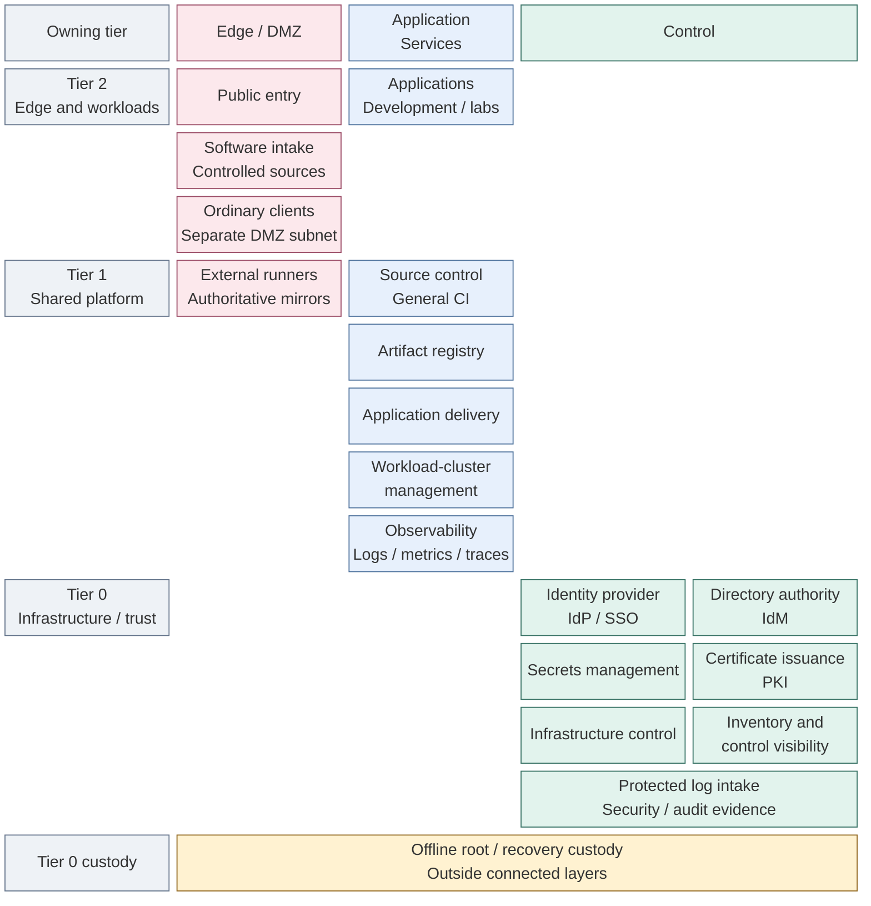

# Platform architecture

This platform supplies shared services and isolated project runtimes on a locally
controlled infrastructure and trust foundation. Users consume applications; teams
deliver reviewed changes; operators retain infrastructure, identity and recovery authority.

Start with the map, then read the responsibility model before choosing a capability's
deployment path. Architecture explains the choices and their consequences; installation
commands and acceptance steps belong to [Deployment](../03-deployment/README.md).

## Contents

- [Functional structure](#functional-structure)
- [Read to make a decision](#read-to-make-a-decision)
- [Capabilities](#capabilities)
- [How the platform works together](#how-the-platform-works-together)

## Functional structure

The map separates **owning tier** vertically from **network protection layer**
horizontally. Boxes are capabilities, not a VM inventory or permission grants.

*Figure: Tier 0 supports shared platform services and workloads; columns identify
protection layers while each capability retains its own access and recovery contract.*

## Read to make a decision

| Understand… | Chapter | Decision it supports |
| --- | --- | --- |
| Why these platform functions exist | 1. [Background](01-background/README.md) and [principles](01-background/01-principles.md) | Objectives, zero trust, scale and recovery constraints |
| Who may administer or consume a service | 2. [Organization and responsibilities](02-organization/README.md), then [tier ownership](02-organization/01-tier-ownership.md) | Shared versus isolated services, trusted administrators and resource/state ownership |
| How the chosen components fit together | 3. [Integrated reference platform](03-reference-platform.md) | Hosting and dependencies of the supplied Proxmox/Kubernetes reference |
| How one capability works and which option fits | The capability below | Interfaces, communication, failure boundaries and local alternatives before installation |

Keep the intended selections in the project architecture record; track deployment
completion separately. [Decision records](../07-decisions/README.md) retain the reasons
for choices that change authority, interfaces, availability or recovery.

## Capabilities

Read the foundation first, then the capability being selected or deployed.
Related capabilities share a chapter; the links open the actual design rather than
another index. Zero trust and scalability constrain each choice.

| Chapter | Capability and design question | Design |
| --- | --- | --- |
| 4 | Hosting: where can services run, and who controls their lifecycle? | [Hosting and orchestration](04-hosting/README.md), [bootstrap/control](04-hosting/02-provisioning.md), [Kubernetes](04-hosting/03-kubernetes.md), [Lab environments](04-hosting/04-lab-environments.md) |
| 5 | Networking: which connections cross a protection boundary? | [Connectivity and firewall policy](05-networking/README.md) |
| 6 | Data and storage: which persistence interfaces and guarantees are provided? | [Storage contracts](06-data/README.md) |
| 7 | Software intake: how do external updates reach consumers safely? | [Proxy/cache](07-software-intake/README.md), [verified publication](07-software-intake/01-verification.md) |
| 8 | Cryptographic trust and Secrets: which authorities and key custody are required? | [Cryptography](08-cryptography/README.md), [certificate authority](08-cryptography/01-certificate-authority.md), [secret interfaces](08-cryptography/08-secrets.md) |
| 9 | Identity: how do users sign in and services authorize access? | [Identity and access](09-identity/README.md) |
| 10 | Delivery and development: how does reviewed code become an approved running release? | [Delivery lifecycle](10-delivery/README.md), [controllers](10-delivery/02-controllers.md), [Development platform](10-delivery/03-development-platform.md) |
| 11 | Operations: how are failures detected, investigated and recovered from? | [Operations and resilience](11-operations/README.md), [Protected logging](11-operations/01-protected-logging.md), [retention](11-operations/02-log-retention.md), [Observability](11-operations/03-observability.md), [backup/recovery](11-operations/04-backup-recovery.md) |

The [capability index](../06-paths/capabilities.md) connects each design to its
deployment and operations guides. Chapters 1–3 provide background, ownership and reference
placement; chapters 4–11 group the technical design. Architecture's reading order groups concepts;
[deployment stages](../03-deployment/README.md#deployment-stages) own installation order.

## How the platform works together

Read each communication example beside the capability that owns the behavior:

| Interaction | Explanation |
| --- | --- |
|  User sign-in and service authorization | [Identity request sequence](09-identity/README.md#service-access) |
|  Reviewed code and artifacts reaching a runtime | [Application delivery sequence](10-delivery/README.md#application-delivery) |
|  Authorized changes to hosts and guests | [Protected infrastructure changes](04-hosting/02-provisioning.md#infrastructure-changes) |
|  Certificate and credential consumption | [Trust and secret interfaces](08-cryptography/08-secrets.md#certificate-and-secret-consumption) |
|  State surviving service loss | [Recovery boundaries](11-operations/04-backup-recovery.md#recovery-boundaries) |
|  Monitoring surviving the observed system | [Independent operation](11-operations/README.md#failure-boundaries) |

Each service keeps its own authorization, data and failure contract. Runtime
placement does not transfer ownership; a cache is not an approval authority,
observability cannot modify protected originals, and ordinary CI has no infrastructure credentials.
