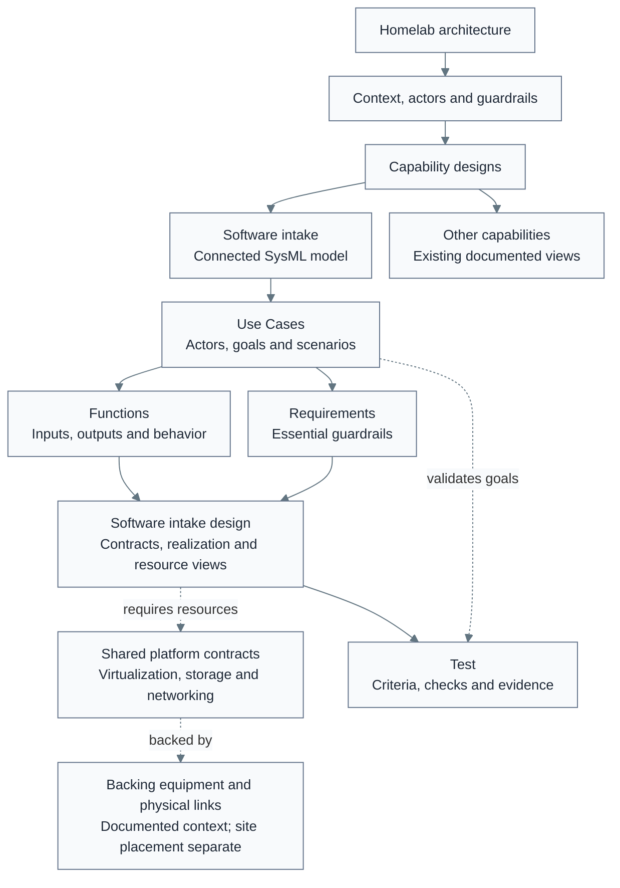

# MBSE model map

Start with [System Overall](../../architecture/README.md), open a subsystem overview and follow
its child folders toward a more focused design. The diagram there shows the main system relationships;
this map locates engineering concerns and records native versus documented coverage.

*Figure: Navigation between design concerns, not runtime topology or a mandatory waterfall process.*

## Contents

- [Find a concern](#find-a-concern)
- [Capability coverage](#capability-coverage)
- [Repository organization](#repository-organization)
- [Change a connected design](#change-a-connected-design)
- [References](#references)

## Find a concern

| Question | Start here |
| --- | --- |
| What problem does the whole system solve? | [Platform context](01-background/README.md) and [responsibilities](02-organization/README.md) |
| How does the whole platform fit together? | [System Overall and subsystem links](../../architecture/README.md), [ownership view](README.md) and [reference realization](03-reference-platform.md) |
| How is intake used? | [Use case and scenarios](../../architecture/models/software-intake/SoftwareIntakeLogicalDesign.sysml) |
| Which obligations remain essential? | [Functional and non-functional requirements](../../architecture/models/software-intake/SoftwareIntakeLogicalDesign.sysml) |
| What functions fulfill those scenarios? | [Function contracts and behavior](../../architecture/models/software-intake/SoftwareIntakeLogicalDesign.sysml) |
| What parts and interfaces are reused? | [Logical design](../../architecture/models/software-intake/SoftwareIntakeLogicalDesign.sysml) |
| Which product choices and IaC fulfill it? | [Solution design](../../architecture/models/software-intake/solution/SoftwareIntakeSolutionDesign.sysml) |
| Which physical equipment supports intake? | [Hardware context and existing owners](../../architecture/models/software-intake/solution/SoftwareIntakeSolutionDesign.sysml) |
| What has actually been checked? | [Test intent and evidence](../../artifacts/architecture/evidence/software-intake/README.md) |
| Why was a product or design choice selected? | [Decision records](../07-decisions/README.md) and the owning realization guide |

## Capability coverage

| Capability | Design entry | Model coverage |
| --- | --- | --- |
| Hosting and runtime | [Hosting](04-hosting/README.md) | Documented owner; intake references a native provider boundary, not a complete hosting model |
| Communication and boundaries | [Networking](05-networking/README.md) | Documented owner; guest/fabric/physical attachment contracts mapped for intake |
| Data and persistence | [Data](06-data/README.md) | Documented owner; selected local-cache backing contract mapped for intake |
| Controlled software acquisition | [Software intake](07-software-intake/README.md) | One connected design: use cases, functions, guardrails, selected realization, provider/backing relationships and tests |
| Trust, keys and secrets | [Cryptography](08-cryptography/README.md) | Documented; no native subsystem model yet |
| Identity and access | [Identity](09-identity/README.md) | Documented; no native subsystem model yet |
| Delivery and development | [Delivery](10-delivery/README.md) | Documented; no native subsystem model yet |
| Observation and recovery | [Operations](11-operations/README.md) | Documented; no native subsystem model yet |

Intake consumes existing hosting, networking and independently verified software sources. Its clients
span the platform. The current model does not claim those neighboring capabilities are implemented,
reachable or verified merely because they appear in its context.

## Repository organization

The [engineering entry point](../../architecture/README.md) opens the owner-based native model.
Each owner gathers its goals/scenarios, guardrails, behavior, design and verification intent together. Native
design folders contain only 1–5 PascalCase `.sysml` files; explanations use native `doc`. Generated SVGs
are separate under `architecture/generated/`, with the same owner hierarchy. Only the architecture root has
a README; tool inputs and evidence live outside this browsing tree. [Design](../../architecture/README.md) opens at level 0;
its child folders are level 1 subsystem overviews, with more focused child designs below them. Intake's
policy proxy and object cache own their definitions in those child folders. Shared platform children
map hosting, networking and data; trust/access, delivery and operations retain existing detailed chapters.
Only intake has been adopted end to end; the shared platform is a referenced provider boundary.
[Its manifest](../../scripts/architecture/config/build/software-intake.json) combines the source packages;
stable identities survive the file moves. Shared notation/layout and generated projections support
the reader structure. IaC, code and executable tests remain with their existing owners.

These directories implement a small project convention around established MBSE concerns: use cases, requirements, functions,
design, verification and allocation. SysML defines language semantics, not a mandatory repository tree. [1][2]
Existing architecture chapters remain in place. Add another modeled capability when work requires it;
do not create empty packages or duplicate its implementation inventory in the navigation map.

In generated architecture repositories, the kit bundle lives under `docs/auto-docs/architecture/`.
It is a reference snapshot. Keep selected site models and decisions in project-owned files outside
`docs/auto-docs/`; refresh must preserve them. Model builds run in the upstream kit checkout.

## Change a connected design

1. Orient in System Overall, descend through the owning design folder, then inspect its use case/scenario,
   parent contracts, guardrails and neighboring consumers.
2. Edit the owning model package, layout or implementation; preserve reusable definitions and identities.
3. Rebuild with the native parser, inspect impact and regenerate the affected views.
4. Run the relevant source contracts and native product tests. Record skipped checks and live acceptance separately.

The [intake maintenance guide](07-software-intake/02-connected-model.md) gives the exact commands.
A message trace identifies code and tests; it is not proof of conformance or live operation.

## References

1. [OMG SysML 2.0 language specification](https://www.omg.org/spec/SysML/2.0/Language/PDF), especially packages, actions and messages.
2. [CMU SEI: an introduction to MBSE](https://www.sei.cmu.edu/blog/introduction-model-based-systems-engineering-mbse/), logical/physical and structural/behavioral concerns.
