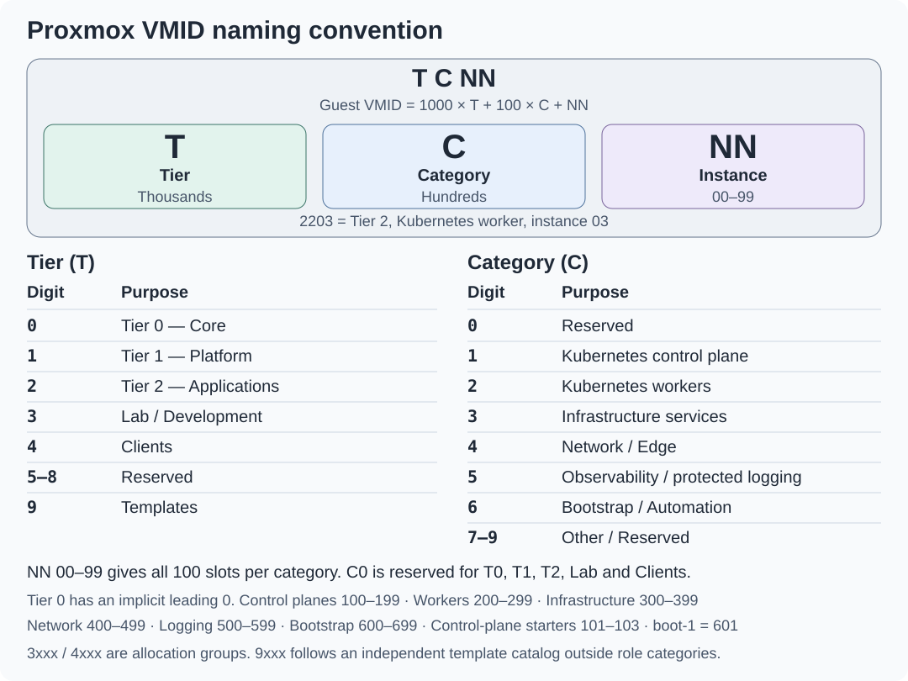

# Proxmox VMID naming convention

VMIDs group guests by tier or allocation purpose, category and instance. The reference
uses **`T C NN`**. Tier 0 omits its leading zero and uses the same categories as the other guest groups.
This is an allocation convention; ownership, networks and access policy remain separate.
The [editable SVG](vmid-convention.svg) is the quick reference; the tables below provide searchable detail.

## Contents

- [Format](#format)
- [Tier and allocation group](#tier-and-allocation-group)
- [Categories](#categories)
- [Examples](#examples)
- [Allocation and existing installations](#allocation-and-existing-installations)
- [References](#references)

## Format

| Field | Position | Meaning |
| --- | --- | --- |
| `T` | Thousands | Tier for `0`, `1` and `2`; allocation group for `3`, `4` and `9`; omit Tier 0's leading zero |
| `C` | Hundreds | Guest category, except in the separately allocated template range |
| `NN` | Last two digits | Instance `00-99`, assigned freely within the group/category |

For example, **`2203` = Tier 2, Kubernetes worker, instance 03**.
Instance numbers need not match hostname suffixes, IP addresses or VLAN IDs.

## Tier and allocation group

| Digit | Range | Purpose |
| --- | --- | --- |
| `0`, implicit | `100-999` | Tier 0 — Core |
| `1` | `1000-1999` | Tier 1 — Platform |
| `2` | `2000-2999` | Tier 2 — Applications and edge services |
| `3` | `3000-3999` | Lab / development environments |
| `4` | `4000-4999` | Client VMs |
| `5-8` | `5000-8999` | Reserved |
| `9` | `9000-9999` | Templates and dedicated template-conversion builders |

The architecture has **three security tiers**. Lab and ordinary client allocations
remain Tier 2-owned; the template lifecycle remains Tier 0-owned. A development-platform
service belongs to Tier 1, while a disposable development environment uses the lab range.
Privileged administrative clients retain the authority classification of the systems they control.

## Categories

| `C` | Category | `CNN` range |
| --- | --- | --- |
| `0` | Reserved | `000-099` |
| `1` | Kubernetes control plane | `100-199` |
| `2` | Kubernetes workers | `200-299` |
| `3` | Infrastructure services | `300-399` |
| `4` | Network / Edge | `400-499` |
| `5` | Observability / protected logging | `500-599` |
| `6` | Bootstrap / Automation | `600-699` |
| `7-9` | Other / Reserved | `700-999` |

IDs below 100 are reserved by Proxmox. [1] Reserving **category `0` in every guest group**
gives all tiers the same usable categories. For example, `1000-1099` and `2000-2099`
are reserved for new allocations too. Tier digit `0` still denotes Tier 0; instance `00` is valid.

All guest groups use **`1000 × T + 100 × C + NN`**. For Tier 0 this becomes
`100 × C + NN`: control planes use `1xx`, workers `2xx`, infrastructure `3xx`,
network services `4xx`, protected logging `5xx` and automation `6xx`.
Every active category has **100 instance slots**. The control-plane starters retain `101`, `102` and `103`.

The `9xxx` template range uses its own catalog allocations: its hundreds digit does
**not** classify the roles of future clones. A generic Linux template can supply any tier
or role. The [published template catalog](../08-reference/template-catalog.md) records those IDs.

## Examples

| VMID | Interpretation |
| --- | --- |
| `101-103` | Tier 0 Kubernetes control planes, `k8ctl-1` through `k8ctl-3` |
| `201` | Tier 0 Kubernetes worker allocation; optional, not enabled in the starter |
| `301`, `302` | Tier 0 directory pair, `idm-1` and `idm-2` |
| `311` | Tier 0 issuing CA, `ca-1` |
| `321` | Tier 0 Vault VM alternative, `vault-1` |
| `331-333` | Tier 0 HSM gateways, `hsm-1` through optional `hsm-3` |
| `401`, `402` | Tier 0 Kubernetes API gateways, `api-gw-1` and `api-gw-2` |
| `501`, `502` | Tier 0 protected logging, `log-1` and optional `log-2` |
| `503` | Tier 0 independent log-backup VM, optional `rec-1` |
| `511` | Tier 0 independent monitoring VM, optional `mon-1` at Stage 6 |
| `601` | Reserved for the manually created Tier 0 bootstrap host, `boot-1` |
| `611` | Tier 0 infrastructure runner, `iac-1` |
| `621` | Tier 0 optional ceremony administration VM, `cadm-1` |
| `1101` | Tier 1 control plane, instance 01 |
| `1501` | Tier 1 observability, instance 01 |
| `2203` | Tier 2 Kubernetes worker, instance 03; illustrative allocation |
| `2411` | Tier 2 network/edge service, instance 11 |
| `3101` | Lab control plane, instance 01; owned by Tier 2 |
| `3301` | Lab infrastructure service, instance 01; owned by Tier 2 |
| `9101` | Template catalog allocation; owned by Tier 0 |

## Allocation and existing installations

VMIDs must be unique across the Proxmox cluster. [2] Reserve them across all repositories,
environments, VMs, containers and templates; separate Terraform states do not isolate the ID space.
Allocate different instance blocks for additional clusters or services in the same category.
Each active category has 100 instance slots. Review the allocation plan before exhausting them.

Tier-local Terraform inputs own exact guest IDs; inventories own logical host names and addresses.
Shared holds approved template references, not a guest inventory or VMID allocator. The
[project standards](../04-development/project-documentation.md) record local choices and
link this convention, without duplicating individual resource assignments.

Starter IaC examples follow this plan. An update does **not** renumber an existing installation:
retain its local VMIDs and state. Copying a new example ID over a managed guest may propose
replacement. Any deliberate renumbering needs its own reviewed migration, backup and updated
state, HA rules, scoped API permissions and references. Legacy template adoption remains supported.

Earlier starters used category `0` for four-digit control-plane IDs and split Tier 0's
`1xx` range between control planes and workers. Current starters use the shared table above.
For example, Tier 1 control planes move from `1001-1003` to `1101-1103`, new `log-1`
uses `501` rather than `401`, and new `boot-1` uses `601` rather than `501`.
An existing bootstrap at `501` still occupies that ID: it must not be reused for a new receiver.
Keep existing local inputs until an intentional [VM recovery/renumbering operation](../05-operations/06-resilience/recovery/virtual-machines.md)
has established the new VMID and reconciled its state. Renumbering is not part of refresh or an ordinary apply.

Implementation: [Tier 0 guests](../../tier-0/terraform/deployments),
[Tier 1 guests](../../tier-1/terraform/deployments),
[Tier 2 guests](../../tier-2/terraform/deployments), and the
[Tier 0 publication catalog](../../tier-0/templates/proxmox.yml.example).
The [ownership model](../01-architecture/02-organization/01-tier-ownership.md) determines authority;
the [network plan](network-plan.md) determines attachments and segmentation.

## References

1. [Proxmox VM configuration: IDs below 100 are reserved](https://github.com/proxmox/pve-docs/blob/master/qm.conf.adoc).
2. [Proxmox VM general settings: unique VM IDs](https://github.com/proxmox/pve-docs/blob/master/qm.adoc#general-settings).
