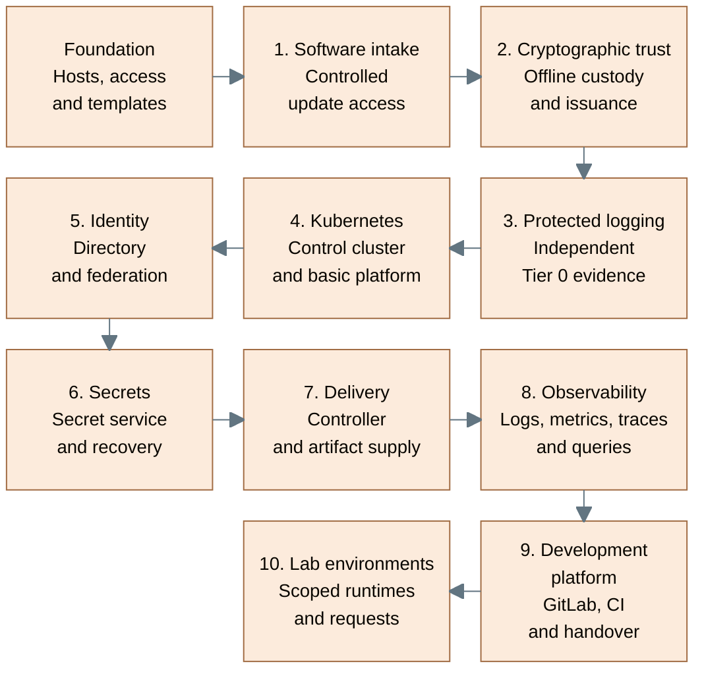

# Deployment

The first manual template and bootstrap establish the execution host. Subsequent new guests,
attached disks, filesystems, mounts, packages and service configuration are deployed through IaC
from that controller. The guides use Ansible or the product API for remote checks; normal installation
does not require an interactive guest login. Existing accepted services, physical equipment,
external storage custody and offline signing approvals retain their stated owners.

Every stage ends with a numbered securing and handoff step. Apply the baseline during deployment;
the final checkpoint accepts its access, boot policy and independent recovery before marking the stage
complete. Use the [common guest hardening and maintenance guide](../05-operations/01-hosting/guest-hardening.md)
for supported Secure Boot/vTPM choices, later capacity changes and updates.

<a id="figure-deployment-sequence"></a>



**Workflow:** *Figure: Foundation and numbered capability stages form a chronological installation path.*
The [IaC capability map](#iac-capability-map) links each entry point to its selected deployment view.

Verify the unnumbered [foundation prerequisites](foundation/README.md), then choose
the capability to deploy and follow its main README from Step 1 onward.
Start with [Software intake](stage-01-software-intake/README.md), using verified
existing supply where appropriate. Foundation only requires an available bootstrap source.
Each stage explains the main path with diagrams, names the capability available at
the end, and links back to the architecture it implements.

**Before starting:** this is a staged installation with explicit commissioning prerequisites. Read the
[stage coverage](../08-reference/implementation-support.md#stage-coverage)
to identify supplied workflows, manual prerequisites and optional integrations.
The diagrams map selected resources and existing dependencies to IaC; they are not live acceptance evidence.

Use [Conventions](../02-conventions/README.md) when choosing names, tags, VMIDs or network allocations.
Select [stable service DNS names](../02-conventions/service-dns.md) before preparing certificates,
ingress/listeners and client URLs; machine hostnames remain separate.

After completing a deployment path, check its entry and selected options in
**`<prefix>-architecture/deployments.md`**. Use `- [x]` for completed installations
and `~~text~~` for unselected options. Keep live acceptance evidence separate;
see [project records](../04-development/project-documentation.md#start-with-project-values).

> [!TIP]
> **Recovery and maintenance:** [Recover an existing system](../05-operations/06-resilience/README.md),
> [reconcile or retire IaC resources](../05-operations/01-hosting/provisioning.md), or
> [maintain Secure Boot and TPM](../05-operations/01-hosting/maintenance.md#boot-maintenance).

## Table of contents

- [Deployment stages](#deployment-stages)
- [IaC capability map](#iac-capability-map)
- [Repository locations](#repository-locations)
- [Follow a stage](#follow-a-stage)
- [Implementation scope](#implementation-scope)

## Deployment stages

Stage folders use two-digit numbers, `stage-01` through `stage-10`, so their file-browser order
matches the installation sequence.

Find each stage's corresponding design and operating guides in the
[capability index](../06-paths/capabilities.md).

| Stage | Capability available | Working repository | Walkthrough |
| --- | --- | --- | --- |
| 1: Software intake | Controlled repository access and accepted bootstrap/host consumers | Tier 2 proxy/cache; tier-local consumers | [Software intake](stage-01-software-intake/README.md) |
| 2: Cryptographic trust | Offline root and online issuer; optional verified publication after issuance | Tier 0 trust; optional Tier 1 worker | [Trust](stage-02-trust/README.md) |
| 3: Protected logging | Independent collection, protected evidence and offline investigation | Tier 0 | [Protected logging](stage-03-logging/README.md) |
| 4: Kubernetes | Independently bootstrapped Tier 0 cluster and basic platform | Tier 0 | [Kubernetes](stage-04-kubernetes/README.md) |
| 5: Identity | Directory authority and federated OIDC access | Tier 0 | [Identity](stage-05-identity/README.md) |
| 6: Secrets | Secret storage, scoped access, audit and independent unseal/recovery; supporting control tools | Tier 0 | [Secrets](stage-06-secrets/README.md), [monitoring](stage-06-secrets/procedures/independent-monitoring.md) |
| 7: Delivery | Tier 1 runtime, independent Flux and Spinnaker promotion, approved artifact supply; explicit controller alternatives | Tier 1 platform; optional Tier 2 edge | [Delivery](stage-07-delivery/README.md) |
| 8: Observability | Netdata diagnostics, infrastructure health, logs, metrics, traces and scoped queries | Tier 1; Tier 0-owned infrastructure collection and approved exports | [Observability](stage-08-observability/README.md) |
| 9: Development platform | GitLab, SSO, on-demand build pods, Vault CI and infrastructure handover | Tier 1 applications; Tier 0 execution/auth policy | [Development platform](stage-09-development/README.md) |
| 10: Lab environments | Isolated Tier 2 runtimes, applications and future bounded requests | Tier 2 definitions; Tier 0 execution | [Lab environments](stage-10-lab-environments/README.md), [isolated clusters](stage-10-lab-environments/procedures/isolated-clusters.md) |

For a new installation, follow [the capability sequence](#figure-deployment-sequence).
Existing infrastructure can satisfy a
stage's verified prerequisites; a stage number is not a tier, network or state boundary.
Stage 1 supplies controlled update access. Verified RPM/APT/artifact publication is
[Stage 2 option 15b](stage-02-trust/README.md#15b-verified-repository-and-artifact-publication-optional),
after issuance. Retain persistent local journal/audit records during trust bootstrap; Stage 3 adds protected
forwarding for the existing hosts. OCI supply belongs to Stage 7; bootstrap supply stays independent.

## IaC capability map

Use this map to find what each runnable entry point deploys and when it is used.
Linux entries use `scripts/deploy.sh <setup>`; Kubernetes and template publication
use their dedicated scripts. Every command runs from the named repository root.

| Repository | Entry point | Capability / when | Walkthrough |
| --- | --- | --- | --- |
| Tier 0 | `templates` | Foundation: approved source images | [Publication](../05-operations/01-hosting/templates/template-lifecycle.md#local-workflow) |
| Tier 0 | `template-refresh` | Maintenance: staged Linux image refresh after source-template acceptance | [Staged Linux refresh](../05-operations/01-hosting/templates/template-refresh.md) |
| Tier 0 | `syslog` | Stage 3: independent log hosts | [Protected logging](stage-03-logging/README.md) |
| Tier 0 | `foundation` | Stages 2/5/6: issuer/directory resources and optional independent monitor | [Trust](stage-02-trust/README.md), [directory deployment](stage-05-identity/procedures/freeipa.md), [monitor provisioning](stage-06-secrets/procedures/independent-monitoring.md#step-1-prepare-the-monitoring-runtime) |
| Tier 0 | `hsm` | Stage 2 option: native USB/provider hosts; issuer binding and PKCS#11 remoting use their explicit recipes | [USB HSM option](stage-02-trust/step-1b-usb-hsm.md), [remoting](stage-02-trust/procedures/pkcs11-remoting.md) |
| Tier 0 | `kubernetes` | Stage 4: control cluster | [Kubernetes](stage-04-kubernetes/README.md) |
| Tier 0 | `cluster-endpoint` | Before Stage 4/7/10: private independent API gateways | [API endpoint](stage-04-kubernetes/procedures/api-endpoint.md) |
| Tier 0 | `vault` | Stage 6 option: dedicated secrets VM | [Vault VM option](stage-06-secrets/step-1b-vault-vm.md) |
| Tier 0 | `vault` with separate `signing` inputs/environment, then `deployment/openbao-signing.yml` | Stage 6 option 11b: independent OpenBao guests/state and signing API; retains existing HashiCorp Vault | [Independent signing API](stage-06-secrets/step-11b-openbao.md) |
| Tier 0 | `immutable-template` | Stage 9 option: image-based Linux builds | [Image-based Linux](stage-09-development/step-15b-image-based-linux.md) |
| Tier 0 | `infrastructure-runner` | Stage 9: dedicated trusted infrastructure CI VM | [Runner](stage-09-development/procedures/infrastructure-runner.md) |
| Tier 0 | `ci-auth` | Stage 9: Vault JWT backend, bounded claims and policies; native Vault root | [Vault CI](stage-09-development/procedures/vault-ci.md) |
| Tier 1 | `kubernetes` | Stage 7: shared platform cluster | [Platform runtime](stage-07-delivery/procedures/platform-cluster.md) |
| Tier 1 | `intake` | Stage 2 option 15b: verified repository and artifact intake VM | [Verified intake](stage-02-trust/step-15b-verified-intake.md) |
| Tier 1 | `development` | Stage 9 option: source-control VM | [Source-control VM](stage-09-development/step-1b-source-control-vm.md) |
| Tier 1 | `development-data` | Stage 9: dedicated PostgreSQL, Redis and Gitaly VMs | [GitLab data services](stage-09-development/procedures/data-services.md) |
| Tier 1 | `podman-runner` | Stage 9 option: general build runner | [Build runner](stage-09-development/step-14b-podman-runner.md) |
| Tier 1 | `observability` | Stage 8 alternative: native dedicated VM products and guarded data disks | [Observability](stage-08-observability/README.md), [VM recipe](stage-08-observability/step-1b-dedicated-vms.md) |
| Tier 2 | `cache` | Stage 1: controlled outbound software access | [Software intake, Step 8](stage-01-software-intake/README.md#step-8-deploy-the-cache-pair) |
| Tier 2 | `edge` | Stages 7/10: public service entry | [Edge deployment](stage-07-delivery/procedures/edge-proxy.md) |
| Tier 2 | `kubernetes` | Stage 10: workload cluster | [Workload runtime](stage-10-lab-environments/README.md#step-2-provision-the-workload-runtime) |
| Tier 2 | `lab` | Stage 10: workload VM/LXC resources | [Workload runtime](stage-10-lab-environments/README.md#step-2-provision-the-workload-runtime) |

Entry points are not one-to-one with stages: the Tier 0 `foundation` root plans all
selected issuer/directory guests together; service configuration follows its stage.
Stages never rename state roots or authorize removal of earlier resources. Product
integration is distinguished from supplied automation in the [support map](../08-reference/implementation-support.md).
The HSM provider/remoting path does not install an application signing API. Stage 6 option 11b
adds that independent service only when selected; its guide supplies the separate inventory,
environment inputs, ceremony and API configuration commands.

GitLab and Kubernetes job runners use the separate Tier 1
[application recipe](stage-09-development/procedures/gitlab.md), not a Terraform VM setup.
The Vault `ci-auth` root likewise does not run through the Proxmox helper.

## Repository locations

`<prefix>` is the collection prefix, `homelab` by default. The upstream source
directory becomes the matching generated repository; paths inside it stay the same.

| Repository | Generated checkout | Upstream source | Responsibility |
| --- | --- | --- | --- |
| Tier 0 | `<prefix>-tier-0/` | [tier-0/](../../tier-0) | Proxmox, templates, trust, identity, control cluster and privileged execution |
| Tier 1 | `<prefix>-tier-1/` | [tier-1/](../../tier-1) | Delivery services, general runners and platform cluster |
| Tier 2 | `<prefix>-tier-2/` | [tier-2/](../../tier-2) | Public edge, ordinary cache, workload cluster and applications |
| Shared | `<prefix>-shared/` | [shared/](../../shared) | Reusable helpers, baseline roles and stateless platform references; no inventory, resources or state |
| Architecture | `<prefix>-architecture/` | [docs/](../README.md) | Project records and upstream references in `docs/auto-docs/`; not a deployment working directory |

`<prefix>` is the generated repository folder prefix; its default is `homelab`.
Each guide names its **working repository**. File paths are relative to that
repository unless another owner is named. For example, Tier 0
`terraform/deployments/foundation/` means
`homelab-tier-0/terraform/deployments/foundation/` in the default collection.

Run repository scripts from the owning tier's root, even when their implementation
is in Shared. `scripts/deploy.sh` delegates to Shared but uses the current tier's
inventory, inputs and state. Host consoles and product CLIs run where the procedure
specifies. For exact code responsibilities, use the [code map](../04-development/code-layout.md).

The text above each block names that location in bold; repository navigation is not an
installation action. File-edit lists are separate from shell commands:

Run from **`<prefix>-tier-2/`**.

```bash
bash scripts/init-local-files.sh --setup cache
```

Edit in **`<prefix>-tier-2/`**.

- `terraform/deployments/cache/terraform.tfvars`: edit guest IDs, sizes and storage class

Edit in **`<prefix>-shared/`**.

- `config/platform.tfvars`: edit shared placement and storage references

## Follow a stage

1. Verify foundation readiness, open the named working repository, then read the
   stage's prerequisites and intended result. Select any required
   [boot/encryption controls](../05-operations/01-hosting/guest-hardening.md#control-decisions)
   before creating its images or guests; the final checkpoint verifies them.
2. Follow the numbered steps in the main README. At a decision, select an adjacent
   option such as Trust's `step-1b-usb-hsm.md`, then return to the stated step.
3. Complete every selected option and its return-point checks before leaving the stage.
   A new-install option must consume only foundation, earlier stages or the already completed
   steps of its own stage. Enhancements that need later prerequisites belong at that later decision point.
4. Follow each named capability's numbered deployment and diagrams; use linked
   procedures for exact product configuration. Record selected options
   and acceptance evidence in the project's deployment documents.

Each action names its working repository, files to edit, command and expected result.
Branches such as **2a** and **2b** are alternatives; follow the selected branch and its
return link instead of executing every option.
Additive options are labelled **optional**; apply them after their prerequisites, then rejoin.
External/manual integrations are labelled explicitly and must be qualified before the selected path is complete.

For Linux setups, `bash scripts/deploy.sh <setup>` displays the plan and asks for `yes`,
then configures the hosts. A separate `--plan-only` run is optional. Approved pipelines
can use `--auto-approve`, or the [saved-plan workflow](../08-reference/repository-scripts.md#cheat-sheet)
for separate review and execution. Dedicated template/cluster scripts keep their stated
plan/apply contract; signing ceremonies and secret activation keep their manual pauses.
A plan shown after apply states its verification purpose and whether it is optional
or a required acceptance gate. Maintenance that changes a system through another
tool can also require a separate Terraform state-reconciliation phase; those steps
remain distinct from the initial installation plan.

The [reference platform](../01-architecture/03-reference-platform.md) owns the complete
design. Stages realize parts of it; [readiness](readiness.md) records what is verified.

## Implementation scope

Deployment views name starter guests and link their owning inputs and executing code.
Existing prerequisites, manual work and project integration are marked separately;
follow the [diagram contract](../04-development/diagrams.md#abstraction-and-implementation).
The [support map](../08-reference/implementation-support.md) distinguishes supplied
automation from project integration. Current wrappers call `terraform`; Terraform / OpenTofu is the
design choice, not a claim of a validated OpenTofu drop-in workflow.

Continue with [operations](../05-operations/README.md) for recurring operation
and [development](../04-development/README.md) for implementation changes.
Retain [recovery inputs](../05-operations/06-resilience/README.md) independently of hosted
services. Tier 0 recovery and root ceremonies never depend on normal Tier 1 CI.

Refresh updates references without moving infrastructure or replacing project
decisions; see the [refresh contract](../04-development/generated-repositories.md#refresh-and-local-ownership).

<a id="purpose"></a>
<a id="current-platforms"></a>
<a id="bootstrap-phases"></a>
<a id="day-0-bootstrap-dependencies"></a>
<a id="day-1-cluster-foundation"></a>
<a id="day-2-service-sequence"></a>
<a id="day-3-operational-handover"></a>
<a id="who-runs-the-deployment"></a>
<a id="working-method"></a>
<a id="automation-paths"></a>
<a id="recovery-rule"></a>
