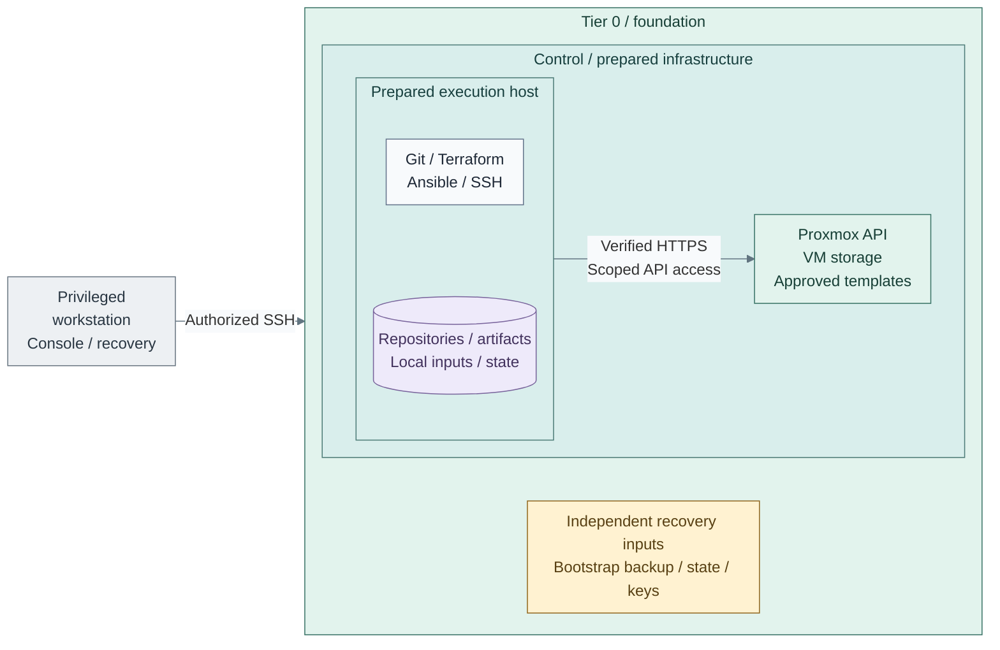

# Foundation and prerequisites

Prepare the hosts and the execution machine, then import or publish tested VM templates.
Complete this path before **Stage 1: Software intake**. Foundation is a prerequisite,
not a numbered capability stage.

<a id="figure-foundation-ready"></a>



**Workflow:** **Figure 1: Foundation ready for IaC.** The [bootstrap steps](bootstrap/README.md)
prepare the execution host; [template publication](../../../tier-0/terraform/deployments/templates/main.tf)
manages the accepted catalog after the first manual template. The figure groups logical control
interfaces, not physical hosting: the execution host may be `boot-1` or an accepted Linux host.
The workstation arrow reaches only the authorized execution-host SSH interface. Recovery inputs
are separately retained and qualified; the preparation path does not install a backup service.

For planned teardown and a new installation, use [resource retirement](../../05-operations/01-hosting/provisioning.md).
For an existing environment lost to failure, use [backup recovery](../../05-operations/06-resilience/README.md) with its original state.

**Start on:** an independent privileged workstation with physical/console recovery access.
**Working repository:** `<prefix>-tier-0` after generation (source: `tier-0/`).
**Continue on:** `boot-1`, then the generated `<prefix>-tier-0` repository.
**Design:** [hosting](../../01-architecture/04-hosting/README.md) and
[network boundaries](../../01-architecture/05-networking/README.md).

## Contents

- [Step 1: Prepare hosts and networks](#step-1-prepare-hosts-and-networks)
- [Step 2: Create the first Linux template manually](#step-2-create-the-first-linux-template-manually)
- [Step 3: Prepare the bootstrap execution host](#step-3-prepare-the-bootstrap-execution-host)
- [Step 4: Configure the template catalog](#step-4-configure-the-template-catalog)
- [Step 5: Prepare the publication plan](#step-5-prepare-the-publication-plan)
- [Step 6: Apply the accepted plan](#step-6-apply-the-accepted-plan)
- [Step 7: Qualify disposable clones](#step-7-qualify-disposable-clones)
- [Step 8: Test guest backup and restore](#step-8-test-guest-backup-and-restore)
- [Step 9: Select the accepted Linux template](#step-9-select-the-accepted-linux-template)
- [Step 10: Qualify selected HA and balancing](#step-10-qualify-selected-ha-and-balancing)
- [Foundation ready](#foundation-ready)

<a id="step-1-prepare-compute-and-templates"></a>
<a id="step-1-prepare-hosts-and-networks"></a>
<a id="before-starting-hosts-and-networks"></a>

## Step 1: Prepare hosts and networks

Prepare the host/network side of [Figure 1](#figure-foundation-ready) in this order.
Existing infrastructure is valid after the same checks.

| Order | Action | Complete when |
| --- | --- | --- |
| 1 | [Prepare the gateway, switches and VLANs](network/unifi.md#bring-up-the-network) | Management access, DNS/time, guest VLANs and a recovery path work |
| 2 | [Install Proxmox and configure its host network](proxmox/README.md#first-deployment-order) | Console/UI work; `vmbr0` and the approved VLAN trunks are active |
| 3 | [Select live storage and an independent backup destination](storage/README.md) | Actual datastore IDs and recovery access are recorded |
| 4 | [Apply and test firewall policy](network/firewall.md) | Required paths work and unauthorized paths fail |

The first three Foundation steps route separate host, manual-template and bootstrap workflows.
Complete each linked workflow once; the managed-publication actions then continue directly on this page.
The Proxmox host guide routes the host choices below during action **2**; do not repeat them here.
Finish storage/firewall actions **3–4** afterward.
HA enrollment and failure testing need a disposable guest later in this Foundation path; cluster membership
alone does not establish HA. Retain persistent local host logs from first boot until Stage 2 can collect them.
Object storage is needed before its first consuming application, not for these initial steps.
If the gateway guide already applied the policy, use the firewall guide's acceptance checks;
do not rebuild the same rules.

| Path / option | Action now | Continue |
| --- | --- | --- |
| 1a: single host | Use one prepared host; no cluster or automatic failover | Storage/firewall checks above, then Step 2 |
| 1b: cluster | [Join empty hosts and prepare HA](proxmox/step-1b-cluster-ha.md) | Storage/firewall checks, then Step 2; enroll/test a disposable guest in Step 10 |
| 1c: SDN, optional with either host path | [Create and apply VNets, Steps 1–3](proxmox/step-1c-sdn.md) | Storage/firewall checks above, then Step 2; finish SDN attachment inputs after bootstrap in Step 3 |

<a id="step-1-create-the-first-linux-template-manually"></a>

## Step 2: Create the first Linux template manually

Use the [VMID quick reference](../../02-conventions/vmid-convention.md) before reserving
template or guest IDs; its allocation plan applies to Terraform-managed VMs and containers too.

Follow the [manual VM template workflow](proxmox/templates.md) from image selection through
the disposable-clone checks. It owns the GUI import sequence; do not publish through Terraform yet.

One AlmaLinux or Rocky Linux template is sufficient for the bootstrap VM. An accepted
existing Linux template is also valid. Add Talos and other candidates in Step 4 below.
No API token, Terraform or GitLab is needed for this first manual template.

<a id="step-2-protect-provisioning-access-and-state"></a>
<a id="step-2-prepare-the-bootstrap-execution-host"></a>

## Step 3: Prepare the bootstrap execution host

The [bootstrap execution-host view](bootstrap/README.md#figure-1-bootstrap-execution-host)
shows the reference workspace, tools and protected API access prepared by this step.
This establishes the execution-host side of [Figure 1](#figure-foundation-ready).
Follow [Bootstrap execution host](bootstrap/README.md) without skipping ahead.
That guide provides the VM, tooling, repository generation, SSH key and API setup.

The bootstrap guide routes workspace **3a or 3b**, optional **3c**, and acquisition **3d or 3e**
at their actual decision points. Finish its SSH/trust/input actions before **3f** below.
An accepted existing execution host
can use the same tooling/trust path without creating another VM.

| Path / option | Detailed guide | Rejoin |
| --- | --- | --- |
| 3a: separate workspace, main | [Prepare the attached data disk](bootstrap/step-3a-bootstrap-storage.md) | Bootstrap storage/home decision, then tool acquisition |
| 3b: LVM root instead | [Expand the existing disk or add an LVM PV](bootstrap/step-3b-bootstrap-lvm.md) | Bootstrap tool acquisition; skip separate-mount/home actions |
| 3c: home on data disk, optional after 3a | [Bind-mount home](bootstrap/step-3c-bootstrap-home.md) | Bootstrap tool acquisition, before repositories/environments are created |
| 3d: connected tools, main | [Install approved tools and generate repositories](bootstrap/README.md#2a-install-git-terraform-and-ansible) | Bootstrap execution-key setup |
| 3e: offline tools instead | [Prepare, transfer and install the bundle](bootstrap/step-3e-bootstrap-offline.md) | Bootstrap execution-key setup |
| 3f: manage hosts | [Initialize and verify existing-host management](../../05-operations/01-hosting/README.md) | SDN attachment inputs if 1c was selected; then Foundation Step 4 |

| Location | Configure before continuing |
| --- | --- |
| Bootstrap VM | Tooling, independently verified Proxmox CA trust and a usable execution-account SSH key/agent |
| Architecture `platform-standards.md` | Actual node names, VMIDs, network/VLAN allocations and selected options |
| Shared `config/platform.tfvars` | Initial destination node, live-disk storage classes and common application network |
| Tier 0 `.env.local` | Verified API endpoint, scoped token and local public-key paths |
| Outside the platform | Recoverable copies of original state, ignored inputs, tools and credentials |

**Gate:** verified API TLS and independent console/recovery access must work. A VM on
Proxmox cannot be the only means of recovering Proxmox. Keep approved package/artifact
access independent of the cache deployed in Stage 1.
Verify recovery of inputs, tools and credentials on the independent execution path before provisioning.
For existing roots, retain and recover their original state too; a fresh root has no state yet.
Protect new state after each operation. Guest backup/restore is tested on a disposable clone in Step 8.

<a id="2a-connect-bootstrap-to-proxmox-host-management"></a>

### 3f: Connect bootstrap to Proxmox host management

Once `boot-1` and the generated Tier 0 repository are ready, follow
[Manage existing Proxmox hosts from bootstrap](../../05-operations/01-hosting/README.md).
Complete that guide's **Steps 1–5**, then return here rather than selecting its later maintenance tasks.
Those actions initialize host-management files, register `hypervisors`, authorize the execution
key and verify SSH/Ansible access. The template files, API CA trust and token were already prepared
in the bootstrap workflow: retain them. The registered hosts already exist; this does not deploy VMs.

If **1c** was selected, finish [SDN attachment inputs](proxmox/step-1c-sdn.md#step-4-authorize-and-connect-iac) now.
Return here for **Step 4**. After Stage 1 establishes the selected software-supply route, use
[Proxmox update access](../../05-operations/02-software-intake/host-updates.md) to configure and test host
updates through it. Host-management tasks use SSH; `deploy.sh foundation` provisions CA/directory VMs.

<a id="step-3-publish-and-test-vm-templates"></a>
<a id="step-4-publish-and-test-vm-templates"></a>

## Step 4: Configure the template catalog

**Run on:** the bootstrap execution host, from generated **Tier 0**. An existing accepted
privileged Linux workstation can perform the same role. No hosted runner is required.

Before adding a Talos build, select its [version contract](proxmox/templates.md#talos-version-contract).
The complete reference through Stage 5 uses an approved exact **1.13.x** release; choosing the
newest Factory entry does not establish compatibility with the later platform/SSO recipes.

The bootstrap workflow already ran `proxmox-templates.sh init` and configured `.env.local`.
Use those files; no second initialization or credential setup is needed.
For entry from an already prepared execution host with no template catalog, run
`bash scripts/proxmox-templates.sh init` once from **`<prefix>-tier-0/`**.

Edit in **`<prefix>-tier-0/`**.

- `templates/proxmox.yml`: Select builds, existing VMIDs and approved local image paths/hashes.

| Field | Set to |
| --- | --- |
| `all.node_name` | Actual node holding the templates |
| `all.storage_class` | A live-disk class configured in Shared; an explicit `datastore_id` overrides it |
| `all.image_datastore_id` | Existing datastore accepting **Import** files, often `local` |
| `all.bridge`, `all.vlan_id` | Prepared `vmbr0`/VLAN, or activated SDN VNet with `vlan_id: null` |
| Each selected build | Actual `vm_id`, `name`, OS family/distribution, exact release, local `image_path` and unpacked `sha256` |
| Existing uploaded files | `image_file_name`: exact Import basename, even if its prefix uses an older VMID |

Keep only managed builds. Use `sha256sum` on each approved unpacked artifact to obtain
its catalog hash. For the first Linux template, remove unused build blocks and replace
every remaining placeholder before import. Set `name` to the existing Proxmox display
name; the YAML candidate names need not match the earlier manual naming examples.
For adoption, match existing hardware and firmware before reviewing changes. Existing
uploads are matched by filename; verify their provenance or remote checksum independently.
Import does not establish that the stored bytes match a checksum embedded in the filename.
The [field reference](../../05-operations/01-hosting/templates/template-lifecycle.md#catalog-fields-and-defaults)
contains optional settings; fixed RAM, 1500-MTU NICs, NIC firewall and OS-specific
controller defaults do not need repeating for every build.

<a id="step-5a5b-prepare-the-publication-plan"></a>

## Step 5: Prepare the publication plan

Choose **5a** for adoption or **5b** for entirely new resources. Both continue at **Step 6**.

<a id="4a-adopt-existing-templates-or-uploaded-images"></a>

### 5a: Adopt existing templates or uploaded images

This is the normal first-run path after creating the manual template:

Run from **`<prefix>-tier-0/`** on the protected execution host.

```bash
bash scripts/proxmox-templates.sh import --env-file .env.local
```

`import` creates a **saved adoption plan**; imports are written to state only at apply.
Missing resources may still be creations. Continue at **Step 6**. Do not replace this saved
adoption plan with a normal plan before applying it.

<a id="4b-publish-an-entirely-new-catalog"></a>

### 5b: Publish an entirely new catalog

Use this alternative only when none of the catalogued templates or uploaded files exists:

Run from **`<prefix>-tier-0/`** on the protected execution host.

```bash
bash scripts/proxmox-templates.sh plan --env-file .env.local
```

Continue at **Step 6**.

<a id="3c-review-apply-and-qualify"></a>
<a id="apply-and-qualify"></a>

## Step 6: Apply the accepted plan

Inspect imports and every hardware/disk change in the saved plan. Stop on unexpected
replacement/deletion; correct the catalog and repeat **5a** or **5b** first.
Keep the catalog, platform profile and execution target unchanged until apply.
The saved plan and its `.context` file belong together; regenerate an older plan
without this context file rather than applying it with changed inputs.

Apply the accepted saved plan. This command applies a previously reviewed plan;
do not rely on another approval prompt.

Run from **`<prefix>-tier-0/`** on the protected execution host.

```bash
bash scripts/proxmox-templates.sh apply --env-file .env.local
```

**Expected:** publication, fixed-RAM/account policy checks and Shared catalog synchronization succeed.
The command performs those checks; a separate `verify` or fresh `plan` is not required on this path.
Stop on errors and retain the existing state; use the
[interrupted-publication procedure](../../05-operations/01-hosting/templates/template-lifecycle.md#interrupted-publication)
before retrying. A later policy-only check is available with `proxmox-templates.sh verify --env-file .env.local`.

## Step 7: Qualify disposable clones

Use [clone and guest-control checks](proxmox/templates.md#clone-and-guest-control-checks)
on each new or changed candidate. Check disks, network, guest control and operator access.
Qualify its firmware, CloudInit and guest-agent settings. A previously accepted unchanged image
needs no second manual import; this check qualifies what Step 6 actually published.

## Step 8: Test guest backup and restore

[Back up and restore a disposable clone](../../05-operations/06-resilience/backups/virtual-machines.md#quick-steps),
including required data disks. Use the backup destination commissioned during host/storage preparation;
do not create another storage service. Record the result before relying on that recovery path.

## Step 9: Select the accepted Linux template

Successful apply updated **Shared's `templates/proxmox-catalog.tfvars`**. After clone acceptance,
edit that file in **`<prefix>-shared/`** and set `default_linux_vm_template_id` to the tested Linux VMID:

```hcl
default_linux_vm_template_id = 9101
```

`9101` is the Rocky example; select the actual tested catalog entry. Future publication preserves
this selection. Talos is not the default image for Linux services.

**IaC:** Tier 0 owns the [publication inputs](../../../tier-0/templates/proxmox.yml.example),
[script](../../../tier-0/scripts/proxmox-templates.sh),
[resources/state](../../../tier-0/terraform/deployments/templates/main.tf).
Shared holds [consumer references](../../../shared/templates/proxmox-catalog.tfvars).
Adoption leaves the bootstrap VM outside Terraform and retains existing boot disks;
intentional image replacement uses [boot-disk maintenance](../../05-operations/01-hosting/templates/template-disk.md).

<a id="4c-finish-selected-ha-and-balancing-options"></a>

## Step 10: Qualify selected HA and balancing

For **1a**, skip to Foundation ready below; no automatic host failover is claimed.

For **1b**, resume [HA setup at guest enrollment](proxmox/step-1b-cluster-ha.md#enable-ha).
Hosts, cluster membership, storage and network eligibility were already prepared: do not reinstall or rejoin them.
Complete enrollment, the selected scheduler and the disposable-guest failover checks, then return here.
The [worked failure example](proxmox/failover.md) explains the expected behavior; it does not require
deploying the later directory service now.

### 10a: Native scheduler — main path

Retain the native rebalancing policy qualified in HA setup. Continue at Foundation ready below.

### 10b: ProxLB — alternative scheduling scope

[Qualify the selected scope](proxmox/step-10b-proxlb.md) with no competing placement authority.
Continue at Foundation ready below; critical HA guests retain their native recovery authority.

<a id="capability-available"></a>

## Foundation ready

- [ ] Hosts/networks are reachable through protected, tested paths.
- [ ] Bootstrap tools, verified API access, SSH and independent recovery copies work.
- [ ] Template clones boot and the selected Linux VMID is recorded in Shared.
- [ ] Guest backup/restore and original-state recovery have recorded results.

Continue to **[Stage 1: Software intake](../stage-1-software-intake/README.md)**.
The cache is the next deployment in the main track and runs from **Tier 2**; stay on
the bootstrap host and change repository as the stage directs. After that stage,
return to Tier 0 for **[Stage 2: Protected logging](../stage-2-logging/README.md)**.
Neither capability waits for FreeIPA or Kubernetes.

This completes the compute portion of the
[reference platform](../../01-architecture/03-reference-platform.md#service-placement).

<a id="4d-refresh-a-linux-image-before-publishing--optional"></a>

## Later Linux image refresh

For package/guest-agent changes after a source template is accepted, use
[staged Linux refresh](../../05-operations/01-hosting/templates/template-refresh.md).
It needs an accepted clone source and approved package access for its builder, and owns that
builder/template in its **separate `template-refresh` state**. Qualify the new clones and update Shared's
consumer selection there; do not also import that template into the publication state.
This is later maintenance, not a second required Foundation publication. Talos uses verified new-image publication.
