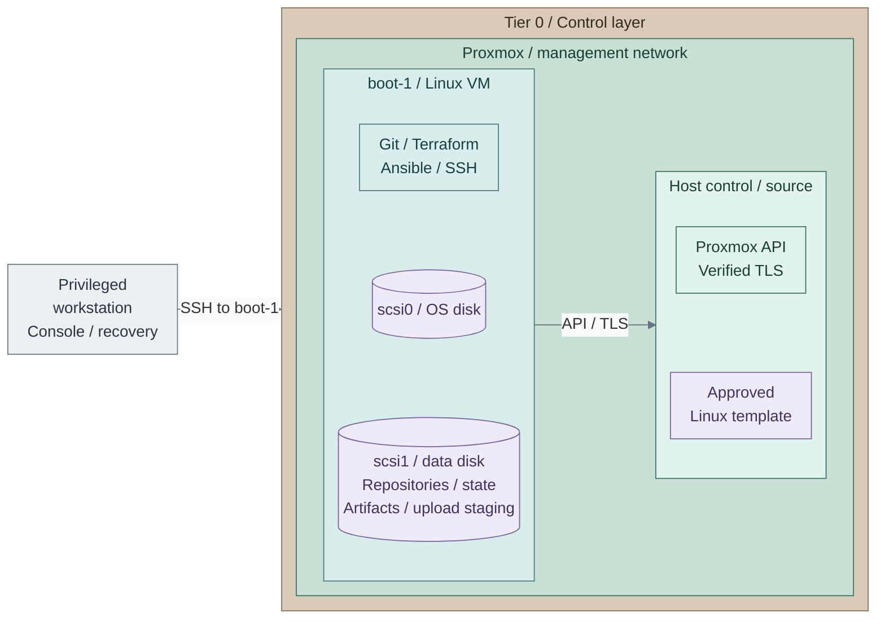

# Bootstrap execution host

Prepare the machine that runs the first infrastructure deployments: stores the
working repositories, stages approved artifacts, trusts the Proxmox API and owns
the initial local inputs/state. It is not a CI runner and needs no hosted GitLab,
FreeIPA, Vault or Kubernetes.

Use a protected existing Linux host or the reference `boot-1` VM. An existing host starts at
**Step 3** and skips Proxmox VM creation/login checks. Proxmox API trust is needed later
because this repository provisions Proxmox resources, not because bootstrap requires that hypervisor.

<a id="figure-1-bootstrap-execution-host"></a>



**Manual:** **Figure 1: Bootstrap execution host.** One `boot-1` VM holds tools, repositories and local state.
It is manually created, not an IaC resource. The view shows the **separate-filesystem reference layout**;
the LVM alternative can instead expand the existing OS disk. The initial template and host already exist.
Its tools operate the
owning tier's [template root](../../../../tier-0/terraform/deployments/templates/main.tf)
and later deployment roots; they do not give Terraform ownership of this bootstrap VM.
Independent encrypted backups/recovery copies remain **outside** this host/storage failure domain.
The network label identifies the shown management interfaces, not the cluster/storage
fabric. The SSH arrow enters `boot-1`; it does not grant host-wide SSH access.

**Working repository:** `<prefix>-tier-0` and sibling repositories after generation.
Step 1 uses the Proxmox GUI and an independent privileged workstation; the following actions
prepare and use the bootstrap VM before any hosted runner exists.
**Prerequisites:** approved software access and independent console/recovery access.
The reference VM path also needs prepared hosts/network/storage and one tested
[manual Linux template](../proxmox/templates.md).
**Design:** [protected execution](../../../01-architecture/04-hosting/02-provisioning.md#execution-contexts).

## Contents

- [1. Clone and configure the bootstrap VM](#step-1-clone-the-bootstrap-vm)
- [2. Verify sudo access](#step-2-verify-sudo-access)
- [3a/3b. Prepare workspace storage](#step-3-prepare-workspace-storage)
- [4. Select optional home placement](#step-4-select-optional-home-placement)
- [5. Select connected or offline acquisition](#step-5-select-tool-acquisition)
- [6. Install OS tools](#step-6-install-os-tools)
- [7. Install Terraform](#step-7-install-terraform)
- [8. Obtain the kit](#step-8-obtain-the-kit)
- [9. Install Ansible](#step-9-install-ansible)
- [10. Verify tools](#step-10-verify-tools)
- [11. Generate repositories](#step-11-generate-repositories)
- [12. Stage approved images](#step-12-stage-approved-images)
- [13. Prepare the execution SSH key](#step-13-prepare-the-execution-ssh-key)
- [14. Trust the Proxmox API](#step-14-trust-the-proxmox-api)
- [15. Create scoped API access](#step-15-create-scoped-api-access)
- [16. Initialize template inputs](#step-16-initialize-template-inputs)
- [17. Configure local credentials](#step-17-configure-local-credentials)
- [18. Configure Shared platform references](#step-18-configure-shared-platform-references)
- [19. Protect the recovery set](#step-19-protect-the-recovery-set)
- [Continue deployment and hand over later](#continue-deployment-and-hand-over-later)
- [References](#references)

## Step 1: Clone the bootstrap VM

Create the VM and disk attachments in [Figure 1](#figure-1-bootstrap-execution-host),
then verify sudo and prepare its workspace below.

1. In the Proxmox GUI, select the tested Linux template, then **Clone > Full Clone**.
   A full clone removes the template/base-disk dependency; do not use a linked clone
   for this recovery execution host.
2. Enter the settings below; configure the clone's **Cloud-Init** before starting it.
3. Start the clone. Verify its SSH host key through the console, then log in as
   `automation` and [verify sudo access](#verify-sudo-access) before continuing.

An existing protected Linux workstation can satisfy Steps 2–4 instead. Do not use
Talos as this general-purpose execution host. Export an accepted VM backup with both
disks for the reference layout, or every disk required by the selected LVM layout,
to independent offline storage and qualify its restore on a recovery host;
a full clone running on this platform is not itself an independent recovery copy.

| Setting | Reference choice |
| --- | --- |
| VM name | `boot-1`; prefer a 3–8 character host label including the instance number |
| VMID | `501` in the [VMID convention](../../../02-conventions/vmid-convention.md); reserve an unused automation ID if already occupied |
| Compute | Start with 2 vCPUs / 4 GiB RAM; size for the selected tools and artifact processing |
| OS disk | Live Proxmox storage, sized for the selected Linux OS and installed tools |
| Workspace capacity | Reference layout: separate attached live-storage disk at `/srv/tier0`, starting at 60 GiB; alternatively expand the existing LVM root disk using storage B below |
| Guest attachment | Current `management` network, example VLAN 10; follow the approved network plan |
| Cloud-Init | Clone-specific static IP/CIDR, gateway and independent DNS; set **User** to `automation` and add each approved workstation's public key to **SSH public key**, one OpenSSH key per line [1] |
| Administration | Verified SSH host key, authorized sudo, working time synchronization and console recovery |

Use the selected [network plan](../../../02-conventions/network-plan.md) and
[naming conventions](../../../02-conventions/proxmox-conventions.md); these are manual
prerequisite values, not new Terraform defaults. The management attachment can
share the approved host-management subnet; it must not join the Corosync or Ceph
transport networks. Sharing a subnet grants no API or SSH permissions.

Add one or several approved public keys **on the clone before first boot**. Each
workstation retains its own private key. Check login from each intended workstation;
these keys authorize access to `boot-1`, not automatic access from it to later guests.
Reusable templates retain no operator account or key list.

Allow only the required paths, including same-subnet filtering where needed:

| Source -> destination | Required interface |
| --- | --- |
| Privileged workstation → bootstrap VM | SSH TCP 22 and authorized console access; no public port forwarding |
| Bootstrap VM → Proxmox | Verified API HTTPS TCP 8006; host SSH only when a specific procedure needs it |
| Bootstrap VM → approved infrastructure | Independent DNS/time and backup destination |
| Bootstrap VM → approved software sources | Scoped HTTPS, an existing proxy/mirror, or verified offline transfer |
| Bootstrap VM → managed guests/clusters | Add SSH/API paths as each capability is deployed, not blanket access to every subnet |

Apply the [host/gateway policy](../network/firewall.md) before broad provisioning.
Initial software supply must work before Stage 1's cache exists; an approved
temporary acquisition path is not permission for unrestricted Tier 0 Internet access.

<a id="verify-sudo-access"></a>

## Step 2: Verify sudo access

Run on **`boot-1`** as `automation`; this checks sudo without a cached password or an interactive prompt:

```bash
sudo -k -n true
```

**Expected:** no output and exit status `0`. With authorized passwordless sudo, Ansible's
`become: true` works without an account password. Omit `--ask-become-pass` (`-K`); that flag
forces a password prompt even when sudo needs none. SSH-key authentication is separate. [9]

If sudo requires a password, use the independent root recovery console to set a local
password with `passwd automation`, then add `--ask-become-pass` to interactive Ansible runs.
If the account is not allowed to use sudo, correct its authorized sudo access there first.
Do not run the whole deployment as root or store a sudo password in Git.

<a id="step-2-prepare-tools-repositories-and-artifacts"></a>
<a id="prepare-the-attached-workspace-disk"></a>
<a id="prepare-bootstrap-storage"></a>

## Step 3: Prepare workspace storage

**Run on `boot-1` as `automation`.** Choose **3a** or **3b** below; both rejoin at Step 4.

Choose **3a** for the separate workspace filesystem in [Figure 1](#figure-1-bootstrap-execution-host),
or **3b** to enlarge an existing LVM root on EL10 or Debian/Ubuntu.
Complete only the selected path before installing tools or copying artifacts.

<a id="a-separate-workspace-filesystem--reference-layout"></a>

### 3a: Separate workspace filesystem — reference layout

1. If the reference VM has no workspace disk yet, use **VM > Hardware > Add > Hard Disk**
   to add `scsi1` on the selected live-disk datastore. Retain an accepted existing attachment/mount.
   Keep its **Backup** option enabled.
2. Complete [workspace disk preparation](step-3a-bootstrap-storage.md): identify the empty disk, create its
   filesystem, record the UUID mount, verify after reboot and create the private directories.
   An existing filesystem is valid; retain its data and verify the actual selected mount.
3. Require the intended data filesystem from `findmnt -T /srv/tier0`, with enough space for compressed
   downloads, unpacked images and tool/provider caches together. Include it in the independent recovery set.

The workspace guide refuses an unmounted directory with `mountpoint -q /srv/tier0` before creating private
paths such as `/srv/tier0/src/homelab`. Back up the data disk independently and include it in bootstrap VM backup jobs.

<a id="b-expand-the-existing-rocky-linux-root--lvm-alternative"></a>

### 3b: Expand the existing root — LVM alternative

Follow [LVM expansion](step-3b-bootstrap-lvm.md): choose **A** to enlarge the existing disk, or **B**
to add a disk to the existing volume group. Each path has its own numbered commands and checks.

For this layout, `/srv/tier0` is a directory on the expanded root filesystem. Use that guide's
directory/verification steps, then continue at **Step 4** below. The separate-mount check and
home bind-mount option in **3a** apply only to its separate-filesystem layout.

## Step 4: Select optional home placement

After **3a**, optionally complete [home directories on the data disk](step-3c-bootstrap-home.md)
before creating Python environments, repositories or new execution keys. It binds `/srv/tier0/home`
at `/home` and returns here after SSH/reboot checks. Otherwise keep the existing `/home`.
After **3b**, skip the bind-mount option: home already uses the selected root layout.
Both choices continue at Step 5.

<a id="step-5a5b-select-tool-acquisition"></a>

## Step 5: Select tool acquisition

| Choice | Run next | Rejoin |
| --- | --- | --- |
| 5a: approved connected sources | Steps 6–12 on this page | Step 13 |
| 5b: prepared offline bundle | [Offline bootstrap](step-3e-bootstrap-offline.md) instead of Steps 6–12 | Step 13 after local tooling checks |

### 5a: Approved connected sources

Continue at Step 6 and finish Steps 6–12 on this page. Use only this path when approved
package/tool sources are reachable; then join Step 13.

### 5b: Prepared offline bundle

Follow the [offline workflow](step-3e-bootstrap-offline.md) instead of Steps 6–12, then join Step 13.
If storage/home preparation already installed verified bundle OS packages, keep them.
Transfer and verify the full bundle in the completed workspace if it is still on separate media,
skip its repeated OS-package installation, then resume kit restoration. Do not regenerate an existing collection.

<a id="2a-install-through-approved-sources"></a>
<a id="2a-install-os-packages-and-terraform"></a>
<a id="2a-install-git-terraform-and-ansible"></a>
<a id="1-install-os-tools"></a>

## Step 6: Install OS tools

For **5a**, run on **`boot-1`** using approved repositories. EL10 (Rocky/Alma) is the reference;
Debian/Ubuntu differences appear beside each command. Already installed storage tools are retained.
Install the base tools and disk/home utilities:

```bash
sudo dnf install -y git bash python3 python3-pip python3-pyyaml \
  openssh-clients ca-certificates curl openssl gnupg2 xz unzip tar /usr/bin/qemu-img \
  dnf-plugins-core rsync policycoreutils-python-utils lvm2 parted xfsprogs
```

For Debian/Ubuntu, use this block instead:

```bash
sudo apt-get update
sudo apt-get install -y git bash python3 python3-pip python3-venv python3-yaml \
  openssh-client ca-certificates curl openssl gnupg xz-utils unzip tar qemu-utils \
  rsync lvm2 parted xfsprogs e2fsprogs
```

<a id="2-install-terraform"></a>

## Step 7: Install Terraform

`dnf-plugins-core` supplies `config-manager`; add HashiCorp's official RHEL RPM channel: [4][5]

```bash
sudo dnf config-manager --add-repo https://rpm.releases.hashicorp.com/RHEL/hashicorp.repo
sudo dnf install terraform
```

Review the package/signing-key prompt. Compare the key fingerprint with the current
[HashiCorp package-signing reference](https://www.hashicorp.com/en/trust/security)
before accepting it; retain signature and TLS verification. [6]

On **Debian/Ubuntu**, use HashiCorp's [Ubuntu/Debian installation block](https://developer.hashicorp.com/terraform/install#linux)
instead of the RPM commands, then continue below. [4]

<a id="2a-continued-obtain-the-kit-and-generate-the-collection"></a>
<a id="3-obtain-the-kit"></a>

## Step 8: Obtain the kit

For a new workspace, obtain the reviewed kit revision using the approved source.
The public clone example is:

Run on **`boot-1`** as automation.

```bash
umask 077
git clone https://github.com/Rexus/homelab.git /srv/tier0/src/homelab
```

A private mirror or transferred Git bundle is also valid. If a collection already
exists, restore it **including ignored inputs and original state**, not just tracked
code; do not initialize a replacement environment.

<a id="step-9a9b-install-ansible"></a>
<a id="4-install-ansible"></a>

## Step 9: Install Ansible

Choose **9a** for the cache/compatible Linux recipes, or **9b** for the full manifest-based
reference runtime. Installing Ansible does not require a manual venv in every case. [8]

### 9a: OS-package path

On **`boot-1`**, using the approved OS repositories:

```bash
sudo dnf install -y ansible-core python3-netaddr
```

On **Debian/Ubuntu**, use `sudo apt-get install -y ansible-core python3-netaddr` instead.

With compatible collections, this is enough to run the cache recipe without the manual Python
setup below. `deploy.sh` automatically prepares missing collections from approved pinned Git sources.
Confirm the installed core and collections support each other; select **9b** if a collection does not
support its version, or a recipe needs additional Python clients. Continue at **Step 10**.
Template commands prepare their own runtime automatically.

### 9b: Isolated reference runtime

Run from the **upstream kit root** on **`boot-1`**.
Install `ansible-core` through the declared runtime manifest, separately from DNF. [7][8]

```bash
python3 -m venv "$HOME/.local/share/homelab/venv"
source "$HOME/.local/share/homelab/venv/bin/activate"
python3 -m pip install -r tier-0/ansible/runtime-requirements.txt
```

With that environment active, install the declared module dependencies from the same kit root:

```bash
python3 -m pip install -r tier-0/ansible/requirements.txt -r tier-1/ansible/requirements.txt \
  -r tier-2/ansible/requirements.txt -r scripts/tier-repos/requirements.txt
```

No separate collection-install commands are needed. Each deployment's precheck installs its missing
or incompatible collections from approved pinned Git sources and retains compatible installed versions.
Allow those sources through the bootstrap's proxy; see
[collection source choices and pins](../../../08-reference/control-node-tooling.md#collection-sources)
for an explicit Galaxy/private-mirror choice. For disconnected execution, use **5b** instead.

For **9b**, keep this environment active for Linux `deploy.sh`; reactivate it in each new shell with
`source "$HOME/.local/share/homelab/venv/bin/activate"`. Template commands select their own
isolated runtime automatically; see [runtime behavior](../../../08-reference/control-node-tooling.md#automatic-template-runtime).

<a id="5-verify-tools-and-generate-the-repositories"></a>
<a id="5-verify-the-tools"></a>

## Step 10: Verify tools

From the kit root, using the runtime selected in **9a** or **9b**:

```bash
git --version
python3 --version
python3 -c 'import yaml; print(yaml.__version__)'
terraform version
qemu-img --version
ansible-playbook --version
```

Require version output from every command. For **9b**, Ansible must report the executable under
`$HOME/.local/share/homelab/venv/`; **9a** uses the OS-installed executable without activation.
For a new collection, continue below. Existing collections retain their original inputs and state.

<a id="6-generate-the-repositories"></a>

## Step 11: Generate repositories

Run from the **upstream kit root** on **`boot-1`**; keep the venv active only when **9b** was selected.

```bash
bash scripts/init-tier-repos.sh
```

This creates `/srv/tier0/src/<prefix>-iac/`. Use `--root` to select another parent;
reuse that path/prefix during refresh. Keep the kit checkout separate from its
five generated repositories; the collection directory is not a Git repository.
Record site choices and completed capabilities:

Edit in **`<prefix>-architecture/`**.

- `platform-standards.md`: Actual host names, VMIDs and network allocations.
- `docs/README.md`: Selected design and verification evidence links.
- `deployments.md`: Completed deployment steps and selected options; update after each completed path.

Read the rendered upstream [Tier 0 checklist](../../../06-paths/tier-0/README.md) in
the browser while executing commands from the named generated repository.

<a id="7-stage-the-template-artifacts"></a>

## Step 12: Stage approved images

Acquire approved images/checksums into `/srv/tier0/artifacts` and retain their provenance. Copy the first
manually uploaded Linux artifact here too if its file/template will be adopted.
Reuse the already verified Linux image from the manual-template workflow; do not upload it again.
For additional images, use the [verification/unpacking procedure](../proxmox/templates.md#step-1-verify-unpack-and-upload)
without its GUI upload when Terraform will publish the file; catalog hashes describe the **unpacked** bytes. Retain
provider/tool/collection artifacts outside this VM for independent recovery.

The [control-node reference](../../../08-reference/control-node-tooling.md#automation-vm-example)
lists compatibility and runtime details.
Packer and later-stage tools such as Helm, kubectl and talosctl belong to their selected paths.

**Connected path complete:** continue at Step 13. Do not perform the offline alternative as another task.

<a id="2b-transfer-a-prepared-bundle--offline-alternative"></a>

The [offline alternative](step-3e-bootstrap-offline.md) replaces Steps 6?12; it restores the kit,
installs local wheels/collections and generates the collection without public package services.

<a id="step-3-prepare-the-execution-accounts-ssh-key"></a>

<a id="step-13a13b-prepare-the-execution-ssh-key"></a>

## Step 13: Prepare the execution SSH key

**Run on `boot-1` as `automation`, outside the repositories.** The key used to
log into this VM is not automatically available for connecting from it to new guests.
Linux clone key lists are empty until configured in each consuming tier.

### 13a: Create a key when none exists

Create a dedicated execution-account key. Enter a passphrase when prompted; do not
overwrite an existing key. Keep both files under the account's `.ssh/`, never in Git.

Run on **`boot-1`** as automation.

```bash
install -d -m 0700 "$HOME/.ssh"
ssh-keygen -t ed25519 -f "$HOME/.ssh/id_ed25519" -C "homelab-bootstrap"
```

Load the private key into a local agent for the deployment session:

Run on **`boot-1`** as automation.

```bash
eval "$(ssh-agent -s)"
ssh-add "$HOME/.ssh/id_ed25519"
ssh-add -l
```

### 13b: Reuse an approved key or agent

Skip key creation when a usable key/agent already exists. Confirm the matching
public-key file is readable on this host and the private key is available through
the local SSH configuration or approved agent. List agent identities with `ssh-add -l`.
Do not copy an administrator's private workstation key into a repository or template.

**Both paths continue at Step 14.** Print the absolute public-key path for the input below:

Run on **`boot-1`** as automation.

```bash
realpath "$HOME/.ssh/id_ed25519.pub"
```

Use the actual public-key filename for an existing key. CloudInit receives only the
public key; Ansible uses its matching private key through SSH. See the
[local SSH input contract](../../../08-reference/platform-inputs.md#local-ssh-access).

<a id="step-3-trust-the-api-and-protect-local-inputs"></a>

<a id="step-4-configure-trust-credentials-and-platform-inputs"></a>

## Step 14: Trust the Proxmox API

These initial steps follow [bootstrap CA trust](../../../05-operations/01-hosting/proxmox-tls.md#step-1-trust-the-bootstrap-ca)
without its later renewal/plan tasks. For the default Proxmox node certificate, obtain its **public CA**
through the independent host console. If the API already uses a custom certificate, use its approved issuer trust instead;
see the [API certificate runbook](../../../05-operations/01-hosting/proxmox-tls.md).

Run on **the selected Proxmox host's console**, as an authorized root operator:

```bash
openssl x509 -in /etc/pve/pve-root-ca.pem -noout -sha256 -fingerprint
cat /etc/pve/pve-root-ca.pem
openssl x509 -in /etc/pve/local/pve-ssl.pem -noout -ext subjectAltName
```

On **`boot-1`**, create the public trust-file directory:

```bash
mkdir -p "$HOME/.config/homelab/trust"
```

Save the complete public PEM block from the console as
**`boot-1` → `$HOME/.config/homelab/trust/pve-root-ca.pem`**. Transfer no private key.
On **`boot-1`**, display its fingerprint and compare it with the independently read console value:

```bash
openssl x509 -in "$HOME/.config/homelab/trust/pve-root-ca.pem" -noout -sha256 -fingerprint
```

Only after the fingerprints match, install it on **`boot-1`**. For EL10:

```bash
sudo install -m 0644 "$HOME/.config/homelab/trust/pve-root-ca.pem" \
  /etc/pki/ca-trust/source/anchors/homelab-pve.crt
sudo update-ca-trust extract
```

For **Debian/Ubuntu**, use this block instead:

```bash
sudo install -m 0644 "$HOME/.config/homelab/trust/pve-root-ca.pem" \
  /usr/local/share/ca-certificates/homelab-pve.crt
sudo update-ca-certificates
```

On **`boot-1`**, enter the actual API URL whose name/IP is covered by the certificate's SANs:

```bash
read -r -p 'Verified Proxmox API URL (https://host:8006/): ' PVE_URL
curl -q --silent --show-error --output /dev/null --write-out 'HTTP %{http_code}\n' \
  "${PVE_URL%/}/api2/json/version"
```

**Expected:** no TLS/name error. An HTTP `401` can mean TLS succeeded but authentication is required;
this is not a token test. Stop on TLS/connectivity failure and correct the CA, endpoint or route.
Browser trust on another workstation is insufficient. Later caller/renewal checks are in the
[API certificate runbook](../../../05-operations/01-hosting/proxmox-tls.md#step-3-remove-exceptions-and-verify-callers);
no plan or platform-issued certificate is required to finish this first-install check.

## Step 15: Create scoped API access

Follow [API setup](../proxmox/api-access.md#create-platform-automation-access) on a **Proxmox host**
to create the scoped roles, group and token. After its token permission checks, continue here at Step 16;
do not repeat CA trust or key creation.

## Step 16: Initialize template inputs

Back on **`boot-1`**, initialize Tier 0's local files:

Run from **`<prefix>-tier-0/`** on the protected execution host.

```bash
bash scripts/proxmox-templates.sh init
```

**Expected:** missing `templates/proxmox.yml` and `.env.local` are created; existing files are retained.
This initializes inputs only. Catalog editing and publication follow on the Foundation page.

## Step 17: Configure local credentials

Edit **Tier 0 `.env.local`**. Replace the examples with the verified endpoint, token
and the absolute public-key path printed in Step 13:

```dotenv
PROXMOX_API_URL=https://pve01.example.internal:8006/
PROXMOX_API_TOKEN_ID=automation@pve!provision
PROXMOX_API_TOKEN_SECRET=replace-with-the-issued-secret
PROXMOX_VE_TMPDIR=/srv/tier0/tmp/proxmox-upload
TF_VAR_ssh_public_key_files='["/home/automation/.ssh/id_ed25519.pub"]'
```

Set these values in **each consuming tier's own `.env.local`** before its first Linux
deployment. Tier 2 does not inherit Tier 0's endpoint, credentials or SSH key setting.
Use a token scoped to that tier's authorized operations. Keep key contents out of
`.tfvars`, templates and Git. Template commands require `--env-file .env.local`;
Linux `deploy.sh` loads that file by default. No manual `source`/exports are needed.
`PROXMOX_VE_TMPDIR` keeps provider upload staging on the prepared data filesystem. [2]

## Step 18: Configure Shared platform references

Configure common platform references before the first managed guest:

Edit in **`<prefix>-shared/`**.

- `config/platform.tfvars`: Set the initial node, live-disk classes and common network attachment.

| Field | Enter |
| --- | --- |
| `default_platform_node_name` | Actual initial destination node, for example `"pve01"`, replacing `null` |
| `proxmox_storage_classes.local.vm_disk` | Real datastore accepting VM disks, for example `"local-zfs"` |
| `proxmox_storage_classes.shared.vm_disk` | Commissioned shared live-disk datastore; its name does not create shared storage |
| `proxmox_storage_classes.fast.vm_disk` | Actual fast-disk datastore if used |
| Class `cloud_init_drive` | Actual datastore accepting VM disks, or omit to inherit that class's `vm_disk` |
| `shared_network_zones.application` | Prepared application bridge/VNet, VLAN and subnet/gateway, or the selected SDN lookup fields |

Replace the used `*-change-me` placeholders and retain only classes that represent
real prepared storage. **`local` is commonly an Import/ISO datastore, not a VM-disk
datastore.** It is distinct from the logical `local` class, which can map to `local-zfs`.
Keep template `image_datastore_id` separate. The template source node also does not
select guest placement. See [platform fields and precedence](../../../08-reference/platform-inputs.md).
On a local-storage pilot, select the configured `local` class in each consuming
setup, including Tier 0's template `all.storage_class`; the starter's `shared`
selection is valid only after that shared datastore exists.

## Step 19: Protect the recovery set

Back up every required bootstrap disk and the selected [recovery set](../../../05-operations/06-resilience/backups/recovery-set.md)
independently of this host/storage, including ignored inputs, inventories, `.env.local`, original state when present
and required recovery material. Follow [backup planning](../../../05-operations/06-resilience/backups/virtual-machines.md)
and test [bootstrap recovery](../../../05-operations/06-resilience/recovery/bootstrap.md) before relying on this host.
Keep protecting newer state after later operations; Git ignore rules are not access control or backup.

**Ready:** operator SSH/console, usable outbound SSH key/agent, tools, artifacts,
verified API trust, scoped credentials, configured Shared profile and independent recovery.
Return to [Foundation Step 3f](../README.md#3f-connect-bootstrap-to-proxmox-host-management)
to register and verify existing-host management, then finish SDN attachment inputs if selected.
Continue at Foundation Step 4 to adopt existing templates or publish new candidates,
including the Kubernetes node image.
Do not boot the reusable template or capture this credential-bearing VM back into it.

## Continue deployment and hand over later

Keep using this collection for Stages 1-8 and the initial Stage 9 installation.
Connect to the approved proxy/internal mirrors through
[Stage 1's bootstrap consumer setup](../../stage-1-software-intake/README.md#step-10-configure-bootstrap-intake)
when that stage's selected supply passes its checks. Remove temporary
acquisition access only after package and tool downloads work through that policy;
retain the offline bundle independently for recovery before the cache/mirrors exist.
Create [local private Git history](../../../04-development/repository-workflow.md#local-history-before-hosted-source-control)
before hosted source control exists. After
GitLab and SSO are accepted, push each repository's reviewed code/history to its
own private remote; never push ignored secrets, state or downloaded images.

A local checkout is not itself a reachable Flux source. Before Stage 4, provide
the [independent bootstrap Git source](../../stage-4-kubernetes/procedures/flux-sops.md)
and read credentials; later hosted GitLab must not be a bootstrap dependency.

The later Tier 0 runner is **`iac-1`**, not another name for `boot-1`.
Follow [bootstrap-to-CI handover](../../stage-9-development/procedures/handover.md)
to restore the original collection/inputs/state, install CA trust on the runner,
move routine credentials to scoped Vault job access and establish **one writer per root**.
Keep independent recovery after handover; a VM on the same Proxmox platform cannot
recover that platform's total loss by itself.

## References

1. [Proxmox Cloud-Init account and public-key fields](https://github.com/proxmox/pve-docs/blob/master/generated/qm-cloud-init-opts.adoc).
2. [Proxmox provider upload staging and temporary directory](https://github.com/bpg/terraform-provider-proxmox/blob/v0.112.0/docs/index.md).
3. [Enterprise Linux filesystem preparation and persistent mounts](https://docs.redhat.com/en/documentation/red_hat_enterprise_linux/10/html/managing_file_systems/index).
4. [HashiCorp Terraform installation and RPM repository](https://developer.hashicorp.com/terraform/install), checked 2026-11-08.
5. [DNF config-manager repository configuration](https://dnf-plugins-core.readthedocs.io/en/latest/config_manager.html), checked 2026-11-08.
6. [HashiCorp package-signing keys](https://www.hashicorp.com/en/trust/security), checked 2026-11-08.
7. [Python virtual environments](https://docs.python.org/3/library/venv.html), checked 2026-11-08.
8. [Ansible packages, pip installation and verification](https://docs.ansible.com/projects/ansible/latest/installation_guide/intro_installation.html), checked 2026-11-08.
9. [Ansible privilege escalation and optional password prompt](https://docs.ansible.com/projects/ansible/latest/playbook_guide/playbooks_privilege_escalation.html), checked 2026-11-08.
