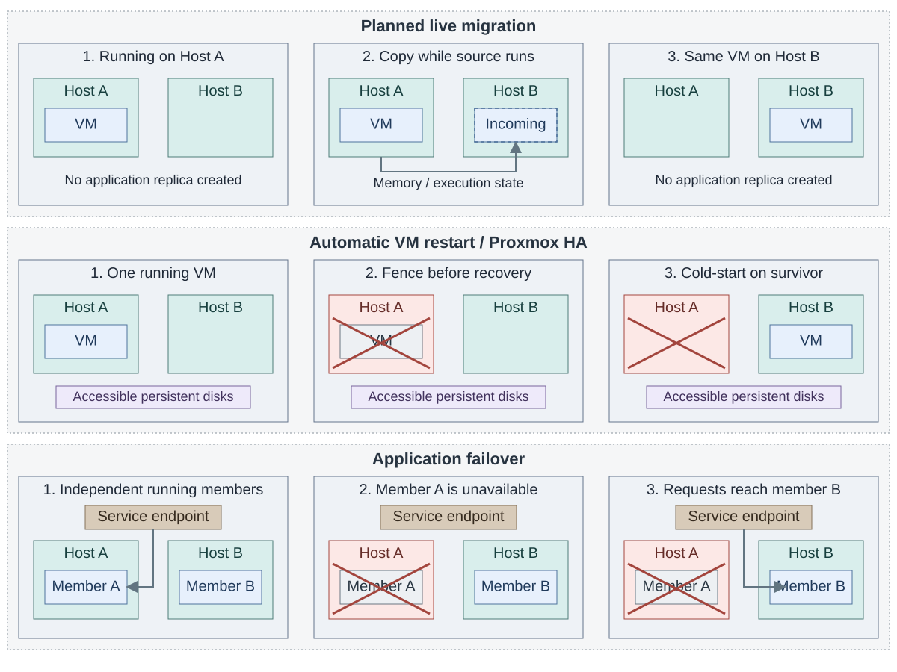
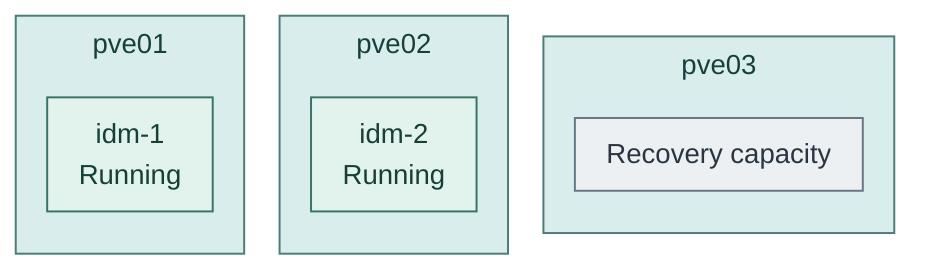
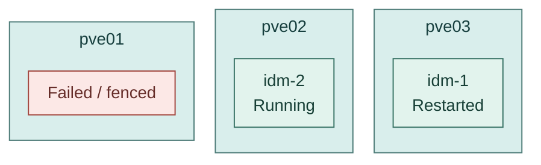

# Proxmox failure and recovery qualification

Test planned migration and automatic VM restart separately. Record how the complete
service behaves while a guest is unavailable and after the same guest starts again.

**Workflow:** *Figure 1. The three strips compare planned migration, automatic VM restart
(Proxmox HA) and application-level failover.* Only source and survivor hosts are shown.
The complete deployment supplies cluster quorum, fencing, accessible disks and recovery capacity.
[Availability design](../../../01-architecture/04-hosting/05-availability.md)

**Working repository:** `<prefix>-tier-0/` for HA policy, with each guest's original
tier retaining its provisioning inputs and state.

**Before testing**, complete cluster, mobility and HA policy preparation with a disposable
VM. Keep independent console access and a verified backup. Choose the expected outage
and recovery point before testing an important service.
[Foundation HA setup](step-1b-cluster-ha.md) ·
[Operational commands](../../../05-operations/01-hosting/proxmox-ha.md)

## Contents

- [Select the failure model](#selected-configuration)
- [Read the directory example](#figure-1-selected-placement-before-failure)
- [Follow host-loss recovery](#when-pve01-fails)
- [Check constrained recovery](#constrained-recovery)
- [Run the qualification](#verify-the-result)
- [References](#references)

## Select the failure model

| Path | Expected interruption | Recovery data |
| --- | --- | --- |
| Planned live migration | Short switchover while both hosts remain working | Running state transferred and accessible current disks |
| Automatic VM restart through Proxmox HA | Detection/fencing, boot and application-recovery interval | Original shared disks, or last accepted replicated disk state |
| Application-level failover | Client retry/routing/promotion interval according to the native protocol | Surviving member's consistent application state |
| Backup restore | Restore, reconfiguration and application-recovery interval | Selected retained recovery point |

A spare host supplies somewhere to run. Disk replication supplies another disk copy.
An application replica runs its own service instance. Test client selection, data consistency
and remaining capacity for the chosen combination. Local asynchronous replication can lose
writes after its last completed synchronization. [1][2]

## Read the directory example

This operator-selected example uses the existing `idm-1` and `idm-2` directory members
on separate hosts, with a third eligible host retaining recovery capacity. The local HA inputs
maintain one negative resource-affinity rule for the pair.

**IaC:** *Figure 2. The directory pair occupies separate physical hosts.* This selected
placement uses the existing [foundation guest inputs](../../../../tier-0/terraform/deployments/foundation/terraform.tfvars.example)
and [inventory](../../../../tier-0/ansible/inventory/hosts.yml.example).
Each member's full disk set is accessible to the eligible survivor hosts. Independent backup,
shared-storage health and directory client endpoint failover are prerequisites outside this placement view.

## Follow host-loss recovery

**Workflow:** *Figure 3. Safe ownership and the separation rule select pve03 for the original
idm-1 guest.* The host-failure sequence acts on the same resources in
[Figure 2](#figure-1-selected-placement-before-failure). The failed host remains unavailable. [1]

1. `idm-1` stops with its host. `idm-2` can continue serving clients configured to use
   both directory endpoints, provided its own dependencies remain available.
2. The surviving quorate cluster establishes safe fencing of the failed host.
3. The separation rule excludes the host already running `idm-2`. HA selects `pve03`
   and boots the **same VMID and disks** for `idm-1`.
4. `idm-1` performs crash recovery and rejoins directory replication. Verify consistency
   and client access before reporting redundancy restored.

## Check constrained recovery

| Condition | Expected result |
| --- | --- |
| One host lost, eligible capacity and shared storage remain healthy | Selected HA guests can restart after fencing |
| Quorum or safe fencing unavailable | Recovery waits for safe ownership |
| Any required disk/network/device unavailable | Restore that dependency or use the selected recovery path |
| Directory pair with only the other member's host eligible | Hard separation blocks restarting the failed member there |
| Three separated control-plane VMs on three physical hosts, one host lost | Two survive, third waits for an eligible host |
| Same control-plane set with a fourth eligible host | Third can restart if capacity, disks and networks remain available |
| Application hangs while its VM remains running | Application monitoring and native recovery must handle the failure |
| Shared live disks lost/corrupted | Independent backup recovery supplies the retained data |

Make one control-plane separation rule per Kubernetes cluster. Workers have their own
capacity/placement policy. A large rule containing all clusters or every worker would demand
one eligible physical host per member. Kubernetes pod topology spread addresses the inner
scheduler separately. [Resource-affinity procedure](../../../05-operations/01-hosting/proxmox-ha.md#resource-affinity)

Vertical scaling increases the space each recovered guest needs on one survivor. Horizontal
scaling adds members and their placement/data requirements. Recalculate usable N+1 capacity
after either change, including host, storage-service and migration overhead.
[Capacity and failure-budget design](../../../01-architecture/04-hosting/05-availability.md#how-scaling-changes-the-failure-budget)

## Run the qualification

1. **Record the baseline.** Save healthy quorum/fencing status, storage health, resources,
   rules, guest locations, application replication and a working client request.
2. **Test planned migration.** Migrate the disposable guest while both hosts work.
   Confirm completion and endpoint/data access. Preview its owning Terraform root and
   investigate unexpected recreation or placement changes.
3. **Test host-loss recovery.** Follow the reviewed fault procedure using independent console
   control. Record failure detection, fencing, destination selection, guest boot and client recovery.
4. **Verify the service.** Require one running instance per original VMID, intact data,
   healthy application replication/quorum, protected log delivery and the intended separation.
5. **Test the constrained case.** Confirm a hard-separated member waits when there are too
   few eligible hosts. Record the degraded service state and its remaining failure tolerance.
6. **Return the repaired host.** Check hardware, storage and networks, then release its
   maintenance state. Review failback/balancing and verify the required redundant members.
7. **Keep the result.** Record measured downtime, observed recovery point, residual risks,
   successful service checks and the owning IaC revision in the protected operating record.

A live migration result qualifies the planned-transfer path. The host-loss test qualifies
safe automatic restart and its actual interruption. Repeat after changes to storage,
networking, hardware, affinity or VM size that affect the accepted failure model.

Return to **Foundation Step 10** after recording acceptance.
[Foundation return](../README.md#step-10-qualify-selected-ha-and-balancing) ·
[Independent VM backup/restore](../../../05-operations/06-resilience/backups/virtual-machines.md)

## References

Official sources checked 2026-11-14.

1. [Proxmox HA fencing, recovery and placement](https://github.com/proxmox/pve-docs/blob/master/ha-manager.adoc).
2. [Proxmox storage replication and possible loss since the last sync](https://github.com/proxmox/pve-docs/blob/master/pvesr.adoc).
