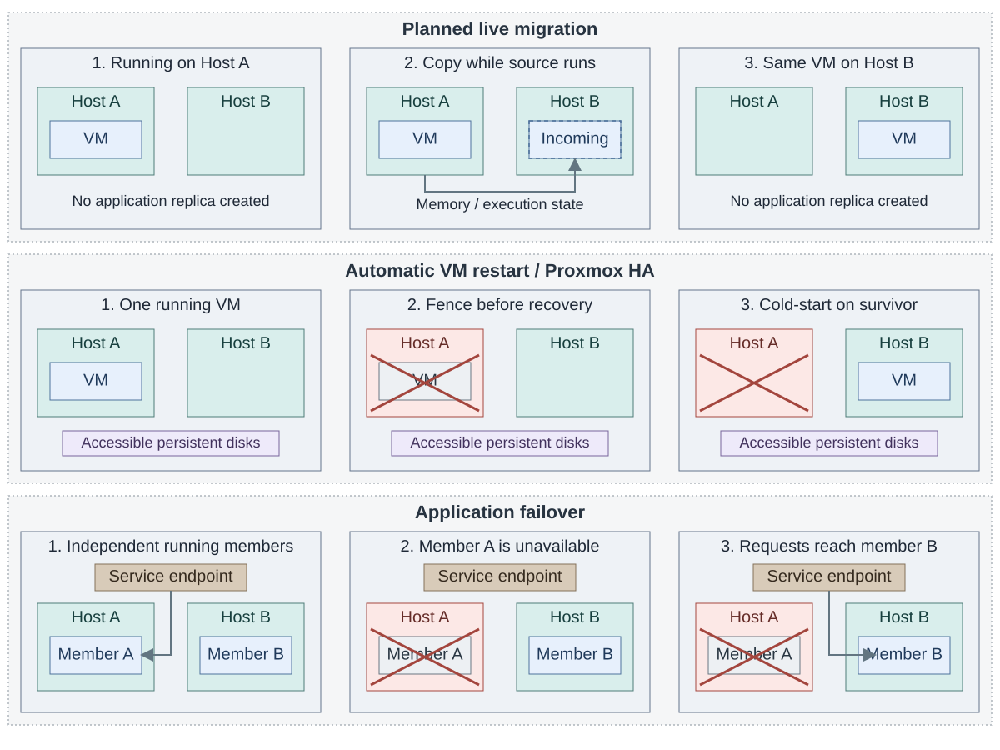

# Step 1b: Proxmox cluster HA

Prepare the host cluster, then enroll selected existing guests for **automatic VM restart
(Proxmox HA)**. After a host fails, Proxmox can automatically boot a guest on an eligible survivor.
The service's accepted interruption and data-loss targets determine whether that recovery is sufficient.

<a id="figure-cluster-ha"></a>



**Workflow:** *Figure 1. Live migration needs a healthy source. Host-loss HA establishes safe
ownership before a fresh boot. Application-level failover uses a running replica.* Only source
and survivor hosts are drawn. The surrounding cluster supplies quorum, usable disks and recovery
capacity. Qualify the selected recovery path before enrolling important guests.
[Availability and scaling design](../../../01-architecture/04-hosting/05-availability.md)

**Working repository:** `<prefix>-tier-0/` on the approved execution host.
Host cluster membership, live storage and fencing are foundation prerequisites. The supplied
HA playbook manages guest enrollment and affinity for the resulting cluster.

<a id="proxmox-cluster-and-ha"></a>

**Branch from** [Foundation Step 1](../README.md#step-1-prepare-hosts-and-networks).
Complete actions 1-2 before adding guests, return through the selected host/SDN options,
then resume actions 3-6 from Foundation Step 10 after a disposable clone exists.
[Host options and return](README.md#step-5-select-optional-branches-before-adding-guests)

**Supported controls** use Proxmox VE 9 affinity rules. Native dynamic balancing,
automatic rebalancing and arm/disarm require 9.2+. Use installed-release help for available fields.
[HA field reference](../../../08-reference/proxmox-ha.md)

## Contents

1. [Prepare and join hosts](#prepare-and-join-hosts)
2. [Qualify mobility and failure capacity](#make-guests-movable)
3. [Set initial guest placement](#terraform-against-the-cluster)
4. [Initialize and select HA policy](#enable-ha)
5. [Apply policy and select scheduling](#select-rebalancing)
6. [Prove service recovery](#prove-failover)

<a id="prepare-and-join-hosts"></a>

## 1. Prepare and join hosts

Use installed hosts with their final names, working DNS/time and independent consoles.
An accepted existing cluster proceeds directly to the membership checks. [1]

1. Select compatible Proxmox releases and the Corosync links. Keep quorum traffic
   independent of congested storage/migration paths.
2. On the first host, use **Datacenter > Cluster > Create Cluster**.
3. Use its **Join Information** and **Join Cluster** on each empty joining host.
   Joining replaces that host's cluster configuration. Preserve existing guests before joining.

Run in **an authorized Proxmox host shell**.

```bash
pvecm status
pvecm nodes
```

**Expected result** is the intended host membership with working quorum.
Use three votes as the normal HA starting design. A two-host/QDevice design requires its
own tested failure model and an independent witness. [1]

<a id="make-guests-movable"></a>

## 2. Qualify mobility and failure capacity

Check **every eligible destination host** before enrolling a guest.

| Check | Required result |
| --- | --- |
| Every disk | OS, data, EFI, TPM and cloud-init volumes accessible on the recovery target |
| Storage path | Resilient shared storage, or supported replication with a tested recovery-point policy |
| Network | Matching bridge/VNet availability, VLAN/MTU and permitted migration/service paths |
| CPU and hardware | Compatible guest CPU model, qualified passthrough/devices and accessible media |
| Cluster ownership | Quorum and tested watchdog/fencing |
| Remaining capacity | Required guests fit after the selected host loss, including host/Ceph reservations |

A spare host provides capacity. Shared/replicated storage provides accessible disk state.
Application replicas provide their native continuity protocol. Select and test the needed
combination. Replicated local storage can lose writes since its last completed synchronization. [2][3]

For the selected shared-storage path, verify the **whole guest**, including additional disks.
The repository's `shared` storage-class name resolves to a configured datastore. Qualify that
actual datastore on all destinations. A host-local hardware device can require restricted placement.

**Before guests exist**, return to the host-options page, complete selected SDN activation
and Foundation storage/firewall checks. Resume below from Foundation Step 10.
[Return to host options](README.md#step-5-select-optional-branches-before-adding-guests)

<a id="terraform-against-the-cluster"></a>

## 3. Set initial guest placement

Edit the **owning tier's original Terraform inputs**. Preserve its resource identities and state.

| File / field | Set |
| --- | --- |
| Shared `config/platform.tfvars`, `default_platform_node_name` | Default initial destination node |
| Tier `terraform/deployments/<setup>/terraform.tfvars`, `vm_instances.<key>.proxmox_node_name` | Distinct initial hosts for the selected Linux replica set |
| Kubernetes `terraform/deployments/kubernetes/terraform.tfvars`, `nodes.<key>.node_name` | Distinct initial physical hosts for that cluster's control-plane voters |
| Shared `templates/proxmox-catalog.tfvars`, selected template `node_name` | Actual source-template host for cross-node cloning |
| Shared storage classes and tier network inputs | Real datastores and attachments usable on eligible hosts |

Run the selected guest deployment through its own guide, then enroll its existing VMIDs below.
Terraform's initial placement and Proxmox's continuing affinity policy serve successive lifecycle
steps. The QEMU VM modules accept Proxmox-owned relocation after creation. Review the owning tier's
preview after moves. The LXC provider has a separate node-specific behavior contract. [4][5]

Reuse the verified API endpoint. Keep an accepted alternate access path for host failure and
preserve source-template metadata when moving a template.
[API trust and permissions](api-access.md#tls-gate) ·
[Consumer template catalog](../../../08-reference/template-catalog.md)

<a id="enable-ha"></a>

## 4. Initialize and select HA policy

Run from **`<prefix>-tier-0/`**.

```bash
bash scripts/init-local-files.sh --setup proxmox-ha
```

Edit **Tier 0 `ansible/group_vars/proxmox_ha.yml`** using the supplied example.
Set `proxmox_ha_resources` to the existing selected guests and `proxmox_ha_rules` to their
placement rules. Select exact Proxmox guest names, or use `vmid` for unambiguous IDs.
Start qualification with a disposable VM.
[Input structure](../../../../tier-0/ansible/group_vars/proxmox_ha.yml.example)

For a cluster's control-plane voters, select one **negative resource-affinity** rule for that
cluster. Give another cluster and any worker sets their own placement policies. Three strictly
separated VMs on three hosts leave one waiting after host loss. To recover all three while
preserving separation, provide a fourth eligible host with resources and disk/network access.
[Illustrated rule effects](../../../05-operations/01-hosting/proxmox-ha.md#resource-affinity)

<a id="select-rebalancing"></a>

## 5. Apply policy and select scheduling

The local selections are ready. Run the HA playbook from operations action 3 and complete
its action 4 verification.
Then return here for the disposable-guest failure qualification in action 6.
[Apply and verify HA policy](../../../05-operations/01-hosting/proxmox-ha.md#apply-ha-policy)

After mobility tests, select the planned-host shutdown policy in **Datacenter > Options >
HA Settings**. On 9.2+, qualify native CRS automatic balancing for the same resource set.
Retain defaults initially and inspect actual resulting moves. ProxLB is a separately selected
alternative scheduler for its own reviewed scope.
[Scheduling procedure](../../../05-operations/01-hosting/proxmox-ha.md#scheduling) ·
[Exact scheduler fields](../../../08-reference/proxmox-ha.md#scheduling-and-maintenance) ·
[ProxLB option](step-10b-proxlb.md)

<a id="prove-failover"></a>

## 6. Prove service recovery

1. Test live migration of a disposable guest and verify service/data access on the destination.
2. Use the reviewed fencing/host-failure test with independent console access.
3. Measure the interruption through boot and application recovery. Verify exactly one
   running original guest, intact data, expected placement and healthy surviving services.
4. Test the intended degraded condition, including a pending hard-separated replica.
5. Record the accepted outage/recovery-point result and remaining failure capacity.

Use the worked test for the exact checks and evidence to retain. Live migration and
host-loss restart exercise different paths in Figure 1.
[Failure and recovery test](failover.md#verify-the-result)

Return to **Foundation Step 10** to complete the selected option's readiness record.
[Foundation return](../README.md#step-10-qualify-selected-ha-and-balancing)

## References

Official sources checked 2026-11-14. Use documentation matching the installed release.

1. [Cluster membership, quorum and QDevice](https://github.com/proxmox/pve-docs/blob/master/pvecm.adoc).
2. [HA fencing, recovery and scheduling](https://github.com/proxmox/pve-docs/blob/master/ha-manager.adoc).
3. [Local storage replication and recovery-point limits](https://github.com/proxmox/pve-docs/blob/master/pvesr.adoc).
4. [Provider multi-node guide](https://registry.terraform.io/providers/bpg/proxmox/latest/docs/guides/multi-node).
5. [Provider container read implementation](https://github.com/bpg/terraform-provider-proxmox/blob/v0.112.0/proxmoxtf/resource/container/container.go).
