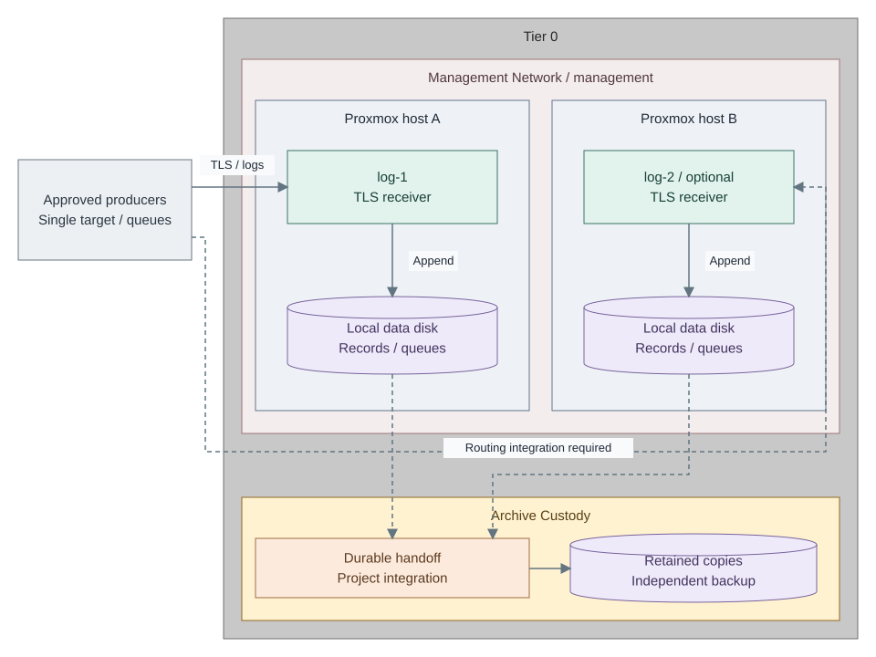
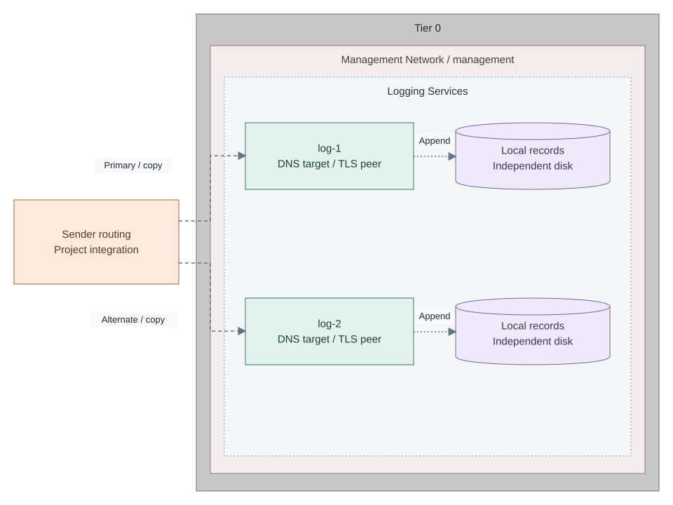
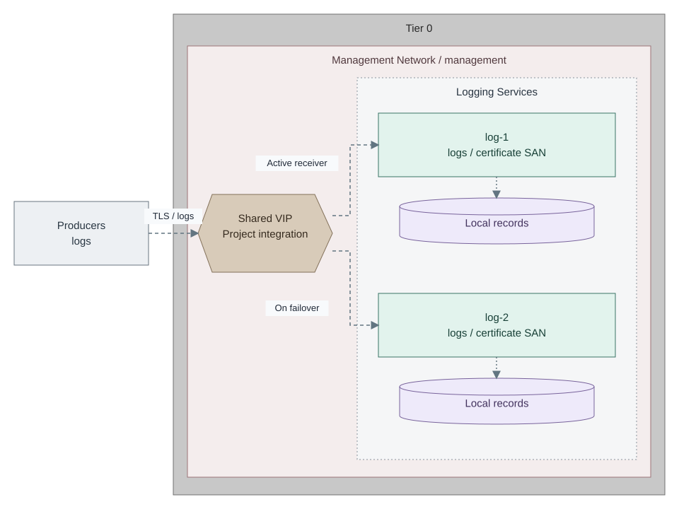

# Step 14b: Redundant protected intake

Extend protected intake with a separately placed receiver; qualify sender routing and archive
handoff for the selected failure contract.

<a id="figure-1-independent-receivers"></a>



**IaC:** **Figure 1: Independent receivers.** Tier 0 [optional VM definition](../../../tier-0/terraform/deployments/syslog/terraform.tfvars.example),
[inventory](../../../tier-0/ansible/inventory/hosts.yml.example) and
[IP map](../../../tier-0/ansible/group_vars/syslog.yml.example).
Both receivers use the same [receiver recipe](../../../tier-0/ansible/playbooks/deployment/foundation-logging.yml);
`logs` still resolves to `log-1`. The dashed alternate path requires a routing integration;
adding `log-2` does not install sender failover, a shared VIP or the stronger durable-handoff contract.
Host A/B remain explicit because this view compares independently placed receivers and their local disks.
Both guest interfaces use `management`; distinct host placement must be selected and verified.

**Working repository:** `<prefix>-tier-0` (source: `tier-0/`).
**Branch from:** [Step 14](README.md#step-14-select-the-receiver-topology), when the required failure contract exceeds a single collector.
**Change:** Add independently placed receivers and verify durable handoff, not merely endpoint failover.
**Return:** [Step 15](README.md#step-15-protect-retained-records) to protect the selected receiver topology.
**Design:** [durability and availability](../../01-architecture/11-operations/01-protected-logging.md#durability-and-availability).
**Prerequisites:** functioning intake, independent backup/key custody and supported receiver/storage integration.

## 1. Add capacity and failure domains

Add the second receiver in [Figure 1](#figure-1-independent-receivers).

Enable `log-2` in Tier 0's local `terraform/deployments/syslog/terraform.tfvars`;
add matching inventory/IP entries. Place receivers on distinct physical failure domains.
Add further capacity as demand requires. Receiver count alone does not establish storage redundancy.

## 2. Review and apply the same state root

From Tier 0, provision after reviewing Terraform's displayed plan and entering `yes`:

Run from **`<prefix>-tier-0/`**.

```bash
bash scripts/deploy.sh syslog --terraform-only
```

Add `--plan-only` for an optional preview. Keep existing hosts and state; no
replacement archive or second Terraform owner is introduced.

In **Tier 0 `ansible/group_vars/syslog.yml`**, remove `syslog_ng_data_uuid`, even an empty value.
Remove it from any other shared `-e`/`--ansible-vars` file too: extra vars override host vars.
Keep the stable data-device selection only if it matches both receivers' attached disks.
Run the [guarded storage action](README.md#step-4-prepare-and-verify-storage) and save each receiver's
printed UUID in **`ansible/inventory/host_vars/<receiver>.yml`**, beside `inventory/hosts.yml`.
Use a separate UUID for each receiver; never apply one global UUID to both filesystems.

Prepare and approve the new receiver's server identity using
[Steps 6–10](README.md#step-6-prepare-the-receiver-key-and-request), reusing the original authority.
Set each receiver's `syslog_ng_tls_cert_src` and `syslog_ng_tls_key_src` to its own protected
controller files in that same inventory-adjacent host file. Existing `ansible/host_vars` files
are supported only when explicitly loaded for one selected host; the inventory-adjacent files
are automatically discovered for this pair. Keep shared CA/CRL paths common where appropriate.
Then configure:

Run from **`<prefix>-tier-0/`**.

```bash
bash scripts/deploy.sh syslog --ansible-only
```

This installs independent
receivers, not replication or an immutable archive.

Keep the existing `log-1` machine record and `logs` alias from
[Step 5](README.md#step-5-configure-the-first-producer). Add an A record for
`log-2.internal.example.com` using its new `platform_host_ips.log-2` address.
Do not add a second CNAME for `logs`, and do not redirect producers before Step 3's routing is accepted.

## 3. Select the producer routing

The supplied [sender template](../../../shared/ansible/roles/log_forwarder/templates/sender.conf.j2)
configures one `log_forwarder_target` and one verified `log_forwarder_peer`. It has no secondary-target
or dual-output input. The paths below describe **project integrations**, not additional kit installers.
Keep the current single-target configuration until your chosen routing IaC is implemented and tested.

| Choice | DNS and producer configuration | What changes |
| --- | --- | --- |
| **3a: sender failover or dual submission** | Keep separate A records for `log-1` and `log-2`; configure both endpoints and their verified certificate names in the sender integration | Producers switch to the alternate or send independent copies; a shared VIP is unnecessary |
| **3b: shared VIP** | Keep the machine A records; replace the `logs` CNAME with an A record for the accepted VIP | Producers retain `logs`; the VIP selects the active receiver |

### 3a. Sender-based redundancy

<a id="figure-2-sender-routing"></a>



**Integration:** **Figure 2: Sender routing.** Dashed paths require project-owned sender automation;
the [current sender](../../../shared/ansible/roles/log_forwarder/templates/sender.conf.j2) installs one destination.
The [receiver inputs](../../../tier-0/ansible/group_vars/syslog.yml.example) retain separate machine identities.

Choose failover or dual submission explicitly; they have different queue, duplicate and acceptance
contracts. Match each configured verification name to its certificate SAN. A client with separate
target/peer settings can connect to a receiver's machine name while verifying `logs`, if its certificate
contains that service SAN. Keep separate receiver keys; review certificates before changing verified names.
No DNS record alone distributes or retries events. Continue at Step 4 after qualification.

### 3b. A shared service endpoint

<a id="figure-3-shared-endpoint"></a>



**Integration:** **Figure 3: Shared service endpoint.** The VIP and dashed routing paths are not
installed by the [receiver recipe](../../../tier-0/ansible/playbooks/deployment/foundation-logging.yml).
Producers retain the service name in the [single-target sender](../../../shared/ansible/roles/log_forwarder/templates/sender.conf.j2).

Provision and qualify the shared endpoint through your routing IaC before changing DNS. Replace the
`logs` CNAME with an A record for its VIP; retain the receiver machine records for administration.
Each receiver needs its own private key and certificate valid for `logs.internal.example.com`.
Keep `log_forwarder_target` and `log_forwarder_peer` on that service name. Reconnect/revalidate producers
after the cutover; DNS caching and existing connections can delay their move.

A TCP balancer is a separate compatible integration only when it preserves the producer's TLS identity
and the observed source address required by `syslog_ng_sources`. Ordinary proxying is not automatically
compatible with that receiver identity check. Neither a VIP nor sender redundancy replicates stored logs.
Continue at Step 4 after qualification.

<a id="3-verify-the-declared-failure-contract"></a>

## 4. Verify the declared failure contract

| Test | Acceptance |
| --- | --- |
| Receiver/process/physical host loss | Accepted event sequence survives; upstream queues replay and duplicates are accounted for |
| Power loss or archive-target outage | Flush/commit behavior matches the contract; no upstream release before required durable protection |
| Partition, bounded outage and peak load | Failure domains, backpressure and headroom match the declared envelope; loss is not hidden |
| Independent restore and key recovery | Retained events remain inspectable without Tier 1, normal SSO or the original collector |

Use numbered events and source/receiver/archive counts. Record remaining source
gaps separately from loss of accepted records; do not claim exactly-once delivery.
Continue with [Stage 2, Step 15](README.md#step-15-protect-retained-records).
Complete the selected **15a NAS** or **15b locked-retention** path for the resulting topology,
then the fault/restore checks in Step 16. Adding a receiver does not complete archive protection.
