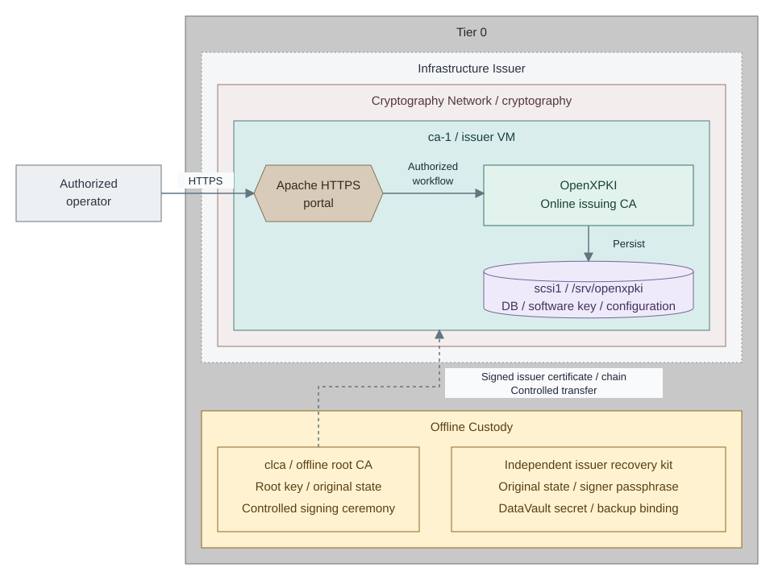

# Stage 2: Cryptographic trust

Create the **Offline Root CA (ORCA)**, prepare the issuer's **key provider**, then deploy and
activate **`ca-1`**. Choose one PicoHSM, one YubiHSM or a software HSM for the issuer. Routine
certificate requests use `ca-1`; reopen the retained ORCA only for root ceremonies.

<a id="figure-1-offline-root-and-online-issuer"></a>



**IaC / Ceremony:** *Figure 1: ORCA and the online issuer. `ca-1` uses its selected key provider and
persistent CA state on the cryptography network. The separate ORCA signs its certificate; the dashed
upward link carries public signed objects. The provider interface represents the selected software
token or hardware device, not an additional VM. [Editable figure and rendering](../../08-reference/diagrams/trust-render.md).*

Tier 0 [foundation inputs](../../../tier-0/terraform/deployments/foundation/terraform.tfvars.example),
[network inputs](../../../tier-0/terraform/common.tfvars.example) and
[issuer recipe](../../../tier-0/ansible/playbooks/deployment/openxpki.yml) own the VM and its data mount.
The fresh starter selects `ca-1` only. Directory VMs are a later Stage 5 selection under the same
provisioning root; their FreeIPA CA becomes a sibling issuer under ORCA.

**Related:** [Architecture](../../01-architecture/08-cryptography/01-certificate-authority.md) · [Operations](../../05-operations/03-cryptography/README.md)

**Prerequisites:** verified [foundation](../foundation/README.md), accepted
[software intake](../stage-01-software-intake/README.md), persistent local journal/audit records,
protected recovery storage and authorized custodians. Protected network logging is added in Stage 3;
it is not a prerequisite for bootstrapping trust. The reference selects OpenXPKI
Community as the permanent infrastructure issuer and clca for offline root operations;
existing qualified authorities remain valid. The on-demand ORCA kit prepares tools and policy;
key creation and signing run explicitly on the offline machine.
**Working repository:** `<prefix>-tier-0` (source: `tier-0/`).
**Automation:** ORCA preparation, issuer provisioning, key-provider setup, policy and recovery mechanisms
are supplied. Approving a CSR, unlocking custody and accepting recovery remain operator actions.
ACME adapter qualification remains separate. See
[coverage](../../08-reference/implementation-support.md#stage-coverage).
**Design:** [certificate authority](../../01-architecture/08-cryptography/01-certificate-authority.md).

> [!TIP]
> **Recovery and maintenance:** [Restore the original issuer](../../05-operations/03-cryptography/issuer-recovery.md),
> [renew/revoke certificates](../../05-operations/03-cryptography/certificate-authority.md), or
> [expand a single HSM into a pool](../../05-operations/03-cryptography/usb-hsm.md#single-device-to-pool).

<a id="main-path"></a>

## Installation route

Follow the actions below in order. Complete ORCA, select **one** issuer-key option, then continue
down this page. Leaf procedures are opened only at the action that uses them.

| Action | Continue at |
| --- | --- |
| [1. Create ORCA and choose the issuer key](#step-1-prepare-issuer-and-key-custody) | Separate offline root with optional [FIDO2 disk unlock](procedures/orca-disk-unlock.md); software HSM 1a or single USB 1d; advanced pool/appliance options remain available |
| [2-4. Configure and provision `ca-1`](#step-2-initialize-the-issuer-inputs) | Same existing foundation state; VM and dedicated data disk |
| [5-7. Prepare the key provider and policy](#step-5-commission-the-selected-issuer-key-provider) | Original token/key identity, then its matching immutable configuration |
| [8-10. Install the inactive issuer and prepare its CSR](#step-8-prepare-runtime-credentials-and-tls) | Selected software or hardware key |
| [11-13. Sign, activate and verify issuance](#step-11-sign-the-approved-request-offline) | Root ceremony, public certificate import, native token activation |
| [14. Accept recovery](#step-14-accept-issuance-and-recovery) | Evidence retained independently |
| [15a / 15b. Optional integrations](#step-15-select-additional-integrations) | API certificate transition and/or verified publication |
| [16. Secure the installation](#step-16-secure-the-installation) | Replace bootstrap TLS, close commissioning and retain recovery |

## Step 1: Prepare issuer and key custody

**First, complete [ORCA's first visit](procedures/offline-root.md#first-visit).** That numbered guide
builds the public tool kit, prepares the offline machine, creates the root once and backs it up.
Return here with `root.pem`, `root.cer`, `root.crl` and the independently recorded root fingerprint.
At Step 11, reopen that **same root** to sign the issuer request. An existing root uses the restore
route instead of creation; [pre-kit clca instances](procedures/offline-software-root.md) retain their
original native workflow and policy.

**Choose the ceremony environment before attaching custody media:** use a dedicated trusted
workstation, or follow the [on-demand ceremony image and VM path](procedures/ceremony-environment.md).
Use separate `cadm-1` hardware-administration and ORCA sessions. Bootstrap prepares public inputs
and runs provisioning; administrative PINs and root secrets are entered locally on the selected
ceremony system. A VM still trusts its hypervisor; retain physical workstation custody when that
separation is required. Updates are built and tested before root media is attached.

ORCA's default is an encrypted software root on separately controlled offline storage. Its key
never goes onto bootstrap or `ca-1`. The accepted ceremony VM explicitly trusts its hypervisor;
it has no NIC and keeps root state on independent removable media. `root_ca` stays empty in connected
inventory. The following choice protects **the issuer's different key**, not ORCA's key.

**Then choose one issuer-key path:**

| Path | Select before installation | Key preparation later |
| --- | --- | --- |
| **1a: software HSM, no hardware** | [SoftHSM2 on `ca-1`](step-1a-software-hsm.md); private token storage and independent PIN/backup custody | Initialize at action 5; use its original key at action 10a |
| **1b: USB pool** | [Provider hosts and device custody](step-1b-usb-hsm.md); no generic application HA is implied | Action 10b with the qualified original key |
| **1c: network HSM** | [Existing appliance and native client](step-1c-network-hsm.md); appliance commissioning remains product-specific | Action 10b |
| **1d: single USB, hardware start** | [Local PicoHSM or YubiHSM 2](step-1d-single-usb.md); [blank-Pico preparation](procedures/picohsm.md) when selected | Commission before attachment; verify at 5 and bind the original key at 10b |

**Existing encrypted key-file installation:** retain its `software` policy, passphrase and original
key. The [file-key path at 10c](#10c-encrypted-key-file-profile) remains supported; selecting SoftHSM
does not migrate an existing key. Read the [custody reference](procedures/local-key-custody.md) if needed.

Single USB is a complete starting deployment. Preserve its same-family wrapped-key material now;
[Vault's provider-growth review](../stage-06-secrets/step-1c-seal-integration.md#review-single-device-growth-before-adding-consumers)
connects the later pool upgrade. Extra consumers get their own keys and permissions; a pool alone
does not enable Vault Community PKCS#11 sealing.

For local USB, complete [device commissioning and attachment inputs](step-1d-single-usb.md#1-select-custody-and-preserve-key-identity)
before action 4. Apply the attachment with that first provisioning run, then verify the commissioned
key and record its URI/provider paths at action 5. Never repeat blank-device initialization.
Run the issuer-binding and CSR commands at action 10b after the inactive runtime exists.
Pool/appliance paths must also select their
qualified original key and native client contract before building the policy. If host/runtime actions were already completed,
retain that installation and continue at the first unfinished action below. Do not generate a software key
for an HSM-backed issuer. Optional [PKCS#11 remoting](procedures/pkcs11-remoting.md) follows qualified local
provider/key recovery; a shared signing API is a separate Stage 6 option.

## Step 2: Initialize the issuer inputs

Here, `foundation` is the shared Terraform setup for the issuer and directory VMs;
it does not mean repeating the earlier foundation chapter. This step creates editable inputs only.
Its default Ansible entry point, `ansible/playbooks/foundation.yml`, imports
`deployment/identity-freeipa.yml` for Stage 5. Use Step 4's `--terraform-only` provisioning and
Step 9's explicit `deployment/openxpki.yml` recipe for this issuer installation.

**Return to the protected controller. Run from `<prefix>-tier-0/`.**

```bash
bash scripts/init-local-files.sh --setup foundation
```

**Expected:** foundation Terraform/Ansible inputs and `ansible/group_vars/issuer.yml` created if missing;
existing inputs retained. Keep the original `--env` on all subsequent
wrapper commands if a named environment is already in use. Continue to Step 3 before deploying;
the starter contains example guests and values that need selecting and editing.

## Step 3: Select the image, host and data disk

Select the approved **Debian 12 amd64** issuer image from the shared template catalogue. This native
OpenXPKI package path differs from the EL10 directory/other Linux hosts; see its [OS qualification](procedures/issuer.md).

Edit in **`<prefix>-tier-0/`**:

| File | Set |
| --- | --- |
| `terraform/deployments/foundation/terraform.tfvars` | `vm_instances["ca-1"]`: approved Debian `template_vm_id`, unused VMID, placement, live storage and `extra_disks` capacity |
| `ansible/inventory/hosts.yml` | `ca-1` in `issuing_ca`; keep `root_ca` empty on connected inventory |
| `ansible/group_vars/foundation.yml` | Reserved `platform_host_ips.ca-1`; preserve the complete existing IP map |
| `terraform/common.tfvars` | Applied `network_zones.cryptography` attachment or its actual bridge/VLAN/subnet |
| `.env.local` | Real Proxmox credentials and approved SSH public-key paths |
| `ansible/group_vars/all.yml` | Accepted Stage 1 package proxy/mirror and standalone `platform_internal_domain`; retain the bootstrap login and approved key |

In independent DNS, reserve the machine name `ca-1.internal.example.com` for the chosen IP,
`ca.internal.example.com` for the administrative portal, and `pki.internal.example.com` for public
certificates/CRLs. Initially both service names target `ca-1`. Substitute the configured internal suffix.
This separates service names, not servers: the supplied baseline has one publication host.
Permit controller SSH, restricted administrator HTTPS, approved public-object HTTP
readers and the selected package route before installation. Keep this DNS independent of Stage 5.

For a **fresh installation**, keep the publication name/path consistent in these files:

| File | Set |
| --- | --- |
| `templates/offline-root/orca.conf` | `ORCA_PUBLICATION_URL=http://pki.<internal-domain>/download` before creating/signing with the root |
| Private `issuer-policy.yml` selected in Step 6 | `openxpki_bundle_publication_url: http://pki.<internal-domain>/download/` before building the issuer policy |
| `ansible/group_vars/issuer.yml` | `openxpki_publication_fqdn: pki.<internal-domain>` for the read-only HTTP alias; retain `openxpki_portal_fqdn: ca.<internal-domain>` |

Use the actual domain, with no angle brackets. **Existing installations keep their original
embedded URLs reachable**; adding this alias does not rewrite certificates or pinned root policy.
The [publication design](../../01-architecture/08-cryptography/01-certificate-authority.md#revocation-and-publication-availability)
explains a later move to independent readers. That replica/health-checked endpoint is not installed
by this baseline; do not assume the DNS alias provides HA.

For a **fresh issuer-only deployment**, edit `terraform/deployments/foundation/terraform.tfvars`:

- Keep `vm_instances["ca-1"]` and replace its example template, placement, storage and network values.
- Leave the optional `idm-1` and `idm-2` objects commented until Stage 5. In an older local file,
  comment out those objects only if they have not already been deployed.
- Keep `lxc_instances = {}` unless containers were deliberately selected in this setup.

For an **existing foundation deployment**, retain previously managed guests in this same map/state;
removing them can plan destruction. Add or update `ca-1` alongside them. Use the issuer-specific Ansible
command in Step 9 for CA configuration.

The example already declares `ca-1` and its data disk. Replace these site values before Step 4:

| Input | Example | Find the real value in |
| --- | --- | --- |
| `template_vm_id` | `9103` | Approved Debian 12 template in Shared `templates/proxmox-catalog.tfvars` and Proxmox |
| `vm_id` | `311` | The site's allocation under the [VMID convention](../../02-conventions/vmid-convention.md); it must be unused |
| `proxmox_node_name`, when pinning a USB device | `pve01` | The Proxmox node containing that physical device |
| `storage_class` and each extra disk's class | `local` | Shared `config/platform.tfvars`; its `vm_disk` must name VM-image storage |
| `network_zone_key` | `cryptography` | The configured attachment in Tier 0 `terraform/common.tfvars` |
| `platform_host_ips.ca-1` | `10.20.21.10` | Reserved unused address in that network, entered in `ansible/group_vars/foundation.yml` |

For local USB custody, add the two attachment fields in
[option 1d, action 2](step-1d-single-usb.md#2-declare-usb-attachment-and-install-the-inactive-issuer)
before this first Terraform apply. Software custody leaves them absent.

<a id="step-7-provision-the-issuer-and-attached-storage"></a>

## Step 4: Provision the issuer and attached storage

Run from **`<prefix>-tier-0/`**:

```bash
bash scripts/deploy.sh foundation --terraform-only
```

Review the whole-state plan and enter `yes` for intended changes. Optional preview adds `--plan-only`;
approved unattended provisioning adds `--auto-approve`. Neither authorizes signing.
For a fresh issuer-only setup, the VM to create is `ca-1`; unexpected directory VMs mean the starter's
`idm-1` / `idm-2` entries are still selected. Correct the inputs before approving.

**Expected:** host and dedicated `scsi1` disk allocated. Ansible prepares the filesystem/UUID mount
at action 5 for SoftHSM, or at action 9 for the other paths; action 9 owns the database bind.
No guest disk-formatting or mounting step is required.

## Step 5: Commission the selected issuer key provider

**Use only the option selected in Step 1.** ORCA's root key stays offline and is never imported here.

| Selected option | Do now on the provisioned issuer / selected device | Keep for Step 6 |
| --- | --- | --- |
| **1a: software HSM** | [Prepare and initialize SoftHSM2](step-1a-software-hsm.md) through Ansible | Reported original serial/key URI, provider paths and retained PINs |
| **1d: single USB** | Verify the original [PicoHSM/YubiHSM commissioning record](step-1d-single-usb.md#1-select-custody-and-preserve-key-identity); never repeat blank-device initialization | Original key URI, device recovery material and application PIN |
| **1b / 1c: pool or appliance** | Complete the selected option's provider/key preparation | Qualified original-key URI and native client paths |
| **Existing encrypted key-file profile** | Keep its software policy and original passphrase; a fresh file key is created at 10c | Signer passphrase; no token initialization |

Record the selected provider's public identity and recovery binding. Routine reconciliation must
reuse that key. The software token and a USB device have the same application interface, but different
recovery material; selecting another backend is a deliberate key migration, not a config-only update.

<a id="step-4-prepare-the-private-policy"></a>

## Step 6: Prepare policy and secrets

For every selected custody path, run from **`<prefix>-tier-0/`**. This creates the default private
parent directory; use an absolute policy path there, or another existing protected directory:

```bash
umask 077
install -d -m 0700 "$HOME/.local/share/pki"
read -r -e -p "Absolute private issuer policy file (example $HOME/.local/share/pki/issuer-policy.yml): " ISSUER_POLICY_FILE
cp -n ansible/group_vars/issuer-policy.yml.example "$ISSUER_POLICY_FILE"
```

Edit **the selected private policy file**:

| Field | Set |
| --- | --- |
| `openxpki_bundle_directory` | New protected absolute build directory, e.g. `/home/automation/.local/share/pki/configuration-001`; retain each immutable bundle |
| `openxpki_bundle_portal_fqdn` | Stable service name from Step 3, e.g. `ca.internal.example.com`, matching portal TLS |
| `openxpki_bundle_publication_url` | Approved public-object URL, e.g. `http://pki.internal.example.com/download/`; it becomes reachable after runtime installation |
| `openxpki_bundle_dns_suffixes` | Approved certificate scope, e.g. `[internal.example.com]` with the actual internal suffix |
| `openxpki_bundle_users` | Separate named requester/approver accounts and independent Argon2id hashes |

Retain the starter's `infrastructure` realm and `/srv/openxpki` data mount in both policy and runtime
inputs. A selected different realm/mount must match `openxpki_bundle_realm` / `openxpki_bundle_data_mount`
and `openxpki_realm` / `openxpki_data_mount` throughout.

For **1a**, copy the `pkcs11` policy values reported by [SoftHSM preparation](step-1a-software-hsm.md).
For an **existing encrypted key-file profile**, retain `openxpki_bundle_signer_backend: software`.
For **local PicoHSM on the Debian issuer**, add the following to that same private policy file;
copy the serial/key ID recorded during commissioning:

```yaml
openxpki_bundle_signer_backend: pkcs11
openxpki_bundle_pkcs11_key_uri: "pkcs11:serial=COPY_THE_TOKEN_SERIAL;id=%01;type=private"
openxpki_bundle_pkcs11_library: /usr/lib/x86_64-linux-gnu/opensc-pkcs11.so
openxpki_bundle_pkcs11_engine_library: /usr/lib/x86_64-linux-gnu/engines-3/pkcs11.so
```

For YubiHSM, use the SDK's actual PKCS#11 library path from `hsm.yml` instead. A remote provider
uses its qualified native client module; it does not turn on application HA. Both builder profiles
retain the common requester/approver and publication policy. Neither creates hardware keys.
An accepted external configuration artifact can replace the builder; preserve its checksum and native contract.

<a id="step-5-prepare-software-policy-secrets"></a>

<a id="step-5-prepare-policy-secrets"></a>

### Account hashes and secrets

Install the native hash tool on **the trusted controller**, from **`<prefix>-tier-0/`** through its
accepted package source:

```bash
ANSIBLE_CONFIG=ansible/ansible.cfg ansible localhost -i localhost, -c local --become \
  -m ansible.builtin.package -a 'name=argon2 state=present'
```

Add `--ask-become-pass` when the controller account requires its sudo password. Require successful
package installation, then generate each account's encoded hash. The [policy reference](procedures/software-pki.md)
records costs and custody.
Run from **`<prefix>-tier-0/`**, once per account:

```bash
read -rsp 'New account password: ' account_password; echo
printf '%s' "$account_password" | argon2 "$(openssl rand -hex 16)" -id -e -t 3 -m 16 -p 4
unset account_password
```

Save the hash in that account's policy entry. For the **encrypted key-file profile only**, load
the independently retained key passphrase in **the same protected Tier 0 shell**:

```bash
read -rsp 'Issuer key passphrase (32+ characters): ' OPENXPKI_SIGNER_PASSWORD; echo
export OPENXPKI_SIGNER_PASSWORD
```

For **SoftHSM or hardware custody**, retain the token's existing application PIN instead:

```bash
read -rsp 'Existing token application PIN: ' HSM_ISSUER_PIN; echo
export HSM_ISSUER_PIN
```

For **either fresh profile**, create and independently retain the separate DataVault recovery secret:

```bash
export OPENXPKI_DATAVAULT_SECRET="$(openssl rand -hex 32)"
```

Restore original secrets on retries; do not generate another DataVault value for an existing CA.
The configuration artifact contains protected runtime secrets, including the selected token PIN.
Keep it private and under independent recovery custody.

<a id="step-6-build-the-software-policy-artifact"></a>

<a id="step-6-build-the-immutable-policy-artifact"></a>

## Step 7: Build the immutable policy artifact

For the selected **software or PKCS#11 profile**, run from **`<prefix>-tier-0/`** with
`ISSUER_POLICY_FILE` and Step 6's secrets retained in the same shell:

```bash
ANSIBLE_CONFIG=ansible/ansible.cfg ansible-playbook -i localhost, ansible/playbooks/deployment/openxpki-bundle.yml -e "@$ISSUER_POLICY_FILE"
```

**Expected:** immutable archive path/SHA256 and a bootstrap portal certificate fingerprint.
Retain these values. Verify bootstrap TLS out of band; replace its seven-day certificate before normal use.
The builder refuses an existing final archive; reuse a successfully built artifact instead of rebuilding it.

## Step 8: Prepare runtime credentials and TLS

First obtain the package-source pins. On **the protected controller**, compare the downloaded
key's SHA256 with the publisher's independently reviewed
[key record](https://github.com/openxpki/openxpki/blob/master/QUICKSTART.md#preparation):

```bash
curl --fail --silent --show-error --connect-timeout 5 --max-time 30 \
  https://packages.openxpki.org/v3/bookworm/Release.key \
  -o "$HOME/.local/share/pki/openxpki-release.asc"
sha256sum "$HOME/.local/share/pki/openxpki-release.asc"
```

Require a match with the approved publisher record, ignoring its display spacing/case. A checksum
downloaded from the same unreviewed source is not independent approval. Set that 64-character lowercase
value in **`<prefix>-tier-0/ansible/group_vars/issuer.yml`** as `openxpki_repository_key_sha256`.
For disconnected execution, inspect the already staged approved key instead of downloading it;
set `openxpki_repository_uri` and `openxpki_repository_key_url` to the accepted HTTPS mirror from
Stage 1, retaining the publisher's key identity. The issuer still needs its native Debian package supply.
Then prepare the signed repository and report candidate versions from **`<prefix>-tier-0/`**:

```bash
bash scripts/deploy.sh foundation --ansible-only --playbook deployment/openxpki-repository.yml --ansible-vars ansible/group_vars/issuer.yml
```

**Expected:** `apt-cache policy` output for `libopenxpki-perl`, `openxpki-cgi-session-driver` and
`openxpki-i18n`. Copy each approved `Candidate:` value into `openxpki_package_versions` under that
package name; stop on `(none)`. Review compatibility with the policy bundle's configuration/schema
revision before accepting those pins. This recipe prepares APT, not the CA database or signing identity.

Edit **`<prefix>-tier-0/ansible/group_vars/issuer.yml`**:

| Field | Set |
| --- | --- |
| `openxpki_data_device`, `openxpki_data_mount`, `openxpki_data_fstype` | Stable `scsi1` by-id path, `/srv/openxpki`, `xfs` for a new disk; `ext4` only for qualified existing storage |
| `openxpki_data_uuid` | Empty for a new disk, or the independently recorded existing-volume UUID |
| `openxpki_configuration_src`, `openxpki_configuration_sha256` | Reviewed artifact from action 7 or an accepted external policy |
| `openxpki_repository_key_sha256`, `openxpki_package_versions` | Approved repository-key hash and exact native package versions |
| `openxpki_portal_fqdn`, `openxpki_admin_networks`, `openxpki_publication_networks` | Stable service name, restricted portal clients and approved public-object readers |
| `openxpki_managed_cli` | `true` for either supplied bundle profile; external configurations follow their qualified native contract |
| `openxpki_initialize_database` | `true` for the first empty database; return to `false` after Step 9 succeeds |
| `openxpki_activate_runtime` | `false` through the unsigned installation; change at Step 12 |

In the protected shell, run from **`<prefix>-tier-0/`**; restore the same values on retries:

```bash
read -r -s -p 'Issuer database password (32+ characters): ' OPENXPKI_DATABASE_PASSWORD; echo
read -r -s -p 'Different session database password (32+ characters): ' OPENXPKI_SESSION_PASSWORD; echo
read -r -s -p 'Independent session secret (32+ characters): ' OPENXPKI_SESSION_SECRET; echo
read -r -e -p 'Absolute portal certificate path (example /home/automation/.local/share/pki/configuration-001/portal-bootstrap.pem): ' OPENXPKI_TLS_CERT_FILE
read -r -e -p 'Absolute matching key path (example /home/automation/.local/share/pki/configuration-001/portal-key.pem): ' OPENXPKI_TLS_KEY_FILE
export OPENXPKI_DATABASE_PASSWORD OPENXPKI_SESSION_PASSWORD OPENXPKI_SESSION_SECRET
export OPENXPKI_TLS_CERT_FILE OPENXPKI_TLS_KEY_FILE
```

Both supplied bundle profiles create `portal-bootstrap.pem` and `portal-key.pem` in the selected build directory.
The database and session passwords must differ. Keep credentials and
TLS keys outside Git. The [issuer input reference](procedures/issuer.md) owns the recovery/activation constraints.

Retain `ca-1`'s persistent local OS journal and CA audit files throughout commissioning and back up
the recovery material independently. [Stage 3 source enrollment](../stage-03-logging/procedures/sources.md)
later uses `foundation.yml` as its existing setup map; it adds forwarding without repeating issuer
provisioning or authority initialization. Verify the OS and actual CA audit streams then.

## Step 9: Install the inactive runtime

Run from **`<prefix>-tier-0/`**:

```bash
bash scripts/deploy.sh foundation --ansible-only --playbook deployment/openxpki.yml --ansible-vars ansible/group_vars/issuer.yml
```

**Expected:** dedicated UUID-mounted data area, packages, MariaDB, portal and publication endpoint;
signing daemons remain stopped. Return `openxpki_initialize_database` to `false` immediately after success.
Retain the reported data-volume UUID in `openxpki_data_uuid` and the independent recovery record.
Do not initialize again to recover a partial/existing CA.

## Step 10: Prepare the issuing request

### 10a: Software HSM: selected 1a

In **Tier 0 `ansible/group_vars/hsm_software.yml`**, retain the serial, SPKI hash and key URI from
Step 5; set `hsm_software_operation: bind`, `hsm_provider_custody_ready: true`, the approved
`hsm_issuer_common_name` and `hsm_issuer_create_csr: true`. Keep activation false in `issuer.yml`.
From **`<prefix>-tier-0/`**, with the same token PIN loaded:

```bash
bash scripts/deploy.sh foundation --ansible-only --playbook deployment/hsm-software.yml --ansible-vars ansible/group_vars/issuer.yml --ansible-vars ansible/group_vars/hsm_software.yml
```

**Expected:** only the inactive issuer gains token access; its original key produces a public CSR
at the reported controller path. Return `hsm_issuer_create_csr` to `false` and set the operation to
`inspect` for later read-only checks. This binds the retained
software token; it does not create another token or issuer key. Continue at Step 11.

### 10b: Original hardware key: selected 1b-1d

Complete the selected option's provider binding and existing-key CSR recipe now, against the inactive
runtime from action 9. [Single-device actions 3-4](step-1d-single-usb.md#3-bind-the-inactive-issuer-to-its-original-key)
define the supplied YubiHSM/PicoHSM path; the pool/appliance option states its qualified interface.
It must return the CSR for the retained original public-key identity, never silently create a new key.
Continue at action 11.

### 10c: Encrypted key-file profile

For a **fresh file-backed issuer only**, in **Tier 0 `ansible/group_vars/issuer.yml`**, set `openxpki_issuer_common_name`, for example
`Example Infrastructure Issuing CA`, a protected absolute `openxpki_ceremony_directory`, for example
`/home/automation/.local/share/pki-ceremony`, and `openxpki_create_issuer_key: true`. Keep activation false.
Run from **`<prefix>-tier-0/`**, with the original signer passphrase loaded:

```bash
bash scripts/deploy.sh foundation --ansible-only --playbook deployment/openxpki-key.yml --ansible-vars ansible/group_vars/issuer.yml
```

**Expected:** encrypted issuer key retained on the issuer; only its public CSR fetched to the controller.
The controller file is `<openxpki_ceremony_directory>/ca-1-issuer.csr`. Return
`openxpki_create_issuer_key` to `false`. If a run fails after creating the key, recover the retained
CSR/key state before retrying; the fresh-key recipe refuses an existing key.
An already accepted file-backed issuer keeps its original key and certificate; ordinary updates
do not rerun this initial key-creation operation.

<a id="step-2-establish-the-certificate-hierarchy"></a>

## Step 11: Sign the approved request offline

Take the returned public CSR and independently approved subject/key fingerprint to the **same ORCA
prepared in Step 1**. Follow its [second-visit signing actions](procedures/offline-root.md#sign-a-subordinate):
verify the original root, sign that request, refresh the CRL and back up the changed root history.
Never run root creation again. This action runs on the offline computer, not inside `ca-1`.

Bring back `issuer.pem` (signed issuer), `root.pem` (root trust anchor), `root.cer` and `root.crl`
(public DER publication objects). Keep the independently verified root and issuer fingerprints.
Copy these public files to the controller's existing private ceremony directory for Step 12;
no root key, database or root passphrase returns to bootstrap.

Retain the root recovery kit for the **separate** sibling FreeIPA CA ceremony in Stage 5.
Root isolation follows the [custody boundary](../../01-architecture/03-reference-platform.md#service-placement),
not a ceremony VLAN alone.

## Step 12: Install public certificates and start the prepared backend

This step publishes ORCA's **public** `root.crl` and root certificate on `ca-1`'s HTTP `/download/`
endpoint. ORCA itself stays offline. Step 13's native issuer workflow separately publishes
`issuer.crl` for service certificates. See the [signing/publication sequence](../../01-architecture/08-cryptography/01-certificate-authority.md#figure-root-signing-exchange).

In **Tier 0 `ansible/group_vars/issuer.yml`**, set `openxpki_issuer_certificate_src`,
`openxpki_root_certificate_src`, `openxpki_issuer_fingerprint` and `openxpki_root_fingerprint`
from the independently verified ceremony outputs.

Set `openxpki_public_root_files` in the same file to the returned public DER objects so their
publication can be checked before accepting issuance:

```yaml
openxpki_public_root_files:
  root.cer: /home/automation/.local/share/pki-ceremony/root.cer
  root.crl: /home/automation/.local/share/pki-ceremony/root.crl
```

Use actual controller paths. The root PEM and signed issuer PEM go in
`openxpki_root_certificate_src` and `openxpki_issuer_certificate_src`; fingerprints are the
colon-separated SHA256 values recorded offline. Install from **`<prefix>-tier-0/`**:

```bash
bash scripts/deploy.sh foundation --ansible-only --playbook deployment/openxpki-certificates.yml --ansible-vars ansible/group_vars/issuer.yml
```

**Expected:** verified public files installed. For the encrypted key-file profile, set the runtime paths
in **`ansible/group_vars/issuer.yml`**:

```yaml
openxpki_required_state_paths:
  - /srv/openxpki/identity/issuer.pem
  - /srv/openxpki/keys/issuer.pem
  - /srv/openxpki/keys/cli.pem
  - "{{ openxpki_release_dir }}/config.d/system/crypto.yaml"
```

SoftHSM and hardware custody retain the issuer certificate, CLI key and selected immutable PKCS#11
configuration paths instead of `/srv/openxpki/keys/issuer.pem`; copy the paths from the selected
[software-HSM](step-1a-software-hsm.md) or [hardware binding](step-1d-single-usb.md#3-bind-the-inactive-issuer-to-its-original-key)
operation. Software-token files remain part of the separately backed-up data volume.
Set `hsm_provider_custody_ready: true` in `issuer.yml` for the accepted SoftHSM/hardware path.
Set `openxpki_activate_runtime: true`, then rerun **action 9's command** once to start that prepared backend.
Hardware activation also requires its qualified provider and custody inputs. A running backend is not token import.

## Step 13: Activate the selected token and publish

As the authorized custodian, perform [file-key token activation](procedures/issuer-token.md) once, or the
selected [SoftHSM activation](step-1a-software-hsm.md) / [hardware token operation](step-1d-single-usb.md#5-complete-activation-and-acceptance).
Inspect existing aliases first, import the approved public root/issuer, record the returned token alias,
check the original key binding, then complete CRL/CA publication. These are explicit authority operations,
not a second host/runtime installation. Keep the root offline throughout routine issuance.

<a id="step-3-enable-and-verify-routine-issuance"></a>

## Step 14: Accept issuance and recovery

Pass the [CA acceptance matrix](../../05-operations/03-cryptography/certificate-authority.md#acceptance-evidence):
allowed/denied requests, separate approval, renewal, revocation, publication and an independent restore.
Hardware paths additionally qualify device/host loss and original-key recovery. Verify portal TLS from an
administrator and public objects from an intended reader. Record evidence and distribute approved public
trust material only. Keep the preissued-leaf path explicit; the Community ACME adapter still requires separate
qualification and is not an installed cert-manager integration.

For initial Stage 2 audit acceptance, inspect and retain the issuer's persistent local CA events and OS
journal with the independent recovery set. Record central receipt in Stage 3 and independent alerting
when its Stage 6 monitor is commissioned; the full operating matrix applies as those paths are added.

Before accepting a scheduled root ceremony, install and test the
[independent public-CRL deadline alarm](../../05-operations/03-cryptography/offline-root.md#alarm-when-a-ceremony-or-publication-is-missed).
It can use an existing independent host now: require valid publication, missed-heartbeat alerts,
backup recipients and escalation. It never needs the root key or an online connection to ORCA.

## Step 15: Select additional integrations

<a id="3a-adopt-platform-pki-for-proxmox--optional"></a>

### 15a: Adopt platform PKI for Proxmox: optional

Complete the [API certificate transition](../../05-operations/01-hosting/proxmox-tls.md#step-2-adopt-the-platform-pki)
if selected, verifying every API caller. Retaining the independently trusted Proxmox CA is also valid.
Both keep certificate verification enabled.

<a id="3b-verified-repository-and-artifact-publication--optional"></a>

### 15b: Verified repository and artifact publication: optional

Follow [the verified-intake installer](step-15b-verified-intake.md), then its selected
[consumer cutover](step-15b-verified-consumers.md).
Its Figure 1 introduces the separately deployed Tier 1 worker at this decision point. Accept first publication,
quarantine/failure handling and the selected consumers, then return here. This extends Stage 1 supply after
issued HTTPS identities exist; it does not require Kubernetes, Vault, Harbor or protected network logging.
Retain its local decision/audit records until Stage 3 enrolls the worker.

## Step 16: Secure the installation

1. Generate the portal TLS request from **`<prefix>-tier-0/`**, with the original
   `OPENXPKI_TLS_KEY_FILE` still loaded:

   ```bash
   bash scripts/deploy.sh foundation --ansible-only --playbook deployment/openxpki-portal-request.yml --ansible-vars ansible/group_vars/issuer.yml
   ```

   **Expected:** `<openxpki_ceremony_directory>/ca-1-portal.csr` on the protected controller.
   In the portal, submit that CSR under `tls_server` as the requester, then approve with the
   separate approver account. Download the issued leaf and issuing chain in leaf-first PEM order.
   Keep the portal key; this is not an issuer/root key ceremony.

2. On **the protected controller**, select that returned full chain:

   ```bash
   read -r -e -p 'Issued portal full-chain PEM (example /home/automation/.local/share/pki/portal-fullchain.pem): ' OPENXPKI_TLS_CERT_FILE
   export OPENXPKI_TLS_CERT_FILE
   ```

   Run **Step 9's command** to install it using the existing key. Verify the portal from an
   approved client using the accepted root and service name before retiring bootstrap TLS.
   Preserve the unchanged package/configuration/schema and database-secret binding.

   From **`<prefix>-tier-0/` on an approved portal client**, verify the installed TLS chain using
   the existing configured name and returned root, without repeating those values:

   ```bash
   ANSIBLE_CONFIG=ansible/ansible.cfg ansible issuing_ca --playbook-dir ansible \
     -i ansible/inventory/hosts.yml -c local -e @ansible/group_vars/all.yml \
     -e @ansible/group_vars/foundation.yml -e @ansible/group_vars/issuer.yml \
     -m ansible.builtin.uri \
     -a '{"url":"https://{{ openxpki_portal_fqdn }}/","ca_path":"{{ openxpki_root_certificate_src }}","status_code":[200,302],"follow_redirects":"none"}'
   ```

   **Expected:** verified HTTPS and HTTP 200 or the portal's 302 redirect. Complete a real
   requester/approver login too; the TLS check alone does not verify authorization.

3. Complete the [common hardening and maintenance checks](../../05-operations/01-hosting/guest-hardening.md)
   for `ca-1` and any selected provider/intake hosts. Preserve independent recovery, the hardware
   key's recovery material when selected, and persistent local audit records pending Stage 3.
   Close root custody, clear one-time initialization/key-creation flags and retire temporary access.
   Select boot protection through the supported OS/image path; do not toggle an unsigned image blindly.

Record the accepted security controls and any explicitly deferred boot-protection work in
**`<prefix>-architecture/deployments.md`** before continuing.

## Capability available

**Result:** offline-root trust and accepted online issuance are available independently of the future cluster.
Record the selected custody path, optional integrations and recovery evidence in
**`<prefix>-architecture/deployments.md`**, then continue with [Stage 3: Protected logging](../stage-03-logging/README.md).
