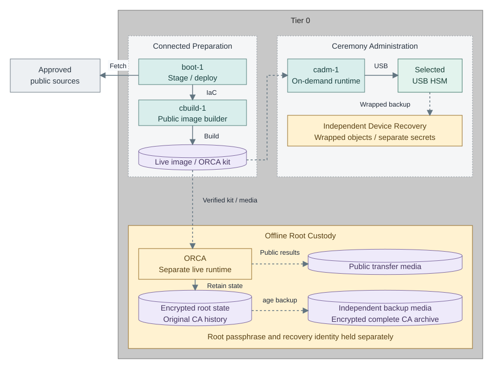
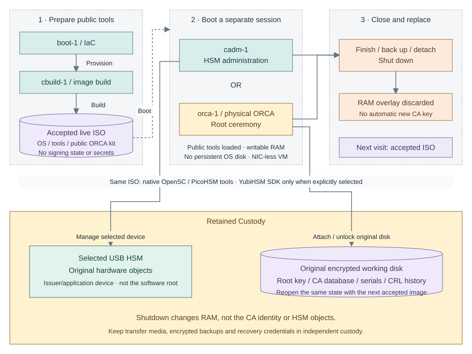
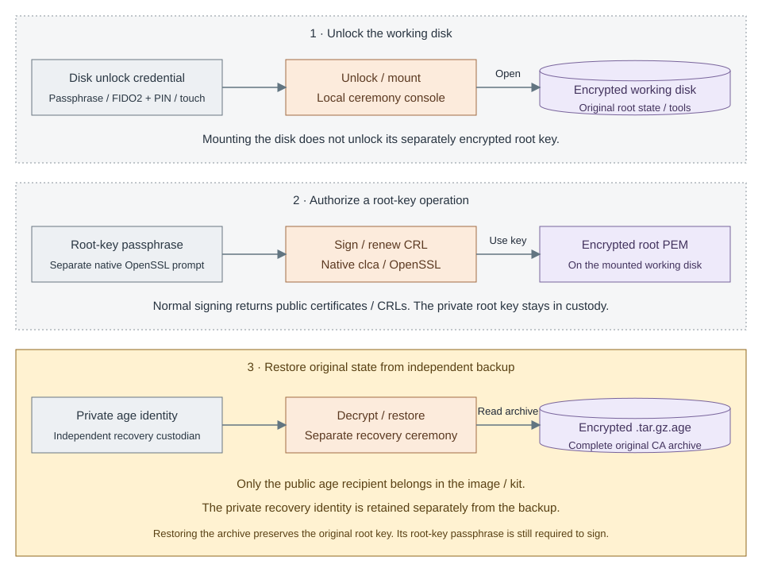

# Prepare an on-demand ceremony environment

Build public ceremony tools while connected, then use a separate local console for HSM
administration or offline root work. Keep those sessions separate from bootstrap and from each other.

<a id="figure-ceremony-environments"></a>



*Figure 1: `boot-1` provisions the connected `cbuild-1` builder. Its public live image supplies an
on-demand `cadm-1` administration session and a separate ORCA session. Dashed links carry approved
tools or controlled media transfers. ORCA's working, transfer and backup media are separate physical
devices. The image contains no signing state or private credentials.*

**IaC:** Tier 0 [builder inputs](../../../../tier-0/terraform/deployments/ceremony-build/terraform.tfvars.example),
[image inputs](../../../../tier-0/ansible/group_vars/ceremony_build.yml.example) and optional
[NIC-less VM inputs](../../../../tier-0/terraform/deployments/ceremony/terraform.tfvars.example).
**Design:** [host responsibilities and local maintenance](../../../01-architecture/08-cryptography/04-usb-hsm.md#ceremony-and-deployment-hosts).

> [!TIP]
> **Maintenance and recovery:** [Reopen the original root, renew its CRL or restore its state](../../../05-operations/03-cryptography/offline-root.md).
> Replacing an image preserves the original CA state and HSM keys; it does not create another root.

**Starting point:** Foundation provides a working bootstrap, an approved **Debian 12 amd64** template
and the selected network/storage inputs. Stage 1 provides approved package/tool supply. No private
custody media is attached to the connected builder. The live image is Debian-based; the controller
can remain Rocky/AlmaLinux.

<a id="understand-the-live-image"></a>

## Understand the live image



*Figure 2 — Workflow: the accepted ISO supplies an operating system and tools. A fresh session uses
retained state, then shuts down; its RAM/writable overlay is discarded. The encrypted working disk,
HSM keys and independent backups remain. [Editable figures and rendering](../../../08-reference/diagrams/trust-render.md).*

| Component | What it does | What survives shutdown |
| --- | --- | --- |
| `boot-1` | Runs IaC and stages approved public inputs | Repository configuration and deployment state; no root unlock credentials |
| `cbuild-1` | Builds a reviewed ISO from the selected public inputs | ISO, package inventory and build records |
| `cadm-1` | Boots the ISO as an HSM administration workbench; attach only the intended HSM/recovery media | Device keys and separately retained recovery material; no persistent guest OS disk |
| `orca-1` or physical root workstation | Boots the ISO, opens the original encrypted root volume and performs a local signing ceremony | Original root key, CA history and counters on that volume; encrypted independent backup |

`cadm-1` is a diskless VM **with a complete live operating system and tools** after boot. It does not
wait for the HSM to become an operating system. The same selected ISO can boot separate administration
and root sessions. OpenSC/PicoHSM tools are included; the YubiHSM SDK is present only if selected at build.
Nothing initializes an HSM or generates a root key just because the VM starts.

Build an image initially and again when accepting tool/OS changes, not for every signature. Reuse the
accepted compatible image between ceremonies. Software is not guaranteed compatible forever: retain
the original public kit and known-good image, and test a new image against a disposable restored CA
before opening production state. The retained clca revision and root policy remain pinned.

For what crosses the offline boundary, see the
[root signing/publication sequence](../../../01-architecture/08-cryptography/01-certificate-authority.md#figure-root-signing-exchange).
The root private key stays in custody; public certificates and signed CRLs are returned for publication.

### Which credentials unlock what?



*Figure 3 — Current custody: unlocking the working disk, using the encrypted root key and restoring
an age-encrypted backup are separate operations. The public backup recipient may be in the image;
the recovery identity and unlock secrets stay with independent custodians.*

| Material | Current use | Keep it |
| --- | --- | --- |
| Disk unlock | Opens the encrypted working disk using its passphrase or selected FIDO2 key + PIN/touch | Token held separately from the disk; recovery passphrase in independent protected custody |
| Root-key passphrase | Authorizes clca/OpenSSL to use the encrypted root private key after the disk is open | Separately protected; enter locally when requested |
| age recovery identity | Decrypts an independent CA-state backup | With the backup custodian, apart from the archive and root working media |

Routine backup encryption needs only the **public** age recipient already in the kit. The private
recovery identity is needed for restoration, not for each signing ceremony.

Use independently accessible protected storage for recovery credentials; the only copy must not
depend on a Vault service or infrastructure that this root may be needed to recover. The ISO,
bootstrap files, Terraform state and timers contain none of these secrets.

A compatible **FIDO2 YubiKey** is the recommended optional disk-unlock path when available.
Follow [enrollment, unlock and recovery](orca-disk-unlock.md) after preparing the LUKS2 volume.
The live-image recipe supplies the native tools; enrollment and PIN/touch remain local custodian
actions. Retain a separate recovery passphrase. Unlocking the disk does not authorize root signing
or move the root key into an HSM. A YubiKey and a YubiHSM 2 have different roles. Rehearse with the
selected hardware and image; an older image may not understand a newer enrollment. [1]

## Contents

- [Understand the live image](#understand-the-live-image)
- [1. Choose the host boundary](#1-choose-the-host-boundary)
- [2. Prepare the public root kit](#2-prepare-the-public-root-kit)
- [3. Initialize the public-image builder](#3-initialize-the-public-image-builder)
- [4. Select build inputs](#4-select-build-inputs)
- [5. Build and retrieve the image](#5-build-and-retrieve-the-image)
- [6. Rehearse and accept the image](#6-rehearse-and-accept-the-image)
- [7. Prepare the selected runtime](#7-prepare-the-selected-runtime)
- [8. Perform the selected ceremony locally](#8-perform-the-selected-ceremony-locally)
- [9. Renew an existing root CRL](#9-renew-an-existing-root-crl)
- [10. Replace tools without replacing identity](#10-replace-tools-without-replacing-identity)
- [11. Secure, schedule and record](#11-secure-schedule-and-record)

## 1. Choose the host boundary

| Path | Use | Continue |
| --- | --- | --- |
| **7a: physical workstation — preferred custody** | Boot the accepted image on separately controlled hardware | Build at actions 2–6, then 7a |
| **7b: optional Proxmox sessions** | Explicitly trust the hypervisor and its administrators; create separate `cadm-1` and `orca-1` sessions | Build at actions 2–6, then 7b |
| **Existing `boot-1` fallback** | Constrained commissioning of the online issuer's HSM; shares deployment-host trust | Follow the selected hardware procedure with access restricted; keep ORCA separate |

The image is common public tooling. **Device administration and root signing use different
sessions and custody media.** A NIC-less VM still trusts its host, storage and console operators.
Three virtual disks backed by one host disk do not satisfy ORCA's independent-media checks.

## 2. Prepare the public root kit

Obtain the backup custodian's public `age1...` recipient first. They generate it on their own trusted
computer using `age-keygen`, independently of this image build; the native tools also support Windows
and macOS. Follow the [recovery-custodian step](offline-root.md#1-prepare-tools-and-independent-recovery)
and [official age tool installation](https://github.com/FiloSottile/age#installation). Only its public
recipient comes to bootstrap; the recovery identity stays with that custodian.

On **`boot-1`**, from **`<prefix>-tier-0/`**:

```bash
bash scripts/offline-root.sh init
```

Edit **`templates/offline-root/orca.conf`** using the
[public input table](offline-root.md#2-initialize-public-configuration): organization, root name,
publication URL, custody-media mount paths and `ORCA_BACKUP_RECIPIENT`. Retain the accepted clca
revision. For a new root leave `ORCA_ROOT_FINGERPRINT` empty; for an existing root retain its original
independently verified fingerprint. No root state is required to build an image.

On **`boot-1`**, from **`<prefix>-tier-0/`**:

```bash
bash scripts/offline-root.sh bundle artifacts/orca-kit
```

**Expected:** a new public kit and its printed manifest SHA256. Independently retain that hash;
the image build requires it. An existing kit destination is preserved. For another accepted kit,
use a new directory and select it in action 4.

This supplies ORCA's preparation actions 2–3 **before** image construction. Root creation happens
only after the accepted image has booted offline and custody media are mounted.

## 3. Initialize the public-image builder

For an **existing refreshed collection**, add `ceremony-build` to Tier 0 `.deployment-setups`
if it is missing. Add `ceremony` too when selecting VM sessions. Keep every existing setup line;
refresh preserves this local selection and its states. Fresh generated repositories already list both.

On **`boot-1`**, from **`<prefix>-tier-0/`**:

```bash
bash scripts/init-local-files.sh --setup ceremony-build
```

**Expected:** missing builder inputs created; existing inputs preserved. No VM or private key is created.

## 4. Select build inputs

Edit in **`<prefix>-tier-0/`**:

| File | Set |
| --- | --- |
| `terraform/deployments/ceremony-build/terraform.tfvars` | `vm_instances["cbuild-1"]`: unused VMID, approved Debian `template_vm_id`, node, disk capacity and accepted `network_zone_key` |
| `ansible/inventory/hosts.yml` | Exactly one `cbuild-1: {}` entry in `ceremony_builders`; no ORCA guest in connected inventory |
| `ansible/group_vars/ceremony_build.yml` | Reserved `platform_host_ips.cbuild-1`, a new `ceremony_build_revision`, the kit path and independently accepted `ceremony_build_orca_kit_sha256` |
| `ansible/group_vars/all.yml` | Accepted package proxy and fixed official Debian sources |
| `.env.local`, `terraform/common.tfvars` | Existing approved provider/SSH inputs and the builder's selected network attachment |

In a preserved inventory, add this group **under the existing `all.children`** if missing;
keep other groups and use the IP selected in `ceremony_build.yml`:

```yaml
ceremony_builders:
  hosts:
    cbuild-1: {}
```

Use a revision such as `20261117-01`, not a reused output name. The example outputs to
`artifacts/ceremony/` on the controller. An accepted existing Debian builder can use an empty
`vm_instances` map and its matching inventory/IP entry; retain the same single-builder contract.

**PicoHSM:** the native OpenSC/PicoHSM tools are selected without adding Yubico packages.
**YubiHSM:** set `ceremony_build_yubihsm_packages` to the complete approved Debian SDK `.deb` set,
including its CLI, connector, PKCS#11 library and required dependencies. Each `src` needs its accepted
`sha256`. An empty list does not install a YubiHSM SDK. Hardware initialization is never an image-build action.

## 5. Build and retrieve the image

On **`boot-1`**, from **`<prefix>-tier-0/`**:

```bash
bash scripts/deploy.sh ceremony-build
```

Review the Terraform plan before approval. **Expected:** the builder is provisioned, Ansible prepares
its native build tools, builds the public image and fetches the resulting ISO/build evidence to the
configured output directory. No manual SSH or guest disk preparation is required.

For another build on the existing builder after reviewing its selected inputs, from the same repo:

```bash
bash scripts/deploy.sh ceremony-build --ansible-only
```

## 6. Rehearse and accept the image

Review the returned ISO hash, kit manifest and installed-package/build evidence. Record the accepted
ISO SHA256 independently before selecting it for a VM or physical boot. Package inventories are
evidence of that build; upstream package repositories are not frozen snapshots.

On **`boot-1`**, in **the configured `artifacts/ceremony/` output directory**, verify the manifest
for the selected revision (example `20261117-01`):

```bash
sha256sum --check --strict ceremony-20261117-01.iso.sha256
```

**Expected:** the ISO, `.packages.txt` and `.build.json` all pass. Compare the ISO hash with the
independent acceptance record; files that agree with their accompanying manifest are not automatically
approved. This live image is not qualified for Secure Boot or TPM attestation.

Boot a rehearsal session **without production HSMs or root media**. Verify the selected device tools,
then rehearse a disposable test root with three separate test devices. Require creation, signing,
CRL renewal, encrypted backup and a restored-copy check before trusting production custody.
Root physical-media checks remain active during this test.

**Expected:** the image supplies the selected public tools. Replacement hardware or images can reopen
original retained state. No test identity becomes the production root or issuer key.

## 7. Prepare the selected runtime

### 7a. Boot separate physical hardware

Boot the accepted ISO through your normal optical/USB image workflow. Keep real custody media
detached until the image and clock are verified, then continue at action 8. Boot device preparation
is a physical operator action; the connected builder never receives the root's media.

### 7b. Provision optional NIC-less VM sessions

First complete [dedicated ceremony API access](../../foundation/proxmox/api-access.md#ceremony-automation-identity).
The provisioner and runtime operator are separate identities. Remove inherited ordinary automation
access to session resources; a narrow extra role does not remove broader inherited grants.

On **`boot-1`**, from **`<prefix>-tier-0/`**:

```bash
bash scripts/init-local-files.sh --setup ceremony
```

Edit **`terraform/deployments/ceremony/terraform.tfvars`**:

| Input | Set |
| --- | --- |
| `ceremony_hypervisor_trust_accepted` | `true` only for this explicitly accepted VM custody model |
| `ceremony_iso_path`, `ceremony_iso_sha256` | Reviewed local ISO and independently recorded hash; the example path is relative to this Terraform root |
| `ceremony_iso_datastore_id`, `ceremony_pool_id` | Dedicated ISO datastore (reference `ceremony-iso`) and pool (`ceremony`) created by API setup |
| `ceremony_sessions` | Unused session IDs, exact nodes and accepted `usb_mappings`; keep administration and root sessions separate |

Use exact mappings for the selected HSM or independent custody devices. Never assign the same device
to both a session and the online issuer/provider. Detach it from its previous owner before changing
attachments. Existing `cadm-1` resources managed elsewhere retain their original owner/state until
explicitly migrated; do not declare the same guest in two roots.

For optional FIDO2 unlock, add the key's exact mapping (for example `orca-unlock`) to **only the
`orca-1` session's `usb_mappings`** before applying. It belongs beside that session's custody-media
mappings, never on `cbuild-1` or the online issuer. Include the same existing mapping ID in
**`ansible/group_vars/ceremony_access.yml`**, `ceremony_access_usb_mappings`, so the dedicated
provisioner receives its exact `Mapping.Use` scope. Enrollment/PINs remain outside Terraform.

With all sessions shut down, open the bounded provisioning window. On **`boot-1`**, from
**`<prefix>-tier-0/`**, using the access configuration prepared by the API guide:

```bash
ANSIBLE_CONFIG=ansible/ansible.cfg ansible-playbook -i ansible/inventory/hosts.yml \
  ansible/playbooks/ceremony-access.yml -e @ansible/group_vars/ceremony_access.yml \
  -e @ansible/group_vars/all.yml -e ceremony_access_action=unlock
```

Answer the private administrator prompt; credentials are not retained by this invocation.
Then provision from **the same repo**, using the dedicated `.env.ceremony-provisioner` file:

```bash
bash scripts/deploy.sh ceremony --env-file .env.ceremony-provisioner --terraform-only
```

Review the whole-state plan and approve only the selected sessions, ISO and intended exact mappings.
Immediately lock provisioning again from **the same repo**, including after a failed apply:

```bash
ANSIBLE_CONFIG=ansible/ansible.cfg ansible-playbook -i ansible/inventory/hosts.yml \
  ansible/playbooks/ceremony-access.yml -e @ansible/group_vars/ceremony_access.yml \
  -e @ansible/group_vars/all.yml -e ceremony_access_action=lock
```

**Expected:** content-checked ISO uploaded; separate stopped sessions created with no NIC, persistent
OS disk, cloud-init or guest agent. The provisioner is disabled before a ceremony. The runtime
operator receives audit/start-stop access only on selected session IDs; it cannot replace their ISO,
alter USB attachment or unlock their custody media. Console access uses the separately accepted
custodian account. Hypervisor administrators remain trusted.

To start the selected existing session using only the runtime token, from **`<prefix>-tier-0/`**
on **`boot-1`**, choose `cadm-1` below for device administration or `orca-1` for the root:

```bash
(
  set -a
  source .env.ceremony-operator
  set +a
  CONTROL_NODE_COLLECTIONS_MODE=check ANSIBLE_CONFIG=ansible/ansible.cfg ansible-playbook -i localhost, \
    ansible/playbooks/ceremony-power.yml -e @ansible/group_vars/ceremony_access.yml \
    -e ceremony_power_session=cadm-1 -e ceremony_power_action=start
)
```

**Expected:** only a start request, with no guest login or root operation. Replace `start` with
`status` to inspect the same session. Continue through its separately authorized console at action 8.

## 8. Perform the selected ceremony locally

Use **the selected physical console or VM console**, never an SSH session from bootstrap.
The live user is `ceremony`; use its local administrator shell for custody-media and device work.
The bundled public root kit is **`/opt/orca-kit/`**. From **that directory on the local console**:

```bash
sha256sum manifest.sha256
sha256sum --check --strict manifest.sha256
date -u
ip -br link
```

Compare the manifest hash with the independent kit record and verify the clock. Root operations
require only loopback up and no default route; the local helper enforces this before mutation.

| Session | Continue with | Keep separate |
| --- | --- | --- |
| `cadm-1` / physical administration | [PicoHSM commissioning](picohsm.md) or [YubiHSM commissioning and recovery policy](../step-1d-single-usb.md#yubihsm-first-key-recovery-choices) | Administrative PINs and wrapped-key recovery material stay outside bootstrap/issuer backups |
| ORCA first visit | [Offline root action 4](offline-root.md#4-mount-custody-media-and-disconnect), then `prepare` and one-time `create` | Three physically independent root working, transfer and backup devices; independent passphrase/recovery custody |
| Existing ORCA | [Reopen the original root](../../../05-operations/03-cryptography/offline-root.md); never run `create` | Original root fingerprint, policy, CA database, serial and CRL history |

Once HSM commissioning finishes, detach the device and independent recovery media before shutting
down administration. Only the commissioned online device subsequently attaches to its issuer/provider.
An offline root's device, if separately qualified, never joins that online provider pool.

Record a new root's printed fingerprint in the **retained public kit configuration**, as the root
guide directs. A live image's writable overlay disappears at shutdown: preserve the accepted public
configuration and original kit externally for the next visit. Public configuration is not a secret
backup of signing state.

After recording that fingerprint, from **`/opt/orca-kit/` on the local console**, copy the public
configuration to the mounted transfer media (default path below; use its configured mount if different):

```bash
cp templates/offline-root/orca.conf /mnt/orca-transfer/orca.conf
sha256sum /mnt/orca-transfer/orca.conf
```

Retain its hash independently. Before a later visit's root commands, verify that retained file and
copy it back to **`/opt/orca-kit/templates/offline-root/orca.conf`** as the local administrator.
This replaces public inputs in the temporary overlay; root state remains on encrypted working media.

## 9. Renew an existing root CRL

Manually boot the accepted root environment, verify its clock/kit and unlock/mount the retained
custody media through [root operations](../../../05-operations/03-cryptography/offline-root.md).
From **the verified kit root on the local ORCA console**:

```bash
bash scripts/offline-root.sh maintain
```

Enter the retained root passphrase when native OpenSSL requests it. **Expected:** original identity
checked, a new current CRL, encrypted complete backup and public `ceremony-receipt.txt`. Failure leaves
the runtime available for diagnosis and never requests shutdown.

For shutdown after successful maintenance, run instead from **the same kit root**, as the local
ceremony administrator on a systemd runtime:

```bash
sudo bash scripts/offline-root.sh maintain --poweroff
```

The helper never starts a VM, unlocks media, downloads updates or publishes the CRL. Return public
outputs to the connected publication path afterward. Retain the receipt and verify publication
before recording completion.

The scheduled **public CRL check** belongs to
[root operations](../../../05-operations/03-cryptography/offline-root.md). It validates the signature,
alarms on a missed renewal/deadline and has an independent dead-man alarm for missed checker runs.
Schedule custodians within 60 days for the reference 90-day CRL; do not store root-unlock credentials
on bootstrap to turn that reminder into unattended signing.

## 10. Replace tools without replacing identity

Build a new public-image revision on the connected builder **before** attaching private media.
Repeat acceptance/rehearsal, shut down sessions and review the intended ISO-only changes before
re-enabling the dedicated provisioner. Disable it again before reopening custody.

Retain the original root kit, policy and encrypted state. An OS/image update does not authorize a
different root key, vendor recovery domain or native clca revision. A change to pinned root tooling
needs its separate accepted migration; do not bypass the retained instance checks.

## 11. Secure, schedule and record

1. Verify the dedicated provisioner is locked and ordinary automation is excluded from the selected
   sessions, dedicated ISO store and accepted USB mappings. Retain the API guide's effective-permission
   evidence; expire/rotate the separate runtime token through its owning access procedure.
2. Detach custody devices and recovery media after each session. Keep independent backups and their
   recovery credentials apart; preserve the original state and the externally retained public configuration.
3. Before accepting any scheduled VM activation, install the
   [public CRL watcher and alarms](../../../05-operations/03-cryptography/offline-root.md).
   Test the renewal warning, overdue/expiry failure and **missed-ping alarm** with primary and backup
   custodians. The checker must not depend on a running ORCA. Scheduled power-on remains preparation
   for a locally authorized ceremony; it is not evidence of renewal or publication.
   Configure the [optional single-window wake timer](../../foundation/proxmox/api-access.md#5-optionally-schedule-one-approved-activation-window)
   only after its dedicated power client and alarm delivery have been verified.
4. Record accepted image/kit hashes, the root/device public identities, media custodians, the next
   ceremony deadline and tested recovery/alert evidence. Keep all PINs, recovery identities and root
   state outside public project records and image outputs.

**Return:** [Trust action 1](../README.md#step-1-prepare-issuer-and-key-custody) after first root/device
preparation, or the calling HSM commissioning/maintenance action. No ceremony session stays running
as a dependency of normal issuer, Vault or application signing.

## References

1. [systemd 252: LUKS2 token enrollment, recovery and compatibility](https://www.freedesktop.org/software/systemd/man/252/systemd-cryptenroll.html).
