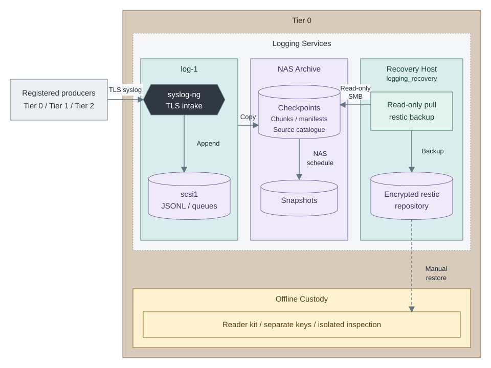
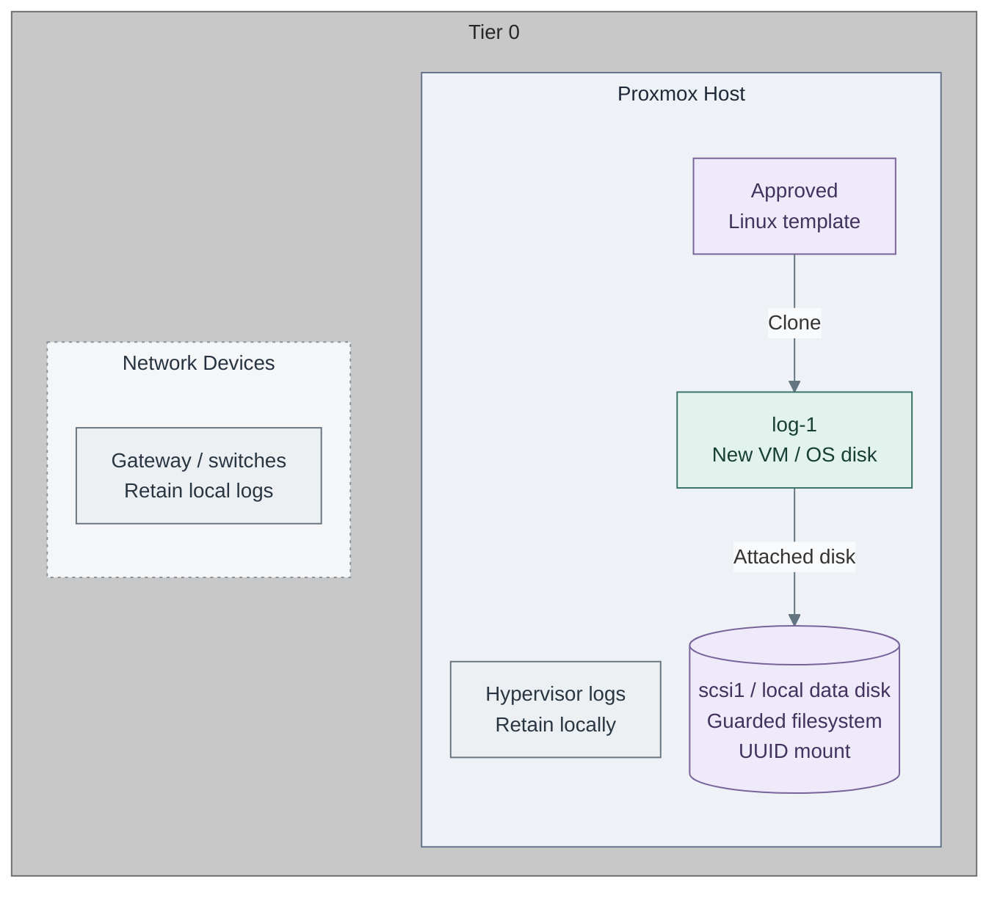
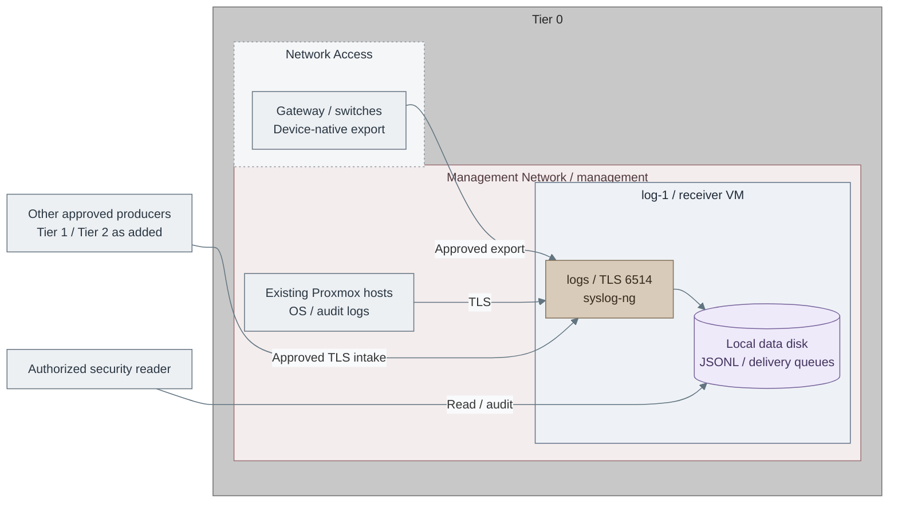
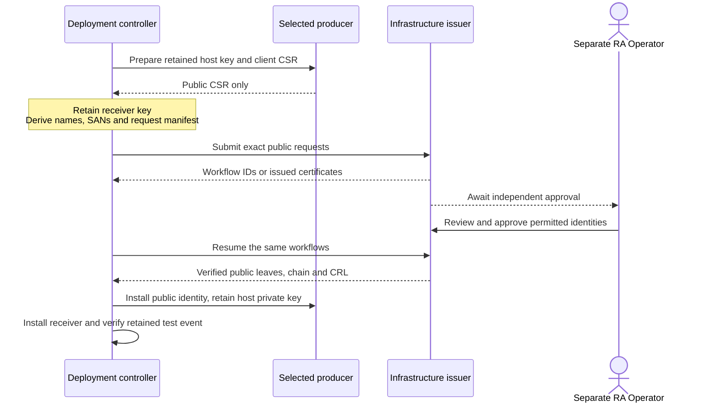

# Stage 3: Protected logging

Deploy an authenticated network receiver, collect selected Linux logs and protect retained records.
Complete the actions below; the normal path requires no guest SSH session or manual certificate handoff.

<a id="figure-1-nas-retention-and-independent-recovery"></a>



**IaC / Integration:** *Figure 1: Selected producers send authenticated records to the receiver.
NAS checkpoints and independent backups are the retention choice in Step 7; they are separate from local intake.*
[Figure source](../../08-reference/diagrams/protected-logging-render.md).

**Working repository:** `<prefix>-tier-0` on the bootstrap/controller.
**Before starting:** completed [foundation](../foundation/README.md), accepted
[Stage 2 trust](../stage-02-trust/README.md), independently authenticated inventory SSH and approved
EL10 syslog-ng 4.11+ packages. [1] Keep persistent local host logs during PKI bootstrap;
network logging starts after certificate issuance. Kubernetes and Vault are not prerequisites.
An accepted existing issuer can replace Stage 2 through the [authority choices](procedures/producer-trust.md).

**Automation:** the syslog run owns storage, request derivation, enrollment/resume, receiver and producer
installation and retained-event checks. CA approval, external DNS and selected NAS/backup custody remain
explicit interfaces; [coverage and live acceptance](../../08-reference/implementation-support.md#stage-coverage).

[Design](../../01-architecture/11-operations/01-protected-logging.md) |
[Operations](../../05-operations/06-resilience/protected-logging.md).


> [!TIP]
> **Recovery and maintenance:**
> [Reapply receiver configuration](../../05-operations/06-resilience/protected-logging.md#how-is-receiver-configuration-reapplied)
> or [restore a failed logging VM](../../05-operations/06-resilience/recovery/virtual-machines.md). Retain the original
> archive and key identities when recovering data.

<a id="installation-order"></a>

## Follow the deployment

1. [Initialize inputs](#step-1-initialize-inputs).
2. [Configure the VM, storage and DNS](#step-2-configure-the-vm-storage-and-dns).
3. [Select producers in one file](#step-3-select-producers).
4. [Deploy and approve certificates](#step-4-deploy-and-approve-certificates).
5. [Verify collection](#step-5-verify-collection).
6. [Select receiver topology](#step-6-select-receiver-topology).
7. [Protect retained records](#step-7-protect-retained-records).
8. [Record recovery and completion](#step-8-record-recovery-and-completion).
9. [Secure the logging deployment](#step-9-secure-the-logging-deployment).


<a id="1-provision-the-bootstrap-receiver"></a>
<a id="step-1-provision-the-log-host"></a>
<a id="step-1-initialize-local-inputs"></a>

## Step 1: Initialize inputs

Run in **`<prefix>-tier-0/`**:

```bash
bash scripts/init-local-files.sh --setup syslog
```

Creates missing local syslog VM inputs and `ansible/group_vars/logging_producers.yml`.
Existing configuration and state are preserved. No `host_vars` file is required.


<a id="step-2-configure-the-vm-disk-and-package-access"></a>

## Step 2: Configure the VM, storage and DNS

<a id="figure-2-log-host-and-local-storage"></a>



**IaC:** *Figure 2: Terraform attaches the data disk; Ansible validates, formats only an accepted blank disk
and persists its UUID mount. The OS disk remains separate.*

Edit these files in **Tier 0**, preserving existing entries:

| File | Edit |
| --- | --- |
| `.env.local` | Proxmox endpoint/token and approved SSH public keys |
| `terraform/common.tfvars` | Actual `network_zones.management` attachment or applied SDN lookup |
| `terraform/deployments/syslog/terraform.tfvars` | Receiver VMID, placement, size and `scsi1` data-disk capacity |
| `ansible/inventory/hosts.yml` | Keep `log-1: {}` under `foundation_logging.hosts`; preserve inherited connection settings |
| `ansible/group_vars/all.yml` | Login, standalone `platform_internal_domain` and accepted package proxy/mirror |
| `ansible/group_vars/syslog.yml` | Receiver `platform_host_ips`, stable data device and approved package sources |

In **Shared**, confirm `config/platform.tfvars` selects the destination node/VM-image storage and
`templates/proxmox-catalog.tfvars` selects the approved Linux template.
For Rocky behind the restricted cache, uncomment the supplied fixed `repository_proxy_dnf_sources`
in **`syslog.yml`**; baseline applies them before installing packages.

In the site's DNS configuration, create:

| Record | Example | Target |
| --- | --- | --- |
| Machine A/AAAA | `log-1.internal.example.com` | Receiver IP from `platform_host_ips` |
| Service CNAME | `logs.internal.example.com` | `log-1.internal.example.com` |

`logs` is the stable service identity; machine names can change independently. Use the configured
internal suffix. Creating a service DNS record does not join a host to a directory.

Leave `syslog_ng_data_uuid` empty for a new blank disk. The mount becomes persistent automatically.
For an optional identity guard, save the printed UUID under `logging_workflow_receiver_options`
for that receiver; [storage adoption](procedures/receiver.md#2-prepare-the-persistent-mount) covers restored disks.

Select an EL10 receiver template here even when Shared also holds the Debian issuer template.
For a new approved RPM source, use the supplied `baseline_rpm_repositories` fields in `syslog.yml`
with its real base URL, key URL and independently verified fingerprint. Baseline installs that repository
before receiver packages. Admit its actual source/redirect hosts in Stage 1's cache policy before this run;
a stock EPEL source alone does not establish the required syslog-ng version.


<a id="2-integrate-protected-intake-and-storage"></a>
<a id="step-2-enable-protected-collection"></a>
<a id="step-2b-connect-the-first-producers"></a>
<a id="step-5-configure-the-first-producer"></a>
<a id="step-13-connect-the-existing-hosts-and-devices"></a>

## Step 3: Select producers

Edit **Tier 0 `ansible/group_vars/logging_producers.yml`**. The receiver URL is common;
each selected host gets its own security journal stream and certificate:

```yaml
log_forwarder_peer: "logs.{{ platform_internal_domain | default(platform_domain) }}"
log_forwarder_target: "{{ log_forwarder_peer }}"
logging_producer_hosts:
  log-1: {setup: syslog}
  ca-1: {setup: foundation}
  pve01: {}
```

Each key must already exist in `ansible/inventory/hosts.yml`. `setup` reuses the existing
`platform_host_ips` map in that setup's group-vars file; `{}` keeps the inventory connection.
Remove hosts that are not ready. No duplicate IP, login or per-host YAML file is needed.
An explicit `streams` list adds [file/application streams](procedures/sources.md).

The catalog above selects OS journals. Add the actual CA audit files through that source guide after
checking the installed OpenXPKI `log.conf`; retain both its OS and CA audit streams in the explicit list.
Selecting `ca-1: {setup: foundation}` alone supplies its journal stream.

**External heartbeat monitoring is optional.** A separate monitoring service supplies a unique HTTPS
check-in URL for each host and alerts when check-ins stop. Add its `watchdog_url` only when that
service exists. With no URL, local service/queue/certificate checks still run; there is no independent
missed-heartbeat alert. Multiple hosts must not share one URL because one host could conceal another's failure.


<a id="step-2a-install-the-receiver"></a>
<a id="step-3-provision-the-vm-and-attached-disk"></a>
<a id="step-4-prepare-and-verify-storage"></a>
<a id="step-6-prepare-the-receiver-key-and-request"></a>
<a id="step-7-prepare-the-first-producer-request"></a>
<a id="step-8-review-the-public-requests"></a>
<a id="step-9-sign-the-approved-identities"></a>
<a id="9a-first-installation-initialize-and-sign"></a>
<a id="9b-existing-authority-sign-without-initialization"></a>
<a id="step-10-register-the-source-and-tls-inputs"></a>
<a id="step-11-install-the-receiver"></a>

## Step 4: Deploy and approve certificates

<a id="figure-3-authenticated-source-collection"></a>



**IaC:** *Figure 3: Certificate identity and observed source address bind each stream to a receiver-owned namespace.
The run prepares keys, submits requests, installs approved TLS material and tests ingestion.*

<a id="figure-4-logging-enrollment"></a>



**IaC / Approval:** *Figure 4: The deployment owns preparation, request submission and installation.
The separate RA Operator owns certificate approval; retries resume the printed requests.*
[Enrollment implementation](../../../tier-0/ansible/roles/logging_pki/tasks/main.yml).

Run in **`<prefix>-tier-0/`**:

```bash
bash scripts/deploy.sh syslog
```

Terraform displays the plan and asks for `yes`. Ansible configures package access, attached storage,
host-local producer keys, receiver keys and public requests. It reuses the active issuer's
**`issuer.yml`** settings and **`foundation.yml`** address; no copied fingerprints or directory prompts.

If enrollment reports **pending approval**, open the configured OpenXPKI portal
(`openxpki_portal_fqdn` in **`issuer.yml`**) as a **separate RA Operator**. Find the printed workflow IDs,
review the requested CN/profile/SAN and approve them. Then rerun the same command; it resumes those
requests and retains the keys. This is the CA approval decision, not a second setup procedure.

After issuance, the same run installs the receiver, producer forwarding, bounded queues and health timers.
For a pipeline, add `--auto-approve` to approve Terraform non-interactively; CA policy still applies.
`--plan-only` is an optional Terraform preview.

Private controller state is under **`~/.local/share/<actual-tier-0-repository-name>/logging/prod/`**.
The run creates receiver key directories and prints the public request manifest/output location.
Producer private keys stay on their hosts; no directories need to be created manually.
[Other authority modes and secret custody](procedures/producer-trust.md) are explicit alternatives.


<a id="step-12-install-forwarding-and-verify-the-first-event"></a>

## Step 5: Verify collection

The deployment already runs acceptance. To repeat it after a change, run in **`<prefix>-tier-0/`**:

```bash
bash scripts/deploy.sh syslog --ansible-only --playbook deployment/logging-verify.yml
```

**Expected:** each selected journal source produces a unique event retained with its certificate CN,
source address and server-owned stream name. File streams receive a TLS ingestion check; use a real
application event to qualify their file capture. No directory or file questions are asked.
External heartbeat coverage is reported separately. A port-open check alone is not acceptance.


<a id="step-14-select-the-receiver-topology"></a>

## Step 6: Select receiver topology

| Choice | Action | Continue |
| --- | --- | --- |
| **6a: one receiver** | Keep the commissioned receiver; record its host failure window | Step 7 |
| **6b: another receiver** | [Add independent intake](step-6b-redundant-intake.md) and qualify routing | Step 7 |

A second receiver installs neither a shared VIP nor sender failover or replicated archive commitment.
Keep `logs` pointing to the commissioned receiver until the routing integration is accepted.


<a id="step-15-protect-retained-records"></a>

## Step 7: Protect retained records

Select the custody boundary in [Figure 1](#figure-1-nas-retention-and-independent-recovery).

| Choice | Action | Continue |
| --- | --- | --- |
| **7a: NAS, main** | [NAS checkpoints and independent encrypted backups](step-7a-nas-archive.md) | Step 8 |
| **7b: locked retention** | [Qualified retention-lock integration](step-7b-retention-lock.md) | Step 8 |

`deploy.sh syslog` installs local intake. Complete the selected retention recipe separately.
Include the attached data disk in the [backup policy](../../05-operations/06-resilience/backups/virtual-machines.md#backup-policy).
Retain bounded-queue, uncheckpointed-tail and duplicate/loss limits in the recovery record.


<a id="3-accept-the-security-logging-contract"></a>
<a id="step-3-protect-and-verify-retained-evidence"></a>
<a id="step-16-verify-recovery-and-record-completion"></a>

## Step 8: Record recovery and completion

Run the [fault/restore drill](../../05-operations/06-resilience/logging-drill.md).
Back up receiver data, keys and public request/issuance receipts under the protected controller workspace.
For an independent logging CA, retain its encrypted credentials and the **separate unlock file**;
[the authority guide](procedures/producer-trust.md#secret-custody-and-vault-migration) lists both locations.
Keep early local logs until their forwarding and retained copies are verified.

Update the architecture repository's [deployment checklist](../readiness.md)
and record source coverage, retention/access policy, monitoring gaps and measured recovery limits.
Complete Step 9 before continuing to Stage 4.

## Step 9: Secure the logging deployment

Complete the [common hardening checkpoint](../../05-operations/01-hosting/guest-hardening.md) for
receivers and selected archive/investigation hosts. Verify peer-name enforcement, producer-scoped
access, retention protections and independent certificate/queue/data recovery. Keep pinned data-volume
UUIDs and receipt custody in the operating record. Apply selected boot protection through its qualified
OS/image procedure, then repeat the logging drill after any reboot or storage change.
Record acceptance and continue to [Stage 4: Kubernetes](../stage-04-kubernetes/README.md).

## Maintain and extend

- [Receiver storage and direct certificate inputs](procedures/receiver.md).
- [Authority choices, enrollment and secret recovery](procedures/producer-trust.md).
- [Producer catalogs, file streams and other owning tiers](procedures/sources.md).
- [Operating and investigating retained logs](../../05-operations/06-resilience/protected-logging.md).


## References

1. [syslog-ng first-read TLS peer metadata fix](https://github.com/syslog-ng/syslog-ng/pull/5603),
   checked 2026-11-13. Qualify the selected signed EL package source against the receiver contract.
2. [RFC 2181 §10.1: a CNAME alias has one canonical target](https://www.rfc-editor.org/rfc/rfc2181.html#section-10.1),
   checked 2026-11-15.
