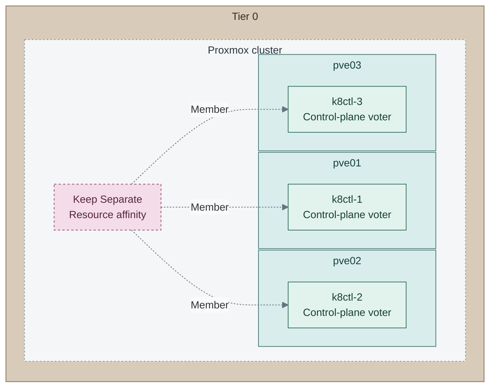

# Step 9b: Keep the Kubernetes control-plane VMs separate

Create **three HA resources and one resource-affinity rule** for the existing Tier 0 control-plane
VMs. The rule keeps the voters on different physical hosts after later Proxmox moves.
Proxmox VE 9 uses **Resources** and **Affinity Rules** for this setup; no legacy HA group is needed.

<a id="figure-control-plane-separation"></a>



**IaC:** *Figure 1: Each control-plane voter occupies a different physical host. The separation rule
preserves distinct hosts; dashed links identify rule membership. The rule does not pin a VM
permanently to the particular host drawn here.*
[Node inputs](../../../tier-0/terraform/deployments/kubernetes/terraform.tfvars.example) supply the
names and initial placement; the [HA playbook](../../../tier-0/ansible/playbooks/proxmox-ha.yml)
maintains the selected rule through the Proxmox API.

**Branch from:** [Step 9](README.md#step-9-apply-the-reviewed-cluster-plan), after node creation finishes.
**Change:** Enroll the selected existing VMs and maintain their physical-host separation.
**Return:** [Step 10](README.md#step-10-export-and-retain-the-client-files).
**Working repository:** `<prefix>-tier-0/` on the approved execution host.
**Prerequisites:** qualified Proxmox cluster, fencing, accessible disks/networks on eligible hosts,
and the [dedicated HA API identity](../foundation/proxmox/api-access.md#ha-automation-identity).

## Contents

- [1. Match the VMs](#1-match-the-existing-vms)
- [2. Initialize inputs](#2-initialize-the-ha-input-file)
- [3. Add resources and their rule](#3-add-the-three-resources-and-their-separation-rule)
- [4. Apply](#4-apply-the-policy)
- [5. Check the GUI fields](#5-check-the-exact-proxmox-fields)
- [6. Optionally restrict hosts](#6-optional-restrict-the-eligible-physical-hosts)
- [7. Verify and continue](#7-confirm-separation-and-continue)

## 1. Match the existing VMs

Read **Tier 0 `terraform/deployments/kubernetes/terraform.tfvars`**, then find those same VMs in Proxmox.
Use the actual names/VMIDs when the deployment differs from the starter. This operation creates no node VM.

| Starter VM | Starter VMID | Initial `node_name` | HA resource ID |
| --- | --- | --- | --- |
| `k8ctl-1` | `101` | `pve01` | `vm:101` |
| `k8ctl-2` | `102` | `pve02` | `vm:102` |
| `k8ctl-3` | `103` | `pve03` | `vm:103` |

## 2. Initialize the HA input file

Run from **`<prefix>-tier-0/`**.

```bash
bash scripts/init-local-files.sh --setup proxmox-ha
```

## 3. Add the three resources and their separation rule

Edit **Tier 0 `ansible/group_vars/proxmox_ha.yml`**. Merge these entries into its existing
`proxmox_ha_resources` and `proxmox_ha_rules` maps for [Figure 1](#figure-control-plane-separation);
retain any other selected services.

```yaml
proxmox_ha_resources:
  k8ctl-1: {hastate: started, max_restart: 1, max_relocate: 1}
  k8ctl-2: {hastate: started, max_restart: 1, max_relocate: 1}
  k8ctl-3: {hastate: started, max_restart: 1, max_relocate: 1}

proxmox_ha_rules:
  tier0-control-plane-separate:
    type: resource-affinity
    affinity: negative
    resources: [k8ctl-1, k8ctl-2, k8ctl-3]
    disable: false
    comment: Keep Tier 0 control-plane voters on separate hosts
```

| Input | What to enter |
| --- | --- |
| Keys under `proxmox_ha_resources` | Exact existing Proxmox VM names; optional `vmid` disambiguates duplicate names |
| `hastate` | `started`: keep the selected VM running and recover it after qualified host failure |
| `max_restart`, `max_relocate` | `1`, `1`: the initial retry policy |
| `tier0-control-plane-separate` | Unique rule ID owned by this cluster's policy |
| `type`, `affinity` | `resource-affinity`, `negative`: keep the selected VMs on different hosts |
| `resources` | The three keys from the resource map above |
| `disable` | `false`: enable the rule |

The playbook resolves the names to actual VMIDs. For example, `k8ctl-1` can instead contain
`vmid: 101` alongside its policy fields when that is its actual VMID.
The [input schema](../../../tier-0/ansible/group_vars/proxmox_ha.yml.example) owns optional fields.

## 4. Apply the policy

Run from **`<prefix>-tier-0/`**. Enter the **dedicated HA token**, using the previously verified API root.
These credentials remain inside this subshell. Existing system trust or `PROXMOX_CA_FILE` must validate the API.

```bash
(
  read -r -p 'Verified Proxmox API root: ' PROXMOX_API_URL
  read -r -p 'HA token ID (example ha-automation@pve!manage): ' PROXMOX_API_TOKEN_ID
  read -r -s -p 'HA token secret: ' PROXMOX_API_TOKEN_SECRET
  printf '\n'
  export PROXMOX_API_URL PROXMOX_API_TOKEN_ID PROXMOX_API_TOKEN_SECRET
  unset PROXMOX_VE_ENDPOINT PROXMOX_VE_API_TOKEN
  ANSIBLE_CONFIG=ansible/ansible.cfg ansible-playbook -i ansible/inventory/hosts.yml \
    ansible/playbooks/proxmox-ha.yml -e @ansible/group_vars/proxmox_ha.yml
)
```

**Expected:** three selected HA resources and one enabled separation rule. Applying a rule can move
existing guests. Optional `--check` validates inputs and identities without predicting placement.
CI supplies the same protected environment inputs and runs the `ansible-playbook` command directly.

## 5. Check the exact Proxmox fields

Open **Datacenter > HA > Resources**. Select each of the three resources and choose **Edit**. [1]

| Resource field | Expected value for each voter |
| --- | --- |
| VM | Its actual VMID from action 1 |
| Max. Restart | `1` |
| Max. Relocate | `1` |
| Request State | `started` |
| Comment | Blank initially, or the service owner/recovery reference |

For new resources, start with **Failback** and **Auto-Rebalance** checked, their Proxmox defaults.
The current collection leaves these GUI-only controls unchanged; the playbook does not set or reset them.
Use the [scheduling procedure](../../05-operations/01-hosting/proxmox-ha.md#scheduling) to change that policy. [1]

Open **Datacenter > HA > Affinity Rules > HA Resource Affinity Rules**. Edit the rule
`tier0-control-plane-separate`; the **ID** column may need enabling in the table's column menu. [2]

| Rule field | Expected value |
| --- | --- |
| Enable | Checked |
| HA Resources | The three control-plane VMs only; starter IDs `101`, `102`, `103` |
| Affinity | **Keep Separate (negative)** |
| Comment | `Keep Tier 0 control-plane voters on separate hosts` |

The GUI's **Add: HA Resource Affinity** dialog uses those same four fields when creating a rule
manually. It generates its own rule ID; an IaC-created rule uses the YAML key. Inspect the existing
rule after the playbook rather than creating a second rule for the same selection. [2]

## 6. Optional: restrict the eligible physical hosts

The separation rule can use any qualified host in this Proxmox cluster. Add a **node-affinity** rule
only when a real device, storage or security requirement limits that host set.

In **the same Tier 0 file**, append this entry **inside `proxmox_ha_rules`**:

```yaml
  tier0-control-plane-hosts:
    type: node-affinity
    resources: [k8ctl-1, k8ctl-2, k8ctl-3]
    nodes: [pve01:1, pve02:1, pve03:1]
    strict: true
    disable: false
    comment: Eligible hosts for Tier 0 control planes
```

Use the actual qualified hosts. Include `pve04:1` too if a fourth host must be eligible for recovery.
Rerun action 4. Inspect **HA Node Affinity Rules > Edit** with these values: [3]

| Node-rule field | Expected value |
| --- | --- |
| Enable | Checked |
| HA Resources | The same three control-plane VMs |
| Affinity | **Prefer Nodes (positive)** |
| Strict | Checked: only the listed hosts are eligible |
| Nodes | Select `pve01`, `pve02`, `pve03`, plus any accepted fourth host |
| Priority | `1` for every selected host |
| Comment | `Eligible hosts for Tier 0 control planes` |

## 7. Confirm separation and continue

In Proxmox, require the three VMs on different physical hosts and an enabled, conflict-free rule.
With three eligible hosts, losing one can leave **two voters running and one waiting** under hard
separation. Recovering all three without relaxing the rule needs a fourth eligible host and capacity. [4]

Retain the application/quorum and [failure qualification](../foundation/proxmox/failover.md#verify-the-result)
checks. Pod spread inside Kubernetes is a separate policy.
Continue at **[Step 10](README.md#step-10-export-and-retain-the-client-files)**.

## References

1. [Proxmox HA resource dialog](https://github.com/proxmox/pve-manager/blob/master/www/manager6/ha/ResourceEdit.js).
2. [Proxmox common rule fields and generated IDs](https://github.com/proxmox/pve-manager/blob/master/www/manager6/ha/RuleEdit.js), [resource-affinity selector](https://github.com/proxmox/pve-manager/blob/master/www/manager6/ha/rules/ResourceAffinityRuleEdit.js).
3. [Proxmox node-affinity dialog](https://github.com/proxmox/pve-manager/blob/master/www/manager6/ha/rules/NodeAffinityRuleEdit.js).
4. [Proxmox resource-affinity enforcement](https://github.com/proxmox/pve-ha-manager/blob/master/src/PVE/HA/Rules/ResourceAffinity.pm).
