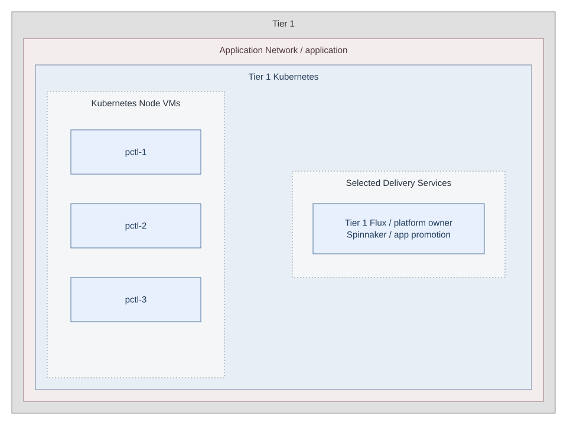

# Stage 7: Delivery

**Related:** [Architecture](../../01-architecture/10-delivery/README.md) · [Operations](../../05-operations/05-delivery.md)

Establish independent Tier 1 Flux ownership and Spinnaker application promotion. Terraform/Ansible
retain cluster lifecycle; Ansible bootstraps minimum networking and Flux, then Flux owns selected
Kubernetes platform services. Stage 8 Observability and Stage 9 GitLab/runners remain later selections.

<a id="figure-platform-runtime"></a>

## Expected outcome: delivery runtime



**IaC:** *Figure: Three starter node VMs provide Tier 1 Kubernetes. Independent Flux owns selected
platform services, including Spinnaker; Spinnaker promotes application Git. This logical grouping
does not assign pods to individual VMs or establish high availability.*
[Ownership and source mapping](../../01-architecture/10-delivery/flux-ownership.md),
[editable SVG/render record](../../08-reference/diagrams/tier1-flux-ownership-render.md),
[Tier 1 node inputs](../../../tier-1/terraform/deployments/kubernetes/terraform.tfvars.example),
[shared bootstrap](../../../shared/ansible/roles/cluster_platform) and
[native delivery renderer](../../../tier-1/ansible/roles/delivery_platform).

The [bootstrap/maintenance/promotion/recovery flow](../../01-architecture/10-delivery/flux-ownership.md#figure-tier1-flux-ownership)
shows the separate sources and actual tier boundaries. Stage 8/9 services are explicit later selections.

**Prerequisites:** accepted Tier 0 access, Kubernetes, Identity and Secrets; independent approved Git,
charts/images, private DNS/TLS, decryption custody and qualified storage. Stage 7 precedes Stage 9
GitLab and cannot require the new GitLab, Harbor, Spinnaker or ordinary runners to restore themselves.
**Working repository:** `<prefix>-tier-1/`; optional private edge remains Tier 2.
**Design:** [D-041](../../07-decisions/README.md#d-041) and [Flux ownership](../../01-architecture/10-delivery/flux-ownership.md).
**Evidence:** code/rendering and live qualification are separate; use the
[support map](../../08-reference/implementation-support.md#tier-1-flux-evidence).

<a id="main-path"></a>

## Deployment actions

| Action | Selected path | Next |
| --- | --- | --- |
| 1a / 1b | Create the Tier 1 runtime, or inventory/adopt an existing one | 2 |
| 2 | Configure Spinnaker for Flux orchestration; alternatives are explicit | 3 |
| 3 | Retain private credentials and export SOPS Secrets | 4 |
| 4-6 | Render, review/publish, then reconcile the exact approved platform revision | 7 |
| 7 | Accept authorization, promotion, drift and independent recovery | 8 |
| 8a / 8b | Flux-managed Harbor, or an existing approved registry | 9-11 / 11 |
| 12 | Optional acceleration/private Tier 2 edge | 13 |
| 13 | Record acceptance; select Stage 8 when required | Stage 8 |

## Contents

- [1. Runtime](#step-1-create-the-platform-runtime)
- [2. Controller responsibilities](#step-2-select-and-qualify-delivery)
- [3. Secrets](#3-choose-the-secret-owner)
- [4–6. Render and reconcile](#4-render-the-controller)
- [7. Acceptance](#7-accept-controller-authorization-and-recovery)
- [8–11. Artifact supply](#8-select-and-configure-artifact-supply)
- [12–13. Options and handoff](#12-complete-selected-distribution-and-edge-options)

<a id="step-1-deploy-shared-delivery-services"></a>
<a id="step-1-create-or-accept-the-tier-1-runtime"></a>
<a id="step-1-create-the-platform-runtime"></a>
<a id="1-create-or-accept-the-tier-1-runtime"></a>

## Step 1: Create or accept the Tier 1 runtime

For **1a**, complete [platform-cluster lifecycle](procedures/platform-cluster.md) using Tier 1's
inventory, original state and credentials. Set `cluster_platform_tier: 1` and
`cluster_platform_management: flux`. Accept Cilium, independent source access and initial Flux,
then Flux ownership of Cilium/Flux, storage, certificates, ingress and database controllers.

For **1b**, preserve the original cluster and complete [explicit adoption](procedures/flux-adoption.md).
Do not rerun fresh bootstrap or recreate storage. Require the same readiness gates, private
Tier 1-only context and enough worker capacity. Node provisioning alone installs no application.

<a id="step-2-select-and-qualify-delivery"></a>
<a id="step-2-create-and-configure-the-selected-controller"></a>
<a id="2-create-and-configure-the-selected-controller"></a>

## Step 2: Configure the selected controller responsibilities

Create the local input copy **from `<prefix>-tier-1/`**:

```bash
cp -n ansible/group_vars/delivery_platform.yml.example ansible/group_vars/delivery_platform.yml
```

The selected **2b** path uses [Spinnaker native inputs](step-2b-spinnaker.md) with
`delivery_platform_owner: flux` and `delivery_platform_spinnaker_delivery_mode: flux`.
Keep `delivery_platform_install_harbor: false` for this controller export. Fill exact Tier 1 context,
private TLS/OIDC, independent backup, stable credentials, lifecycle and Job revision.

[Flux platform installation](procedures/flux-platform.md) owns the complete selected sequence.
Follow it through service export and reconciliation, then rejoin at Step 7 below.

**Alternatives:** **2a** [Argo CD](step-2a-argocd.md) and explicitly selected **direct** Spinnaker
deployment retain the [native installation procedure](procedures/delivery-installer.md).
Legacy role defaults remain Ansible. Record a separate approved scope and one writer per object;
refresh never migrates an existing installation or enables alternative controllers over Flux objects.
Tier 2 destinations require separate approved integration.

<a id="step-3-choose-the-secret-owner"></a>
<a id="3-choose-the-secret-owner"></a>

## Step 3: Retain and export the Secret owner

For the selected Flux path, retain stable protected inputs and independently recoverable age keys.
Follow [Flux export inputs](procedures/flux-platform.md#render-services-into-the-platform-source).
The renderer emits SOPS-encrypted service Secrets, including binary TLS/PKCS12 contracts, into the
private platform source. Plaintext private render directories and Helm release Secrets stay outside Git.

An accepted external Secret controller is a separate explicit owner; do not reconcile the same
Secrets through two tools. Alternative direct installers retain their existing Secret branches.

<a id="4-render-the-controller"></a>

## Step 4: Render the controller

Use [the native render command and Flux inputs](procedures/flux-platform.md#render-services-into-the-platform-source).
Review the existing pinned base and the actual exported lifecycle graph. Rendering contacts no
Kubernetes cluster and grants no approval. It must produce real resources, not only directory starters.

<a id="5-review-the-controller-output"></a>

## Step 5: Review the controller output

Inspect the private native output and encrypted Flux graph against Spinnaker's complete
[TLS/state/backup lifecycle](step-2b-spinnaker.md). Check repository commissioning, data readiness,
finite versioned Jobs, schemas, stable identities, network/RBAC, backup verification and ingress gates.
Never apply combined Spinnaker YAML as a substitute for that lifecycle.

Retain the reviewed checksum, exact platform commit and independent configuration/artifact custody
receipt. Publish only through the existing manual signed-commit and push policy.

<a id="6-apply-the-reviewed-controller"></a>

## Step 6: Reconcile the approved controller

[Advance the separate approved platform revision](procedures/flux-platform.md#approve-a-platform-revision)
through external authorized maintenance. Bootstrap `platform` remains immutable RBAC/canary only;
`tier1-platform` reconciles services and Flux's own matching `flux2` HelmRelease.
Normal Ansible must stop writing adopted resources. Require the intended revision and all lifecycle
health gates, including verified backup before ingress. A Git push alone is not success.

<a id="7-accept-controller-authorization-and-recovery"></a>

## Step 7: Accept controller authorization and recovery

Complete [the live acceptance matrix](procedures/flux-platform.md#promotion-and-acceptance) and
[Spinnaker checks](step-2b-spinnaker.md#step-4-qualify-delivery). Test denied direct API/Git paths,
revoked old direct-deploy tokens, exact-revision promotion, conflicts/retries, drift, compatible rollback
and independent maintenance with Spinnaker unavailable. Record actual
[approval limitations](../../01-architecture/10-delivery/approval-controls.md).

After fresh filesystem repository commissioning, disable `filesystem_initialize`, render a new
reviewed platform revision and reconcile it. Reconciliation must never initialize existing state
or replay data restoration. Keep triggers fenced until product and recovery checks pass.

<a id="step-3-connect-approved-artifact-supply"></a>
<a id="8-select-and-configure-artifact-supply"></a>

## Step 8: Select and configure artifact supply

Choose **8a: Harbor** or **8b: existing approved registry**.

For **8a**, keep `delivery_platform_owner: flux`, select `delivery_platform_controller: none`
and `delivery_platform_install_harbor: true` for this export. Set
`delivery_platform_flux_component: platform/artifact-registry` so the Harbor-only run cannot overwrite
Spinnaker's accepted `platform/delivery` graph. Include `artifact-registry` in the authored platform
root after review; retain both entries. Preserve the separate controller input profile for later
Spinnaker exports. Fill [Harbor endpoint/storage/SSO/Secrets](procedures/registry.md).
For **8b**, retain its existing owner, skip Steps 9-10 and rejoin at 11.

<a id="9-render-and-review-harbor"></a>

## Step 9: Render and review Harbor

Use the same [Flux export procedure](procedures/flux-platform.md#render-services-into-the-platform-source).
Retain the native chart pin, all five volume allocations and private database password. Review
Helm identity, encrypted values, dependencies, storage retention and explicit Helm drift correction.

<a id="10-apply-harbor"></a>

## Step 10: Reconcile Harbor

Approve/publish and externally advance the exact platform commit using Step 6's procedure.
Require Harbor component health and private HTTPS. Existing Ansible-owned Harbor installations
require [adoption](procedures/flux-adoption.md); do not uninstall/recreate their data for handover.

<a id="11-accept-artifact-access-and-recovery"></a>

## Step 11: Accept artifact access and recovery

Push/pull an approved disposable artifact by digest; test denied access and clean-target recovery
of blobs, database and stable Secrets. Follow [registry acceptance](procedures/registry.md#acceptance).
Keep independent bootstrap supply and pinned recovery artifacts after cutover; Harbor cannot be
the sole source of its own reinstall artifacts. This single-instance reference is not an HA claim.

<a id="12-complete-selected-distribution-and-edge-options"></a>

## Step 12: Complete selected distribution and edge options

- **12a:** optional [registry acceleration](procedures/registry.md#select-the-procedure) is separate
  product integration; qualify clients, preheat and fallback before returning.
- **12b:** optional [private Tier 2 edge](procedures/edge-proxy.md) uses the existing approved backend.
  Keep public DNS/NAT closed until Stage 10 publication/renewal acceptance.

If neither is selected, continue directly to 13.

<a id="13-record-acceptance-and-continue"></a>

## Step 13: Record acceptance and continue

Record exact owners, accepted revisions, custody receipts, live evidence and named transition exceptions
in `<prefix>-architecture/deployments.md`. Select [Stage 8](../stage-08-observability/README.md) when
required; GitLab/general runners remain [Stage 9](../stage-09-development/README.md).
Retain the verified [independent recovery package](../../05-operations/05-delivery.md#prepare-independent-custody).
No later service is needed to repair this delivery platform.

<a id="step-2-enable-protected-execution"></a>
<a id="step-3-deploy-shared-investigation"></a>
<a id="step-3-deploy-observability"></a>

Tier 0 infrastructure runner/Vault handover remains Stage 9's separate trust decision.
This stage transfers no Tier 0 execution authority.
