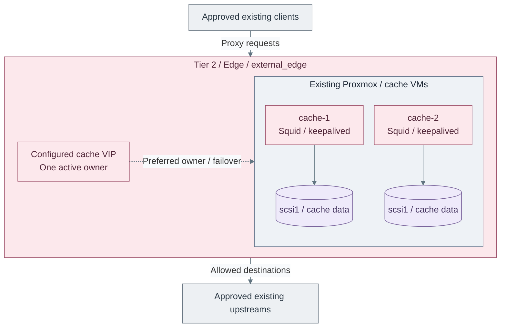

# Stage 1: Software intake

Establish approved update access, then connect the existing bootstrap and Proxmox hosts.
The main path creates a Tier 2 policy proxy/cache; an existing approved proxy or native mirror is also valid.

<a id="figure-1-controlled-proxy-pair"></a>



**IaC:** **Figure 1: Controlled proxy pair.** Tier 2 [cache inputs](../../../tier-2/terraform/deployments/cache/terraform.tfvars.example)
and [cache recipe](../../../tier-2/ansible/playbooks/deployment/outbound-cache.yml).
The pair and attached disks are created; clients, upstreams and physical networking already exist.
The VIP fails over; it does not replicate cache data or balance both VMs concurrently.

**Related:** [Architecture](../../01-architecture/07-software-intake/README.md) ·
[Operations](../../05-operations/02-software-intake/README.md)

**Prerequisites:** [foundation](../foundation/README.md), a tested Linux template and independent
bootstrap software access. New cache VMs need an approved initial package source; they cannot install themselves.
**Working repositories:** `<prefix>-tier-2` for cache resources, `<prefix>-tier-0` for existing-host consumers,
and Shared for common platform references.
**Automation:** the Squid/keepalived installer and existing-host proxy configuration are supplied.
This stage is complete without PKI or a hosted registry. Verified publication is selected at
[Stage 3, option 15b](../stage-3-trust/README.md#15b-verified-repository-and-artifact-publication-optional),
after its trust/logging prerequisites exist. Harbor belongs to Stage 7.
See [coverage](../../08-reference/implementation-support.md#stage-coverage).
**Design:** [controlled software intake](../../01-architecture/07-software-intake/README.md).

## Installation order

| Actions | Result |
| --- | --- |
| [1–2: select and initialize](#step-1-choose-the-supply-route) | New cache, existing cache update, or existing accepted supply |
| [3–8: configure and deploy](#step-3-select-shared-storage-and-template-references) | Cache pair and selected policy, including the optional Windows scope |
| [9: test supply](#step-9-test-the-accepted-supply) | Approved requests work before consumer changes |
| [10–13: connect bootstrap](#step-10-configure-bootstrap-intake) | Package and shell settings applied and verified |
| [14–16: connect Proxmox](#step-14-configure-proxmox-update-inputs) | Existing hosts retrieve their approved APT updates |
| [17–18: restrict and record](#step-17-retire-temporary-egress) | Replacement paths verified, bypass denied and completion recorded |

New pair: **1a → 2a → 3–18**. Existing pair update: **2b → 9–18**.
Existing accepted supply: **1b → 9–18**; it creates no cache resources.
The normal bootstrap and Proxmox configuration runs are on this page.

## Step 1: Choose the supply route

### 1a: Create the proxy/cache pair — main path

Use the supplied Tier 2 `cache-1`/`cache-2` realization in
[Figure 1](#figure-1-controlled-proxy-pair). Continue at Step 2.
The prepared bootstrap's OS-packaged Ansible or selected venv runs the installer;
its precheck prepares declared controller dependencies. Retain independent recovery artifacts.

<a id="2b-use-existing-approved-supply--alternative"></a>

### 1b: Use existing approved supply

Record its proxy URL or native repository endpoints, approved clients, source restrictions and owner.
Continue at Step 9. Mirror repository/tool configuration must already be commissioned by its owner;
this route does not install mirror services or another cache pair.

<a id="step-1-deploy-the-policy-proxy-and-cache"></a>
<a id="step-1-prepare-the-cache-inputs"></a>

## Step 2: Initialize cache inputs

### 2a: New pair — main path

Run from **`<prefix>-tier-2/`** on the prepared bootstrap:

```bash
bash scripts/init-local-files.sh --setup cache
```

**Expected:** missing ignored inputs are created; existing configuration is preserved. No VM is created.
Continue at Step 3.

### 2b: Existing pair update

Use [update adoption](step-2b-adopt-update.md) for an already deployed pair. It refreshes automation,
reviews retained policy and reconciles existing hosts without recreating them. Select any Windows
policy additions at that guide's policy review, before its Ansible run. Rejoin at Step 9.

<a id="step-3-configure-the-cache-deployment"></a>
<a id="shared-references-check-once"></a>

## Step 3: Select Shared storage and template references

Edit in **`<prefix>-shared/`**:

| File | Set |
| --- | --- |
| `config/platform.tfvars` | `default_platform_node_name`: an existing destination node, such as `pve01`; `proxmox_storage_classes.local.vm_disk`: VM-image storage, such as `local-zfs`; omit `cloud_init_drive` to inherit it |
| `templates/proxmox-catalog.tfvars` | `default_linux_vm_template_id`: the clone-tested Linux template approved by Tier 0, for example Rocky `9101` |

The logical class `local` is not the datastore named `local`. Import storage and VM-disk storage
have different requirements; retain other valid classes. See [storage mapping](../../08-reference/platform-inputs.md#vm-disk-storage).

<a id="tier-2-inputs-edit-before-deployment"></a>

## Step 4: Set Tier 2 credentials and VM inputs

Edit in **`<prefix>-tier-2/`**:

| File | Set |
| --- | --- |
| `.env.local` | Actual `PROXMOX_API_URL`, token ID/secret and `TF_VAR_ssh_public_key_files`; Tier 2 does not inherit Tier 0's credentials |
| `terraform/deployments/cache/terraform.tfvars` | Free VMIDs, selected size/storage and OS/data disks; retain `cache-1`/`cache-2` keys |
| `ansible/group_vars/all.yml` | `platform_domain`, hostname prefix/suffix and `ansible_user` matching the clone's login account |

In **Tier 2 `.env.local`**, uncomment `TF_VAR_ssh_public_key_files` and use the actual absolute
public-key path from [bootstrap SSH setup](../foundation/bootstrap/README.md#step-3-prepare-the-execution-accounts-ssh-key):

```dotenv
TF_VAR_ssh_public_key_files='["/home/automation/.ssh/id_ed25519.pub"]'
```

The matching private key remains on the execution host or agent. Empty clone key inputs
do not inherit the key used to log into the bootstrap VM.

## Step 5: Select the network attachment

Edit **`<prefix>-tier-2/terraform/common.tfvars`**. Choose one attachment, then continue at Step 6.

### 5a. Applied SDN VNet

 replace only `external_edge` inside `network_zones`:

```hcl
external_edge = {
  bridge     = "edge"
  sdn_lookup = true
}
```

Use the actual applied VNet ID. Its subnet supplies prefix/gateway; host IPs come from `cache.yml`.
The token needs scoped `SDN.Use` and `SDN.Audit`; see [API permissions](../foundation/proxmox/api-access.md#2b-existing-sdn-vnet).

### 5b. Regular VLAN-aware bridge

 instead retain the explicit `external_edge` bridge, VLAN,
subnet and gateway fields and set them to the prepared network. Do not add a VLAN tag to an SDN VNet.

## Step 6: Set addresses and cache policy

Edit **`<prefix>-tier-2/ansible/group_vars/cache.yml`**. Replace these example addresses
with reserved site values:

```yaml
platform_host_ips:
  cache-1: 10.30.30.20
  cache-2: 10.30.30.21
cache_proxy_vip_cidr: "10.30.30.22/24"
cache_keepalived_virtual_router_id: 40
cache_squid_allowed_cidrs:
  - 10.10.10.0/24
  - 10.30.30.0/24
cache_validation_url: https://mirrors.fedoraproject.org/
```

Include the actual bootstrap and Proxmox management CIDRs. Narrow `cache_squid_allowed_domains`
to the selected repositories, required tools and redirect destinations; an empty list is rejected.
Use exact source hostnames where possible; `.example.com` permits that whole domain and its subdomains.
The bootstrap's default collection precheck uses approved pinned Git sources. Permit their Git hosts;
explicit Galaxy acquisition instead needs its API and approved artifact destinations. Use prepared
archives for disconnected execution; see [collection source choices](../../08-reference/control-node-tooling.md#collection-sources)
and [existing-cache recovery](../../08-reference/control-node-tooling.md#recover-an-existing-cache-that-blocks-galaxy).
Terraform's connected path also needs `registry.terraform.io` for the locked provider registries,
plus the selected providers' package hosts. The example includes HashiCorp and GitHub source domains.
Disconnected execution uses the [prepared provider mirror](../foundation/bootstrap/step-3e-bootstrap-offline.md#9-select-local-sources-and-verify).
Keep `cache_validation_denied_url` outside the allowed sources; the default uses a reserved `.invalid` name.
Keep `cache_validation_url` within that policy and `repository_proxy_enabled: false` for cache hosts,
so their initial installation does not depend on their own unfinished VIP.

Keep `cache_squid_data_device` on the dedicated Terraform `scsi1` disk. The reference uses
`/dev/disk/by-id/scsi-0QEMU_QEMU_HARDDISK_drive-scsi1`; Linux `/dev/sda` and `/dev/sdb` order can
differ between clones. Existing deployments must verify that link before switching. Optional
`cache_squid_data_uuid` pins a known filesystem. An OS/partitioned device, foreign use or hidden
files cause the storage guard to stop before Squid is stopped or a filesystem is created.

## Step 7: Select Windows Update scope

| Choice | Action | Continue |
| --- | --- | --- |
| **7a: Linux/bootstrap supply** | Keep the accepted Linux/tool policy | Step 8 |
| **7b: Windows Update** | [Prepare the cache-policy extension](step-7b-windows-update.md#1-prepare-the-route) for existing managed Windows clients | Step 8; validate the Windows consumer after Step 9 |

The optional guide owns Windows endpoint-management and Delivery Optimization requirements.
Those are an external management contract, not manual setup of a new Windows guest.

<a id="step-2-deploy-the-selected-intake-path"></a>
<a id="2a-create-the-proxycache-pair--main-path"></a>
<a id="step-4-deploy-the-cache-pair"></a>

## Step 8: Deploy the cache pair

This installs the selected pair in [Figure 1](#figure-1-controlled-proxy-pair).
Existing approved supply follows its own owner and rejoins at Step 9.

<a id="4a-provision-and-configure-the-pair--main-path"></a>

### 8a: Provision and configure the pair — main path

The selected, verified blank data disk is formatted for rebuildable cache data; an accepted existing
filesystem is reused and mounted by UUID.
Confirm that the target VMs/disks contain no required data.
Review the separate [Proxmox NIC and guest-filtering controls](../foundation/network/firewall.md#proxmox-guest-interfaces);
the NIC Firewall flag and the guest's firewalld policy are separate controls.

CIDR validation uses `ansible.utils` and Python `netaddr` on the bootstrap/controller.
They are declared in Tier 2's [collection](../../../tier-2/ansible/requirements.yml) and
[Python requirements](../../../tier-2/ansible/requirements.txt). The setup precheck verifies both,
even when the collection is already installed: OS-packaged Ansible uses `python3-netaddr`;
an active venv receives its own `netaddr` dependency. Offline `check` mode verifies prepared
dependencies without installing them.

Run from **`<prefix>-tier-2/`**:

```bash
bash scripts/deploy.sh cache
```

Review Terraform's displayed plan and enter `yes` to create the resources and run Ansible,
or `no` to stop. Optional preview: add `--plan-only`. Approved unattended CI can use
`--auto-approve` with prepared tools, credentials and SSH access.

**Expected:** both hosts accept SSH, Squid responds and exactly one host owns the VIP.
VIP validation requires every member to have completed deployment; it must not stop the working
owner after a peer's configuration failure. A failed takeover is an availability failure, not a pass
because the owner was restarted by cleanup.
Default validation briefly stops keepalived to test takeover from the cache hosts, then restores it.
The deployment host checks the VIP; each node checks its own proxy locally.
If Terraform fails partway through, retain state and follow [partial-apply recovery](../../08-reference/repository-scripts.md#partial-terraform-apply).
Continue through **8b** if selected, then **Step 9**.

<a id="4b-apply-the-linux-security-profile--optional"></a>

### 8b: Apply the Linux security profile — optional

With SSH and approved package access working on both cache VMs, apply the
[Linux service-VM profile](../../05-operations/01-hosting/linux-security.md).
Include the approved client ports, operator sources and VRRP peers before activating its firewall.
Return here for **Step 9** to retest the cache and takeover under the selected policy.

<a id="3a-test-the-intake-path"></a>
<a id="step-5-test-the-selected-intake-path"></a>

## Step 9: Test the accepted supply

Before changing host proxy settings, test from **the bootstrap host** and each intended consumer network.
For a proxy, use the accepted endpoint explicitly:

```bash
read -r -p "Proxy URL (example: http://10.30.30.22:3128): " PROXY_URL
read -r -p "Approved download URL: " APPROVED_URL
curl --fail --noproxy '' --proxy "$PROXY_URL" --output /dev/null "$APPROVED_URL"
```

| Check | Expected result |
| --- | --- |
| Approved source through proxy | Download succeeds |
| Unapproved HTTP destination | HTTP 403; deployment validation checks both nodes and the VIP |
| Unapproved HTTPS CONNECT or forbidden source network | Request is denied; include a real network-boundary check |
| Selected HTTP cacheable object, when HTTP caching is required | A repeated request produces a Squid cache hit; HTTPS CONNECT is not cached |

For native mirrors, test their actual repository/tool retrieval instead.
If **7b** is selected, complete [Windows consumer configuration and validation](step-7b-windows-update.md#3-configure-the-windows-consumer)
before accepting that option. Stop on failed approved retrieval or policy checks.
Temporary bootstrap acquisition access may still exist here; retire it only after its replacement
works in Steps 10–16, then prove direct-WAN bypass is denied.

<a id="3b-configure-the-existing-bootstrap-host"></a>
<a id="step-6-connect-the-bootstrap-host"></a>

## Step 10: Configure bootstrap intake

Run on **`boot-1`, from `<prefix>-tier-0/`**:

```bash
cp -n ansible/group_vars/bootstrap.yml.example ansible/group_vars/bootstrap.yml
```

Edit **Tier 0 `ansible/group_vars/bootstrap.yml`**. Choose 10a or 10b, then continue at Step 11.
This configures the existing bootstrap; it is not another Terraform setup or inventory enrollment.

### 10a. Policy proxy

| Input | Set |
| --- | --- |
| `bootstrap_software_intake_mode` | `proxy` |
| `repository_proxy_url` | Accepted HTTP proxy URL, using its resolvable name or IP; no credentials |
| `shell_proxy_no_proxy_extra` | Internal HTTP/HTTPS destinations that bypass the proxy, for example the Proxmox API hostname and IP; no scheme/path |
| `repository_proxy_dnf_sources` | Fixed approved sources for enabled EL repositories whose mirror lists select unapproved hosts |

On **`boot-1`**, inspect actual EL repository filenames and sections before selecting fixed sources:

```bash
grep -nE '^\[|^(metalink|mirrorlist|baseurl)=' /etc/yum.repos.d/*.repo
```

For Rocky, add the matching enabled sections in **Tier 0 `ansible/group_vars/bootstrap.yml`**.
Other EL distributions use their corresponding existing files/sections and approved sources.

```yaml
repository_proxy_dnf_sources:
  - file: rocky.repo
    section: baseos
    baseurl: 'https://dl.rockylinux.org/pub/rocky/$releasever/BaseOS/$basearch/os/'
  - file: rocky.repo
    section: appstream
    baseurl: 'https://dl.rockylinux.org/pub/rocky/$releasever/AppStream/$basearch/os/'
  - file: rocky-extras.repo
    section: extras
    baseurl: 'https://dl.rockylinux.org/pub/rocky/$releasever/extras/$basearch/os/'
```

Include enabled EPEL/other sections only when used, with their approved fixed sources. Preserve
publisher keys/signature checks; the proxy must admit selected hosts and actual redirects.
Debian/Ubuntu uses its existing accepted APT sources; it needs no DNF section mapping.

### 10b. Native mirrors or disconnected supply

Set `bootstrap_software_intake_mode: mirror`. Retain the commissioned native repository/tool
configurations and prepared offline artifacts. This removes the recipe's package/shell proxy settings;
it does not install a mirror or replace pip, collection or Terraform source configurations.
The [bootstrap intake reference](procedures/bootstrap-consumer.md) covers field behavior and rollback.

## Step 11: Apply bootstrap configuration

Run on **`boot-1`, from `<prefix>-tier-0/`**, using its prepared Ansible installation and authorized sudo:

```bash
ANSIBLE_CONFIG=ansible/ansible.cfg ansible-playbook -i localhost, \
  ansible/playbooks/deployment/bootstrap-software-intake.yml -e @ansible/group_vars/bootstrap.yml
```

The precheck prepares declared collections through the accepted source. Disconnected runs source
the prepared `offline.env` and prefix this command with `CONTROL_NODE_COLLECTIONS_MODE=check`.
Add `--ask-become-pass` only when the account actually requires a sudo password.
**Expected:** native package policy, package-proxy settings and login-shell settings are reconciled;
other baseline host settings remain untouched. No VM, inventory entry or state is created.

**IaC:** Tier 0 [inputs](../../../tier-0/ansible/group_vars/bootstrap.yml.example) and
[local play](../../../tier-0/ansible/playbooks/deployment/bootstrap-software-intake.yml)
reuse Shared's [package](../../../shared/ansible/roles/baseline/tasks/repository_proxy.yml)
and [shell](../../../shared/ansible/roles/baseline/tasks/shell_proxy.yml) proxy tasks.

## Step 12: Load shell settings

For proxy mode, run on **`boot-1` in the current Bash terminal**:

```bash
source /etc/profile.d/shell-proxy.sh
```

A fresh SSH login also loads them. For mirror mode, use a fresh login to discard the previous
terminal's proxy variables; the proxy file is removed. No reboot is needed. Ansible cannot change
its parent terminal. Reactivate the selected venv/offline environment if used.
HTTPS Git normally uses these variables; SSH Git remotes retain their own approved SSH route.

## Step 13: Verify bootstrap package and tool access

Run on **`boot-1`**, for EL10:

```bash
sudo dnf --refresh --setopt='*.skip_if_unavailable=False' makecache
```

For Debian/Ubuntu, use this block instead on **`boot-1`**:

```bash
sudo apt-get -o APT::Update::Error-Mode=any update
```

Require successful approved package and tool retrieval. Repeat Step 9's explicit download with
the bootstrap's accepted endpoint; verify required Git, pip, collections, Terraform and artifacts.
For explicit Galaxy acquisition, test its [API and artifact route](../../08-reference/control-node-tooling.md#galaxy-through-a-policy-proxy).
Stop on failed required sources; login-shell proxy settings alone do not configure every tool/service.

<a id="3d-connect-proxmox-host-updates"></a>
<a id="step-7-connect-proxmox-host-updates"></a>

## Step 14: Configure Proxmox update inputs

Reuse the `hypervisors` inventory and authorized SSH account already accepted during Foundation.
If registration is missing, complete [host registration](../../05-operations/01-hosting/README.md)
first; do not provision CA/directory guests to manage existing hosts.

For proxy consumers, edit **Tier 0 `ansible/group_vars/all.yml`**:

```yaml
repository_proxy_enabled: true
repository_proxy_url: "http://10.30.30.22:3128"
```

Use the actual accepted endpoint. Ensure host subnets and enabled Debian, Proxmox and Ceph repository
domains are admitted. The proxy does not supply an enterprise subscription or change repository choice.
For native mirrors, retain the existing owner's accepted APT definitions and skip the proxy apply in
Step 15; continue with Step 16. No native mirror installer is implied by that path.

Select the registered account and list targets from **`<prefix>-tier-0/`**:

```bash
read -r -p 'Proxmox host SSH user (example: root): ' PVE_SSH_USER
ANSIBLE_CONFIG=ansible/ansible.cfg ansible-playbook -i ansible/inventory/hosts.yml \
  -e @ansible/group_vars/all.yml -e "ansible_user=$PVE_SSH_USER" \
  ansible/playbooks/proxmox-hosts.yml --list-hosts
```

**Expected:** only the intended registered hosts. The account needs accepted root/sudo access.

## Step 15: Apply Proxmox proxy configuration

Run from **`<prefix>-tier-0/`**, retaining `PVE_SSH_USER`:

```bash
ANSIBLE_CONFIG=ansible/ansible.cfg ansible-playbook -i ansible/inventory/hosts.yml \
  -e @ansible/group_vars/all.yml -e "ansible_user=$PVE_SSH_USER" ansible/playbooks/proxmox-hosts.yml
```

**Expected:** the [host play](../../../tier-0/ansible/playbooks/proxmox-hosts.yml) and
[proxy role](../../../tier-0/ansible/roles/proxmox_host/tasks/main.yml) reconcile Datacenter/APT
proxy settings and package-verification policy. This installs no updates and reboots no host.
Add `--ask-become-pass` only if the selected account requires it.

## Step 16: Verify host APT access

Run from **`<prefix>-tier-0/`** against the registered hosts, with the same SSH account:

```bash
ANSIBLE_CONFIG=ansible/ansible.cfg ansible hypervisors --playbook-dir ansible \
  -i ansible/inventory/hosts.yml -e @ansible/group_vars/all.yml -e "ansible_user=$PVE_SSH_USER" \
  --become -m ansible.builtin.command -a 'apt-get -o APT::Update::Error-Mode=any update'
```

**Expected:** every enabled repository refreshes successfully. Stop on denied sources, subscription,
signature or TLS errors. Use the [APT diagnostic runbook](../../05-operations/02-software-intake/apt-refresh.md)
for failures. Install patches later through the [maintenance procedure](../../05-operations/02-software-intake/host-updates.md#how-are-proxmox-updates-installed),
one cluster host at a time; patch rollout is not a prerequisite for completing update access.

## Step 17: Retire temporary egress

After Steps 13 and 16 pass, remove temporary bootstrap/host WAN allowances through the existing
network-policy owner. Keep explicitly accepted external-service exceptions, such as the selected
Windows DO path, separately scoped. Repeat approved retrieval and prove unapproved direct-WAN
bypass is denied from each consumer network. These Ansible recipes change no central firewall rules.
Hosts pull content; Tier 2 receives no host credentials or management access.

<a id="step-2-connect-the-approved-consumers"></a>
<a id="step-3-accept-controlled-intake"></a>
<a id="step-3-connect-and-verify-consumers"></a>

## Step 18: Record completion and continue

Update **`<prefix>-architecture/deployments.md`** with the selected route/options and verified
bootstrap/host consumers. Keep independent recovery artifacts and the selected endpoint/checks.
This establishes supply and access policy, not installed patches, approved releases or an offline mirror.
Native verification/failure defaults still require review of repository-specific overrides and publisher keys.

## Capability available

**Result:** the selected supply and consumers work with unapproved bypass denied. Continue from **Tier 0**
at [Stage 2: Protected logging](../stage-2-logging/README.md).

<a id="3c-configure-later-linux-deployments"></a>

## Use the intake path in later deployments

When another tier/setup is initialized, edit **that tier's `ansible/group_vars/all.yml`**.
Reuse the accepted endpoint; do not replace an already accepted host configuration with another example:

```yaml
repository_proxy_enabled: true
repository_proxy_url: "http://10.30.30.22:3128"
```

A hostname is valid when independent DNS already resolves it.
Optional `repository_proxy_fqdn`/`repository_proxy_ip` inputs can supply a temporary hosts entry
before directory DNS exists. Keep the cache setup's own proxy override disabled.

The later deployment's [Shared baseline role](../../../shared/ansible/roles/baseline/tasks/repository_proxy.yml)
applies these defaults when those guests are created. This section deploys no future hosts.
Native mirrors need their own commissioned repository configuration instead.
Kubernetes uses its separate [image-access inputs](../stage-4-kubernetes/procedures/image-access.md).
See the [policy and sizing reference](../../08-reference/proxy-cache.md) when extending the allowed consumers.

## Extend the capability later

| Extension | When and ownership | Relation to the early path |
| --- | --- | --- |
| Retained RPM/APT repositories and selected files | [Stage 3, option 15b](../stage-3-trust/README.md#15b-verified-repository-and-artifact-publication-optional) | Install after trust/logging, then accept consumer cutover before leaving Stage 3 |
| Wider vulnerability policy | [Design extension](../../01-architecture/07-software-intake/01-verification.md); OCI/Trivy integration remains separate | Add target-specific gates; ordinary proxy tunnels remain unscanned |
| OCI registry | [Stage 7 artifact supply](../stage-7-delivery/procedures/registry.md); Tier 1, Harbor is an example | Store/promote container images and compatible OCI artifacts; does not replace RPM/APT repositories |
| Patch rollout | Tier-owned maintenance automation; not supplied end to end | Use approved content with test/reboot/health gates; content availability alone is not patch compliance |

Repository and registry services can share intake policy and approval records,
but use their own protocols, credentials, persistence and recovery contracts.
Do not create another ordinary proxy merely because Harbor is introduced.
Do not remove retained bootstrap/recovery artifacts when these hosted services become available.
