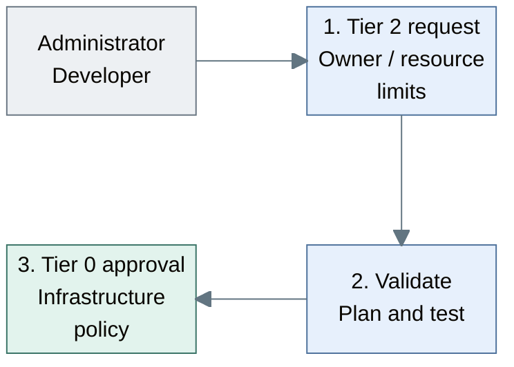
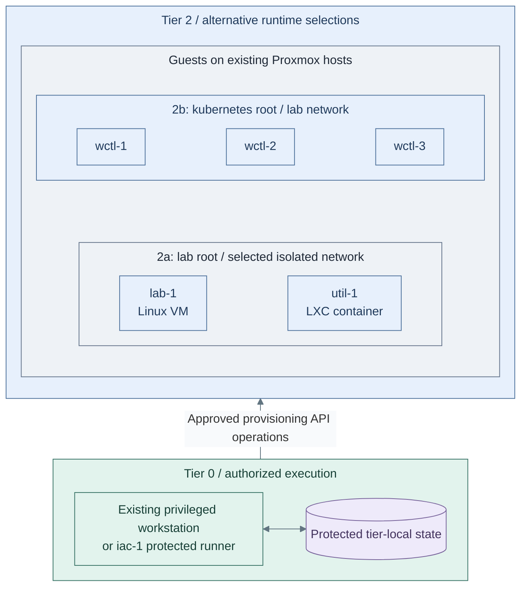
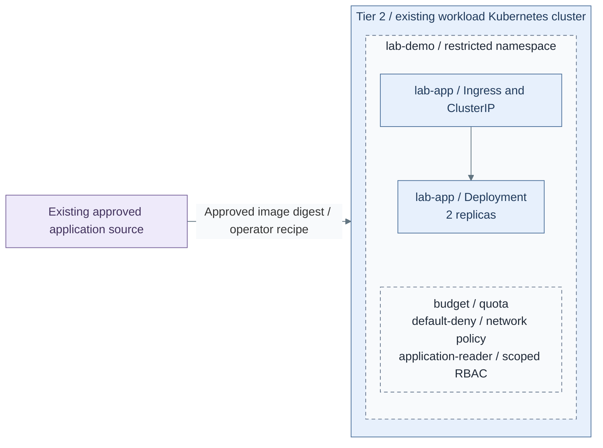

# Stage 10: Lab environments

**Related:** [Architecture](../../01-architecture/04-hosting/04-lab-environments.md) · [Operations](../../05-operations/01-hosting/kubernetes-and-labs.md)

Create isolated Tier 2 VMs and Kubernetes environments for development, testing
and experiments. Begin with reviewed operator deployments; future self-service
requests use bounded profiles and explicit authorization. Application delivery
remains separate from hypervisor and cluster lifecycle authority.

**Prerequisites:** accepted [Development platform and trusted execution](../stage-9-development/README.md),
accepted [Observability interfaces](../stage-8-observability/README.md), scoped
credentials, protected state and tested recovery.
**Working repositories:** `<prefix>-tier-2` for workload definitions;
`<prefix>-tier-0` for privileged execution (source: matching `tier-N/`).
**Automation:** tier-local guest and cluster lifecycle workflows are supplied;
a bounded application recipe is supplied; the optional protected request controller remains project integration.
See [coverage](../../08-reference/implementation-support.md#stage-coverage).

## Working repositories

| Work | Repository | IaC location inside that repository |
| --- | --- | --- |
| VM and workload definitions | `<prefix>-tier-2` | [terraform/deployments/lab/](../../../tier-2/terraform/deployments/lab), [ansible/](../../../tier-2/ansible) and [workloads/](../../../tier-2/workloads) |
| Workload cluster | `<prefix>-tier-2` | [terraform/deployments/kubernetes/](../../../tier-2/terraform/deployments/kubernetes) and [clusters/tier2/](../../../tier-2/clusters/tier2) |
| Privileged request execution | `<prefix>-tier-0` | Project integration; no complete request controller is supplied |

Run local operator commands from Tier 2's root. Tier 0 execution does not move
these definitions, inventory or state into Tier 0 or Shared.

**Execution context:** `<prefix>-tier-2/`.

## Main path

Follow Steps 1–3. Select only the runtimes and application options needed for this environment.

| Step | Path or option | Continue when |
| --- | --- | --- |
| 1 | [Approve scope](#step-1-define-the-approved-request); for Kubernetes, select [isolation](procedures/isolated-clusters.md#step-1-select-the-isolation-profile) | Owner, limits and isolation are approved; go to Step 2 |
| 2a | [Linux VM/LXC labs](#step-2a-linux-vmlxc-labs) | OS baseline and isolated attachment accepted; go to Step 3 |
| 2b | [Kubernetes labs](#step-2b-kubernetes-labs), instead of or alongside 2a | Cluster, add-ons, identity and recovery accepted; go to Step 3 |
| 2c | Optional [bounded self-service integration](procedures/isolated-clusters.md#step-3-introduce-bounded-automation), after an accepted operator deployment | Project-owned dispatcher must be implemented/tested; no portal or allocator is supplied |
| 3a | [Private application](step-3a-application.md) for 2b; project-owned application installer for 2a | Application access, update and rollback work |
| 3b | Optional [public HTTPS](step-3b-public-https.md) for an accepted website; provision the [edge pool](../stage-7-delivery/procedures/edge-proxy.md) first if absent | Return to Step 3 for recovery and operational handoff |
| 3c | [Scoped collection](step-3c-telemetry.md) for instrumented Kubernetes applications; protected Linux forwarding for 2a | Verify source-to-query delivery, then complete Step 3 recovery checks |

## Step 1: Define the approved request

Begin with an **operator-reviewed deployment**, not a self-service request API.
For Kubernetes, use only [the isolation-selection step](procedures/isolated-clusters.md#step-1-select-the-isolation-profile)
now, then return here; its later deployment/automation sections are not prerequisites to Step 2.
The supplied root creates one configured cluster. Virtual clusters, automatic multi-cluster allocation
and portal integration need separate implementation; example size profiles are not consumed by the script.



**Workflow:** reviewed request handling, not a deployed controller.
Tier 2 [workload inputs](../../../tier-2/terraform/deployments/lab/terraform.tfvars.example)
feed a [Shared plan executor](../../../shared/scripts/deploy.sh); automated Tier 0 authorization remains project integration.

1. Record the workload owner, permitted templates, sizes, networks and quotas in
   the [Tier 2 repository](../../06-paths/tier-2/README.md).
2. Validate the requested scope under the
   [provisioning contract](../../01-architecture/04-hosting/02-provisioning.md).
   Step 2 creates the runtime's plan after its inputs are configured.
3. Have an authorized Tier 0 operator accept that scope before provisioning.
   Test automated accepted/rejected request handling only if the separate dispatcher has actually
   been implemented; it is not an installation gate for the operator workflow.

**Result:** an approved owner, runtime/isolation choice and resource scope for Step 2.
The bounded request interface remains outstanding; this record does not deploy one.

## Step 2: Provision the workload runtime

For Linux labs, select the [tier-local application override](../../08-reference/network-inputs.md#guest-attachment)
before provisioning untrusted guests. The starter `lab-1`/`util-1` definitions
otherwise inherit the shared application subnet; their names do not isolate them.
The Kubernetes example already selects VLAN 420. Record the selected Lab-zone
policy and attachment in the [network plan](../../02-conventions/network-plan.md#services-zone).

An authorized Tier 0 operator creates resources using Tier 2's inputs and state.
The Stage 9 CI helper can run registered Linux setups only after that owning project/scope is
separately authorized. Kubernetes retains its dedicated operator lifecycle commands;
the CI example is not a multi-cluster request controller. Shared owns neither inventory nor resources.



**IaC:** Tier 2 [Kubernetes inputs](../../../tier-2/terraform/deployments/kubernetes/terraform.tfvars.example)
and [cluster entry point](../../../tier-2/scripts/kubernetes-cluster.sh), or
[VM/LXC inputs](../../../tier-2/terraform/deployments/lab/terraform.tfvars.example)
and [lab recipe](../../../tier-2/ansible/playbooks/deployment/lab-vms.yml).
Paths 2a and 2b are independent roots, not one command that creates both; choose the required runtime.
The [Shared executor](../../../shared/scripts/deploy.sh) consumes Tier 2 inventory/state, never owns them.

Choose **2a: Linux VM/LXC** or **2b: Kubernetes** below; both return to Step 3.
They have independent roots and state. Deploy both only when both runtimes are required.

### Step 2a: Linux VM/LXC labs

#### 1. Create local inputs

Run from **`<prefix>-tier-2/`**.

```bash
bash scripts/init-local-files.sh --setup lab
```

#### 2. Select the guests and isolated attachment

Edit in **`<prefix>-tier-2/`**.

- `terraform/deployments/lab/terraform.tfvars`: Complete `vm_instances`/`lxc_instances`, unused VMIDs, sizes
  and storage
- `terraform/common.tfvars`: Tier-local application network override for the selected isolated lab subnet
- `ansible/inventory/hosts.yml`: Matching logical host keys and lab groups
- `ansible/group_vars/lab.yml`: Matching `platform_host_ips`
- `.env.local`: This tier's verified API endpoint/token and local SSH public-key paths

Keep only required `vm_instances`/`lxc_instances`; the starter includes one of each.
An LXC entry needs an actual uploaded template file ID. Verify that guest keys, IP reservations
and inventory groups match before creating resources.

#### 3. Deploy the selected guests

Use independently authorized execution credentials.

Run from **`<prefix>-tier-2/`**.

```bash
bash scripts/deploy.sh lab
```

Review Terraform's plan and enter `yes` only for the intended changes. Add `--plan-only`
for preview only; approved unattended jobs use `--auto-approve`. These are operator
commands; ordinary workload users receive no Proxmox credentials.

#### 4. Verify and rejoin

Require successful Terraform and Ansible results. Verify the intended guests, SSH access,
isolated attachment and firewall policy, then continue at the shared checks below Step 2b.
This deploys an OS baseline, not an application or self-service controller.

### Step 2b: Kubernetes labs

#### 1. Create the cluster inputs

Run from **`<prefix>-tier-2/`**.

```bash
bash scripts/kubernetes-cluster.sh init
```

#### 2. Edit the Tier 2 cluster definition

In **`<prefix>-tier-2/`**, edit:

- `ansible/inventory/hosts.yml`: matching `talos_control_plane` / `talos_workers` keys.
- `ansible/group_vars/talos.yml`: each node's reserved `platform_host_ips` address.
- `terraform/deployments/kubernetes/terraform.tfvars`: unused VMIDs, approved template,
  live storage, isolated node attachment, private API endpoint and ordered native patches.

Complete the common procedure's [configuration](../stage-4-kubernetes/procedures/talos-terraform.md#configure)
and node-configuration steps for image access, CNI and logging. Keep Tier 2's own values, then return here.

#### 3. Load the provider environment

On **the authorized execution host**, from **`<prefix>-tier-2/`**, load the already configured local file.
The cluster script does not load `.env.local`; keep shell tracing disabled.

```bash
set -a
source .env.local
set +a
export PROXMOX_VE_ENDPOINT="${PROXMOX_API_URL:?Set the real Proxmox API URL}"
export PROXMOX_VE_API_TOKEN="${PROXMOX_API_TOKEN_ID:?Set the token ID}=${PROXMOX_API_TOKEN_SECRET:?Set the token secret}"
```

Approved CI may inject those two native provider variables instead. Keep verified CA trust.

#### 4. Create and review the saved plan

Run from **`<prefix>-tier-2/`**.

```bash
bash scripts/kubernetes-cluster.sh plan
```

Review node addresses, disks, template, network and placement. This is a dedicated saved-plan
workflow, not Linux `deploy.sh`; it has no `--plan-only` or `--auto-approve` flag.

#### 5. Apply the reviewed plan

Run from **`<prefix>-tier-2/`** only after review; saved-plan apply has no extra `yes` prompt.

```bash
bash scripts/kubernetes-cluster.sh apply
```

#### 6. Export credentials and complete the platform

Run from **`<prefix>-tier-2/`** after successful apply:

```bash
bash scripts/kubernetes-cluster.sh credentials
```

Keep `secrets/talos/` and the original state under independent recovery custody.
Install and verify the [basic platform](../stage-4-kubernetes/procedures/basic-platform.md)
from **Tier 2**, with its kubeconfig and `ansible/group_vars/cluster_platform.yml`.
Complete [cluster verification](../stage-4-kubernetes/procedures/talos-terraform.md#verify-and-hand-over),
then rejoin below.

Before either branch rejoins Step 3, verify isolation, readiness, original-state
locking and independent recovery. No autoscaler or multi-cluster allocator is installed.
Select **2c: bounded automation** only after that operator deployment works; complete the
[dispatcher integration contract](procedures/isolated-clusters.md#step-3-introduce-bounded-automation)
and its acceptance tests before handing requests to users. Otherwise continue directly to Step 3.

**Result:** the [compute runtime](../../01-architecture/04-hosting/README.md) is ready within
the workload's allocated scope, without changing Tier 0 ownership.

## Step 3: Deploy and verify applications

For Kubernetes, the supplied application recipe is the initial deployment path.
For Linux, supply the application's own installer after the Step 2a OS baseline;
the Kubernetes recipe below does not install applications on those VMs/LXCs.
Controller adoption or Rancher/Fleet management is separate project integration,
never a prerequisite silently installed by this stage and never Tier 0 lifecycle authority.



**IaC:** Tier 2 [application recipe](../../../tier-2/ansible/playbooks/deployment/lab-environment.yml)
and [inputs](../../../tier-2/ansible/group_vars/lab_environment.yml.example) render/apply
the [native resources](../../../tier-2/ansible/roles/lab_environment/templates/environment.yml.j2).
The namespace, quota, policies, reader role, two app replicas and private route are
installed together. The cluster and trusted TLS Secret are explicit prerequisites.
See [application installation](step-3a-application.md) for commands and acceptance.

1. Complete **3a: private application**. For Kubernetes, install the [bounded application reference](step-3a-application.md): prepare its namespace TLS,
   render/review, apply and verify its reader/isolation boundary. For Linux, complete and accept the
   project-owned application installation instead. Keep one owner for subsequent revisions.
2. For a public website, take [3b: public HTTPS](step-3b-public-https.md), then return here.
   Private applications skip that branch.
3. Complete **3c: [workload collection](step-3c-telemetry.md)** for instrumented Kubernetes applications.
   Linux security/audit senders use the [protected-source recipe](../stage-2-logging/procedures/sources.md);
   the supplied application Collector runs in Kubernetes only.
   Its logs/metrics/traces need actual application SDK instrumentation, not just the HTTP reference image.
   Record uninstrumented application signals as deferred; do not claim their collection.
   Security/audit submissions still go directly to Tier 0; Tier 1 receives only approved copies.
4. Exercise an update, rollback and restore, including the behavior when source control
   is unavailable. Source loss pauses new requests; it never authorizes deletion.
5. Hand recurring operations to [administration](../../05-operations/README.md), retaining
   independent recovery and separately authorized key ceremonies.

**Result:** application delivery works independently of privileged infrastructure
execution, as required by the [service boundaries](../../01-architecture/02-organization/README.md).

## Capability available

The platform can repeatedly deliver Tier 2 workloads through its approved workflow.
Record policy, recovery and acceptance evidence against
[readiness criteria](../readiness.md). Continue with administration for ongoing operation
and [development](../../04-development/README.md) for unimplemented automation.
