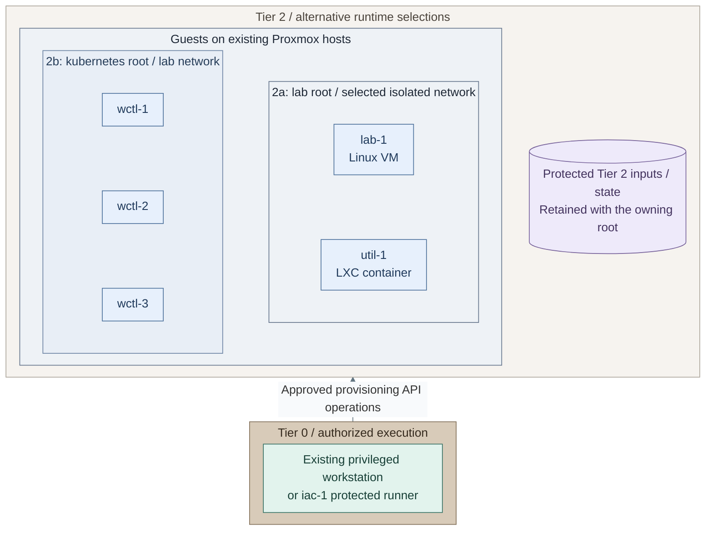
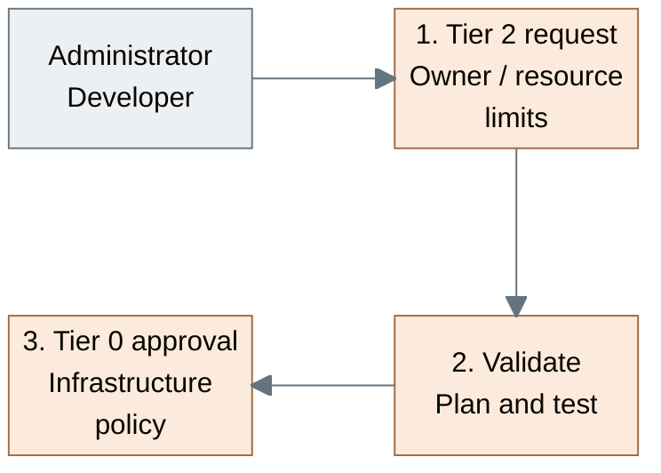

# Stage 10: Lab environments

**Related:** [Architecture](../../01-architecture/04-hosting/04-lab-environments.md) · [Operations](../../05-operations/01-hosting/kubernetes-and-labs.md)

Create isolated Tier 2 VMs and Kubernetes environments for development, testing
and experiments. Begin with reviewed operator deployments; future self-service
requests use bounded profiles and explicit authorization. Application delivery
remains separate from hypervisor and cluster lifecycle authority.

<a id="figure-workload-runtimes"></a>

## Expected outcome: selected workload runtimes



**IaC:** *Figure: Tier 2 owns the selected VM/LXC or Kubernetes resources and their state. An authorized Tier 0
operator provisions them; the two roots are independent selections.*
Tier 2 [Kubernetes inputs](../../../tier-2/terraform/deployments/kubernetes/terraform.tfvars.example)
and [cluster entry point](../../../tier-2/scripts/kubernetes-cluster.sh), or
[VM/LXC inputs](../../../tier-2/terraform/deployments/lab/terraform.tfvars.example)
and [lab recipe](../../../tier-2/ansible/playbooks/deployment/lab-vms.yml).
Paths 2a and 2b are independent roots, not one command that creates both; choose the required runtime.
The [Shared executor](../../../shared/scripts/deploy.sh) consumes Tier 2 inventory/state, never owns them.
The state shape records Tier 2 ownership, not a new storage service; the authorized execution host
uses those original inputs under the selected access policy.

**Prerequisites:** accepted [Development platform and trusted execution](../stage-9-development/README.md),
accepted [Observability interfaces](../stage-8-observability/README.md), scoped
credentials, protected state and tested recovery.
**Working repositories:** `<prefix>-tier-2` for workload definitions;
`<prefix>-tier-0` for privileged execution (source: matching `tier-N/`).
**Automation:** tier-local guest and cluster lifecycle workflows are supplied;
a bounded application recipe is supplied; the optional protected request controller remains project integration.
See [coverage](../../08-reference/implementation-support.md#stage-coverage).

## Working repositories

| Work | Repository | IaC location inside that repository |
| --- | --- | --- |
| VM and workload definitions | `<prefix>-tier-2` | [terraform/deployments/lab/](../../../tier-2/terraform/deployments/lab), [ansible/](../../../tier-2/ansible) and [workloads/](../../../tier-2/workloads) |
| Workload cluster | `<prefix>-tier-2` | [terraform/deployments/kubernetes/](../../../tier-2/terraform/deployments/kubernetes) and [clusters/tier2/](../../../tier-2/clusters/tier2) |
| Privileged request execution | `<prefix>-tier-0` | Project integration; no complete request controller is supplied |

Run local operator commands from Tier 2's root. Tier 0 execution does not move
these definitions, inventory or state into Tier 0 or Shared.

**Execution context:** `<prefix>-tier-2/`.

## Main path

Follow Steps 1-7. Select only the runtimes and application options needed for this environment.

| Step | Path or option | Continue when |
| --- | --- | --- |
| 1 | [Approve scope](#step-1-define-the-approved-request); for Kubernetes, select [isolation](procedures/isolated-clusters.md#step-1-select-the-isolation-profile) | Owner, limits and isolation are approved; go to Step 2 |
| 2a | [Linux VM/LXC labs](#step-2a-linux-vmlxc-labs) | OS baseline and isolated attachment accepted; go to Step 3 |
| 2b | [Kubernetes labs](#step-2b-kubernetes-labs), instead of or alongside 2a | Cluster, add-ons, identity and recovery accepted; go to Step 3 |
| 2c | Optional [bounded self-service integration](procedures/isolated-clusters.md#step-3-introduce-bounded-automation), after an accepted operator deployment | Project-owned dispatcher must be implemented/tested; no portal or allocator is supplied |
| 3a | [Private Kubernetes application](step-3a-application.md), after 2b | Accept private route and namespace policy; go to 4 |
| 3b | Existing/project-owned Linux application installer, after 2a | Accept its private service and data-recovery contract; go to 4 |
| 4a / 4b | Keep private, or add [public HTTPS](step-4b-public-https.md); use the existing edge pool or provision it first | Return to 5 after website acceptance |
| 5a / 5b | Protected OS/audit forwarding, and optional [instrumented application collection](step-5b-telemetry.md) | Verify selected source-to-query delivery; go to 6 |
| 6 | Update, rollback and recovery rehearsal | 7 |
| 7 | Record ownership and accepted options | Ongoing operations |

## Step 1: Define the approved request

<a id="figure-request-approval"></a>



**Workflow:** *Figure: The request proceeds from owner and limits through validation to Tier 0 approval. This is the
reviewed authorization workflow; an automated request controller remains project integration.*
Tier 2 [workload inputs](../../../tier-2/terraform/deployments/lab/terraform.tfvars.example)
feed a [Shared plan executor](../../../shared/scripts/deploy.sh); automated Tier 0 authorization remains project integration.

Begin with an **operator-reviewed deployment**, not a self-service request API.
For Kubernetes, use only [the isolation-selection step](procedures/isolated-clusters.md#step-1-select-the-isolation-profile)
now, then return here; its later deployment/automation sections are not prerequisites to Step 2.
The supplied root creates one configured cluster. Virtual clusters, automatic multi-cluster allocation
and portal integration need separate implementation; example size profiles are not consumed by the script.


1. Start the [approval workflow](#figure-request-approval): record the workload owner,
   permitted templates, sizes, networks and quotas in
   the [Tier 2 repository](../../06-paths/tier-2/README.md).
2. Validate the requested scope under the
   [provisioning contract](../../01-architecture/04-hosting/02-provisioning.md).
   Step 2 creates the runtime's plan after its inputs are configured.
3. Have an authorized Tier 0 operator accept that scope before provisioning.
   Test automated accepted/rejected request handling only if the separate dispatcher has actually
   been implemented; it is not an installation gate for the operator workflow.

**Result:** an approved owner, runtime/isolation choice and resource scope for Step 2.
The bounded request interface remains outstanding; this record does not deploy one.

## Step 2: Provision the workload runtime

The [workload-runtime figure](#figure-workload-runtimes) shows the independent **2a** and **2b** selections.
Choose their inputs and attachment before creating either plan.

For Linux labs, select the [tier-local application override](../../08-reference/network-inputs.md#guest-attachment)
before provisioning untrusted guests. The starter `lab-1`/`util-1` definitions
otherwise inherit the shared application subnet; their names do not isolate them.
The Kubernetes example already selects VLAN 420. Record the selected Lab-zone
policy and attachment in the [network plan](../../02-conventions/network-plan.md#services-zone).

An authorized Tier 0 operator creates resources using Tier 2's inputs and state.
The Stage 9 CI helper can run registered Linux setups only after that owning project/scope is
separately authorized. Kubernetes retains its dedicated operator lifecycle commands;
the CI example is not a multi-cluster request controller. Shared owns neither inventory nor resources.

Choose **2a: Linux VM/LXC** or **2b: Kubernetes** below; both return to Step 3.
They have independent roots and state. Deploy both only when both runtimes are required.

### Step 2a: Linux VM/LXC labs

This branch provisions `lab-1`/`util-1` from the [VM/LXC part of the runtime figure](#figure-workload-runtimes).
Retain only the guests selected for this environment; application installation follows at Step 3.

#### 1. Create local inputs

Run from **`<prefix>-tier-2/`**.

```bash
bash scripts/init-local-files.sh --setup lab
```

#### 2. Select the guests and isolated attachment

Edit in **`<prefix>-tier-2/`**.

- `terraform/deployments/lab/terraform.tfvars`: Complete `vm_instances`/`lxc_instances`, unused VMIDs, sizes
  and storage
- `terraform/common.tfvars`: Tier-local application network override for the selected isolated lab subnet
- `ansible/inventory/hosts.yml`: Matching logical host keys and lab groups
- `ansible/group_vars/lab.yml`: Matching `platform_host_ips`
- `.env.local`: This tier's verified API endpoint/token and local SSH public-key paths

Keep only required `vm_instances`/`lxc_instances`; the starter includes one of each.
An LXC entry needs an actual uploaded template file ID. Verify that guest keys, IP reservations
and inventory groups match before creating resources.

#### 3. Deploy the selected guests

Use independently authorized execution credentials.

Run from **`<prefix>-tier-2/`**.

```bash
bash scripts/deploy.sh lab
```

Review Terraform's plan and enter `yes` only for the intended changes. Add `--plan-only`
for preview only; approved unattended jobs use `--auto-approve`. These are operator
commands; ordinary workload users receive no Proxmox credentials.

#### 4. Verify and rejoin

Require successful Terraform and Ansible results. Verify the intended guests, SSH access,
isolated attachment and firewall policy, then continue at the shared checks below Step 2b.
This deploys an OS baseline, not an application or self-service controller.

### Step 2b: Kubernetes labs

This branch provisions the [Kubernetes node group](#figure-workload-runtimes).
The saved-plan workflow below owns only that cluster and its existing state.

#### 1. Create the cluster inputs

Run from **`<prefix>-tier-2/`**.

```bash
bash scripts/kubernetes-cluster.sh init
```

#### 2. Edit the Tier 2 cluster definition

In **`<prefix>-tier-2/`**, edit:

- `ansible/inventory/hosts.yml`: matching `talos_control_plane` / `talos_workers` keys.
- `ansible/group_vars/talos.yml`: each node's reserved `platform_host_ips` address.
- `terraform/deployments/kubernetes/terraform.tfvars`: unused VMIDs, approved template,
  live storage, isolated node attachment, private API endpoint and ordered native patches.

Complete the common procedure's [configuration](../stage-4-kubernetes/procedures/talos-terraform.md#configure)
and node-configuration steps for image access, CNI and logging. Keep Tier 2's own values, then return here.

#### 3. Load the provider environment

On **the authorized execution host**, from **`<prefix>-tier-2/`**, load the already configured local file.
The cluster script does not load `.env.local`; keep shell tracing disabled.

```bash
set -a
source .env.local
set +a
export PROXMOX_VE_ENDPOINT="${PROXMOX_API_URL:?Set the real Proxmox API URL}"
export PROXMOX_VE_API_TOKEN="${PROXMOX_API_TOKEN_ID:?Set the token ID}=${PROXMOX_API_TOKEN_SECRET:?Set the token secret}"
```

Approved CI may inject those two native provider variables instead. Keep verified CA trust.

#### 4. Create and review the saved plan

Run from **`<prefix>-tier-2/`**.

```bash
bash scripts/kubernetes-cluster.sh plan
```

Review node addresses, disks, template, network and placement. This is a dedicated saved-plan
workflow, not Linux `deploy.sh`; it has no `--plan-only` or `--auto-approve` flag.

#### 5. Apply the reviewed plan

Run from **`<prefix>-tier-2/`** only after review; saved-plan apply has no extra `yes` prompt.

```bash
bash scripts/kubernetes-cluster.sh apply
```

#### 6. Export credentials and complete the platform

Run from **`<prefix>-tier-2/`** after successful apply:

```bash
bash scripts/kubernetes-cluster.sh credentials
```

Keep `secrets/talos/` and the original state under independent recovery custody.

#### 7. Configure and render the add-ons

Run from **`<prefix>-tier-2/`**:

```bash
cp -n ansible/group_vars/cluster_platform.yml.example ansible/group_vars/cluster_platform.yml
```

Edit `ansible/group_vars/cluster_platform.yml`: Tier 2's kubeconfig/context, selected components,
exact pins, image access, storage and trust using the [basic-platform input contract](../stage-4-kubernetes/procedures/basic-platform.md).
This new cluster needs its own add-ons; it does not reuse another tier's live resources.
Render from **the same Tier 2 root**:

```bash
ANSIBLE_CONFIG=ansible/ansible.cfg ansible-playbook -i localhost, \
  ansible/playbooks/deployment/cluster-platform.yml \
  -e @ansible/group_vars/cluster_platform.yml -e cluster_platform_action=render
```

Review the private output against that selected component list and Tier 2 destination.

#### 8. Apply and verify the add-ons

Run from **`<prefix>-tier-2/`** after review:

```bash
ANSIBLE_CONFIG=ansible/ansible.cfg ansible-playbook -i localhost, \
  ansible/playbooks/deployment/cluster-platform.yml \
  -e @ansible/group_vars/cluster_platform.yml -e cluster_platform_action=apply
```

Apply changes the selected cluster without an extra confirmation. Verify selected CNI, logging,
storage, private ingress/TLS and [cluster handoff checks](../stage-4-kubernetes/procedures/talos-terraform.md#verify-and-hand-over),
then rejoin below. No second node bootstrap or basic-platform installation is needed at Step 3.

Before either branch rejoins Step 3, verify isolation, readiness, original-state
locking and independent recovery. No autoscaler or multi-cluster allocator is installed.
Select **2c: bounded automation** only after that operator deployment works; complete the
[dispatcher integration contract](procedures/isolated-clusters.md#step-3-introduce-bounded-automation)
and its acceptance tests before handing requests to users. Otherwise continue directly to Step 3.

**Result:** the [compute runtime](../../01-architecture/04-hosting/README.md) is ready within
the workload's allocated scope, without changing Tier 0 ownership.

<a id="step-3-deploy-and-verify-applications"></a>

## Step 3: Install the private application

Choose the installation for the accepted runtime:

- **3a: Kubernetes** - complete [the bounded application guide](step-3a-application.md).
  Its [result figure](step-3a-application.md#figure-private-application) shows the namespace,
  route, quota and reader policy installed together. Configure inputs, render/review, supply the
  namespace TLS Secret, apply and verify before returning here.
- **3b: Linux VM/LXC** - use the application's existing/project-owned installer after Step 2a's OS
  baseline. The Kubernetes application recipe does not install software on those guests.
  Keep package/service configuration in that IaC, not interactive guest setup.

Both choices rejoin at Step 4 after private access works. Controller adoption, Rancher/Fleet and
self-service dispatchers remain separately accepted integrations; no second cluster is created here.

## Step 4: Select website exposure

Choose **4a: retain private access** and continue at 5, or **4b: public website**.
For 4b, complete [public HTTPS](step-4b-public-https.md), starting with its
[certificate-deployment figure](step-4b-public-https.md#figure-public-https). Use the existing edge
pool or complete its explicit provisioning branch once. Accept public TLS, renewal and denied-origin
checks before rejoining Step 5. A private application needs no public DNS/NAT.

## Step 5: Connect the selected signals

**5a: protected OS/audit evidence** retains the direct Tier 0 submission path. For Linux sources,
use the existing [protected-source recipe](../stage-2-logging/procedures/sources.md) with Tier 2-owned
inventory and stream inputs. Cluster OS/API forwarding was commissioned with its platform; verify it
rather than bootstrapping that cluster again.

**5b: instrumented Kubernetes application signals** use the optional
[scoped Collector path](step-5b-telemetry.md). Its
[collection figure](step-5b-telemetry.md#figure-workload-collection) shows the new namespace-local
Collectors and distinct remote intake identities. Complete its input/render/apply and emission checks,
then return to Step 6. It installs no second signal backend or syslog archive.

The reference HTTP image has no automatic SDK instrumentation. Mark unimplemented signals deferred;
application code must supply its selected logs/metrics/traces. Security/audit evidence never depends
only on that analytical route. Both selections use accepted endpoints, not a future deployment stage.

## Step 6: Rehearse update, rollback and recovery

Exercise an approved application change, rollback and clean-target restore while retaining original
runtime state and independently supplied credentials. Test source-control unavailability: source loss
pauses new requests; it never authorizes deletion. The disposable reference application needs its
reviewed image/inputs and TLS recovery; adapted stateful applications also need tested data backups.

## Step 7: Record the deployment and operational handoff

Record the runtime, application, exposure and collection choices in
**`<prefix>-architecture/deployments.md`**. Retain separate acceptance evidence, named resource/state
owners and independent recovery. Hand recurring tasks to [lab operations](../../05-operations/01-hosting/kubernetes-and-labs.md).
Keep lifecycle, credentials and separately authorized custody ceremonies with their existing owners.

## Capability available

The platform can repeatedly deliver Tier 2 workloads through its approved workflow.
Record policy, recovery and acceptance evidence against
[readiness criteria](../readiness.md). Continue with administration for ongoing operation
and [development](../../04-development/README.md) for unimplemented automation.
