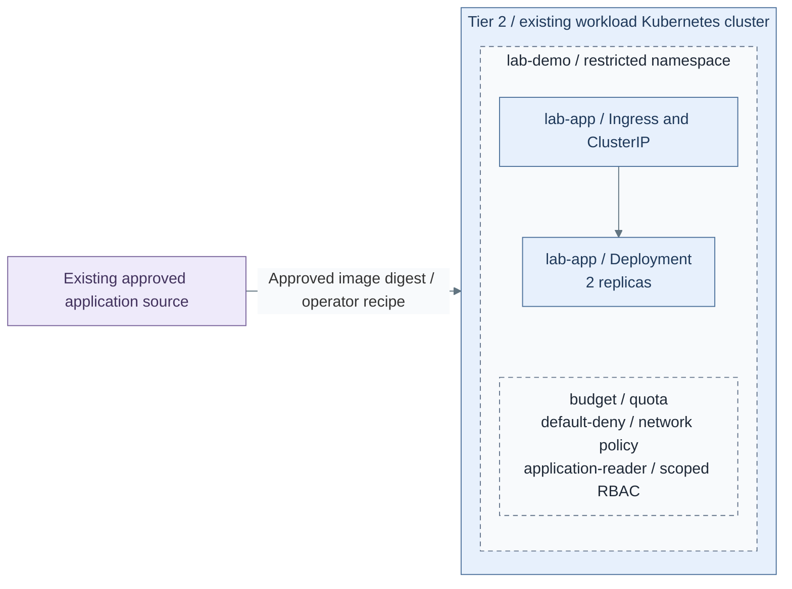

# Step 3a: Bounded application environment

**Branch from:** [Step 3](README.md#step-3-deploy-and-verify-applications), path **3a**, after Kubernetes Step 2b.
**Change:** install the selected application inside its approved namespace and access boundary.
**Return:** [Step 4](README.md#step-4-select-website-exposure) after boundary checks;
then choose exposure at Step 4 and collection at Step 5 before recovery.

<a id="figure-private-application"></a>

## Expected outcome: bounded private application



**IaC:** *Figure: The private route reaches two restricted application replicas. Namespace quota, default-deny policy
and reader RBAC are installed together; cluster and TLS ownership already exist.*
Tier 2 [application recipe](../../../tier-2/ansible/playbooks/deployment/lab-environment.yml)
and [inputs](../../../tier-2/ansible/group_vars/lab_environment.yml.example) render/apply
the [native resources](../../../tier-2/ansible/roles/lab_environment/templates/environment.yml.j2).
The namespace, quota, policies, reader role, two app replicas and private route are
installed together. The cluster and trusted TLS Secret are explicit prerequisites.
The numbered actions below install and verify this boundary.

**Working repository:** `<prefix>-tier-2`. The application is selected at Stage 10 Step 3; its accepted installation continues at Step 4.
**Prerequisites:** accepted cluster networking/storage/ingress, at least two schedulable
nodes, trusted DNS/TLS and the selected identity group's authentication into Kubernetes.
The runtime must enforce NetworkPolicy and Pod Security Admission.

## Contents

- [1. Create local inputs](#1-prepare-inputs)
- [2. Select the application](#3-select-the-application)
- [3. Render the resources](#2-render-and-install)
- [4. Prepare the namespace certificate](#5-prepare-the-namespace-certificate)
- [5. Apply the reviewed resources](#6-apply-the-reviewed-resources)
- [6. Verify the boundary](#3-verify-the-boundary)

<a id="1-prepare-inputs"></a>

## 1. Create local inputs

The [application figure](#figure-private-application) defines the namespace, route and policy scope to review.

Run from **`<prefix>-tier-2/`**.

```bash
umask 077
cp -n ansible/group_vars/lab_environment.yml.example ansible/group_vars/lab_environment.yml
```

Existing inputs are preserved; continue with that local file.

<a id="2-install-controller-dependencies"></a>

The native playbook checks/prepares declared controller dependencies before render/apply.
Reuse the prepared environment; disconnected controllers pre-stage those requirements and use
`CONTROL_NODE_COLLECTIONS_MODE=check`. No separate Galaxy/pip installation is required here.

<a id="3-select-the-application"></a>

## 2. Select the application

In **`<prefix>-tier-2/`**, edit `ansible/group_vars/lab_environment.yml`:

| Field | Set |
| --- | --- |
| `lab_environment_kubeconfig`, `lab_environment_context` | Private Tier 2 kubeconfig; explicit context when the file has several clusters |
| `lab_environment_name`, `lab_environment_owner_group` | Allocated namespace and exact authenticated reader group |
| `lab_environment_image` | Approved non-root image pinned by SHA256 digest |
| `lab_environment_host` | Actual private DNS name covered by `lab-tls` |
| `lab_environment_ingress_class`, `lab_environment_ingress_namespace` | Accepted existing ingress |

The reference image must serve `/` on port 8080 as UID 10001 with
a read-only root filesystem and writable `/tmp`. Adapt the tier-owned template for
applications needing different probes, volumes or carefully scoped outbound access.
An arbitrary image is not guaranteed to fit this contract.

<a id="2-render-and-install"></a>

<a id="4-render-the-resources"></a>

## 3. Render the resources

Run from **`<prefix>-tier-2/`**.

```bash
ANSIBLE_CONFIG=ansible/ansible.cfg ansible-playbook -i localhost, \
  ansible/playbooks/deployment/lab-environment.yml \
  -e @ansible/group_vars/lab_environment.yml -e lab_environment_action=render
```

Expect `secrets/lab-environment/<lab_environment_name>.yml`, `lab-demo.yml` with the starter name.
Render does not contact Kubernetes. Review namespace, quota, image digest, policies, reader group and route.

<a id="5-prepare-the-namespace-certificate"></a>

## 4. Prepare the namespace certificate

In **the selected Tier 2 cluster**, use the accepted certificate owner to prepare the selected
namespace and its `lab-tls` Secret before apply. It must be type `kubernetes.io/tls`, with
`tls.crt` and `tls.key` for the private hostname's trusted chain/key.
No certificate, CA key or issuer is silently generated by this application recipe.

<a id="6-apply-the-reviewed-resources"></a>

## 5. Apply the reviewed resources

Confirm the private kubeconfig/context in **`<prefix>-tier-2/ansible/group_vars/lab_environment.yml`**.
Apply changes the selected cluster without another confirmation prompt.

Run from **`<prefix>-tier-2/`**.

```bash
ANSIBLE_CONFIG=ansible/ansible.cfg ansible-playbook -i localhost, \
  ansible/playbooks/deployment/lab-environment.yml \
  -e @ansible/group_vars/lab_environment.yml -e lab_environment_action=apply
```

The [recipe](../../../tier-2/ansible/playbooks/deployment/lab-environment.yml) applies
namespace restrictions, quota, default-deny policy, ingress allowance and read-only
group access before the application. It waits for readiness. No privileged pods,
host mounts, API token, unrestricted egress or hypervisor credentials are granted.
Two replicas require capacity; they do not establish storage or physical failover.

<a id="3-verify-the-boundary"></a>

<a id="7-verify-the-boundary"></a>

## 6. Verify the boundary

1. Verify private HTTPS, both replicas and an update/rollback with an approved digest.
2. Test the reader group: its namespace logs are readable; other namespaces, Secrets
   and mutations are denied. Identity authentication does not itself grant this role.
3. Prove default-deny isolation and quota enforcement, then connect selected
   [telemetry](step-5b-telemetry.md). Protected evidence remains outside this namespace.

Namespace isolation is not a hard boundary for hostile tenants. Use dedicated
[cluster isolation](procedures/isolated-clusters.md) where required. Keep automatic allocation,
expiry and portal integration separate; no such controller is installed by this recipe.

The reference application has only disposable `/tmp` storage; it installs no data volume or backup job.
Retain its reviewed inputs, image digest and independently recoverable TLS Secret to recreate it.
An adapted stateful application needs its own data backup and clean-target restore procedure before
acceptance. Runtime recovery follows the selected [lab operations path](../../05-operations/01-hosting/kubernetes-and-labs.md)
and [original cluster state/etcd procedure](../../05-operations/06-resilience/recovery/original-state-etcd.md).

**Return:** [Stage 10, Step 4](README.md#step-4-select-website-exposure) for exposure selection;
Steps 5-7 own collection, recovery and handoff.
