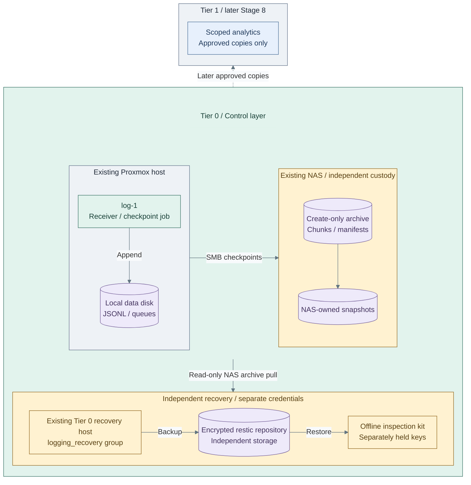
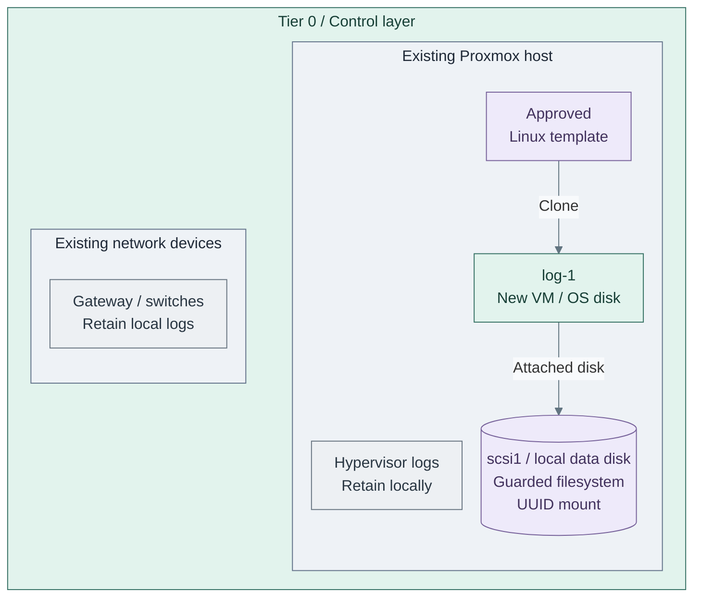
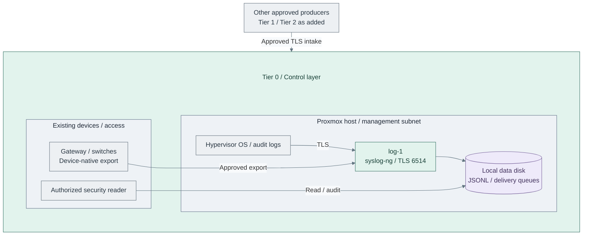

# Stage 2: Protected logging

Deploy `log-1`, authenticate its own OS stream, then connect the existing hosts and
protect the retained records before PKI and FreeIPA. Complete the numbered actions on this page in order.
Later [Observability](../stage-8-observability/README.md) consumes approved copies;
it does not own this Security Logging and Audit capability.

<a id="figure-1-nas-retention-and-independent-recovery"></a>

## Expected outcome



**IaC:** **Figure 1: NAS retention and independent recovery.** The main retention choice adds NAS
checkpoints and independent recovery to the local receiver. NAS accounts/snapshots and the recovery
host are existing prerequisites; the archive and backup recipes configure their selected interfaces.
[Archive implementation](../../../tier-0/ansible/playbooks/deployment/logging-archive.yml) ·
[Backup implementation](../../../tier-0/ansible/playbooks/deployment/logging-backup.yml).

**Working repository:** `<prefix>-tier-0` (source: `tier-0/`). Run commands from this root on the
bootstrap/controller unless a protected signing controller is named explicitly.
**Prerequisites:** completed [foundation](../foundation/README.md), independently authenticated SSH,
accepted package access and protected controller storage. Use approved EL10 syslog-ng **4.11+**
packages; the receiver role installs packages and configures the guest. This version includes the
TLS metadata fix needed for strict source routing; do not weaken that routing for an older package. [1]
Kubernetes, FreeIPA, Vault and Stage 3 PKI are not prerequisites.

**Automation:** receiver resources, guarded storage preparation, reviewed-request signing, Linux forwarding,
NAS checkpoints and independent backup recipes are supplied. NAS custody, device-native forwarding and live
acceptance remain commissioning tasks; see [stage coverage](../../08-reference/implementation-support.md#stage-coverage).

**Design:** [Protected logging](../../01-architecture/11-operations/01-protected-logging.md) ·
**Operate:** [Protected logging operations](../../05-operations/06-resilience/protected-logging.md).

## Installation order

| Actions | Result |
| --- | --- |
| [1–4: provision and prepare storage](#step-1-initialize-local-inputs) | VM, attached data disk and persistent UUID mount |
| [5–9: prepare and approve identities](#step-5-configure-the-first-producer) | Receiver and producer certificates; no listener yet |
| [10–12: install and test collection](#step-10-register-the-source-and-tls-inputs) | Authenticated first event in protected intake |
| [13: connect existing sources](#step-13-connect-the-existing-hosts-and-devices) | Explicit source coverage |
| [14: select receiver topology](#step-14-select-the-receiver-topology) | One receiver, or the optional second receiver |
| [15: select retained storage](#step-15-protect-retained-records) | NAS custody, or a qualified locked-storage integration |
| [16: accept recovery and continue](#step-16-verify-recovery-and-record-completion) | Recorded limits, restore evidence and next stage |

After the storage run prints its verified binding, continue at **Step 5**.
The remaining actions reuse that storage; no guest login, manual `mkfs` or fstab edit is needed.
Keep early local host/device records until forwarding and retained copies are verified.

<a id="1-provision-the-bootstrap-receiver"></a>
<a id="step-1-provision-the-log-host"></a>

## Step 1: Initialize local inputs

Run from **`<prefix>-tier-0/`**.

```bash
bash scripts/init-local-files.sh --setup syslog
```

Existing local inputs are preserved. For an older generated collection, register the `syslog`
setup under the [setup ownership contract](../../04-development/generated-repositories.md#setup-ownership)
before initialization. Keep existing inventory keys and Terraform state.

## Step 2: Configure the VM, disk and package access

Edit these local files in **Tier 0**, and the two named files in **Shared**:

| File | Set |
| --- | --- |
| `.env.local` | Real Proxmox endpoint/token and `TF_VAR_ssh_public_key_files`; use the matching private key for Ansible |
| Shared `config/platform.tfvars` | Destination node and VM-image storage, such as `local-zfs`, in `proxmox_storage_classes` |
| Shared `templates/proxmox-catalog.tfvars` | Approved Linux `default_linux_vm_template_id`, not the Talos image |
| `terraform/common.tfvars` | Actual `network_zones.management` attachment and subnet, or applied SDN lookup |
| `terraform/deployments/syslog/terraform.tfvars` | `log-1` VMID, placement, size and separate `scsi1` data-disk capacity |
| `ansible/inventory/hosts.yml` | `log-1` under `foundation_logging`; preserve the other inventory groups |
| `ansible/group_vars/all.yml` | Guest login/domain and accepted package proxy/mirror |
| `ansible/group_vars/syslog.yml` | `platform_host_ips.log-1`, `syslog_ng_data_device`, filesystem and any receiver-specific repository inputs |

The starter's `/dev/disk/by-id/scsi-0QEMU_QEMU_HARDDISK_drive-scsi1` matches Terraform's
extra disk. Leave `syslog_ng_data_uuid` empty for a new disk. Existing/recovered volumes use
their retained identity; see [storage adoption](procedures/receiver.md#2-prepare-the-persistent-mount).

For cache-backed package access, configure **Tier 0 `ansible/group_vars/all.yml`**:

```yaml
repository_proxy_enabled: true
repository_proxy_url: "http://cache.{{ platform_domain }}:3128"
```

Include the receiver's subnet in the cache's approved clients. For Rocky, uncomment the approved
fixed `repository_proxy_dnf_sources` in **`ansible/group_vars/syslog.yml`**; other distributions
use their own existing repository filenames and approved sources. Retain publisher keys/signature
checks. `bootstrap.yml` configures boot-1 only. Baseline applies guest package settings before
installing filesystem tools; no guest repository edits are required.

## Step 3: Provision the VM and attached disk

<a id="figure-2-log-host-and-local-storage"></a>



**IaC:** **Figure 2: Log host and local storage.** Tier 0's [VM inputs](../../../tier-0/terraform/deployments/syslog/terraform.tfvars.example)
and [inventory](../../../tier-0/ansible/inventory/hosts.yml.example)
allocate `log-1` and `scsi1`; the [storage recipe](../../../tier-0/ansible/playbooks/deployment/logging-storage.yml)
prepares the filesystem in Step 4. The template, Proxmox host and network already exist.

Run from **`<prefix>-tier-0/`**. Review Terraform's displayed plan and approve the intended resources.

```bash
bash scripts/deploy.sh syslog --terraform-only
```

Optional preview: add `--plan-only`. Approved unattended provisioning can use `--auto-approve`.
**Expected:** the VM and its disks exist; no receiver or signing authority has been installed.

## Step 4: Prepare and verify storage

Run from **`<prefix>-tier-0/`**.

```bash
bash scripts/deploy.sh syslog --ansible-only --playbook deployment/logging-storage.yml
```

**Expected:** the guest is reachable, OS baseline package access is configured, and the guarded data
filesystem in [Figure 2](#figure-2-log-host-and-local-storage) is mounted at `/srv/security-logging`.
Ansible persists its UUID in `/etc/fstab` and prints the verified binding and configuration guidance.
Retain that binding in the recovery record. For one receiver, save its printed `uuid` as
`syslog_ng_data_uuid` in **Tier 0 `ansible/group_vars/syslog.yml`** for an explicit future identity check.
The mount already persists if that optional input remains empty.

<a id="2-integrate-protected-intake-and-storage"></a>
<a id="step-2-enable-protected-collection"></a>

## Step 5: Configure the first producer

Start with `log-1`'s own OS journal. This is a separate client identity from the receiver's server
certificate. Ansible creates its private key on the guest and fetches only its public request.

Run from **`<prefix>-tier-0/`**.

```bash
cp -n ansible/group_vars/logging_producers.yml.example ansible/group_vars/logging_producers.yml
cp -n ansible/group_vars/logging_authority.yml.example ansible/group_vars/logging_authority.yml
mkdir -p ansible/inventory/host_vars
```

In **Tier 0 `ansible/inventory/hosts.yml`**, add `log-1` to `logging_producers` beneath the existing
`all.children`; retain its `foundation_logging` membership and all other groups:

```yaml
logging_producers:
  hosts:
    log-1: {}
```

Edit **Tier 0 `ansible/group_vars/logging_producers.yml`**. Use the receiver's real IP and a
[stable service name](../../02-conventions/service-dns.md); the latter must match its certificate SAN.
The fixed IP can provide routing before platform DNS exists.

```yaml
log_forwarder_target: 10.10.10.30
log_forwarder_peer: logs.internal.example.com
```

Create **Tier 0 `ansible/inventory/host_vars/log-1.yml`**. Replace the watchdog URL with this host's unique
accepted external dead-man endpoint; it must be reachable through the selected network policy.

```yaml
log_forwarder_watchdog_url: https://REPLACE_WITH_UNIQUE_EXTERNAL_DEAD_MAN_ENDPOINT
log_forwarder_streams:
  - {name: log-1-os, kind: security, input: journal}
```

## Step 6: Prepare the receiver key and request

Run on **the protected deployment controller, from `<prefix>-tier-0/`**.
Choose a protected absolute credential directory outside Git; use `log-1` as the receiver
inventory name and the exact service name selected in Step 5.

```bash
read -r -e -p 'Protected receiver credential directory: ' LOGGING_RECEIVER_DIR
read -r -p 'Receiver inventory name (example: log-1): ' LOGGING_RECEIVER_NAME
read -r -p 'Receiver DNS name (example: logs.internal.example.com): ' LOGGING_RECEIVER_DNS
export LOGGING_RECEIVER_DIR LOGGING_RECEIVER_NAME LOGGING_RECEIVER_DNS
ANSIBLE_CONFIG=ansible/ansible.cfg ansible-playbook -i localhost, \
  ansible/playbooks/deployment/logging-receiver-request.yml
```

**Expected:** `key.pem` and `server.csr` in `LOGGING_RECEIVER_DIR`. Reruns preserve the key.
This runs locally; it neither installs a listener nor creates an authority.

## Step 7: Prepare the first producer request

Run from **`<prefix>-tier-0/`**. Select an absolute protected request directory on the controller.

```bash
read -r -e -p 'Protected public request directory: ' LOGGING_REQUEST_DIR
export LOGGING_REQUEST_DIR
ANSIBLE_CONFIG=ansible/ansible.cfg ansible-playbook -i ansible/inventory/hosts.yml \
  ansible/playbooks/deployment/logging-producers.yml --limit log-1 \
  -e @ansible/group_vars/all.yml -e @ansible/group_vars/syslog.yml \
  -e @ansible/group_vars/logging_producers.yml -e @ansible/inventory/host_vars/log-1.yml \
  -e log_forwarder_mode=prepare
```

**Expected:** `LOGGING_REQUEST_DIR/log-1-os.csr` on the controller. Its private key stays on `log-1`.
No running receiver is needed. The explicit host file is last so its inputs apply to this selected producer.
The inventory-adjacent location is also discoverable by the receiver's group deployment.

## Step 8: Review the public requests

Run on **the protected signing controller, from `<prefix>-tier-0/`**. If signing uses a separate
controller, transfer only the public CSRs there through authenticated custody. Enter each actual
CSR path in turn: the receiver's `server.csr`, then the producer's `log-1-os.csr`.

```bash
read -r -e -p 'Public CSR path to review: ' LOGGING_CSR
ANSIBLE_CONFIG=ansible/ansible.cfg ansible localhost -i localhost, -c local \
  -m community.crypto.openssl_csr_info -a "path=$LOGGING_CSR"
```

Independently confirm the SHA256 public-key fingerprint, identity and intended purpose.
Edit **the signing controller's Tier 0 `ansible/group_vars/logging_authority.yml`**; replace paths,
fingerprints and SAN below with the reviewed output. Preserve previously approved entries.

```yaml
logging_authority_requests:
  - name: log-1
    profile: server
    csr: /REPLACE_WITH_PROTECTED_RECEIVER_DIRECTORY/server.csr
    key_sha256: REPLACE_WITH_VERIFIED_COLON_SEPARATED_KEY_FINGERPRINT
    san: ['DNS:logs.internal.example.com']
  - name: log-1-os
    profile: client
    csr: /REPLACE_WITH_PROTECTED_REQUEST_DIRECTORY/log-1-os.csr
    key_sha256: REPLACE_WITH_VERIFIED_COLON_SEPARATED_KEY_FINGERPRINT
```

Approval is explicit; the signer rejects mismatched subjects, keys, SANs or certificate powers.
No guest filesystem work is needed at this point.

## Step 9: Sign the approved identities

Use a dedicated protected authority directory outside Git on **the signing controller**.
Use a passphrase of at least 20 characters. Keep the encrypted authority key and its passphrase
in separate recovery custody. This must not
be a general CI runner, collector or application host.

Run from **the signing controller's `<prefix>-tier-0/`**:

```bash
read -r -e -p 'Protected authority directory: ' LOGGING_AUTHORITY_DIR
read -r -s -p 'Authority key passphrase: ' LOGGING_AUTHORITY_PASSPHRASE
export LOGGING_AUTHORITY_DIR LOGGING_AUTHORITY_PASSPHRASE
```

### 9a. First installation: initialize and sign

Use this only for a new empty authority directory. Missing or partial existing material must be
recovered, not replaced by first initialization.

Run from **the signing controller's `<prefix>-tier-0/`**.

```bash
ANSIBLE_CONFIG=ansible/ansible.cfg ansible-playbook -i localhost, \
  ansible/playbooks/deployment/logging-authority.yml \
  -e @ansible/group_vars/logging_authority.yml -e logging_authority_initialize=true
```

### 9b. Existing authority: sign without initialization

Reuse its original directory, key, passphrase, request history and cumulative revocations.
Run from **the signing controller's `<prefix>-tier-0/`**.

```bash
ANSIBLE_CONFIG=ansible/ansible.cfg ansible-playbook -i localhost, \
  ansible/playbooks/deployment/logging-authority.yml -e @ansible/group_vars/logging_authority.yml
```

Both choices continue at Step 10. **Expected:** `public/ca.pem`, `public/revoked.pem`,
`public/log-1.pem` and `public/log-1-os.pem`. Return only these public files to a protected
handoff directory on the deployment controller; never transfer the authority's `key.pem`.
Inspect the CA fingerprint from **the signing controller's `<prefix>-tier-0/`**:

```bash
ANSIBLE_CONFIG=ansible/ansible.cfg ansible localhost -i localhost, -c local \
  -m community.crypto.x509_certificate_info -a "path=$LOGGING_AUTHORITY_DIR/public/ca.pem"
```

Record `fingerprints.sha256` through the independent verification channel and retain encrypted
authority recovery copies.
An existing qualified signing service can supply these same reviewed identities and current CRL
instead; its issuance/custody remains with its existing owner.

The independent producer authority is still required: the Stage 3
[software PKI policy](../stage-3-trust/procedures/software-pki.md#decisions-and-recovery-kit)
currently has no client-auth issuance profile. Stage 3 completion alone does not migrate this trust.

## Step 10: Register the source and TLS inputs

Edit **Tier 0 `ansible/group_vars/syslog.yml`**. Replace the source address with the actual
receiver-observed IP; certificate CN and source `name` must match exactly.

```yaml
syslog_ng_sources:
  - name: log-1-os
    address: 10.10.10.30
    tier: 0
    tls_dn: CN=log-1-os
```

Set `syslog_ng_firewall_zone` for the intake interface. Permit registered sources to TCP 6514
in the existing network policy. Keep `syslog_ng_legacy_sources` empty for the authenticated main path.

Run on **the deployment controller, from `<prefix>-tier-0/`**. Select the public handoff directory,
receiver certificate, receiver service key from Step 6 and signed CRL from Step 9.

```bash
read -r -e -p 'Approved public certificate handoff directory: ' LOGGING_PUBLIC_DIR
read -r -e -p 'Receiver CA bundle path: ' SYSLOG_NG_TLS_CA_FILE
read -r -e -p 'Receiver certificate chain path: ' SYSLOG_NG_TLS_CERT_FILE
read -r -e -p 'Receiver private key path: ' SYSLOG_NG_TLS_KEY_FILE
read -r -e -p 'Current signed producer CRL path: ' SYSLOG_NG_TLS_CRL_FILE
export LOGGING_PUBLIC_DIR SYSLOG_NG_TLS_CA_FILE SYSLOG_NG_TLS_CERT_FILE
export SYSLOG_NG_TLS_KEY_FILE SYSLOG_NG_TLS_CRL_FILE
```

The public directory contains `ca.pem`, `revoked.pem` and `log-1-os.pem`.
The receiver leaf is `log-1.pem`; its matching private key remains in `LOGGING_RECEIVER_DIR/key.pem`.
Keep this environment for the next runs. Approved unattended jobs inject equivalent protected inputs;
they do not authorize authority initialization or request approval implicitly.

<a id="step-2a-install-the-receiver"></a>

## Step 11: Install the receiver

<a id="figure-3-authenticated-source-collection"></a>



**IaC:** **Figure 3: Authenticated source collection.** The
[receiver recipe](../../../tier-0/ansible/playbooks/deployment/foundation-logging.yml) installs intake;
the [producer recipe](../../../tier-0/ansible/playbooks/deployment/logging-producers.yml) installs
the selected sender in Step 12. [Shared's sender role](../../../shared/ansible/roles/log_forwarder/tasks/main.yml)
owns execution code; each tier owns its inventory, keys and stream inputs.

Run from **`<prefix>-tier-0/`**, with Step 10's environment:

```bash
bash scripts/deploy.sh syslog --ansible-only
```

**Expected:** the isolated `syslog-ng-receiver.service` listens with the approved TLS identity
and source catalogue. Storage preparation is idempotent: it verifies/reuses Step 4's filesystem.
It does not ask for another disk or replace the OS logger. Vendor syslog-ng conflicts stop installation;
the dedicated receiver leaves journald/rsyslog and their original records intact.

## Step 12: Install forwarding and verify the first event

Run from **`<prefix>-tier-0/`**, retaining `LOGGING_REQUEST_DIR` and `LOGGING_PUBLIC_DIR`:

```bash
ANSIBLE_CONFIG=ansible/ansible.cfg ansible-playbook -i ansible/inventory/hosts.yml \
  ansible/playbooks/deployment/logging-producers.yml --limit log-1 \
  -e @ansible/group_vars/all.yml -e @ansible/group_vars/syslog.yml \
  -e @ansible/group_vars/logging_producers.yml -e @ansible/inventory/host_vars/log-1.yml
```

**Expected:** a separate authenticated sender, persistent cursor/queue and independent health timer.
This completes the first source-to-record path in [Figure 3](#figure-3-authenticated-source-collection).

Submit a uniquely numbered event through Ansible from **`<prefix>-tier-0/`**:

```bash
ANSIBLE_CONFIG=ansible/ansible.cfg ansible log-1 --playbook-dir ansible \
  -i ansible/inventory/hosts.yml -e @ansible/group_vars/all.yml -e @ansible/group_vars/syslog.yml \
  --become -m ansible.builtin.command -a 'logger -t logging-acceptance logging-acceptance-event-001'
```

Read the matching receiver record from **`<prefix>-tier-0/`**; allow normal delivery before checking:

```bash
ANSIBLE_CONFIG=ansible/ansible.cfg ansible log-1 --playbook-dir ansible \
  -i ansible/inventory/hosts.yml -e @ansible/group_vars/all.yml -e @ansible/group_vars/syslog.yml \
  --become -m ansible.builtin.command \
  -a 'grep -R -F --max-count=1 logging-acceptance-event-001 /srv/security-logging/records/log-1-os'
```

**Expected:** the original event with `source`, `peer_ip`, `peer_cn`, `raw` and `received_at`.
Use the selected mount/stream path if customized. An open listener alone is insufficient.
Verify the installed mount and receiver service from **`<prefix>-tier-0/`**:

```bash
bash scripts/deploy.sh syslog --ansible-only --playbook deployment/logging-verify.yml
```

<a id="step-2b-connect-the-first-producers"></a>

## Step 13: Connect the existing hosts and devices

Add each current Proxmox/Linux host to **its owning tier's `logging_producers` inventory group**.
Keep the existing administration address/login; a hypervisor is an existing host, not a new guest
or a receiver. Give each host its own `ansible/inventory/host_vars/<host>.yml`, stream name and watchdog URL.
Add real audit/application files only when present; application files need separate
`kind: application` identities and explicit paths.

For example, edit **Tier 0 `ansible/inventory/host_vars/pve01.yml`** with the existing
host's approved address/login and its own health endpoint:

```yaml
ansible_host: 10.10.10.11
ansible_user: REPLACE_WITH_ACCEPTED_ADMIN_USER
log_forwarder_watchdog_url: https://REPLACE_WITH_UNIQUE_EXTERNAL_DEAD_MAN_ENDPOINT
log_forwarder_streams:
  - {name: pve01-os, kind: security, input: journal}
```

For each selected Linux host, prepare its ordered inputs on **the owning tier's controller**:

```bash
read -r -p 'Producer inventory host (example: pve01): ' LOGGING_HOST
read -r -e -p 'Existing setup vars file (empty for unmanaged hosts): ' LOGGING_SETUP_VARS
logging_inputs=(-i ansible/inventory/hosts.yml --limit "${LOGGING_HOST:?Select one host}"
  -e @ansible/group_vars/all.yml)
if [[ -n "$LOGGING_SETUP_VARS" ]]; then
  logging_inputs+=(-e "@$LOGGING_SETUP_VARS")
fi
logging_inputs+=(-e @ansible/group_vars/logging_producers.yml
  -e "@ansible/inventory/host_vars/$LOGGING_HOST.yml")
```

Retain/export that tier's protected `LOGGING_REQUEST_DIR`. A named environment also loads its
`all.<env>.yml` and `<setup>.<env>.yml` after base setup inputs and before producer/host inputs.
Run from **the producer's `<prefix>-tier-0/`, `-tier-1/` or `-tier-2/`**:

```bash
ANSIBLE_CONFIG=ansible/ansible.cfg ansible-playbook "${logging_inputs[@]}" \
  ansible/playbooks/deployment/logging-producers.yml -e log_forwarder_mode=prepare
```

Review each new CSR as in Step 8, append its `profile: client` request, and sign with **9b**.
Return public results to its owning tier. Append the approved CN, observed IP, tier and classification
to **Tier 0 `syslog_ng_sources`**, preserving earlier entries, then reapply the receiver as in Step 11.
With the updated `LOGGING_PUBLIC_DIR`, run from **the producer's owning tier**:

```bash
ANSIBLE_CONFIG=ansible/ansible.cfg ansible-playbook "${logging_inputs[@]}" \
  ansible/playbooks/deployment/logging-producers.yml
```

Submit and inspect a distinct event as in Step 12, selecting this producer for `logger` and the
receiver for record inspection. For cache hosts, include the [proxy decision stream](../../08-reference/proxy-cache.md#security-events).
The [source reference](procedures/sources.md) covers later enrollment, native device exports and durability.

For UniFi, select its native **Integration > System Logging / SIEM** export and required categories.
Use the accepted receiver/relay and narrow firewall policy; qualify actual TLS/spool support.
If only UDP is available, register the observed address in `syslog_ng_legacy_sources` and record
the unauthenticated first-hop/loss exception before enabling that listener. Test a real device event.
Do not apply the Linux host role to appliances or Talos; later runtime stages own their integrations.

<a id="3-accept-the-security-logging-contract"></a>
<a id="step-3-protect-and-verify-retained-evidence"></a>

## Step 14: Select the receiver topology

| Choice | Action | Continue |
| --- | --- | --- |
| **14a: one receiver, main** | Keep the commissioned `log-1`; record the single-host failure window | Step 15 |
| **14b: additional receiver** | Deploy [redundant intake](step-14b-redundant-intake.md) on another physical host and qualify sender routing | Return to Step 15 |

Two receivers alone do not provide replicated archive commitment or lossless HA.
Keep the declared durability limits: TCP/TLS queue release is not an archive acknowledgement;
bounded queues, rotation and the uncheckpointed tail can lose or duplicate records on failure.

## Step 15: Protect retained records

Select the custody boundary in [Figure 1](#figure-1-nas-retention-and-independent-recovery).
These are actual deployment choices; complete the selected guide before Step 16.

| Choice | Configure and run | Continue |
| --- | --- | --- |
| **15a: NAS, main** | [NAS checkpoints and independent encrypted backups](step-15a-nas-archive.md); existing NAS accounts/snapshots and a separate recovery destination | Return to Step 16 |
| **15b: locked retention** | [Qualified retention-lock integration](step-15b-retention-lock.md), instead of or in addition to NAS custody | Return to Step 16 |

`deploy.sh syslog` installs neither archive nor independent backup by itself.
Local receiver files and VM snapshots alone do not provide independent protected retention.
Include the separate log-data disk in the [backup policy](../../05-operations/06-resilience/backups/virtual-machines.md#backup-policy).
Do not destroy retained evidence when replacing a receiver.

## Step 16: Verify recovery and record completion

Run the selected topology's [fault/restore drill](../../05-operations/06-resilience/logging-drill.md)
and keep measured results in project records.

| Test | Required result |
| --- | --- |
| Approved and forged origins | Expected events arrive; unknown certificates, mismatched origins and cross-source writes are rejected |
| Peak load and bounded outage | Measured queue/storage headroom and independent exhaustion alerts cover the declared failure window |
| Tier 1, control cluster and SSO unavailable | Intake, authorized investigation and independent recovery remain usable |
| Only the log-data volume and offline kit survive | Read-only inspection identifies sources/times without Proxmox, directory, Vault or search running |
| Independent restore and retention | Restore accepted copies; deny writer administration of snapshots/backups, or prove the selected lock's deletion/shortening limits |

Record checkpoint/snapshot/backup lag, the replay window and any unsupported-source gaps.

Update **`<prefix>-architecture/deployments.md`** for the receiver, enrolled sources and selected
14/15 options only after their runs and checks succeed. Record [readiness](../readiness.md#readiness-levels)
separately; a successful Terraform apply or repository test is not fault/recovery acceptance.

## Maintain and extend

| Task | Guide |
| --- | --- |
| Adopt/recover storage or diagnose the receiver | [Receiver storage and runtime](procedures/receiver.md) |
| Renew/revoke certificates and refresh the CRL | [Logging trust maintenance](procedures/producer-trust.md#renewal-and-revocation) |
| Add a producer after this stage | [Source enrollment](procedures/sources.md) |
| Look up files, queue controls and limitations | [Receiver contract](../../08-reference/syslog-receiver.md) |
| Find all implementations and owners | [Pipeline map](../../08-reference/logging-pipeline.md#ownership-and-entry-points) |

**Result:** approved sources append protected evidence under the selected custody and recovery contract.
Continue with [Stage 3: Cryptographic trust](../stage-3-trust/README.md).

## References

1. [syslog-ng first-read TLS peer metadata fix](https://github.com/syslog-ng/syslog-ng/pull/5603),
   checked 2026-11-13. Qualify the selected signed EL package source against the receiver contract.
