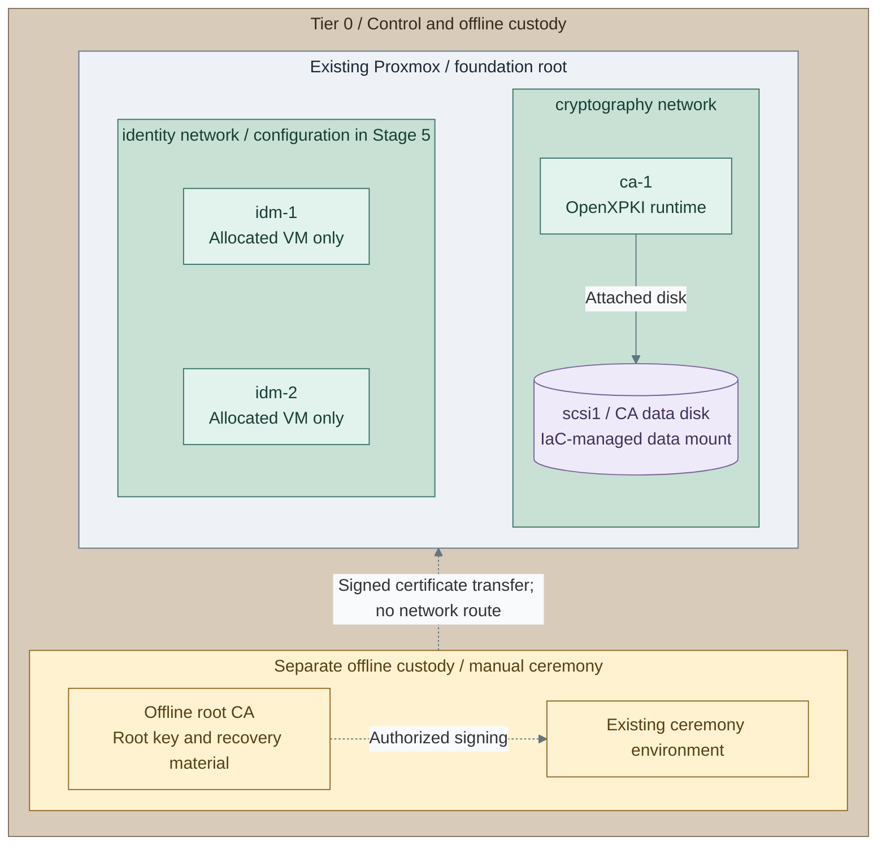

# Stage 3: Cryptographic trust

Establish an offline root and an online issuing CA. Normal issuance and renewal use
the intermediate CA, never an online root. Hardware protection changes key custody;
it is an optional branch, not a prerequisite for the rest of the platform.

<a id="figure-1-offline-root-and-online-issuer"></a>



**IaC:** **Figure 1: Offline root and online issuer.** Tier 0 [foundation guest definitions](../../../tier-0/terraform/deployments/foundation/terraform.tfvars.example)
and [issuer recipe](../../../tier-0/ansible/playbooks/deployment/openxpki.yml).
The unchanged starter root allocates all three VMs; directory configuration follows in Stage 5.
The issuer is configured first and drawn to the right; the FreeIPA CA remains its
sibling under the offline root, not a subordinate of the infrastructure issuer.
Ansible prepares the data mount; the root ceremony and CA activation remain controlled operations.
Hardware options replace software key custody; they are not additional default VMs.

**Related:** [Architecture](../../01-architecture/08-cryptography/01-certificate-authority.md) · [Operations](../../05-operations/03-cryptography/README.md)

**Prerequisites:** verified [foundation](../foundation/README.md) and accepted
[protected logging](../stage-2-logging/README.md),
protected recovery storage and authorized custodians. The reference selects OpenXPKI
Community as the permanent infrastructure issuer and clca for offline root operations;
existing qualified authorities remain valid. The runtime installer does not perform root ceremonies or token activation.
**Working repository:** `<prefix>-tier-0` (source: `tier-0/`).
**Automation:** software issuer/key/policy and recovery mechanisms are supplied;
ceremonies and acceptance remain controlled operations. Native provider installation and original-key
issuer CSR/token operations are supplied; ACME adapter qualification remains separate. See
[coverage](../../08-reference/implementation-support.md#stage-coverage).
**Design:** [certificate authority](../../01-architecture/08-cryptography/01-certificate-authority.md).

<a id="main-path"></a>

## Installation route

Follow the actions below in order. **1a** is software custody; **1b-1d** replace only the
key/provider work. Offline signing and token activation remain explicit custodial operations.

| Action | Continue at |
| --- | --- |
| [1. Select custody](#step-1-prepare-issuer-and-key-custody) | Software 1a, USB pool 1b, network HSM 1c or single USB 1d |
| [2-7. Prepare inputs, policy and the issuer host](#step-2-initialize-the-issuer-inputs) | Same existing foundation state |
| [8-10. Install the inactive issuer and prepare its CSR](#step-8-prepare-runtime-credentials-and-tls) | Selected software or hardware key |
| [11-13. Sign, activate and verify issuance](#step-11-sign-the-approved-request-offline) | Root ceremony, public certificate import, native token activation |
| [14. Accept recovery](#step-14-accept-issuance-and-recovery) | Evidence retained independently |
| [15a / 15b. Optional integrations](#step-15-select-additional-integrations) | API certificate transition and/or verified publication |

## Step 1: Prepare issuer and key custody

Use the [key-custody procedure](procedures/local-key-custody.md) for the selected physical key path.

[Figure 1](#figure-1-offline-root-and-online-issuer) separates the online runtime from offline custody.
Approve names, [algorithms](../../01-architecture/08-cryptography/02-algorithm-selection.md), requester/approver
roles, root custodians and recovery recipients before creating keys.

| Path | Select before installation | Key preparation later |
| --- | --- | --- |
| **1a: software, main** | Encrypted software issuer key; independent signer passphrase, DataVault and root recovery custody | Action 10a |
| **1b: USB pool** | [Provider hosts and device custody](step-1b-usb-hsm.md); no generic application HA is implied | Action 10b with the qualified original key |
| **1c: network HSM** | [Existing appliance and native client](step-1c-network-hsm.md); appliance commissioning remains product-specific | Action 10b |
| **1d: single USB** | [Local YubiHSM 2 or PicoHSM](step-1d-single-usb.md); qualify backup and physical host affinity | Action 10b |

For hardware, read the selected option's input/custody requirements now; perform its issuer-binding/CSR
commands at action 10b after the inactive runtime exists. If its host/runtime actions were already completed,
retain that installation and continue at the first unfinished action below. Do not generate a software key
for an HSM-backed issuer. Optional [PKCS#11 remoting](procedures/pkcs11-remoting.md) follows qualified local
provider/key recovery; a shared signing API is a separate Stage 6 option.

## Step 2: Initialize the issuer inputs

Run from **`<prefix>-tier-0/`**:

```bash
bash scripts/init-local-files.sh --setup foundation
cp -n ansible/group_vars/issuer.yml.example ansible/group_vars/issuer.yml
```

**Expected:** missing files created, existing inputs retained. Keep the original `--env` on all subsequent
wrapper commands if a named environment is already in use.

## Step 3: Select the image, host and data disk

Select the approved **Debian 12 amd64** issuer image from the shared template catalogue. This native
OpenXPKI package path differs from the EL10 directory/other Linux hosts; see its [OS qualification](procedures/issuer.md).

Edit in **`<prefix>-tier-0/`**:

| File | Set |
| --- | --- |
| `terraform/deployments/foundation/terraform.tfvars` | `vm_instances["ca-1"]`: approved Debian `template_vm_id`, unused VMID, placement, live storage and `extra_disks` capacity |
| `ansible/inventory/hosts.yml` | `ca-1` in `issuing_ca`; keep `root_ca` empty on connected inventory |
| `ansible/group_vars/foundation.yml` | Reserved `platform_host_ips.ca-1`; preserve the complete existing IP map |
| `terraform/common.tfvars` | Applied `network_zones.cryptography` attachment or its actual bridge/VLAN/subnet |
| `.env.local` | Real Proxmox credentials and approved SSH public-key paths |

Keep previously managed guests in this same foundation map/state. Fresh inputs may select only `ca-1`,
or retain the starter's allocated directory pair for Stage 5. Never run the identity recipe to install this CA.

## Step 4: Prepare the private policy

For **software 1a**, run from **`<prefix>-tier-0/`**; select a file in an existing protected directory:

```bash
read -r -e -p 'Absolute private issuer policy file path: ' ISSUER_POLICY_FILE
cp -n ansible/group_vars/issuer-policy.yml.example "$ISSUER_POLICY_FILE"
```

Edit **the selected private policy file**:

| Field | Set |
| --- | --- |
| `openxpki_bundle_directory` | New protected absolute build directory; retain each immutable bundle |
| `openxpki_bundle_portal_fqdn` | Stable `ca.<domain>` service name matching portal TLS |
| `openxpki_bundle_publication_url` | Reachable public-object URL ending in `/download/` |
| `openxpki_bundle_dns_suffixes` | Approved certificate scope |
| `openxpki_bundle_users` | Separate named requester/approver accounts and independent Argon2id hashes |

**Hardware 1b-1d:** supply a separately qualified immutable production configuration with the selected native
provider binding. The filesystem-key policy builder is not an HSM configuration generator; skip actions 5-6
when using that accepted bundle. Keep its reviewed artifact path/checksum for action 8.

## Step 5: Prepare software-policy secrets

For **1a**, generate each account's encoded hash on the trusted controller with the native `argon2` CLI.
Install its OS package if missing; the [policy reference](procedures/software-pki.md) records costs and custody.
Run from **`<prefix>-tier-0/`**, once per account:

```bash
read -rsp 'New account password: ' account_password; echo
printf '%s' "$account_password" | argon2 "$(openssl rand -hex 16)" -id -e -t 3 -m 16 -p 4
unset account_password
```

Save the hash in that account's policy entry. Prepare independently retained signer/DataVault secrets in
**the same protected Tier 0 shell**, for a fresh policy only:

```bash
read -rsp 'Issuer key passphrase (32+ characters): ' OPENXPKI_SIGNER_PASSWORD; echo
export OPENXPKI_SIGNER_PASSWORD
export OPENXPKI_DATAVAULT_SECRET="$(openssl rand -hex 32)"
```

Back up those exact values before building. Restore them on a retry; a newly generated DataVault value
cannot recover existing state.

## Step 6: Build the software-policy artifact

For **1a**, run from **`<prefix>-tier-0/`**:

```bash
ANSIBLE_CONFIG=ansible/ansible.cfg ansible-playbook -i localhost, ansible/playbooks/deployment/openxpki-bundle.yml -e "@$ISSUER_POLICY_FILE"
```

**Expected:** immutable archive path/SHA256 and a bootstrap portal certificate fingerprint.
Retain these values. Verify bootstrap TLS out of band; replace its seven-day certificate before normal use.
The builder refuses an existing final archive; reuse a successfully built artifact instead of rebuilding it.

## Step 7: Provision the issuer and attached storage

Run from **`<prefix>-tier-0/`**:

```bash
bash scripts/deploy.sh foundation --terraform-only
```

Review the whole-state plan and enter `yes` for intended changes. Optional preview adds `--plan-only`;
approved unattended provisioning adds `--auto-approve`. Neither authorizes signing.

**Expected:** host and dedicated `scsi1` disk allocated. Ansible manages the filesystem/UUID mount and
database bind during action 9; no guest disk-formatting or mounting step is required.

## Step 8: Prepare runtime credentials and TLS

Edit **`<prefix>-tier-0/ansible/group_vars/issuer.yml`**:

| Field | Set |
| --- | --- |
| `openxpki_data_device`, `openxpki_data_mount`, `openxpki_data_fstype` | Stable `scsi1` by-id path, `/srv/openxpki`, `xfs` for a new disk; `ext4` only for qualified existing storage |
| `openxpki_data_uuid` | Empty for a new disk, or the independently recorded existing-volume UUID |
| `openxpki_configuration_src`, `openxpki_configuration_sha256` | Reviewed artifact from action 6 or the qualified hardware policy |
| `openxpki_repository_key_sha256`, `openxpki_package_versions` | Approved repository-key hash and exact native package versions |
| `openxpki_portal_fqdn`, `openxpki_admin_networks`, `openxpki_publication_networks` | Stable service name, restricted portal clients and approved public-object readers |
| `openxpki_managed_cli` | `true` for the supplied software bundle; hardware follows its qualified native configuration |
| `openxpki_initialize_database`, `openxpki_activate_runtime` | `true` only for the first empty database; activation remains `false` |

In the protected shell, run from **`<prefix>-tier-0/`**; restore the same values on retries:

```bash
read -r -s -p 'Issuer database password: ' OPENXPKI_DATABASE_PASSWORD; echo
read -r -s -p 'Issuer session database password: ' OPENXPKI_SESSION_PASSWORD; echo
read -r -s -p 'Issuer session secret: ' OPENXPKI_SESSION_SECRET; echo
read -r -e -p 'Absolute portal TLS certificate path: ' OPENXPKI_TLS_CERT_FILE
read -r -e -p 'Absolute matching portal TLS key path: ' OPENXPKI_TLS_KEY_FILE
export OPENXPKI_DATABASE_PASSWORD OPENXPKI_SESSION_PASSWORD OPENXPKI_SESSION_SECRET
export OPENXPKI_TLS_CERT_FILE OPENXPKI_TLS_KEY_FILE
```

The software bundle supplies private bootstrap portal files in its build directory. Keep credentials and
TLS keys outside Git. The [issuer input reference](procedures/issuer.md) owns the recovery/activation constraints.

Enroll `ca-1` through [the reusable source-forwarding procedure](../stage-2-logging/procedures/sources.md),
using `foundation.yml` as its existing setup map. This adds the new producer; it does not repeat receiver
storage or authority initialization. Require an OS test event at protected intake before activating issuance;
add actual CA audit files when they exist.

## Step 9: Install the inactive runtime

Run from **`<prefix>-tier-0/`**:

```bash
bash scripts/deploy.sh foundation --ansible-only --playbook deployment/openxpki.yml --ansible-vars ansible/group_vars/issuer.yml
```

**Expected:** dedicated UUID-mounted data area, packages, MariaDB, portal and publication endpoint;
signing daemons remain stopped. Return `openxpki_initialize_database` to `false` immediately after success.
Do not initialize again to recover a partial/existing CA.

## Step 10: Prepare the issuing request

### 10a: Software key: main path

In **Tier 0 `ansible/group_vars/issuer.yml`**, set `openxpki_issuer_common_name`, a protected absolute
`openxpki_ceremony_directory`, and `openxpki_create_issuer_key: true`. Keep activation false.
Run from **`<prefix>-tier-0/`**, with the original signer passphrase loaded:

```bash
bash scripts/deploy.sh foundation --ansible-only --playbook deployment/openxpki-key.yml --ansible-vars ansible/group_vars/issuer.yml
```

**Expected:** encrypted issuer key retained on the issuer; only its public CSR fetched to the controller.
Return `openxpki_create_issuer_key` to `false`; retain the same key for any retry.

### 10b: Original hardware key: selected 1b-1d

Complete the selected option's provider binding and existing-key CSR recipe now, against the inactive
runtime from action 9. [Single-device actions 3-4](step-1d-single-usb.md#3-bind-the-inactive-issuer-to-its-original-key)
define the supplied YubiHSM/PicoHSM path; the pool/appliance option states its qualified interface.
It must return the CSR for the retained original public-key identity, never silently create a new key.
Both paths continue at action 11.

<a id="step-2-establish-the-certificate-hierarchy"></a>

## Step 11: Sign the approved request offline

Verify the CSR signature, subject, constraints and public-key fingerprint. Follow only the authorized
[software-root ceremony](procedures/offline-software-root.md) or
[hardware-root ceremony](procedures/offline-root.md) for the custody selected in action 1.
Return signed public certificates/CRLs only, back up the changed root instance and close offline custody.
This human signing handoff is not a CI job or an instruction to log into `ca-1`.

Retain the root recovery kit for the **separate** sibling FreeIPA CA ceremony in Stage 5.
Root isolation follows the [custody boundary](../../01-architecture/03-reference-platform.md#service-placement),
not a ceremony VLAN alone.

## Step 12: Install public certificates and start the prepared backend

In **Tier 0 `ansible/group_vars/issuer.yml`**, set `openxpki_issuer_certificate_src`,
`openxpki_root_certificate_src`, `openxpki_issuer_fingerprint` and `openxpki_root_fingerprint`
from the independently verified ceremony outputs. Run from **`<prefix>-tier-0/`**:

```bash
bash scripts/deploy.sh foundation --ansible-only --playbook deployment/openxpki-certificates.yml --ansible-vars ansible/group_vars/issuer.yml
```

**Expected:** verified public files installed without copying private keys. Set
`openxpki_required_state_paths` to the actual signer/provider and DataVault state under the mounted volume;
for the software bundle retain `keys/issuer.pem`, `keys/cli.pem` and `config.d/system/crypto.yaml`.
Set `openxpki_activate_runtime: true`, then rerun **action 9's command** once to start that prepared backend.
Hardware activation also requires its qualified provider and custody inputs. A running backend is not token import.

## Step 13: Activate the selected token and publish

As the authorized custodian, perform [software token activation](procedures/issuer-token.md) once, or the
selected [hardware token operation](step-1d-single-usb.md#5-complete-activation-and-acceptance).
Inspect existing aliases first, import the approved public root/issuer, record the returned token alias,
check the original key binding, then complete CRL/CA publication. These are explicit authority operations,
not a second host/runtime installation. Keep the root offline throughout routine issuance.

<a id="step-3-enable-and-verify-routine-issuance"></a>

## Step 14: Accept issuance and recovery

Pass the [CA acceptance matrix](../../05-operations/03-cryptography/certificate-authority.md#acceptance-evidence):
allowed/denied requests, separate approval, renewal, revocation, publication and an independent restore.
Hardware paths additionally qualify device/host loss and original-key recovery. Verify portal TLS from an
administrator and public objects from an intended reader. Record evidence and distribute approved public
trust material only. Keep the preissued-leaf path explicit; the Community ACME adapter still requires separate
qualification and is not an installed cert-manager integration.

## Step 15: Select additional integrations

<a id="3a-adopt-platform-pki-for-proxmox--optional"></a>

### 15a: Adopt platform PKI for Proxmox: optional

Complete the [API certificate transition](../../05-operations/01-hosting/proxmox-tls.md#step-2-adopt-the-platform-pki)
if selected, verifying every API caller. Retaining the independently trusted Proxmox CA is also valid.
Both keep certificate verification enabled.

<a id="3b-verified-repository-and-artifact-publication--optional"></a>

### 15b: Verified repository and artifact publication: optional

Follow [the verified-intake installer](step-15b-verified-intake.md), then its selected
[consumer cutover](step-15b-verified-consumers.md).
Its Figure 1 introduces the separately deployed Tier 1 worker at this decision point. Accept first publication,
quarantine/failure handling and the selected consumers, then return here. This extends Stage 1 supply after
logging and issued HTTPS identities exist; it does not require Kubernetes, Vault or Harbor.

## Capability available

**Result:** offline-root trust and accepted online issuance are available independently of the future cluster.
Record the selected custody path, optional integrations and recovery evidence in
**`<prefix>-architecture/deployments.md`**, then continue with [Stage 4: Kubernetes](../stage-4-kubernetes/README.md).
