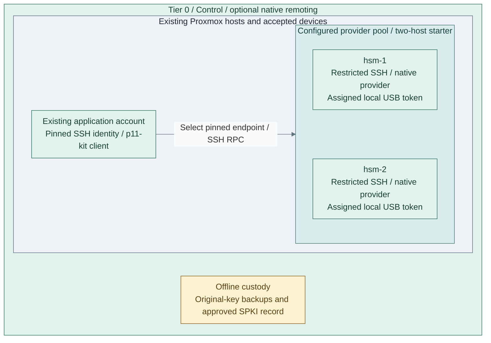

# Optional native PKCS#11 remoting

**Working repository:** `<prefix>-tier-0` (source: `tier-0/`), on the authorized controller.

After accepting a [local hardware issuer](../step-1d-single-usb.md), use this advanced extension
when an existing application needs remote PKCS#11 access. It does not change issuer custody or
require the issuer to use a network service. Complete the selected extension before returning to
[Step 1b](../step-1b-usb-hsm.md#3-verify-the-complete-service).



**IaC:** the existing [HSM VM inputs](../../../../tier-0/terraform/deployments/hsm/terraform.tfvars.example)
own `hsm-1/2` and native USB attachment. The [server play](../../../../tier-0/ansible/playbooks/deployment/hsm-remote.yml),
[client play](../../../../tier-0/ansible/playbooks/deployment/hsm-remote-client.yml) and
[role](../../../../tier-0/ansible/roles/hsm_remote) configure native transport on these accepted hosts/accounts.
This two-backend view creates no client VM, key copies or shared session state. Larger selected pools
retain one approved physical token and endpoint per host.

## Contents

- [1. Prepare a dedicated original-key domain](#1-prepare-a-dedicated-original-key-domain)
- [2. Declare the transport and client inputs](#2-declare-the-transport-and-client-inputs)
- [3. Publish the provider endpoints](#3-publish-the-provider-endpoints)
- [4. Configure an existing application account](#4-configure-an-existing-application-account)
- [5. Check signing and qualify failure behavior](#5-check-signing-and-qualify-failure-behavior)
- [Maintenance and recovery](#maintenance-and-recovery)
- [References](#references)

## 1. Prepare a dedicated original-key domain

Finish [provider host deployment](../step-1b-usb-hsm.md#1-prepare-the-service-hosts) first.
Select two devices from **one** family: `yubihsm2`, or `picohsm` using OpenSC's `sc-hsm` driver.
YubiHSM wrapped objects and PicoHSM DKEK recovery are different mechanisms. Possessing one device
of each family does not provide a pair of interchangeable backups. Use independent domains for
different keys; cross-vendor transfer requires separate qualification.

Custodians commission both devices with the approved original key, replace factory credentials,
and retain tested offline recovery material. IaC never initializes, resets, imports, clones or
regenerates a private key. Record each physical token's **distinct** PKCS#11 serial, the common
key object ID and its approved public SubjectPublicKeyInfo (SPKI) SHA-256 fingerprint.

Dedicate each exposed token to this one private signing key. Native `p11-kit remote` filters a
token, not individual objects or allowed cryptographic operations. Its SSH authorization grants
token-level access; the HSM credential/capabilities remain the cryptographic boundary. The role
requires a custody assertion, checks the authenticated private-key inventory contains exactly one
visible key, and compares that key's canonical SPKI DER fingerprint on every backend. Those checks
do not prevent a custodian from adding objects later or another HSM credential accessing more
objects. Do not expose a multi-purpose token or give clients administrator credentials. [1]

Use compatible, qualified p11-kit builds on all servers and clients. Set the common upstream version
explicitly; distro package releases may differ. RPC compatibility across different upstream versions
is not assumed. Version checks supplement the native end-to-end acceptance test. [2]

## 2. Declare the transport and client inputs

Copy `ansible/group_vars/hsm_remoting.yml.example` to a protected local `hsm_remoting.yml` and
edit it before deployment. The [role defaults](../../../../tier-0/ansible/roles/hsm_remote/defaults/main.yml)
own the complete optional input contract.

| Input | Selection |
| --- | --- |
| `hsm_remote_family` | `yubihsm2` or `picohsm`, matching both installed provider profiles |
| `hsm_remote_backends` | Inventory name → address, physical serial and independently accepted OpenSSH host public keys |
| `hsm_remote_key_id`, `hsm_remote_expected_spki_sha256` | Common hex object ID and 64 lowercase hex digits of the approved original SPKI SHA-256 |
| `hsm_remote_p11kit_version` | Qualified common upstream RPC version, available from the approved OS repositories |
| `hsm_remote_clients` | One dedicated SSH public key per application identity and explicit IPv4 source CIDRs; no `/0` |
| Custody assertions | `hsm_provider_custody_ready: true` and `hsm_remote_single_key_custody_confirmed: true`, only after the work above |
| Client host/account inputs | Existing inventory group, `hsm_remote_client_id`, existing application user/group and protected controller `hsm_remote_client_private_key_src` |
| PicoHSM reader authorization | `hsm_provider_pcsc_readers`: exact accepted PC/SC reader names, recorded during commissioning; the remoting role grants only its dedicated service identity |
| Guest firewall | `hsm_remote_firewall: auto` reconciles active firewalld; `firewalld` explicitly installs/enables it; `external` leaves guest policy with the declared external owner |

Retain per-host `hsm_provider_expected_serial` and YubiHSM connector serial in host vars. Supply
`HSM_REMOTE_PIN` through the protected controller environment. The role rejects factory credentials;
for YubiHSM the value includes the authentication-key ID. Neither the PIN nor a private SSH key
belongs in Git, a URI or copied command arguments. The SSH service key must be usable unattended
without a passphrase; the installed file is readable only by its application identity.

Independently accept both backend SSH host keys through the existing controller/custody path.
The server checks the supplied pins against its original OS-provisioned keys and never regenerates
them. No trust-on-first-use scan is accepted. Declare TCP `hsm_remote_port` (default `2222`) and
approved consumer source networks in the existing network/firewall IaC before deployment.
This listener is separate from management SSH and permits only its dedicated account. [3]
On enforcing SELinux targets, Ansible labels the selected port `ssh_port_t` using native policy
modules and installs the module dependencies. Selected firewalld rules admit only declared client
CIDRs and remove this pool's recorded obsolete rules on rerun. Review existing guest firewall
policy before explicitly enabling firewalld; this role does not replace the host's management rules.

## 3. Publish the provider endpoints

**Working repository:** `<prefix>-tier-0/` on the protected controller.

```bash
bash scripts/deploy.sh hsm --ansible-only --playbook deployment/hsm-remote.yml \
  --ansible-vars ansible/group_vars/hsm_remoting.yml
```

The normal HSM inputs remain loaded by the deployment wrapper. Select the complete backend group;
partial `--limit` acceptance is refused. Ansible prepares its controller dependencies, waits for the
managed guests, inspects the installed providers, installs native p11-kit/SSH/GnuTLS tools and
creates a dedicated forced-command identity with no usable password. It verifies each original
key as that account before enabling its native systemd SSH listener.
If a later server reconciliation rejects key readiness, it stops and disables that pool's existing
listener on the affected host. Recover the original key/credential, then rerun the deployment.

Every authorized key has `restrict` and explicit `from` CIDRs. The listener disables passwords,
PTYs, forwarding, user startup files and arbitrary commands. Its fixed command is native
`p11-kit remote --provider <library> pkcs11:serial=<physical-serial>`. The client supplies no command
or module path. YubiHSM uses the existing local loopback connector; PicoHSM uses PC/SC. No HTTP
signing server, VIP or general HA controller is installed. [1][3]

## 4. Configure an existing application account

Provision the consumer guests and create their service account through the owning application's
IaC first. Then include `hsm_remote` with `hsm_remote_action: client` **before starting that service**.
This lets a new consumer install the client in one deployment without depending on a pre-existing
account or deliberately failing its first start. Application installation remains owned by its
product role. For an already prepared account, use the standalone recipe below.

**Working repository:** `<prefix>-tier-0/` on the protected controller.

```bash
ANSIBLE_CONFIG=ansible/ansible.cfg ansible-playbook -i ansible/inventory/hosts.yml \
  -e @ansible/group_vars/all.yml -e @ansible/group_vars/hsm_remoting.yml \
  ansible/playbooks/deployment/hsm-remote-client.yml
```

Expected result: approved native packages, the existing private SSH credential, pinned host keys,
noninteractive SSH aliases, and one `hsm-<pool>-<backend>.module` per explicit endpoint. Each native
module runs the pinned SSH alias. Applications load `hsm_remote_proxy_library` (`p11-kit-proxy.so`)
and select the desired physical token serial/object ID. Other system p11-kit modules remain visible;
the consumer must select the approved key explicitly. Ansible verifies every backend as the real
application user before reporting success. No application configuration or service restart is inferred.

For an OpenBao consumer, the product role must create `openbao`, include this client role, then
start OpenBao with `openbao_pkcs11_library` set to this proxy path. OpenBao external-key API policy,
Raft state and plugin configuration belong to its separate Stage 6 integration. HashiCorp Vault's
default Shamir unseal is unchanged. A configured library path alone does not establish a usable API.

## 5. Check signing and qualify failure behavior

The same public key can occur on two distinct serials. The supplied probe selects **each serial**,
authenticates, counts visible private keys, exports only the public key, computes the canonical
SPKI DER hash and rejects a mismatch. Its default native GnuTLS `--test-sign` signs and verifies a
test message without creating a key. This consumes an HSM operation and may affect device usage
counters; set `hsm_remote_probe_sign: false` only for public-identity inspection. [4][5]
Each readiness probe has an isolated native p11-kit configuration because GnuTLS can deduplicate
providers with identical metadata. Raw PKCS#11 consumers use the separately configured aggregate
proxy library; a GnuTLS discovery pass is not evidence that both endpoints were checked. [6]

**Working repository:** `<prefix>-tier-0/` on the protected controller, with `HSM_REMOTE_PIN` injected.

```bash
ANSIBLE_CONFIG=ansible/ansible.cfg ansible-playbook -i ansible/inventory/hosts.yml \
  -e @ansible/group_vars/all.yml -e @ansible/group_vars/hsm_remoting.yml \
  ansible/playbooks/deployment/hsm-remote-check.yml
```

This recipe checks installed state and every original key without installing packages or rewriting
configuration. A missing backend, wrong SSH pin, invalid HSM PIN, additional private key or different
SPKI fails acceptance. Do not repeatedly test a wrong production PIN: device retry counters apply.

| Failure | Required consumer behavior |
| --- | --- |
| Lost SSH connection, token or host | Discard failed PKCS#11 sessions/handles; determine whether an operation completed before retrying |
| Reconnect to the same endpoint | Reinitialize the native client, log in and rediscover the pinned serial/object |
| Select another accepted endpoint | Explicitly select its different serial and verify the approved SPKI before signing |
| Fixed consumer `token_serial` | Remains bound to that physical device; the aggregate library does not substitute the other token |
| Same token label on both devices | Does not prove selection order, recovery or hot failover; qualify the exact consumer before relying on it |

There is no session migration, transparent serial substitution or automatic operation replay.
Both modules being visible does not prove consumer failover. The native fixture covers new
connections, sign/verify, denial, listener loss, use of the surviving endpoint and reconnection;
it does not establish in-flight operation recovery or OpenBao plugin failover.

## Maintenance and recovery

Rerun the server and client deployment commands after reviewing changes to packages, host pins,
authorized clients or native configuration. The base `maintenance/hsm.yml` maintains providers;
it does not reconcile this optional extension. The explicit deployment recipes above do so.
Removing an input client revokes its SSH key on the next server reconciliation. Remove obsolete
backend module files explicitly through reviewed configuration cleanup before retiring a backend;
the role does not delete unrelated system p11-kit configuration.
Existing SSH sessions survive authorization-file changes and listener reloads. For urgent
revocation, close the affected sessions or stop the listener through the managed service path
and revoke the HSM credential through custody; changing a public-key file alone is insufficient.

Upgrade all selected RPC participants through accepted packages and repeat native acceptance.
Recover original host identities, physical keys and credentials through custody; never regenerate
them to make a deployment pass. Complete independent same-family restore and each consumer's
failure/retry test before production acceptance. Physical YubiHSM/PicoHSM and SELinux-enforcing
target acceptance remain required; a software-token fixture is transport evidence only.

## References

Sources checked 2026-11-11.

1. [p11-kit native token remoting](https://p11-glue.github.io/p11-glue/p11-kit/manual/p11-kit.html)
   and [native remote module configuration](https://github.com/p11-glue/p11-kit/blob/master/doc/manual/pkcs11.conf.xml)
2. [Upstream RPC version compatibility report](https://github.com/p11-glue/p11-kit/issues/733)
3. [OpenSSH server options](https://man.openbsd.org/sshd_config) and [authorized key restrictions](https://man.openbsd.org/sshd)
4. [GnuTLS native p11tool operations](https://www.gnutls.org/manual/html_node/p11tool-Invocation.html)
5. [Ansible public-key fingerprint contract](https://docs.ansible.com/projects/ansible/latest/collections/community/crypto/openssl_publickey_info_module.html)
6. [GnuTLS native provider deduplication](https://github.com/gnutls/gnutls/blob/master/lib/pkcs11.c)
