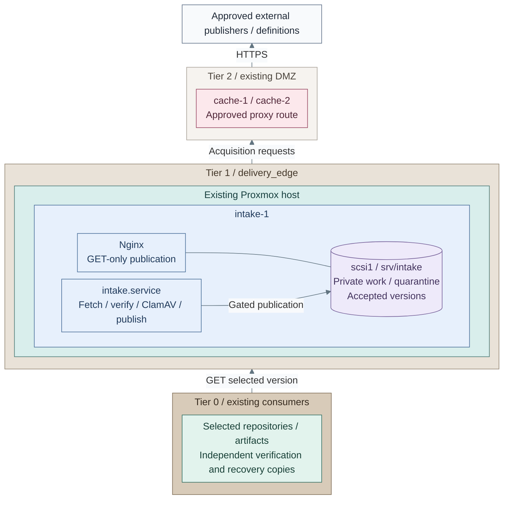
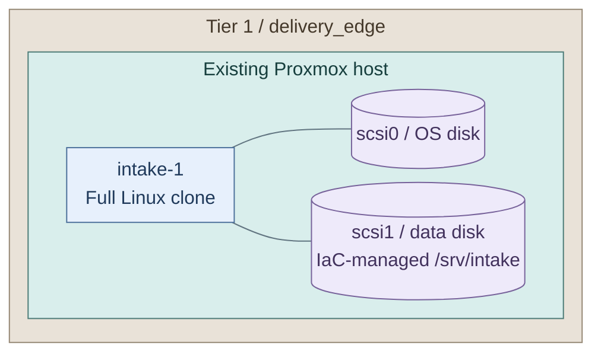

# Step 15b: Verified software intake

**Branch from:** [Step 15](README.md#step-15-select-additional-integrations), after issuer acceptance.
**Change:** extend Stage 1 software intake with a Tier 1 verification and publication worker.
**Return:** [Stage 3 completion](README.md#capability-available) after the selected sources and consumers pass.

Add `intake-1` to acquire RPM/APT repositories and selected artifacts, verify and scan a private
copy, then publish an identified version over read-only HTTPS. Retain the existing cache and its state;
extend its approved client/source policy in Step 2 when using that supply route.
This extension works with either Stage 1 supply route; it does not deploy Kubernetes or Harbor.

<a id="figure-1-verified-publication-and-consumers"></a>



**IaC:** **Figure 1: Verified publication and consumers.** Tier 1 [installer](../../../tier-1/ansible/playbooks/deployment/intake.yml),
[runtime](../../../tier-1/ansible/roles/software_intake/files/runtime/intake.yml) and
[policy inputs](../../../tier-1/ansible/group_vars/intake.yml.example).
Upward arrows show acquisition and consumer requests; the job arrow shows gated publication. The storage link
shows read-only attachment. The job aggregates `intake-fetch`, `intake-scan` and root publication;
OS storage holds policy, TLS and ClamAV definitions, with optional native FreshClam updating them.
Proxmox, proxy, trust,
firewall and protected logging are commissioned prerequisites, not additional resources from this setup.

**Provisioning:** one `deploy.sh intake` command in **Step 3** creates `intake-1`, prepares its
data volume and installs the service. Terraform owns the VM/disks; Ansible manages the filesystem
and UUID mount. Step 1 initializes configuration files only.

**Working repository:** `<prefix>-tier-1` owns the worker and state; Shared supplies platform references.

**Existing collection:** first [refresh the collection](../../04-development/generated-repositories.md#refresh-and-local-ownership)
if the selected kit update has not been adopted. Retain the original prefix, parent directory and state.
Refresh preserves the local setup registry and inventory; register this option in Step 1 below.

**Before starting:** complete [Stage 1 intake](../stage-1-software-intake/README.md),
[Stage 2 logging](../stage-2-logging/README.md) and [issuer acceptance](README.md#step-14-accept-issuance-and-recovery).
Reserve an address on `delivery_edge` and issue its HTTPS certificate before installation.
Use the [logging source guide](../stage-2-logging/procedures/sources.md) to protect intake decisions.
No Kubernetes, Vault, Harbor or GitLab service is required.

**Host:** a clone-tested EL10 or Debian-family systemd image. Its approved repositories must supply
the [native packages](../../../tier-1/ansible/roles/software_intake/defaults/main.yml), including
EL10 EPEL packages, and ClamAV with `--fail-if-cvd-older-than`. The installer checks the engine;
it never enables an external package repository or downloads worker collections from Galaxy.
The worker also requires curl ≥8.4, DNF 4 and the native RPM/APT verification libraries;
an older distribution's default packages may not satisfy these gates.

## Contents

- [1. Initialize inputs](#1-initialize-inputs)
- [2. Select sources and trust](#2-select-sources-and-trust)
- [3. Deploy the VM and service](#3-deploy-the-vm-and-service)
- [4. Supply current scanner definitions](#4-supply-current-scanner-definitions)
- [5. Run and inspect the first intake](#5-run-and-inspect-the-first-intake)
- [6. Connect consumers and schedule intake](#6-connect-consumers-and-schedule-intake)

## 1. Initialize inputs

For an existing collection, register the setup before initialization. In **`<prefix>-tier-1/`**:

1. Add `intake` to `.deployment-setups` if absent; retain every existing entry.
2. Under `all.children` in `ansible/inventory/hosts.yml`, add this group if absent:

   ```yaml
   software_intake:
     hosts:
       intake-1: {}
   ```

3. Under the existing `all.children.guests.children`, add this membership if absent:

   ```yaml
   software_intake: null
   ```

Keep other hosts/groups and check existing names, VMIDs and address reservations.
This registers inventory and the recipe; it imports or creates no VM. Fresh generated collections
already contain these entries. Both paths continue with initialization below.

Run on the bootstrap host from **`<prefix>-tier-1/`**:

```bash
bash scripts/init-local-files.sh --setup intake
```

Edit in **`<prefix>-shared/`**:

| File | Set |
| --- | --- |
| `config/platform.tfvars` | Existing destination node and VM-image storage classes |
| `templates/proxmox-catalog.tfvars` | Approved Linux template; firmware must match that template |

Edit in **`<prefix>-tier-1/`**:

| File | Set |
| --- | --- |
| `.env.local` | Actual Proxmox endpoint/token and local SSH public-key paths |
| `terraform/common.tfvars` | Applied `delivery_edge` VNet, or its explicit bridge/VLAN/subnet |
| `terraform/deployments/intake/terraform.tfvars` | Free VMID, placement, memory and data-disk capacity |
| `ansible/group_vars/all.yml` | Domain and the clone's SSH user |
| `ansible/group_vars/intake.yml` | Reserved `intake-1` IP, HTTPS identity/files, reader CIDRs, proxy and selected sources |

The starter uses VMID `1221`, IP `10.30.31.40`, a 40 GiB OS disk and 200 GiB `scsi1` data disk.
Size for **two working copies**, retained versions, quarantine and the free-space reserve;
200 GiB is a starter, not capacity for every distribution. See [input precedence](../../08-reference/platform-inputs.md).
Measure a small architecture/component selection first; large trees also need a suitable
`software_intake_timeout_seconds` rather than an assumption that a complete distro fits the default window.

In **Tier 1 `ansible/group_vars/intake.yml`**, keep these defaults for the new `scsi1` disk:

```yaml
software_intake_data_device: /dev/disk/by-id/scsi-0QEMU_QEMU_HARDDISK_drive-scsi1
software_intake_data_fstype: xfs
software_intake_data_dir: /srv/intake
software_intake_data_uuid: ""
```

Use `ext4` instead of `xfs` if selected for that volume. Leave the UUID empty for a new blank disk;
pin the existing UUID when adopting or restoring data. Existing data must match the selected
device, filesystem and recorded mount identity; an unrecognized volume is not reformatted.

## 2. Select sources and trust

Edit `software_intake_sources` in **Tier 1 `ansible/group_vars/intake.yml`**. Start with one small
source. Public keys live outside Git; obtain their full fingerprints through a trusted vendor channel.
Never copy an unverified key or hash from the same untrusted download as its only trust check.

| Kind | Required source fields | Published layout / verification |
| --- | --- | --- |
| `rpm` | `name`, HTTPS `url`, `releasever`, `architectures`, `key_file`, `key_fingerprint` | Native repository root; metadata-bound hashes and package signatures; signed metadata when `repo_gpgcheck: true` |
| `apt` | `name`, HTTPS `url`, `distribution`, `components`, `architectures`, `key_file`, `key_fingerprint` | Native `dists/` and `pool/`; signed Release/InRelease, freshness and referenced hashes |
| `artifact` | `name`, HTTPS `url`, `filename`, trusted `sha256` | Selected file; optional `signature_url` plus pinned `key_file` / `key_fingerprint` |

The [editable example](../../../tier-1/ansible/group_vars/intake.yml.example) shows all three shapes.
Use a fixed RPM repository URL; enable `repo_gpgcheck` only where the vendor signs `repomd.xml`.
RPM package signatures remain required either way. For APT, use `expected_codename` if a suite
such as `bookworm-updates` declares a different signed Codename. Vendor metadata is preserved,
not rewritten or re-signed. Missing packages, invalid signatures or stale metadata stop publication.

**Coverage:** ClamAV checks supported files/archives and holds detections, encrypted/broken content,
scan-limit failures and engine errors. Opaque VM disk images (`raw`, `qcow2`, ISO and similar) are
held; this path does not inspect their guest filesystems. OCI signatures, Trivy vulnerability gates
and automatic patch installation are separate integrations. See the [design](../../01-architecture/07-software-intake/01-verification.md).

For the supplied proxy pair, edit **Tier 2 `ansible/group_vars/cache.yml`**: add the worker's actual
IP as a narrow entry in `cache_squid_allowed_cidrs` (starter `10.30.31.40/32`) and include selected
vendor/redirect and definition hosts in `cache_squid_allowed_domains`. Preserve existing clients/sources.
Apply that policy from **`<prefix>-tier-2/`** before the new worker needs packages:

```bash
bash scripts/deploy.sh cache --recipe maintenance
```

For an existing supply service, make the equivalent client/source-policy change there.

Select the definition supply in **Tier 1 `ansible/group_vars/intake.yml`** before deploying:

- **Connected updates (4a):** set `software_intake_freshclam_enabled: true` and configure the
  approved `software_intake_environment.http_proxy` / `https_proxy` route.
- **Disconnected supply (4b):** keep the updater disabled and prepare verified official database
  files for transfer in Step 4.

Allow only approved clients to `intake-1:443`, bootstrap management to SSH and the worker to its
approved proxy, DNS/time and protected logging. Deny direct Internet bypass independently.
Nginx also restricts readers to `software_intake_allowed_cidrs`; this is a shared reader scope,
not per-repository user authentication.

<a id="3-provision-the-vm"></a>
<a id="4-prepare-the-data-filesystem"></a>
<a id="5-install-the-service"></a>

## 3. Deploy the VM and service

<a id="figure-2-intake-worker-and-disks"></a>



**IaC:** **Figure 2: Intake worker and disks.** Tier 1 [VM inputs](../../../tier-1/terraform/deployments/intake/terraform.tfvars.example),
[resource root](../../../tier-1/terraform/deployments/intake/main.tf) and
[inventory](../../../tier-1/ansible/inventory/hosts.yml.example). The Tier 1
[deployment playbook](../../../tier-1/ansible/playbooks/deployment/intake.yml) uses Shared's
[data-volume role](../../../shared/ansible/roles/data_volume/tasks/main.yml) to manage the filesystem,
UUID mount and growth. Storage links mean attachment.
One VM is not HA; its outage pauses both new intake and its publication endpoint.

Provision the worker and attached storage in [Figure 2](#figure-2-intake-worker-and-disks).

Run from **`<prefix>-tier-1/`**:

```bash
bash scripts/deploy.sh intake
```

Review the plan and enter `yes`. Approved CI can add `--auto-approve`; optional preview uses
`--plan-only`. Terraform provisions the VM and disks; Ansible then prepares the data volume and
installs the service. No manual formatting or mount setup is needed.

**Expected:** a writable `/srv/intake` mounted by UUID with `nodev,nosuid,noexec`, isolated fetch/scan
accounts, root-owned policy, read-only HTTPS publication and `intake.service`. Only a verified new
blank disk is formatted. Recognized existing data is preserved; a missing declared volume or a
different filesystem/UUID stops deployment. There is no fallback to the OS disk.

The installer checks the supplied TLS chain/key, publisher fingerprints and scanner capabilities.
No intake runs yet; keep `software_intake_timer_enabled: false` until Step 6.

Before the first intake in Step 5, enroll **`intake-1`** through
[logging source preparation, signing and installation](../stage-2-logging/procedures/sources.md).
Use Tier 1's `ansible/group_vars/intake.yml` as its existing setup map. Verify its journal stream
at protected Tier 0 intake; add a separate file stream for the actual Nginx access/error logs.
The intake recipe installs neither forwarding nor receiver enrollment. Return here for Step 4
after the host's test event arrives; do not start acquisition before that gate.

<a id="6-supply-current-scanner-definitions"></a>

## 4. Supply current scanner definitions

**4a — Approved connected updates:** the selected native FreshClam service supplies `/var/lib/clamav`
through the approved proxy. From **`<prefix>-tier-1/`**, inspect the managed host without a guest login:

```bash
ANSIBLE_CONFIG=ansible/ansible.cfg ansible intake-1 --playbook-dir ansible -i ansible/inventory/hosts.yml --become -m ansible.builtin.command -a 'journalctl -u clamav-freshclam.service -n 30 --no-pager' -e @ansible/group_vars/all.yml -e @ansible/group_vars/intake.yml
ANSIBLE_CONFIG=ansible/ansible.cfg ansible intake-1 --playbook-dir ansible -i ansible/inventory/hosts.yml --become -m ansible.builtin.command -a 'ls -lh /var/lib/clamav' -e @ansible/group_vars/all.yml -e @ansible/group_vars/intake.yml
```

**4b: Disconnected supply.** Place approved ClamAV database files on the bootstrap host, including
current `daily.cvd` or `daily.cld`. In **Tier 1 `ansible/group_vars/intake.yml`**, keep
`software_intake_freshclam_enabled: false` and add their controller paths and independently approved hashes:

```yaml
software_intake_definition_files:
  - name: daily.cvd
    src: /srv/artifacts/clamav/daily.cvd
    sha256: <approved-sha256>
```

Add `main.cvd` and `bytecode.cvd` entries when supplying those databases; use their actual filenames,
paths and hashes. Reconcile from **`<prefix>-tier-1/`**:

```bash
bash scripts/deploy.sh intake --ansible-only
```

The installer transfers and qualifies the complete proposed database before activating selected files.
It checks hashes, native container verification/loading, daily freshness and revision rollback; replaced
files retain backups. CVD signature verification and an approved CLD hash are different trust checks.
Do not run FreshClam and imported-file ownership together. Refresh approved files and repeat this action
before `software_intake_max_definition_age_days` expires (default two days).
No current definitions means no publication; an HTTP cache is not an offline definition bundle.

Both routes continue at **Step 5**.

<a id="7-run-and-inspect-the-first-intake"></a>

## 5. Run and inspect the first intake

Exercise the gated publication path in [Figure 1](#figure-1-verified-publication-and-consumers)
before changing consumer repositories.

Run from **`<prefix>-tier-1/`**:

```bash
bash scripts/deploy.sh intake --recipe maintenance
```

This starts the serialized native service with the configured policy. Acquisition, private-copy
verification, scanning and publication run in order. A failed source is quarantined; the command
fails, while independently successful sources can publish. There is no all-sources transaction.

From an allowed client with the publisher CA trusted, enter its real DNS name and source ID:

```bash
read -r -p 'Intake hostname: ' INTAKE_HOST
read -r -p 'Source name: ' SOURCE
curl --fail --show-error "https://$INTAKE_HOST/approved/$SOURCE/latest.json"
```

**Expected:** a version, immutable content URL and receipt URL. Read that receipt and a selected
file using the returned URLs. A new source stays 404 until accepted; rejected bytes never appear
under `/approved/`. Complete the [failure checks](../../05-operations/02-software-intake/verified-publication.md#how-is-the-publication-gate-tested)
in a disposable test source before selecting production consumers.

<a id="8-connect-consumers-and-schedule-intake"></a>

## 6. Connect consumers and schedule intake

Use the returned **versioned content URL** as the native repository base URL. Keep vendor keys,
package/metadata signature checks, TLS verification and APT freshness checks enabled. Package-manager
syntax belongs to the selected distribution; preserve its existing repository IDs and policy.
Do not configure `latest.json` as a repository or disable verification to use an expired snapshot.
Follow the copyable [RPM/APT consumer cutover](step-15b-verified-consumers.md) for the actual file edits and refresh checks.

Tier 0 operators select and verify these versions, retain recovery supply independently and deny
live-source bypass. The worker holds no Tier 0 credentials. Artifact consumers retain the approved
SHA256/signature alongside their pinned URL; a scan receipt is not a vendor signature.

After first-publication and failure acceptance, set `software_intake_timer_enabled: true` and
the desired `software_intake_schedule` in Tier 1 `intake.yml`; repeat Step 3. Retain the deployment
inputs, public keys, receipts and VM/data backup independently. Continue the main
[Stage 3 completion](README.md#capability-available); use the [operations runbook](../../05-operations/02-software-intake/verified-publication.md)
for incidents, rollback and storage cleanup.
