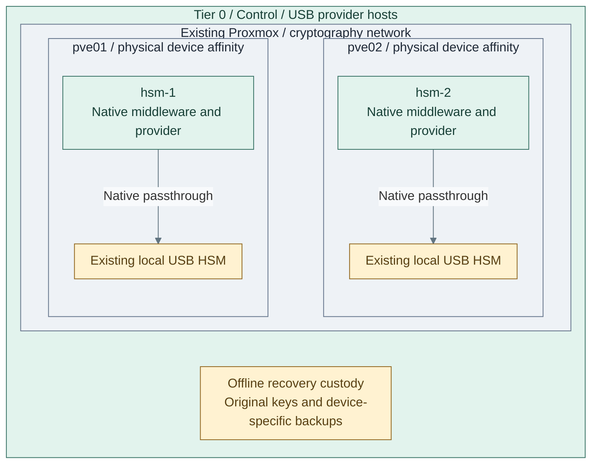

# Step 1b: Replicated USB HSM services

**Working repository:** `<prefix>-tier-0` on the protected controller (source: `tier-0/`).

<a id="usb-hsm-active-active-deployment-guide"></a>

**Branch from:** [Step 1](README.md#step-1-prepare-issuer-and-key-custody), before production keys.
**Change:** prepare independently managed USB provider hosts for a selected signing application.
**Return:** [action 10b](README.md#step-10-prepare-the-issuing-request) for the issuer runtime
and original hardware-key CSR, then action 11 signing.
**Design:** [USB services and endpoint variants](../../01-architecture/08-cryptography/04-usb-hsm.md).

<a id="figure-1-usb-provider-hosts-and-custody"></a>



**IaC:** **Figure 1: USB provider hosts and custody.** [HSM VM inputs](../../../tier-0/terraform/deployments/hsm/terraform.tfvars.example) and
[deployment recipe](../../../tier-0/ansible/playbooks/deployment/hsm-gateways.yml) own the two-host
starter, USB attachment and provider installation. Hardware and key custody already exist.
This view adds no signing application, key replication or VIP; shared transport is selected at action 2.

**First installation:** select custody at Stage 3 action 1; prepare the issuer through
[actions 2-9](README.md#step-2-initialize-the-issuer-inputs), then execute this option
from its first unfinished provider/key action at [10b](README.md#step-10-prepare-the-issuing-request).
Retain the already installed inactive runtime and data mount; do not provision or initialize them again.

## Contents

- [Supplied automation and prerequisites](#supplied-automation-and-prerequisites)
- [1. Prepare the service hosts](#1-prepare-the-service-hosts)
- [2. Integrate the application and endpoint](#2-integrate-the-application-and-endpoint)
- [3. Verify the complete service](#3-verify-the-complete-service)
- [Maintenance](#maintenance)
- [References](#references)

## Supplied automation and prerequisites

Terraform provisions the selected VMs and attaches approved USB devices through native bpg
`usb` blocks. Ansible installs the selected packages and native configuration, starts local
YubiHSM or OpenSC transport when selected, and lists present tokens without login. [1][2][3]

| Selection | Automated host capability | Required external input |
| --- | --- | --- |
| `yubihsm2`, `usb` | Packaged connector bound to loopback and device serial; native PKCS#11 configuration | Approved SDK packages/source, library path, device and reported token serials |
| `picohsm`, `usb` | OpenSC `sc-hsm`, native PC/SC transport and scoped headless authorization | Supported device/firmware, exact reader name, library path and reported token serial |
| `pkcs11`, `client` | Explicit vendor client packages and supplied native configuration files | Selected product/release, entitlement and completed authenticated enrollment |

Physical installation, device initialization, key generation/import/backup ceremonies and custody
remain separately authorized operations. Prepare approved package sources through baseline inputs;
do not log into a new guest to install middleware. The role accepts Debian and RedHat systemd hosts;
the selected SDK still needs qualification on the exact OS/CPU. The issuer retains its Debian contract.

The optional [native PKCS#11 remoting extension](procedures/pkcs11-remoting.md) supplies restricted
SSH endpoints, client configuration and original-key sign/verify probes. It requires two same-family
devices holding the same approved original key. Independent tokens do not synchronize keys or
establish application HA. For separate YubiHSM and PicoHSM devices, start with
[one local issuer device](step-1d-single-usb.md); the other family can serve an independent key domain.
Tier 1 and Tier 2 consumers, public edge and Kubernetes are not prerequisites for these Tier 0 hosts.

### 1. Prepare the service hosts

Configure the two hosts and local device attachments in
[Figure 1](#figure-1-usb-provider-hosts-and-custody) before selecting any shared transport.

Initialize local files from **`<prefix>-tier-0/`**:

```bash
bash scripts/init-local-files.sh --setup hsm
```

Edit these inputs before applying:

| File | Required edits |
| --- | --- |
| `terraform/common.tfvars` | Approved templates, storage and `cryptography` network attachment |
| `terraform/deployments/hsm/terraform.tfvars` | Selected `vm_instances` with explicit `proxmox_node_name` and per-VM `usb_devices` |
| `ansible/inventory/hosts.yml` | Selected hosts under `hsm_gateways`; remove unselected examples |
| `ansible/group_vars/all.yml` | Connection, hostname, baseline and approved package-source inputs |
| `ansible/group_vars/hsm.yml` | Complete IP map, `hsm_provider`, mode, packages, library and any native client configuration |
| `ansible/host_vars/<host>.yml` or inventory host fields | `hsm_provider_expected_serial`; also `hsm_yubihsm_serial` for each local YubiHSM |

The [example](../../../tier-0/terraform/deployments/hsm/terraform.tfvars.example) selects two VMs
on different Proxmox nodes. Size the pool for measured demand and failure headroom. Additional
hosts need matching Terraform, inventory, IP and per-device inputs.

Each VM's `usb_devices` accepts one `host` bus-port/vendor:product selector or an existing `mapping`
per attachment, with optional `usb3`. Prefer an approved port or resource mapping when identical
devices share a host. The physical token and selected Proxmox mapping are existing prerequisites;
attachment to the VM is automated. Raw host passthrough can require stronger API privileges. [1]

Keep each mapping restricted to its reviewed physical device/node. Initial placement and a resource
mapping do not guarantee runtime affinity or copy keys. Complete the selected
[cluster mobility policy](../foundation/proxmox/step-1b-cluster-ha.md#terraform-against-the-cluster)
before allowing device-facing guests to move. Do not add alternative nodes with unrelated tokens.

Plan from **`<prefix>-tier-0/`**:

```bash
bash scripts/deploy.sh hsm --plan-only
```

Review USB selectors, VM/node identity and any replacement before applying from **`<prefix>-tier-0/`**:

```bash
bash scripts/deploy.sh hsm
```

For approved unattended execution, use `--auto-approve` on the same command. Expected result:
Terraform attaches the selected devices; Ansible waits for guests, applies baseline, installs the
provider and lists the expected serial on every selected host. Missing middleware, permissions,
enrollment or an absent/wrong token stops deployment. Listing uses no PIN and changes no key. [3]

**IaC:** [HSM Terraform](../../../tier-0/terraform/deployments/hsm/main.tf),
[native USB input](../../../tier-0/terraform/deployments/hsm/usb.tf),
[deployment recipe](../../../tier-0/ansible/playbooks/deployment/hsm-gateways.yml),
[provider role](../../../tier-0/ansible/roles/hsm_provider/tasks/main.yml) and
[input examples](../../../tier-0/ansible/group_vars/hsm.yml.example).

### 2. Integrate the application and endpoint

For shared remote PKCS#11 access, complete the numbered
[native p11-kit/SSH procedure](procedures/pkcs11-remoting.md) after provider deployment above.
It installs dedicated forced-command listeners, per-client/source authorization, pinned host keys,
native client modules and canonical SPKI checks for every physical token. Each endpoint exposes
one dedicated token containing the original signing key. There is no object-level RPC policy,
session migration, VIP or automatic replay. Clients explicitly select endpoints and reestablish sessions.

For an application signing API, use the separately selected
[OpenBao external-key option](../stage-6-secrets/step-11b-openbao.md) after its prerequisites.
Its API policy and persistent state are separate from PKCS#11 transport. Existing independent
tokens are not a replicated key domain, and the transport does not make an application highly available.
Record that later option and finish Stage 3's selected provider/remoting checks here;
the signing API is not a Stage 3 completion dependency.

For a supported provider on the infrastructure issuer, follow the
[single-device issuer binding](step-1d-single-usb.md#3-bind-the-inactive-issuer-to-its-original-key).
It validates the approved OpenXPKI PKCS#11 signer configuration and uses an existing key for a CSR.
It does not turn independent issuer/provider hosts into application replicas.

### 3. Verify the complete service

Repeat non-destructive provider inspection from **`<prefix>-tier-0/`**:

```bash
bash scripts/deploy.sh hsm --ansible-only --playbook deployment/hsm-inspect.yml
```

| Case | Required evidence for the selected consumer |
| --- | --- |
| Authorized request / denied operation | Correct key identity, supported mechanisms and enforced application policy |
| USB device lost while VM and port remain up | Native key/sign probe fails; the consumer rejects this backend |
| Host or endpoint lost | Measured interruption and explicit reconnect/endpoint selection; no unsafe replay |
| Independent restore | Original key, application state, policy and startup credentials recover without active replicas |

Token listing proves visibility only. Record live sign/verify, denied-operation, endpoint and independent
recovery results in project-owned deployment records before continuing with production acceptance.

## Maintenance

Reconcile reviewed package/configuration changes from **`<prefix>-tier-0/`**:

```bash
bash scripts/deploy.sh hsm --ansible-only --playbook maintenance/hsm.yml
```

Maintenance reuses provider installation and inspection, with one provider host at a time.
If remoting is selected, also rerun its server/client deployment commands in the
[remoting maintenance procedure](procedures/pkcs11-remoting.md#maintenance-and-recovery).
Use [USB maintenance](../../05-operations/03-cryptography/usb-hsm.md) for custody and recovery procedures.

## References

Sources checked 2026-11-11.

1. [bpg VM native USB attachment](https://github.com/bpg/terraform-provider-proxmox/blob/main/docs/resources/virtual_environment_vm.md)
   and [API privilege requirements](https://github.com/bpg/terraform-provider-proxmox/blob/main/docs/index.md)
2. [YubiHSM connector configuration and USB permissions](https://docs.yubico.com/hardware/yubihsm-2/hsm-2-user-guide/hsm2-tools-connector.html)
3. [OpenSC token inspection options](https://manpages.debian.org/bookworm/opensc/pkcs11-tool.1.en.html)
