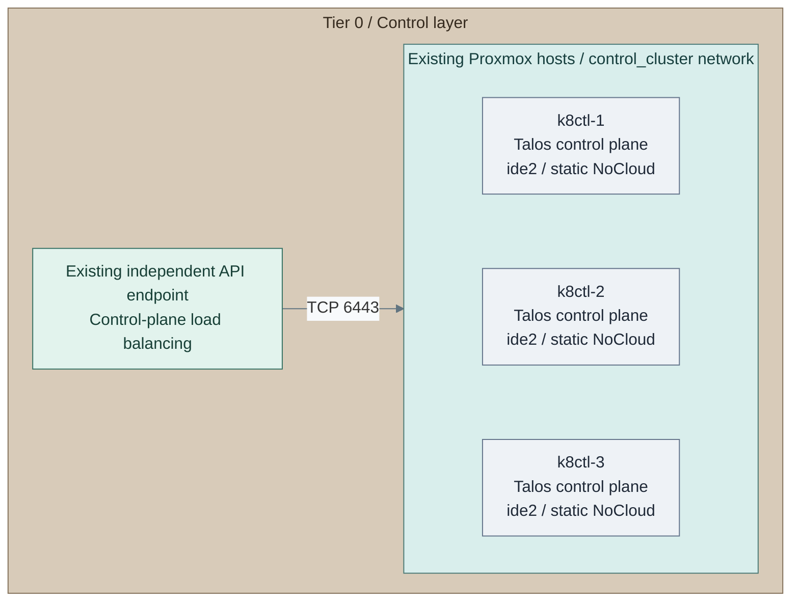
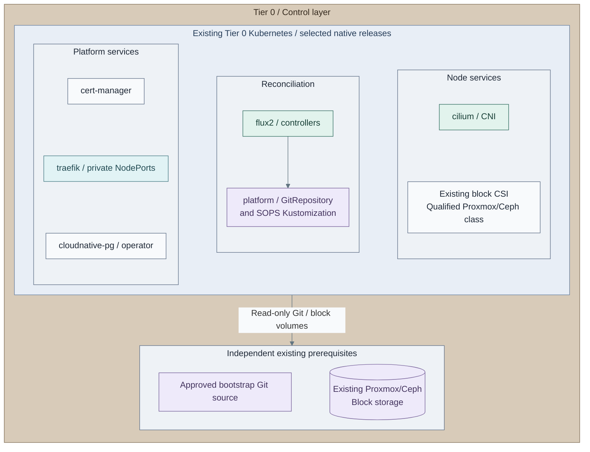
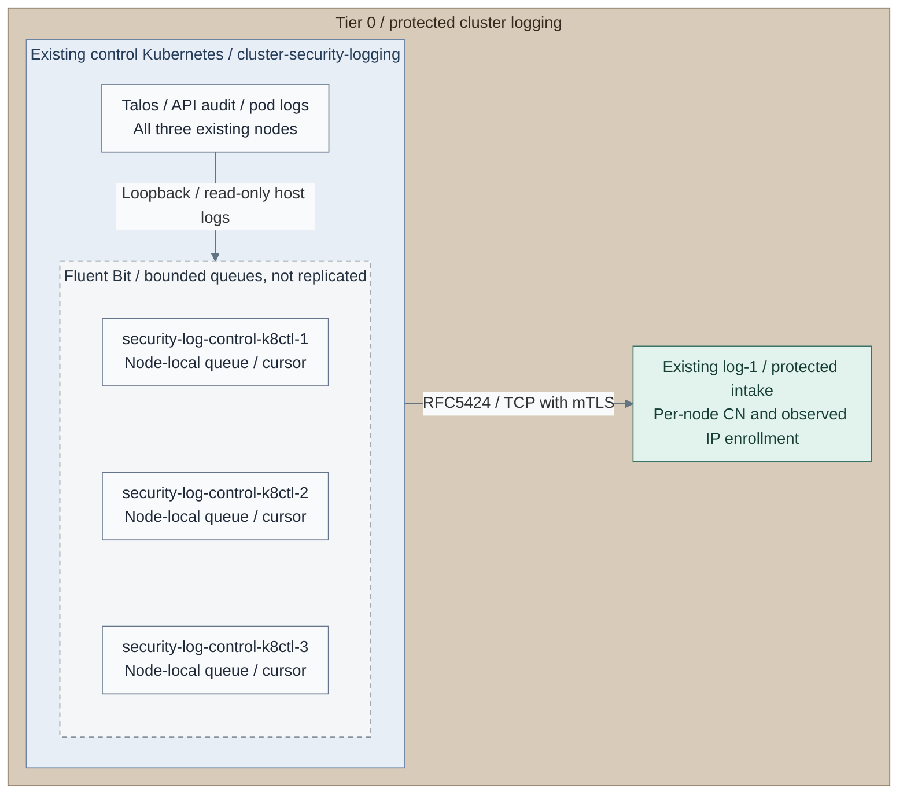

# Stage 4: Kubernetes

Create the Tier 0 control cluster, then establish the basic platform before
deploying identity federation, secrets or other control applications. Kubernetes
is the capability; Talos is the supplied node-OS implementation.

<a id="figure-1-control-cluster-runtime"></a>



**IaC:** **Figure 1: Control-cluster runtime.** Tier 0 [Kubernetes inputs](../../../tier-0/terraform/deployments/kubernetes/terraform.tfvars.example)
and [cluster entry point](../../../tier-0/scripts/kubernetes-cluster.sh) create these three VMs and bootstrap Kubernetes.
The API endpoint, IP allocations and approved node template already exist.
Each VM receives a network-only NoCloud drive at `ide2`, plus its live boot/EFI disks;
the Talos API applies machine configuration. DHCP bootstrap remains an explicit legacy option.
No workers are active in this starter; application and add-on manifests are separate inputs.

**Related:** [Architecture](../../01-architecture/04-hosting/03-kubernetes.md) · [Operations](../../05-operations/01-hosting/kubernetes-and-labs.md)

**Prerequisites:** accepted software intake, protected logging and cryptographic
trust; approved node images, independent DNS/time, reserved static node IPs and a private
API endpoint outside this cluster. Retain bootstrap tools, images and credentials
without depending on FreeIPA, Keycloak or later Tier 1 delivery services.
**Working repository:** `<prefix>-tier-0` (source: `tier-0/`).
**Automation:** tier-local Terraform provisions nodes and bootstraps Kubernetes.
Prepare the [private endpoint](procedures/api-endpoint.md) before cluster bootstrap;
a qualified existing endpoint is also valid. Tier-local Ansible inputs select reusable
platform and protected cluster-source collection roles in Shared.
See [coverage](../../08-reference/implementation-support.md#stage-coverage).
**Design:** [Kubernetes runtime](../../01-architecture/04-hosting/03-kubernetes.md).

**Version decision before provisioning:** retain the approved **Talos 1.13.x** image, installer
schematic/release and matching CLI selected in
[Foundation](../foundation/proxmox/templates.md#talos-version-contract).
The reference Cilium patches and Stage 5 SSO workflow use that minor. A 1.14 logging-render option
does not qualify the complete platform or SSO path; do not upgrade/downgrade existing nodes here.

<a id="main-path"></a>

## Installation route

Follow actions 1-19. They keep node preparation **before** bootstrap and install Cilium **before** ordinary
pods. An accepted existing cluster skips new-node provisioning, not the platform/logging gates.

| Actions | Result |
| --- | --- |
| [1-3](#step-1-select-the-cluster-owner) | One node lifecycle and an independent private API endpoint |
| [4-7](#step-4-initialize-new-cluster-inputs) | New-node inputs and all ordered native patches prepared |
| [8-10](#step-8-save-and-review-the-node-plan) | New cluster bootstrapped once; credentials retained |
| [11-14](#step-11-configure-the-platform-target) | Cilium, node readiness and protected collection |
| [15a / 15b / 15c](#step-15-qualify-live-storage) | Selected block CSI; optional separate file CSI |
| [16-18](#step-16-prepare-flux-and-bootstrap-secrets) | Remaining platform and verified Flux reconciliation |
| [19](#step-19-accept-operation-and-recovery) | Recovery and service gates before Identity |

<a id="step-1-create-the-kubernetes-cluster"></a>

## Step 1: Select the cluster owner

Select **1a: new Terraform-owned Talos cluster** in [Figure 1](#figure-1-control-cluster-runtime), or
[**1b: accepted existing Talos cluster**](step-1b-existing-cluster.md). The existing path retains its original
node secrets, IaC/state owner, client files and qualified native patches. After its checks, complete **action 7** for its actual node logging inputs/render,
then rejoin at **action 11**. Skip new-resource actions 2-6 and 8-10; retain the accepted endpoint. Keep the accepted Talos 1.13.x reference for the complete
platform/SSO path; another OS/schema needs its own qualified implementation.

## Step 2: Configure the independent API endpoint

Choose **2a: deploy the supplied gateway pair** or **2b: retain an accepted independent endpoint**.
For 2b, verify its private VIP/DNS, reserved backends, fault domains and original owner; then continue at action 4.
It cannot depend on this cluster's ingress. The reusable [endpoint contract](procedures/api-endpoint.md)
owns its site/network acceptance and existing-pair commands.

For **2a**, run from **`<prefix>-tier-0/`**:

```bash
bash scripts/init-local-files.sh --setup cluster-endpoint
```

Edit **Tier 0**:

| File | Set |
| --- | --- |
| `terraform/deployments/cluster-endpoint/terraform.tfvars` | Two unused VMIDs, approved Linux image, live storage and distinct physical hosts |
| `ansible/inventory/hosts.yml` | Exactly two `cluster_endpoint` guests; preserve existing groups |
| `ansible/group_vars/cluster_endpoint.yml` | Reserved gateway IPs, one interface/L2 segment, private control VIP/VRID and planned control-plane IPs |
| `terraform/common.tfvars`, `.env.local` | Actual management attachment, scoped API and SSH inputs |

Reserve the stable `api.<domain>` record to that VIP. Accept fault-domain and network gates only after
checking narrow TCP 6443 access, VRRP **IP protocol 112**, VIP mobility and independent recovery access.
The gateway forwards TLS; it supplies no Talos API VIP.

## Step 3: Deploy and verify the endpoint

For **2a**, run from **`<prefix>-tier-0/`**:

```bash
bash scripts/deploy.sh cluster-endpoint
```

Review the gateway-only plan and enter `yes`; CI may add `--auto-approve`, preview `--plan-only`.
**Expected:** both native proxies installed, exactly one owner of the reserved VIP, and independent DNS.
Verify the [endpoint handover gates](procedures/api-endpoint.md#verify-and-hand-over) now. Unhealthy planned
Kubernetes backends are expected before bootstrap; duplicate VIP ownership is not.

## Step 4: Initialize new-cluster inputs

For **1a**, run from **`<prefix>-tier-0/`**:

```bash
bash scripts/kubernetes-cluster.sh init
```

**Expected:** missing local inventory/Talos/hardware inputs created; existing files preserved.
The [cross-tier lifecycle reference](procedures/talos-terraform.md) owns detailed schema/state constraints.

## Step 5: Edit node hardware, addresses and release pins

Edit **Tier 0**:

| File | Set |
| --- | --- |
| `ansible/inventory/hosts.yml` | Actual `talos_control_plane` / `talos_workers`; the starter is three schedulable control planes, no workers |
| `ansible/group_vars/talos.yml` | Reserved static `platform_host_ips` for every node |
| `terraform/deployments/kubernetes/terraform.tfvars` | Approved Talos `template_vm_id`, firmware/agent, endpoint, release/installer pins, nonoverlapping pod/service networks, each node's VMID/MAC/placement/storage/bridge and `bootstrap_network` |

Use the matching image, installer schematic, `talosctl` and native schema. This root does not read Linux
`common.tfvars`. Applied SDN lookup can supply the bootstrap prefix/gateway; all node bridges must select
that VNet without an extra VLAN tag. A NoCloud drive supplies network settings only.

## Step 6: Append image-access and CNI/storage patches

Edit the **same ordered `machine_config_patches`** list in Tier 0's cluster `.tfvars`:

- Apply the [native image-access settings](procedures/image-access.md#configure-node-access) for accepted
  proxy/mirrors, independent DNS/time and internal `no_proxy` routes.
- Append the [Cilium/KubePrism settings](procedures/basic-platform.md#prepare-talos): no default CNI,
  kube-proxy disabled, KubePrism enabled. Preserve the previous entries.
- If selecting **15a: Ceph RBD**, append its [Talos RBD preparation](procedures/basic-platform.md#ceph-rbd-node-preparation-when-selected)
  now, before bootstrap. **15b: existing CSI** uses that driver's qualified native node requirements.

These links are native configuration references, not installers to run and return from. Do not replace
the list with one patch or rebootstrap later to add a missing setting.

## Step 7: Render and append node logging patches

Run from **`<prefix>-tier-0/`**:

```bash
cp -n ansible/group_vars/cluster_security_logging.yml.example ansible/group_vars/cluster_security_logging.yml
```

Edit **`ansible/group_vars/cluster_security_logging.yml`**: matching Talos schema, every actual node,
unique stream/CN and TLS Secret, receiver name/IP, observed origin, exact chart/image pins and repository approvals.
Keep activation/enrollment flags false until their checks pass. Render from **the same Tier 0 root**:

```bash
ANSIBLE_CONFIG=ansible/ansible.cfg ansible-playbook -i localhost, ansible/playbooks/deployment/cluster-security-logging.yml -e @ansible/group_vars/cluster_security_logging.yml -e cluster_security_logging_action=render
```

Inspect **`secrets/cluster-security-logging/`**. Append `talos-system-logging.patch.yml` and
`talos-api-audit.patch.yml` as literal YAML heredoc strings in the existing native patch list.
Preserve image/CNI/storage patches; validate the complete merged configuration with the matching Talos CLI.
For **1b**, the original node owner applies/verifies these native logging settings through its existing
health-gated IaC. Render the local collector/source inputs here, then continue at action 11 without a new
Terraform plan/bootstrap or replacement state.
Retain `receiver-sources.yml` for action 14. Rendering contacts chart sources, not a live cluster.
The [logging reference](procedures/security-logging.md#prepare-talos) explains schema and host-access limits.

## Step 8: Save and review the node plan

In a protected shell, run from **`<prefix>-tier-0/`**:

```bash
set -a
source .env.local
set +a
export PROXMOX_VE_ENDPOINT="${PROXMOX_API_URL:?Set the real Proxmox API URL}"
export PROXMOX_VE_API_TOKEN="${PROXMOX_API_TOKEN_ID:?Set the token ID}=${PROXMOX_API_TOKEN_SECRET:?Set the token secret}"
bash scripts/kubernetes-cluster.sh plan
```

Review every VMID, image, MAC, live disk, initial host, complete patch list, endpoint and secret resource.
Do not print tokens or disable TLS verification. This dedicated helper **requires a saved plan**.

## Step 9: Apply the reviewed cluster plan

Run from **`<prefix>-tier-0/`**:

```bash
bash scripts/kubernetes-cluster.sh apply
```

**Expected:** VMs cloned, native machine configurations applied, Kubernetes bootstrapped once.
Saved-plan apply has no second `yes` prompt; CI approves that exact protected plan before this command.
It has no `--auto-approve` flag.

## Step 10: Export and retain the client files

Run from **`<prefix>-tier-0/`**:

```bash
bash scripts/kubernetes-cluster.sh credentials
export TALOSCONFIG="$PWD/secrets/talos/talosconfig"
export KUBECONFIG="$PWD/secrets/talos/kubeconfig"
kubectl get --raw='/readyz'
```

**Expected:** private API access; nodes/CoreDNS can remain unready until Cilium. Retain original state,
machine secrets and client files independently before installing consumers. An existing-cluster path
uses its original kubeconfig/Talos files; never substitute the fallback paths above.

<a id="step-2-establish-the-basic-platform"></a>

## Step 11: Configure the platform target

<a id="figure-2-basic-platform-services"></a>



**IaC:** **Figure 2: Basic platform services.** Tier 0's [platform playbook](../../../tier-0/ansible/playbooks/deployment/cluster-platform.yml)
owns the selected pinned releases; reusable execution roles install them on the existing cluster.
Scope: the five chart releases in the Tier 0 example, their Flux source/decryption
objects and the accepted existing block CSI prerequisite. Application databases
are created later by their owning recipes, not implied by the operator box.
NFS CSI for later backup/shared-file claims and Barman Cloud for object/WAL
backups are separate selections, not installed by this pictured main path.

Run from **`<prefix>-tier-0/`**, retaining the selected lifecycle's existing kubeconfig:

```bash
cp -n ansible/group_vars/cluster_platform.yml.example ansible/group_vars/cluster_platform.yml
```

Edit **`ansible/group_vars/cluster_platform.yml`**:

| Fields | Set |
| --- | --- |
| `cluster_platform_kubeconfig`, `cluster_platform_context` | Exact existing Tier 0 target |
| `cluster_platform_versions`, `cluster_platform_approved_repositories`, optional native values | Approved exact selected chart pins/repositories and image overrides |
| `cluster_platform_expected_nodes`, `cluster_platform_talos_cilium_ready` | Actual node names; acknowledge the applied Cilium preparation |
| Storage fields | Selected block provider/class for action 15; separate file class for NAS claims |
| Ingress fields | Accepted private ingress class, NodePorts and DNS/firewall routing |
| Flux fields | Prepare source/keys at action 16 before the remaining platform apply |

Leave optional database/issuance probes disabled until their real prerequisites exist. Preissued trusted
application leaves remain valid; installing cert-manager supplies no OpenXPKI ACME adapter.
The [platform input reference](procedures/basic-platform.md#configure) owns native tuning and Secret contracts.

## Step 12: Render Cilium only

Run from **`<prefix>-tier-0/`**:

```bash
ANSIBLE_CONFIG=ansible/ansible.cfg ansible-playbook -i localhost, ansible/playbooks/deployment/cluster-platform.yml -e @ansible/group_vars/cluster_platform.yml -e '{"cluster_platform_components":["cilium"]}' -e cluster_platform_action=render
```

Inspect private Cilium values/manifests in **`secrets/cluster-platform/`**. No cluster changes occur yet.

## Step 13: Install Cilium and verify networking

After review, run from **`<prefix>-tier-0/`**:

```bash
ANSIBLE_CONFIG=ansible/ansible.cfg ansible-playbook -i localhost, ansible/playbooks/deployment/cluster-platform.yml -e @ansible/group_vars/cluster_platform.yml -e '{"cluster_platform_components":["cilium"]}' -e cluster_platform_action=apply
kubectl get nodes -o wide
kubectl get pods -n kube-system
```

**Expected:** intended nodes Ready, DNS healthy. Resolve networking/image failures before ordinary pods.
Ansible `apply` changes the selected release immediately; it is not the VM helper's confirmation prompt.

## Step 14: Enroll and install protected node collection

<a id="figure-3-protected-cluster-collection"></a>



**IaC:** **Figure 3: Protected cluster collection.** The Tier 0 [collection playbook](../../../tier-0/ansible/playbooks/deployment/cluster-security-logging.yml)
and [node inputs](../../../tier-0/ansible/group_vars/cluster_security_logging.yml.example)
select these three releases from the [Shared role](../../../shared/ansible/roles/cluster_security_logging).
Scope: cluster sources and bounded local queues; the receiver and its archive are existing Stage 2 services.

For [Figure 3](#figure-3-protected-cluster-collection), merge the rendered `receiver-sources.yml` entries
into **Tier 0 `ansible/group_vars/syslog.yml`** under `syslog_ng_sources`, preserving the complete existing catalogue. Update the
receiver through the [existing-receiver recipe](../stage-2-logging/procedures/receiver.md); do not repeat
storage preparation. Issue each unique node's client-auth leaf through the accepted producer authority.

Run from **`<prefix>-tier-0/`** to prepare installer-owned node Secrets:

```bash
cp -n ansible/group_vars/cluster_security_logging_secrets.yml.example ansible/group_vars/cluster_security_logging_secrets.yml
ansible-vault encrypt ansible/group_vars/cluster_security_logging_secrets.yml
ansible-vault edit ansible/group_vars/cluster_security_logging_secrets.yml
```

In the encrypted file, set `cluster_security_logging_manage_secrets: true` and supply each selected node's
issued leaf/key/CA. In the public logging input, set the original kubeconfig/context and acknowledge
verified Talos settings, completed receiver enrollment and approved host mounts. Run from **Tier 0**:

```bash
ANSIBLE_CONFIG=ansible/ansible.cfg ansible-playbook -i localhost, ansible/playbooks/deployment/cluster-security-logging.yml -e @ansible/group_vars/cluster_security_logging.yml -e @ansible/group_vars/cluster_security_logging_secrets.yml --ask-vault-pass -e cluster_security_logging_action=apply
```

**Alternative existing Secret owner:** retain `manage_secrets: false` and omit only the encrypted-file/password
arguments after that owner supplies every required Secret. Both routes must prove real Talos, pod and API
markers at protected intake under the enrolled CN/IP before action 15. The [collection acceptance table](procedures/security-logging.md#accept-the-complete-path)
owns outage/queue checks. Patches and bootstrap from actions 6-9 are not repeated.

## Step 15: Qualify live storage

Select one block path; these choices correspond to the storage boundary in
[Figure 2](#figure-2-basic-platform-services):

| Choice | Configure in Tier 0 `ansible/group_vars/cluster_platform.yml` | Run / rejoin |
| --- | --- | --- |
| **15a: install Ceph RBD CSI** | Existing initialized pool/FSID/monitors, scoped CephX identity, native image digests, exact chart/repository, approved node preparation and new retained block class | [RBD-specific input/Secret contract](procedures/basic-platform.md#8a-install-ceph-rbd-csi-against-existing-proxmoxceph-storage), then subset render/apply below |
| **15b: existing block CSI** | Provider `existing`, commissioned class and `cluster_platform_existing_storage_accepted: true` | Preserve its existing owner; perform persistence checks, then action 16 |
| **15c: additional NFS CSI** | After 15a/15b, provider `nfs`, separate file class, existing NAS/export and accepted mount policy | [File-claim inputs](procedures/basic-platform.md#8c-install-nfs-csi-for-backupshared-file-claims), same subset commands, then restore the block selection |

For a new selected driver, render from **`<prefix>-tier-0/`**:

```bash
ANSIBLE_CONFIG=ansible/ansible.cfg ansible-playbook -i localhost, ansible/playbooks/deployment/cluster-platform.yml -e @ansible/group_vars/cluster_platform.yml -e '{"cluster_platform_components":["storage"]}' -e cluster_platform_action=render
```

Inspect storage values/manifests and retained class. If the selected driver uses installer-owned Secrets,
pass its encrypted `cluster_platform_secrets.yml` and `--ask-vault-pass` to **both** commands. Apply from **Tier 0**:

```bash
ANSIBLE_CONFIG=ansible/ansible.cfg ansible-playbook -i localhost, ansible/playbooks/deployment/cluster-platform.yml -e @ansible/group_vars/cluster_platform.yml -e '{"cluster_platform_components":["storage"]}' -e cluster_platform_action=apply
```

**Expected:** registered driver and intended class. Test disposable claim write/read, pod recreation,
node movement and isolated restore before consumers. File backup claims do not replace live database block
storage. Existing Ceph/NAS administration remains with its declared storage owner; no gateway or second Ceph
cluster is installed. All selected paths rejoin at action 16.

## Step 16: Prepare Flux and bootstrap Secrets

In **the independent approved Git source**, add the encrypted SOPS canary and its Kustomization entry using
[the native source example](procedures/flux-sops.md#prepare-the-source). Publish through the approved Git
workflow. Empty `clusters/tier0/` starters do not create a remote source or transfer Ansible's Helm ownership.

In **Tier 0 `ansible/group_vars/cluster_platform.yml`**, set the exact approved source URL/commit/path,
canary digest and source approval. Select either an accepted existing Secret owner or installer-managed
read-only Git credentials/age identity. For managed bootstrap inputs, run from **`<prefix>-tier-0/`**:

```bash
cp -n ansible/group_vars/cluster_platform_secrets.yml.example ansible/group_vars/cluster_platform_secrets.yml
ansible-vault encrypt ansible/group_vars/cluster_platform_secrets.yml
ansible-vault edit ansible/group_vars/cluster_platform_secrets.yml
```

Merge every required Secret for the selected full platform, including an installed CSI's credentials, into
the same private map; managed mode owns all required Secrets. Keep age recovery keys independently.
Do not run the Flux page's platform apply separately: actions 17-18 install this completed selection once.

## Step 17: Render the remaining platform

In **Tier 0 `ansible/group_vars/cluster_platform.yml`**, retain the qualified block class and the intended
full component list: Cilium, selected storage, cert-manager, ingress, CloudNativePG and Flux; add Barman Cloud
only for an accepted object/WAL backup path. Existing releases converge; selecting NFS earlier did not uninstall RBD.
Run from **`<prefix>-tier-0/`** with managed bootstrap inputs:

```bash
ANSIBLE_CONFIG=ansible/ansible.cfg ansible-playbook -i localhost, ansible/playbooks/deployment/cluster-platform.yml -e @ansible/group_vars/cluster_platform.yml -e @ansible/group_vars/cluster_platform_secrets.yml --ask-vault-pass -e cluster_platform_action=render
```

Inspect **`secrets/cluster-platform/`** for the selected native releases, source commit, decryption, storage,
private ingress and TLS references. For an existing Secret owner, omit the private-file/password arguments
on both commands; retain `cluster_platform_manage_secrets: false`.

## Step 18: Install the reviewed platform

Run from **`<prefix>-tier-0/`**, using the same target, selections and Secret ownership as the render:

```bash
ANSIBLE_CONFIG=ansible/ansible.cfg ansible-playbook -i localhost, ansible/playbooks/deployment/cluster-platform.yml -e @ansible/group_vars/cluster_platform.yml -e @ansible/group_vars/cluster_platform_secrets.yml --ask-vault-pass -e cluster_platform_action=apply
```

**Expected:** native product readiness gates, approved Flux revision reconciled, canary decrypted and checked.
The role waits between dependencies. If an enabled HTTP-01 issuance probe needs ingress, commission ingress
in a selected-component run before enabling the probe. The installer does not create an application database
unless its explicit probe is selected; later applications own their databases.

For CI, replace `--ask-vault-pass` with the accepted protected `--vault-id`/password-file mechanism.
There is no second Ansible confirmation; approve reviewed inputs before `action=apply`.

<a id="step-3-verify-operation-and-recovery"></a>

## Step 19: Accept operation and recovery

Run from **`<prefix>-tier-0/`**, retaining the selected lifecycle's client configuration:

```bash
talosctl health
kubectl get nodes -o wide
kubectl get pods -A
```

Stop on unexpected nodes, contexts or unhealthy system pods. Confirm protected collection still passes after
all consumers, then complete the [cluster-foundation gates](procedures/kubernetes.md#cluster-foundation):
real traffic/DNS/image access, persistent claim recovery, intended private ingress/TLS, database capability,
Flux commit/decryption, native node/pod/API logging and independent failure/recovery behavior.
No new bootstrap or logging installation is required during this final check.

Retain original state, Talos secrets/configs, etcd and persistent-data backups, Git source/credentials and
age keys independently of directory/IdP, Vault or hosted delivery. A fresh bootstrap is not recovery.
Record results and selections in **`<prefix>-architecture/deployments.md`**.

## Capability available

**Result:** the accepted Tier 0 platform can host control applications. It supplies no directory authority,
Keycloak or Vault until their owning stages are deployed. Continue with [Stage 5: Identity](../stage-5-identity/README.md).
Tier 1/2 reuse the [cross-tier contract](procedures/kubernetes.md) later with their own state, nodes and credentials.
