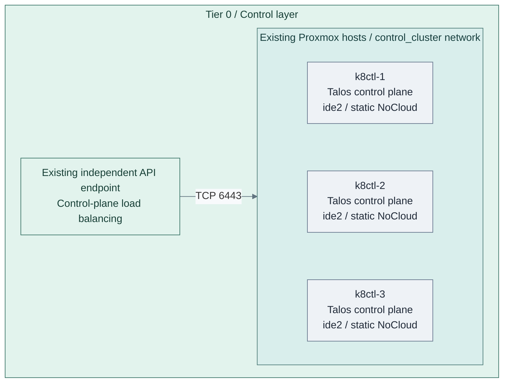
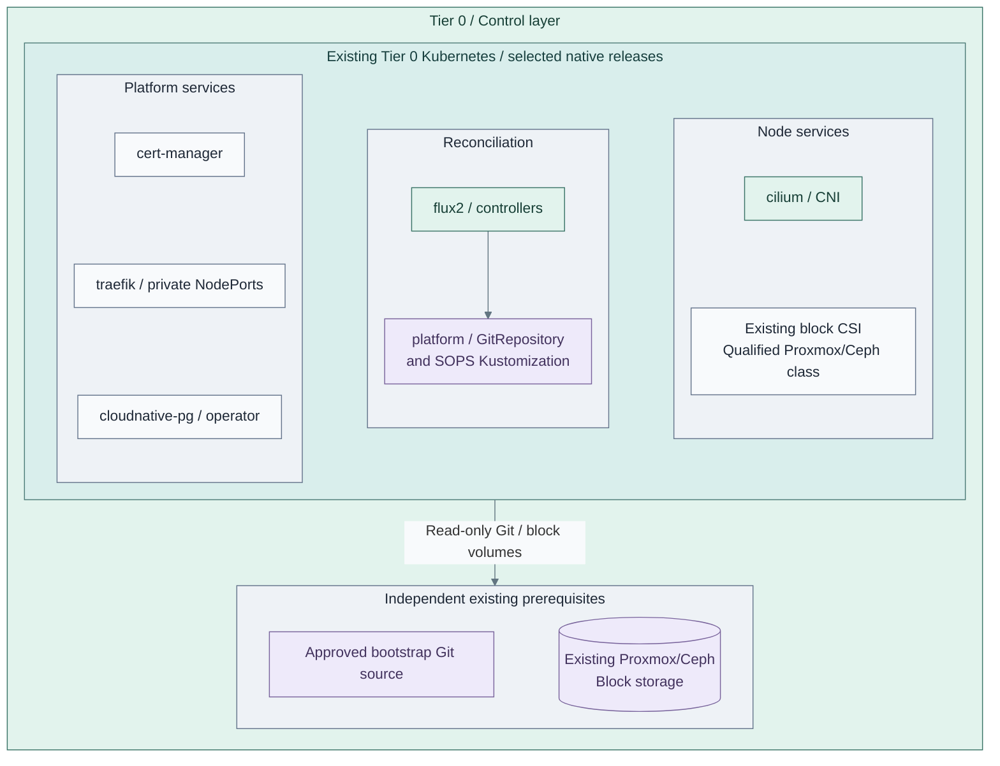
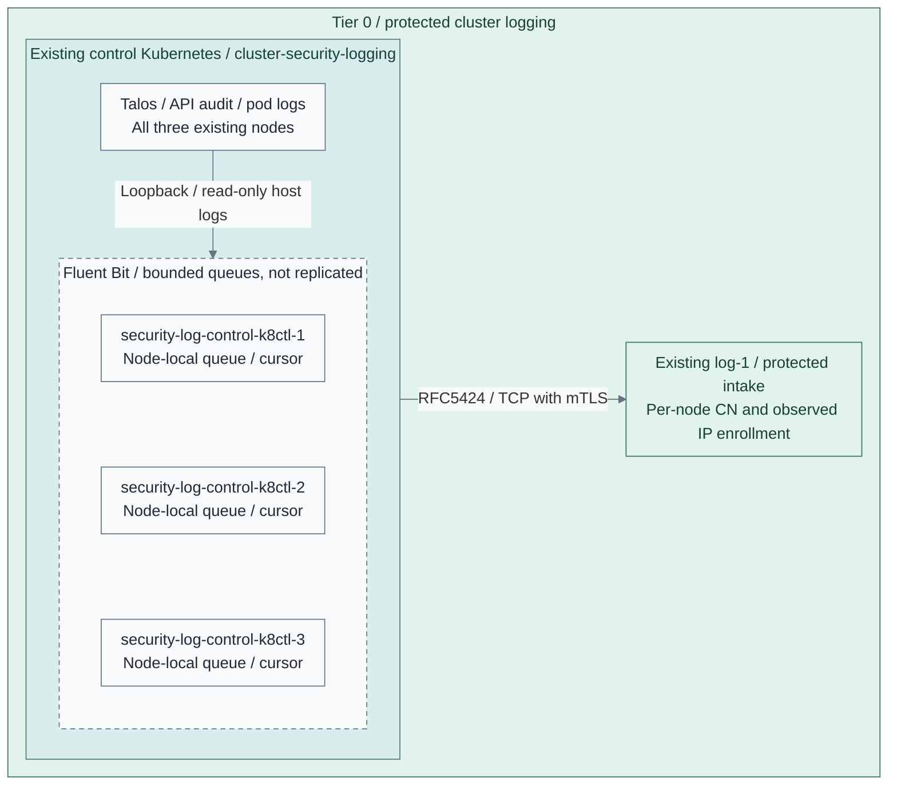

# Stage 4: Kubernetes

**Related:** [Architecture](../../01-architecture/17-kubernetes/README.md) · [Operations](../../05-operations/kubernetes/README.md)

Create the Tier 0 control cluster, then establish the basic platform before
deploying identity federation, secrets or other control applications. Kubernetes
is the capability; Talos is the supplied node-OS implementation.

**Prerequisites:** accepted software intake, protected logging and cryptographic
trust; approved node images, independent DNS/time, reserved static node IPs and a private
API endpoint outside this cluster. Retain bootstrap tools, images and credentials
without depending on FreeIPA, Keycloak or later Tier 1 delivery services.
**Working repository:** `<prefix>-tier-0` (source: `tier-0/`).
**Automation:** tier-local Terraform provisions nodes and bootstraps Kubernetes.
Prepare the [private endpoint](procedures/api-endpoint.md) before cluster bootstrap;
a qualified existing endpoint is also valid. Tier-local Ansible inputs select reusable
platform and protected cluster-source collection roles in Shared.
See [coverage](../../08-reference/implementation-support.md#stage-coverage).
**Design:** [Kubernetes runtime](../../01-architecture/10-hosting/04-kubernetes.md).

**Version decision before provisioning:** retain the approved **Talos 1.13.x** image, installer
schematic/release and matching CLI selected in
[Foundation](../foundation/proxmox/templates.md#talos-version-contract).
The reference Cilium patches and Stage 5 SSO workflow use that minor. A 1.14 logging-render option
does not qualify the complete platform or SSO path; do not upgrade/downgrade existing nodes here.

## Main path

| Step / option | Detailed path | Rejoin |
| --- | --- | --- |
| 1: endpoint before nodes | [Private API endpoint](procedures/api-endpoint.md); [node image access](procedures/image-access.md) | Choose 1a or 1b before provisioning |
| 1a: Terraform, main | [Talos cluster](procedures/talos-terraform.md), Steps 1–3 | Step 2; do not run another cluster lifecycle |
| 1b: manual alternative | [Manual cluster](step-1b-manual-cluster.md); Stage 5 SSO needs a separately qualified manual integration | Step 2 after client export |
| 2: platform and source collection | [Base add-ons](procedures/basic-platform.md), [cluster logging](procedures/security-logging.md), [Flux/SOPS](procedures/flux-sops.md) | Follow the interleaved order in Step 2 below |
| 3: acceptance | [Common cluster contract](procedures/kubernetes.md), then verification below | Stage 5 after recovery checks |

1. [Create the Kubernetes cluster](#step-1-create-the-kubernetes-cluster)
2. [Establish the basic platform](#step-2-establish-the-basic-platform)
3. [Verify operation and recovery](#step-3-verify-operation-and-recovery)

## Step 1: Create the Kubernetes cluster

**IaC:** Tier 0 [Kubernetes inputs](../../../tier-0/terraform/deployments/kubernetes/terraform.tfvars.example)
and [cluster entry point](../../../tier-0/scripts/kubernetes-cluster.sh) create these three VMs and bootstrap Kubernetes.
The API endpoint, IP allocations and approved node template already exist.
Each VM receives a network-only NoCloud drive at `ide2`, plus its live boot/EFI disks;
the Talos API applies machine configuration. DHCP bootstrap remains an explicit legacy option.
No workers are active in this starter; application and add-on manifests are separate inputs.

Choose the lifecycle **before provisioning nodes**:

| Route | Run only this cluster lifecycle | Stop/rejoin |
| --- | --- | --- |
| 1a: main path | [Terraform cluster Steps 1-3](procedures/talos-terraform.md#configure), including native patch preparation, saved plan/apply and credential export | Stop before its Step 4; return here for Step 2 |
| 1b | [Manual bootstrap](step-1b-manual-cluster.md), with the same native node settings | Stop after bootstrap/client export; return here for Step 2 without Terraform ownership |

1. **Prepare the independent endpoint first.** Complete
   [API endpoint Steps 1-3](procedures/api-endpoint.md#configure-local-inputs): initialize
   inputs, configure the two gateway VMs/VIP, deploy and verify ownership/DNS.
   An accepted existing independent endpoint replaces that installation; retain
   its original state owner. Do not use this cluster's ingress as its bootstrap endpoint.
2. Follow **only the selected lifecycle** from the table. Prepare image-access, CNI and security-logging
   settings before first bootstrap. Do not run the alternative installer afterward or continue into its
   platform-installation section; the shared platform sequence is Step 2 below.
3. Check private API access. With CNI deliberately disabled, node/DNS readiness can
   wait until Step 2 installs Cilium. Preserve the generated state and credentials
   outside the cluster before continuing.

The [common cluster procedure](procedures/kubernetes.md) is the cross-tier contract,
not another installation to run. Another OS requires its own implementation.
New-cluster inputs provide three schedulable control planes and no workers.
Additional workers are an explicit capacity choice; existing clusters retain their local nodes.

## Step 2: Establish the basic platform

**IaC:** Tier 0's [platform playbook](../../../tier-0/ansible/playbooks/deployment/cluster-platform.yml)
owns the selected pinned releases; reusable execution roles install them on the existing cluster.
Scope: the five chart releases in the Tier 0 example, their Flux source/decryption
objects and the accepted existing block CSI prerequisite. Application databases
are created later by their owning recipes, not implied by the operator box.
NFS CSI for later backup/shared-file claims and Barman Cloud for object/WAL
backups are separate selections, not installed by this pictured main path.

| Capability | Supplied installation | Explicit prerequisite or remaining acceptance |
| --- | --- | --- |
| Networking | Talos-compatible Cilium | CNI/proxy preparation before bootstrap; cross-node traffic and DNS tests |
| Persistence | Accepted existing Proxmox/Ceph-backed block CSI; optional separate NFS CSI for file claims | Qualified live disk and backup destinations; persistence and restore tests |
| Certificates | cert-manager, optional ClusterIssuer and issuance probe | Qualified existing issuer, trust and enrollment credentials |
| Ingress | Traefik with explicit NodePorts and ingress class | Private DNS, routing/firewall and end-to-end TLS tests |
| PostgreSQL | CloudNativePG operator and optional probe database; Barman Cloud only for the object/WAL option | Qualified block CSI/image; application connection, selected backup and restore tests |
| Reconciliation/secrets | Flux controllers, pinned Git source, SOPS age decryption | Independent source/keys and encrypted acceptance canary |

1. Complete [basic platform Step 2](procedures/basic-platform.md#configure).
   Copy `ansible/group_vars/cluster_platform.yml.example` to its local file, edit the
   approved pins/storage/context fields.
2. Complete [basic platform actions 5–7](procedures/basic-platform.md#5-render-cilium-only):
   render, inspect and apply **Cilium only**, then wait for nodes/DNS. Stop before installing other components.
3. Complete [cluster logging Steps 4–6](procedures/security-logging.md#enroll-node-streams): enroll
   node leaves at Tier 0, install collectors and verify real node/pod/API events before adding consumers.
   The native logging patches were prepared before bootstrap in Step 1; do not bootstrap again.
4. Accept the [live block CSI prerequisite](procedures/basic-platform.md#persistence), including claim
   persistence/recovery checks. The example does not install a Proxmox/Ceph block driver.
5. Complete [basic platform action 9](procedures/basic-platform.md#8a-prepare-flux-and-managed-bootstrap-secrets--main-path)
   for the selected Secret owner. It prepares the independent Flux source/encrypted canary and performs
   the remaining platform render/review/apply once. Return here for Step 3.

The installer applies networking, storage, certificates, ingress, database and Flux
in that order, waiting between products. Components can be selected independently;
install ingress first when an enabled certificate probe uses HTTP-01.
The [foundation checklist](procedures/kubernetes.md#cluster-foundation) defines acceptance,
including the dependencies a selected-component run must already satisfy.
Connect certificate automation to the existing issuer through a supported integration.
For the OpenXPKI Community reference, the [ACME adapter qualification](../stage-3-trust/procedures/issuer.md#step-3-activate-and-accept-issuance)
is explicit; installing cert-manager does not supply that adapter or authorize enrollment.

Tier 0's [clusters/tier0/](../../../tier-0/clusters/tier0) folders remain GitOps starters;
the installer does not populate them or transfer Helm ownership to Flux.
Verify reconciliation, decryption, persistence, TLS and database health, and start backups as state appears.
Flux requires a reachable source with independent credentials, not merely a local checkout.
Install and qualify [protected cluster-source collection](procedures/security-logging.md)
before acceptance. It has a separate recipe from the add-on subset above; neither
the VM/bootstrap root nor installing a logging pod alone accepts that complete path.

## Step 3: Verify operation and recovery

**IaC:** the Tier 0 [collection playbook](../../../tier-0/ansible/playbooks/deployment/cluster-security-logging.yml)
and [node inputs](../../../tier-0/ansible/group_vars/cluster_security_logging.yml.example)
select these three releases from the [Shared role](../../../shared/ansible/roles/cluster_security_logging).
Scope: cluster sources and bounded local queues; the receiver and its archive are existing Stage 2 services.

1. Confirm [cluster logging acceptance](procedures/security-logging.md#accept-the-complete-path)
   still passes with the installed platform. Collectors were installed in Step 2; this is verification,
   not another patch/bootstrap or installer pass.
2. For **1a**, run the [Terraform lifecycle's verification commands](procedures/talos-terraform.md#verify-and-hand-over).
   For **1b**, complete [manual verification and handover](step-1b-manual-cluster.md#verify-and-hand-over)
   with that lifecycle's existing client files. Accept every selected
   [foundation gate](procedures/kubernetes.md#cluster-foundation) and recovery check below.
   Empty manifests or three running VMs are insufficient.
3. Keep the results and independent recovery copies in the project records before
   starting Identity.

No signing authority enters Kubernetes. A lost node, full queue or unavailable first-hop
listener can lose records; protected intake is not an application-acknowledged replica.

| Check | Required evidence |
| --- | --- |
| Nodes and endpoint | Expected inventory nodes, private API access and selected failure behavior; no public-edge dependency |
| Platform services | Networking, reconciliation, decryption, persistence, certificates/ingress and database checks pass before consumers |
| Security records | Node and API audit events reach protected Tier 0 intake under approved identities |
| Recovery | Original machine secrets, state, etcd and required persistent data have protected copies and a selected restore procedure |
| Independence | Bootstrap/recovery access still works without directory/IdP login, Vault or hosted delivery |

Record results in Tier 0's project deployment and administration records. Restore
is not a fresh-cluster bootstrap; live failure and clean-target recovery evidence
remain required for the selected availability/recovery contract.

## Capability available

**Result:** the accepted Tier 0 Kubernetes runtime can host control applications.
The cluster owns no directory authority and does not imply that Keycloak, Vault
or other application starters are installed.
Continue with [Stage 5: Identity](../stage-5-identity/README.md).

Tier 1 and Tier 2 reuse the [common cluster procedure](procedures/kubernetes.md)
from their later stages, with their own inventory, resources, state and delivery
choice. They do not inherit Tier 0 credentials or Flux automatically.
