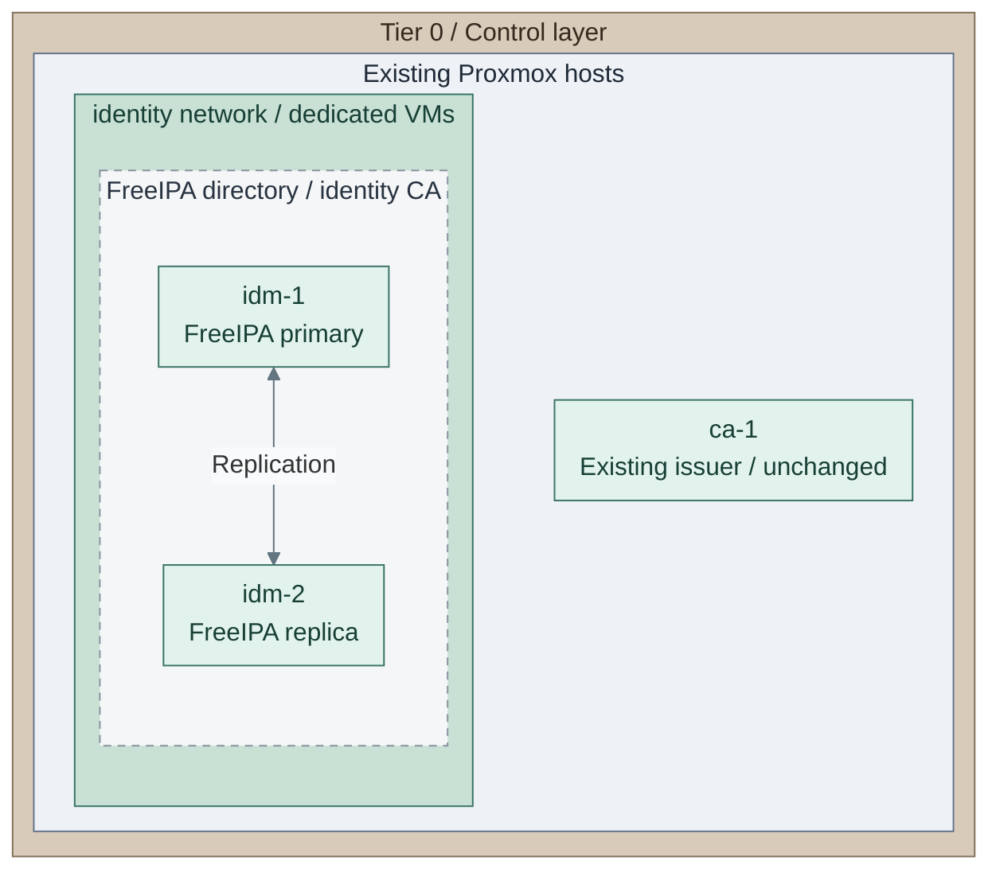
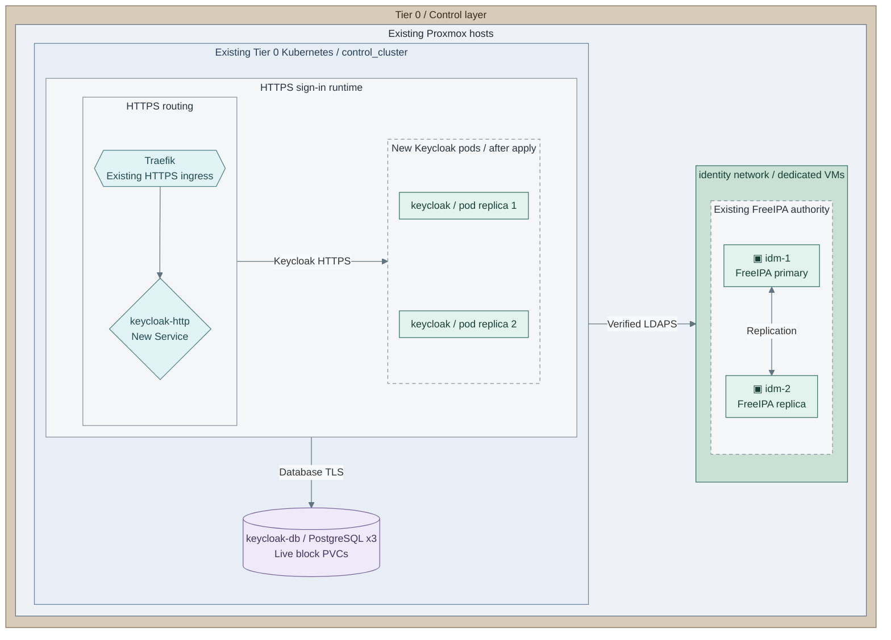

# Stage 5: Identity

**Related:** [Architecture](../../01-architecture/09-identity/README.md) · [Operations](../../05-operations/04-identity.md)

Establish directory authority and federated service authentication. Ansible configures
FreeIPA on dedicated VMs; the accepted Tier 0 Kubernetes platform hosts the identity provider.

<a id="figure-directory-pair"></a>

## Expected outcome: directory authority



**IaC:** *Figure: The dedicated FreeIPA primary and CA replica share directory authority outside Kubernetes; the
existing issuer stays in place.*
Tier 0 [foundation inputs](../../../tier-0/terraform/deployments/foundation/terraform.tfvars.example) and
[directory recipe](../../../tier-0/ansible/playbooks/deployment/identity-freeipa.yml).
Directory VMs may already be allocated by Stage 3; retain the existing CA and all state.

**Prerequisites:** accepted [Kubernetes platform](../stage-4-kubernetes/README.md),
approved compute/templates, certificate trust, software supply and independent credentials.
**Working repository:** `<prefix>-tier-0` (source: `tier-0/`).
**Automation:** the dedicated FreeIPA recipe and
[native Keycloak installer](procedures/keycloak.md) are supplied. Render, apply and
service acceptance are separate operations.
See [stage coverage](../../08-reference/implementation-support.md#stage-coverage) for
prerequisites, optional variants and live acceptance.
**Design:** [identity authority](../../01-architecture/09-identity/README.md) and
[cluster runtime](../../01-architecture/04-hosting/README.md).

The supplied API SSO rollout uses the **Terraform-owned Talos 1.13.x** reference from Stage 4.
An existing externally managed cluster needs its own qualified native SSO/recovery integration; the plan-based recipe
does not adopt it. Talos 1.14 remains outside this complete reference path until separately qualified.

<a id="main-path"></a>

## Installation route

Follow the numbered actions. The first directory run creates a **pending CSR**; the second completes
the primary and replica after authorized offline signing. Keycloak/database installation follows once.

| Actions / choice | Continue when |
| --- | --- |
| [1a / 1b / 1c](#step-1-select-and-initialize-the-directory-path) | Fresh externally signed pair, accepted existing directory, or explicitly internally rooted pair |
| [2-11](#step-2-edit-the-existing-foundation-inputs) | Selected directory accepted; original issuer/state retained |
| [12-14](#step-12-select-the-existing-cluster-and-identity-provider-inputs) | Keycloak target, certificate/credential owner and backup method selected |
| [15-17a / 17b](#step-15-render-database-preparation) | Per-database NAS destination or qualified object/WAL path |
| [18-20](#step-18-render-the-completed-keycloak-selection) | Keycloak/federation installed and accepted |
| [21-23](#step-21-roll-out-kubernetes-api-human-sso) | Native API OIDC, real human access and independent recovery accepted |

<a id="step-1-deploy-the-directory-pair"></a>

## Step 1: Select and initialize the directory path

For the [directory-pair figure](#figure-directory-pair), select one path before provisioning:

| Choice | Action |
| --- | --- |
| **1a: new external-CA pair, main** | Follow actions 2-11; use the separate root-signing pause |
| **1b: accepted existing directory** | Verify [LDAPS/schema, restricted reader, identity and recovery contracts](procedures/freeipa.md#existing-domains-and-alternatives); preserve its owner/realm and skip to action 12 |
| **1c: new internally rooted FreeIPA pair** | Follow actions 2-6, set `foundation_freeipa_ca_mode: internal`, then action 10; skip external CSR/signing actions 7-9 |

For **1a/1c**, run from **`<prefix>-tier-0/`**, using the issuer's existing environment/state:

```bash
bash scripts/init-local-files.sh --setup foundation
```

Keep the same `--env` on wrapper commands when a named environment was used. Missing local files are
created; existing selections and the accepted issuer remain unchanged.

## Step 2: Edit the existing foundation inputs

Edit **Tier 0** without removing the issuer or any other managed guest:

| File | Set |
| --- | --- |
| `terraform/deployments/foundation/terraform.tfvars` | Existing `vm_instances` plus `idm-1/2`, approved EL image, unused VMIDs, live storage and independent placement |
| `ansible/inventory/hosts.yml` | One `identity_primary`, `identity_replicas`; retain `issuing_ca`; keep connected `root_ca` empty |
| `ansible/group_vars/all.yml` | Actual domain, SSH account and hostname decoration |
| `ansible/group_vars/foundation.yml` | Complete existing `platform_host_ips`, adding both directory IPs; realm/domain, DNS and selected CA mode |
| `terraform/common.tfvars` | Applied `network_zones.identity` attachment or actual bridge/VLAN/subnet/gateway |

Provide stable forward/reverse DNS and independent bootstrap DNS/time before realm installation.
A Stage 3 guest allocation needs no replacement; the plan below should retain it.

## Step 3: Provision only missing directory resources

Run from **`<prefix>-tier-0/`**:

```bash
bash scripts/deploy.sh foundation --terraform-only
```

Review the complete foundation plan, preserving `ca-1`, then enter `yes`. Preview adds `--plan-only`;
approved unattended provisioning adds `--auto-approve`. **Expected:** selected pair exists with the approved
OS and placement, without realm installation or changes to the existing issuer.

## Step 4: Connect the new directory hosts to protected logging

For **`idm-1` and `idm-2`**, extend [the existing source-forwarding setup](../stage-2-logging/procedures/sources.md)
using `foundation.yml` as their setup map. Declare distinct producer identities and retain other streams.
Prepare keys/CSRs, authorize signing, update the existing receiver catalogue, then install forwarding from
the controller. No receiver disk/authority setup is repeated.

**Expected:** each host's real OS test event reaches protected intake before realm creation.
The FreeIPA recipe does not install the separate forwarding role; add actual directory/audit file streams
as those files appear.

## Step 5: Set the CA phase and bootstrap DNS

Edit **Tier 0 `ansible/group_vars/foundation.yml`**, preserving its complete IP map:

```yaml
baseline_disable_ipv6: false
foundation_freeipa_ca_mode: external
foundation_freeipa_external_phase: csr
foundation_freeipa_external_cert_files: []
```

For **1c**, set the mode to `internal` instead. FreeIPA requires the IPv6 localhost stack even with IPv4-only
routed networks. Set `foundation_freeipa_auto_forwarders: false` and actual `foundation_freeipa_dns_forwarders`
if the host resolver is not the approved bootstrap source. Keep `ipareplica_setup_ca: true` for the CA replica.
Do not depend only on the DNS service being created.

## Step 6: Load protected directory credentials

In the protected execution shell, run from **`<prefix>-tier-0/`**:

```bash
read -r -s -p 'FreeIPA Directory Manager password: ' FREEIPA_DM_PASSWORD; echo
read -r -s -p 'FreeIPA administrator password: ' FREEIPA_ADMIN_PASSWORD; echo
export FREEIPA_DM_PASSWORD FREEIPA_ADMIN_PASSWORD
```

Retain these exact values independently. Remove conflicting placeholder assignments from `.env.local`,
which the wrapper loads. Private Ansible-only secret overrides are also supported. **1c continues at action 10.**

## Step 7: Generate the pending identity CA request

For **1a**, run against the already allocated pair from **`<prefix>-tier-0/`**:

```bash
bash scripts/deploy.sh foundation --ansible-only
```

**Expected:** baseline and pending primary prepared; public request fetched to
`secrets/identity/<primary-fqdn>-ipa.csr`. Health acceptance and replica installation wait for the signed
chain. This identity-only recipe does not initialize or configure `ca-1`.

## Step 8: Sign the identity request offline

Verify the public request and use the authorized [root ceremony](../stage-3-trust/procedures/offline-root.md)
for the selected custody. Sign the sibling identity CA, not a TLS-server leaf through the infrastructure
issuer. Return public certificates only. Keep the primary's pending installation and private key;
do not regenerate its identity to retry a transfer.

## Step 9: Select completion with the approved chain

Verify the signed identity matches the pending CSR, subordinate constraints and independently accepted root.
Edit **Tier 0 `ansible/group_vars/foundation.yml`**:

```yaml
foundation_freeipa_external_phase: complete
foundation_freeipa_external_cert_files:
  - /REPLACE_WITH_ABSOLUTE_APPROVED_IDENTITY_CA_CERTIFICATE_PATH
  - /REPLACE_WITH_ABSOLUTE_PUBLIC_ROOT_OR_CHAIN_PATH
```

Retain the same hosts, realm, passwords and state. The native role transfers those public files.

## Step 10: Complete the primary and replica

For **1a** after signing, or **1c** with internal mode selected, run from **`<prefix>-tier-0/`**:

```bash
bash scripts/deploy.sh foundation --ansible-only
```

**Expected:** primary completed and checked before serial installation of the CA-enabled replica.
This is the intentional second phase for an externally signed directory, not another VM provisioning run.

## Step 11: Verify directory replication and recovery

Run from **`<prefix>-tier-0/`**:

```bash
bash scripts/deploy.sh foundation --recipe maintenance
```

Verify directory/DNS replication, certificate issuance on **both** hosts, the accepted identity CA chain
and loss/recovery of either host. Record independent credentials and recovery material before replacing
bootstrap dependencies. A passing daemon/API check alone is not CA replication acceptance.

<a id="step-2-deploy-identity-federation"></a>
<a id="step-4-deploy-identity-federation"></a>

## Step 12: Select the existing cluster and identity-provider inputs

<a id="figure-identity-federation"></a>



**IaC:** *Figure: Existing Traefik ingress and the new `keycloak-http` Service route HTTPS to two stacked
Keycloak pods. Their three-instance PostgreSQL database remains inside the control cluster, on live block
PVCs. The directory pair sits in its separate VM network to the right. Arrows between groups denote the
named service interface, not another network hop or direct HTTP access to the database.*
Tier 0 [control-application recipe](../../../tier-0/ansible/playbooks/deployment/control-applications.yml),
[product role](../../../tier-0/ansible/roles/control_applications) and
[example inputs](../../../tier-0/ansible/group_vars/control_applications.yml.example).
Scope: identity runtimes and directory authority, not the separate backup jobs/storage.
The picture shows configured placement, not a verified live installation.
The existing directory comes from the [FreeIPA recipe](../../../tier-0/ansible/playbooks/deployment/identity-freeipa.yml).
CNPG must be available before database creation. Backup destinations are separate
from its live volumes; the Barman plugin is required only for the object/WAL option.
The [backup realization](../../05-operations/06-resilience/backups/postgresql.md) identifies the
scheduled file jobs and NAS destinations omitted from this runtime view.

Run from **`<prefix>-tier-0/`**, retaining Stage 4's existing kubeconfig:

```bash
cp -n ansible/group_vars/control_applications.yml.example ansible/group_vars/control_applications.yml
export KUBECONFIG="${KUBECONFIG:-$PWD/secrets/talos/kubeconfig}"
kubectl get nodes -o wide
```

**Expected:** the accepted Tier 0 nodes. Stop on another target. Fresh Terraform exports live at
`secrets/talos/kubeconfig`; an externally managed cluster keeps its original client path/owner.

## Step 13: Edit Keycloak and choose its backup method

For the [federation figure](#figure-identity-federation), edit **Tier 0 `ansible/group_vars/control_applications.yml`**:

| Input | Set |
| --- | --- |
| `control_applications_components` | `[keycloak]` only |
| `control_applications_kubeconfig`, `control_applications_context` | Accepted Tier 0 target |
| `control_applications_versions.keycloak`, `control_applications_hosts.keycloak` | Approved chart pin and stable HTTPS service name, matching certificate/issuer URLs |
| `control_applications_ldap_url`, `control_applications_ldap_users_dn`, `control_applications_ldap_groups_dn`, `control_applications_ldap_bind_dn` | Verified FreeIPA LDAPS endpoint/search bases and the restricted reader prepared in action 14 |
| `control_applications_keycloak_realm` | Selected federation realm; preserve an existing realm's identity |
| `control_applications_storage_class`, `control_applications_database_storage_class` | Qualified live block storage, not NAS backup storage |
| `control_applications_backup_mode` | **13a: `files`** for completed scheduled NAS sets, or **13b: `object`** for an existing qualified object/WAL service |
| `control_applications_backup_files_phase` | `prepare` for 13a; object mode does not use that commissioning phase |
| Platform/logging/storage/recovery acceptance inputs | Acknowledge only the actual accepted prerequisites |

Select the backup method before certificates/Secrets. **13b** requires the accepted Barman plugin, scoped
object credentials and destination contract, then skips actions 15-17a and rejoins at action 18.
Neither choice moves live database volumes to NAS or installs a storage gateway.

The [federation reference](procedures/keycloak.md) defines the read-only schema and TLS contract.
A friendly LDAP alias requires qualified listener/certificate/authentication support.

## Step 14: Supply private certificates and credentials

Choose **14a: installer-owned bootstrap Secrets**, or **14b: existing qualified Secret controller**.
For 14a, run from **`<prefix>-tier-0/`**:

```bash
cp -n ansible/group_vars/control_applications_secrets.yml.example ansible/group_vars/control_applications_secrets.yml
ansible-vault encrypt ansible/group_vars/control_applications_secrets.yml
ansible-vault edit ansible/group_vars/control_applications_secrets.yml
```

Set `control_applications_manage_secrets: true` in the encrypted input. Populate only selected Keycloak
namespace entries: bootstrap/database credentials, IdP HTTPS leaf/key/chain, LDAP trust, external DB server
and replication TLS, and the selected file-backup client or object/WAL credentials. Include the private
LDAP password and existing Keycloak API administration credentials.

Use the [exact namespace/key/certificate table](../stage-6-secrets/procedures/control-applications.md#secrets-and-certificates)
from the shared product reference. Client-auth profiles require qualified issuance; Stage 3's TLS-server-only
profile does not issue them. No CA private key or later Vault dependency belongs in bootstrap inputs.

For **14b**, retain `manage_secrets: false` and commission the same Secrets through that owner; omit only
the encrypted-file/password arguments from both render/apply commands below.

For the **new FreeIPA pair (1a/1c)**, prepare its bind-only reader from **`<prefix>-tier-0/`**:

```bash
cp -n ansible/group_vars/freeipa_ldap_reader.yml.example ansible/group_vars/freeipa_ldap_reader.yml
```

Edit **`ansible/group_vars/freeipa_ldap_reader.yml`**: enable the route, set the actual base DN,
primary's LDAPI socket and future password expiry. Keep its derived DN and protected password identical
to `control_applications_ldap_bind_dn` / `control_applications_ldap_bind_password`.
For 14b, store that same bind password in a private encrypted controller override; use its path in place
of `control_applications_secrets.yml` below. Run from **Tier 0**:

```bash
ANSIBLE_CONFIG=ansible/ansible.cfg ansible-playbook -i ansible/inventory/hosts.yml \
  ansible/playbooks/deployment/freeipa-ldap-reader.yml \
  -e @ansible/group_vars/all.yml -e @ansible/group_vars/foundation.yml \
  -e @ansible/group_vars/control_applications.yml \
  -e @ansible/group_vars/control_applications_secrets.yml --ask-vault-pass \
  -e @ansible/group_vars/freeipa_ldap_reader.yml
```

**Expected:** a read-only system account on the installed primary, with no POSIX login or Kerberos
principal. Existing passwords are not reset. For **1b**, retain the qualified existing reader and skip
this account-bootstrap command. Both paths continue at action 15.

## Step 15: Render database preparation

For **13a: files**, retain `files` / `prepare`, with NAS identity fields empty and backup acceptance false.
Run from **`<prefix>-tier-0/`**:

```bash
ANSIBLE_CONFIG=ansible/ansible.cfg ansible-playbook -i localhost, ansible/playbooks/deployment/control-applications.yml -e @ansible/group_vars/control_applications_secrets.yml --ask-vault-pass -e control_applications_action=render
```

Inspect **`secrets/control-applications/*-database-prepare.yml`** and Secret references. This selection
prepares the database only; no application, NAS marker or scheduled backup is installed yet.

## Step 16: Prepare the database

After review, run from **`<prefix>-tier-0/`**:

```bash
ANSIBLE_CONFIG=ansible/ansible.cfg ansible-playbook -i localhost, ansible/playbooks/deployment/control-applications.yml -e @ansible/group_vars/control_applications_secrets.yml --ask-vault-pass -e control_applications_action=apply
```

**Expected:** `keycloak-db` Ready on live block claims; actual system identifier printed. Keycloak is not
installed yet. Retain this database for backup commissioning; do not repeat its initialization.

## Step 17: Commission the selected backup destination

### 17a: NAS file copies: main path

Have the NAS custodian supply the dedicated export, permissions and matching source marker under
[the NAS destination contract](../../05-operations/06-resilience/backups/postgresql.md#commission-the-nas).
The preparation command from action 16 is complete; keep that database and its reported identity.

In **Tier 0 `ansible/group_vars/control_applications.yml`**, set `control_applications_backup_files.keycloak`
with the actual `claim`, `volume_handle`, quoted `system_identifier`, random `marker` and five-field UTC
`schedule`. Select its `storage` route:

- **New backup claim:** set `storage.mode: static_nfs`, `storage.server`, `storage.share` and
  `storage.size` from that dedicated export. The accepted
  [NFS CSI driver](../stage-4-kubernetes/README.md#step-15-qualify-live-storage) must be installed.
  Actions 18-19 render/create only the retained backup PV and exact bound claim.
- **Accepted existing claim:** retain `storage: {mode: existing}` and its exact recorded handle;
  automation qualifies it without taking ownership.

After the destination contract is ready, set `control_applications_backup_files_accepted: true` and
`control_applications_backup_files_phase: backup`. Recovery ends at the last completed verified set,
not a selected time between sets. Continue at action 18.

### 17b: Object/WAL recovery: alternative

For **13b**, qualify the existing native endpoint/Barman plugin and the exact scoped Secret/destination
under the [object/WAL contract](../stage-6-secrets/procedures/control-applications.md#persistence-and-recovery).
Skip the NAS-only preparation and marker actions. Continue at action 18.

## Step 18: Render the completed Keycloak selection

Run from **`<prefix>-tier-0/`** with the selected backup inputs complete:

```bash
ANSIBLE_CONFIG=ansible/ansible.cfg ansible-playbook -i localhost, ansible/playbooks/deployment/control-applications.yml -e @ansible/group_vars/control_applications_secrets.yml --ask-vault-pass -e control_applications_action=render
```

Inspect the completed database, selected backup, TLS, ingress and federation resources under
**`secrets/control-applications/`** before installation.

## Step 19: Install Keycloak and federation

Run from **`<prefix>-tier-0/`** with the same target, private inputs and selections:

```bash
ANSIBLE_CONFIG=ansible/ansible.cfg ansible-playbook -i localhost, ansible/playbooks/deployment/control-applications.yml -e @ansible/group_vars/control_applications_secrets.yml --ask-vault-pass -e control_applications_action=apply
```

**Expected:** database/backup gates pass, Keycloak installed, realm and read-only FreeIPA federation configured.
Ansible apply has no second confirmation. CI supplies its protected Vault password/identity instead of
`--ask-vault-pass`, with approval before apply. Keep the independent bootstrap administrator and credentials
outside the IdP; recreating an empty realm/database is not recovery.

<a id="step-3-accept-identity-and-human-sso"></a>

## Step 20: Accept federation, audit and restoration

Verify exact HTTPS discovery issuer; allowed/denied/disabled identities and removed group membership;
authentication/admin events at protected intake; selected backup completion and a separate database restore
followed by a login. Test directory endpoint, IdP replica and IdP outage behavior.
The [federation acceptance table](procedures/keycloak.md#accept-and-recover) owns the detailed evidence contract.
Do not reinstall the IdP after these checks.

## Step 21: Roll out Kubernetes API human SSO

The API change is a separate **serial maintenance operation**, not part of installing Keycloak or Headlamp.
Use [the native API OIDC rollout](procedures/kubernetes-sso.md#preserve-the-authoritative-configuration) now:

| Edit / run | Required result |
| --- | --- |
| Existing `terraform/deployments/kubernetes/terraform.tfvars` | Append exactly one selected OIDC document; preserve every existing machine patch and original cluster secret |
| Private OIDC rollout inputs | Existing plan path, Talos client/context, retained X509 kubeconfig/context, issuer/CA and private output directory |
| `kubernetes-cluster.sh plan`, then `export-plan` | Review only expected complete machine-config changes |
| Dedicated `kubernetes_sso` render, then explicit serial apply | Native validation, one-node-at-a-time rollout and verified certificate recovery |
| Equality/dry-run gates, reviewed state commit and required no-op plan | Reconcile the same original state after the controlled rollout |

Follow that one maintenance procedure through its state-commit boundary, then continue at action 22.
Do not run a normal broad bootstrap apply or initialize replacement state to bypass its gates.
An externally owned cluster retains its own qualified native SSO integration; the supplied plan-based
recipe does not adopt it. Keep Headlamp acceptance false while API access is unqualified.

## Step 22: Commission human CLI login and namespace access

From **Tier 0 on a browser-capable authorized workstation**, complete the
[CLI client/RBAC procedure](procedures/kubernetes-cli-access.md). Its inputs are
`ansible/group_vars/kubernetes_human_access.yml`, an approved int128/kubelogin executable,
existing namespaces and independent realm-administration credentials.

The supplied `deployment/kubernetes-human-access.yml` renders the public client, namespace bindings and
human kubeconfig; its explicit `sso_human_action=apply` converges them. Test actual reader and unbound
identities, allowed namespace reads, denied writes/Secrets and denied other namespaces.
This does not install Headlamp or another realm.

## Step 23: Accept API outage and independent recovery

Complete [API issuer/directory outage and recovery checks](procedures/kubernetes-sso.md#outage-and-recovery-acceptance)
using the commissioned human client and retained X509 identity. Record the cold-start single-node check,
private endpoint access and protected audit evidence. Preserve independent credentials before restricting
bootstrap access. The [service SSO gate](procedures/service-sso.md) is reused when later consumers install;
those services are not deployed in this stage.

## Capability available

**Result:** accepted directory authority, federation and human API access, with independent recovery.
Record selected paths, backup/restore and live login/denial evidence in **`<prefix>-architecture/deployments.md`**,
then continue with [Stage 6: Secrets](../stage-6-secrets/README.md). Headlamp UI installation/acceptance follows there.
