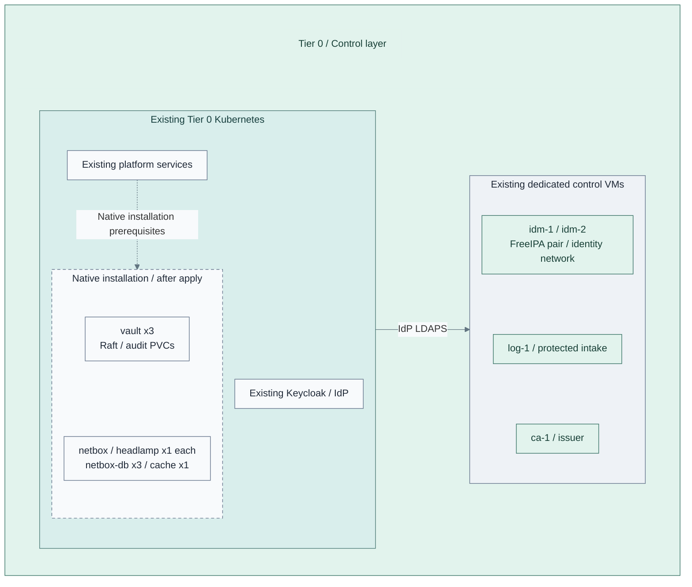

# Stage 6: Secrets

**Related:** [Architecture](../../01-architecture/08-cryptography/08-secrets.md) · [Operations](../../05-operations/03-cryptography/README.md)

Establish the Tier 0 secret service, its audit trail and independent recovery custody.
Then add the inventory and administration tools that support platform operation.
FreeIPA, the issuer and the identity provider already exist.

**Prerequisites:** accepted [Identity](../stage-5-identity/README.md),
service storage/backups and independent recovery inputs.
**Working repository:** `<prefix>-tier-0` (source: `tier-0/`).
**Execution context:** `<prefix>-tier-0/`.

**Automation:** native installation supplies Vault, NetBox and Headlamp. Initialization/unseal and
recovery acceptance remain operator tasks; see [coverage](../../08-reference/implementation-support.md#stage-coverage).
**Design:** [identity](../../01-architecture/09-identity/README.md),
[secrets](../../01-architecture/08-cryptography/README.md) and [operations](../../01-architecture/11-operations/README.md).

<a id="step-1-deploy-identity-federation"></a>

Identity federation and the OIDC provider are established in
[Identity, Step 2](../stage-5-identity/README.md#step-2-deploy-identity-federation).
This stage integrates secret-service and operator access with that provider.

## Main path

Follow Steps 1–4. Choose one Vault placement. Seal/authentication choices refine that service;
the advanced signing option adds a separate, independently owned service.

| Step | Path or option | Continue when |
| --- | --- | --- |
| 1a | [Kubernetes Vault](#step-1-deploy-the-secret-service): [inputs/install](procedures/control-applications.md), then [ceremony](procedures/vault-kubernetes.md) | Vault access, audit and recovery are accepted; go to Step 2 |
| 1b | [Dedicated Vault VM](step-1b-vault-vm.md), instead of 1a | Rejoin Step 1 acceptance, then Step 2 |
| 1c | Optional [seal integration](step-1c-seal-integration.md); decide **before** either placement is initialized | Qualified provider and recovery path; return to selected 1a/1b |
| 1d | Optional [independent hardware signing API](step-1d-openbao.md), after the selected Vault path is accepted | Qualify original HSM keys, scoped clients and independent recovery; rejoin Step 2 |
| 2 | [Operational tools](#step-2-add-operational-tools): prepare the [monitoring host](procedures/independent-monitoring.md#step-1-prepare-the-monitoring-runtime), install NetBox, add [change audit](procedures/netbox-audit.md), then Headlamp | Tools, SSO, protected audit and backups work; go to Step 3 |
| 3a | [Access and independent recovery](#step-3-integrate-access-and-recovery), required for either Vault placement | Allowed/denied access and break-glass recovery pass |
| 3b | Optional [hardware authentication](step-3b-hardware-authentication.md) after 3a | Return to Step 3 checks before Step 4 |
| 4 | [Independent monitoring](#step-4-establish-independent-monitoring): complete [installation and alerts](procedures/independent-monitoring.md) on the host prepared at Step 2 | Verify cluster-loss detection before Stage 7 |



**IaC:** Tier 0 [control-application recipe](../../../tier-0/ansible/playbooks/deployment/control-applications.yml),
[product role](../../../tier-0/ansible/roles/control_applications) and
[example inputs](../../../tier-0/ansible/group_vars/control_applications.yml.example)
install the added group after explicit prerequisite gates. The picture shows configured
placement, not a verified live service. Empty Flux application starters are not a
second reconciliation owner for these Helm releases.
The [Vault VM alternative](step-1b-vault-vm.md) replaces, rather than duplicates, the cluster Vault instance.
Independent monitoring is a separate [selected integration](procedures/independent-monitoring.md), not an installed workload here.

| Existing interface | New consumer |
| --- | --- |
| Existing Keycloak / OIDC | Secret-service and operator-tool access where supported |
| CloudNativePG | NetBox database |
| Issuing CA | Preissued service/database certificates; automated enrollment needs a separately accepted issuer integration |
| Cluster API | Headlamp with scoped RBAC |

<a id="step-2-deploy-operational-services"></a>

## Step 1: Deploy the secret service

1. Choose **1a: Kubernetes Vault** (main path) or
   [1b: dedicated Vault VM](step-1b-vault-vm.md). Install only one realization.
   [1c: seal integration](step-1c-seal-integration.md) is a separate choice made before initialization;
   qualify its provider/recovery dependency first. It is not an automatic post-install migration.
   Applications needing an open-source hardware signing API can additionally select
   [1d: independent OpenBao](step-1d-openbao.md) after this Vault acceptance. It uses separate
   guests, state, keys and access policy; it does not replace HashiCorp Vault.
2. For 1a, create the local application inputs without overwriting Stage 5 settings:

   Run from **`<prefix>-tier-0/`**.

   ```bash
   cp -n ansible/group_vars/control_applications.yml.example ansible/group_vars/control_applications.yml
   ```

   Edit in **`<prefix>-tier-0/`**.

   - `ansible/group_vars/control_applications.yml`: Component selection, cluster context, TLS/SSO, database and
     backup-phase inputs.

3. Edit `ansible/group_vars/control_applications.yml`:

   | Field | Set before installation |
   | --- | --- |
   | `control_applications_components` | `[vault]` |
   | `control_applications_vault_phase` | `install` initially |
   | `control_applications_backup_files_phase` | Database commissioning only; ignored for a `[vault]`-only selection |
   | `control_applications_kubeconfig`, `control_applications_context` | Existing Tier 0 cluster only |
   | `control_applications_hosts.vault` | Approved private Vault DNS name |
   | `control_applications_storage_class` | Accepted live block storage for Raft/audit PVCs |

4. Prepare TLS and the accepted Secret owner using
   [application Steps 1–2](procedures/control-applications.md#configure-inputs), then render:

   Run from **`<prefix>-tier-0/`**.

   ```bash
   ANSIBLE_CONFIG=ansible/ansible.cfg ansible-playbook -i localhost, ansible/playbooks/deployment/control-applications.yml -e control_applications_action=render
   ```

   Review the private output, then install the sealed service:

   Run from **`<prefix>-tier-0/`**.

   ```bash
   ANSIBLE_CONFIG=ansible/ansible.cfg ansible-playbook -i localhost, ansible/playbooks/deployment/control-applications.yml -e control_applications_action=apply
   ```

   These commands assume pre-existing Secrets. For encrypted bootstrap inputs, add
   `-e @secrets/control-applications.yml --ask-vault-pass` to both, as described in the input procedure.
5. Complete [Vault ceremony and acceptance](procedures/vault-kubernetes.md#operator-ceremony).
   The first install leaves Vault sealed. Keep recovery shares outside Vault and Git.
   Commission [scheduled independent recovery copies](../../05-operations/06-resilience/backups/control-applications.md#configure-and-schedule)
   after API access is configured and before recording backup/restore acceptance.

**Continue only after:** verified TLS, scoped access, protected audit delivery and a clean-target restore.

## Step 2: Add operational tools

1. Complete [monitoring Step 1](procedures/independent-monitoring.md#step-1-prepare-the-monitoring-runtime):
   choose **1a: provision `mon-1`** through the existing foundation Terraform root, or
   **1b: accept an existing independent host**. Prepare SSH/sudo and protected forwarding.
   NetBox audit collection needs this host now; Netdata installation still follows in Step 4.
   Keep accepted issuer/directory inputs and state; protected receivers cannot be monitoring targets.
2. In **`<prefix>-tier-0/ansible/group_vars/control_applications.yml`**, select `[netbox]`;
   retain accepted Vault and identity inputs. Complete [application installation](procedures/control-applications.md)
   with live database/media storage and the existing IdP client. For NAS backups, first prepare the NetBox
   database with file-backup acceptance still false, commission its own backup claim/marker, then
   accept that destination, switch to `backup` and install the application.
   Keycloak's backup claim/system identifier cannot be reused for NetBox.
3. Install [NetBox change-audit collection](procedures/netbox-audit.md) on the host prepared in action 1.
   Verify real changes at protected intake before accepting inventory changes as audited.
4. After [API OIDC acceptance](../stage-5-identity/procedures/kubernetes-sso.md#outage-and-recovery-acceptance),
   select `[headlamp]`, supply/register its exact IdP client and scoped namespace RBAC, then render/review/apply
   through the same application recipe. Complete the deferred Headlamp login/denial checks now.
   Keep this installation blocked if API bearer-token and independent certificate recovery tests have not passed.

The recipe creates/gates the CNPG database and backup resources before NetBox Helm,
supplies a persistent TLS cache, and binds only selected human groups to namespace
view access in Headlamp. Complete the native
[Stage 5 API OIDC integration](../stage-5-identity/procedures/kubernetes-sso.md),
including certificate access during issuer outage, before accepting Headlamp access.

NetBox documents inventory. It never supplies the inventory needed to bootstrap
its own platform. Test backups and restoration before other tiers depend on these services.
Ordinary application logging does not preserve NetBox's complete change ledger.

## Step 3: Integrate access and recovery

1. Apply the [service SSO checks](../stage-5-identity/procedures/service-sso.md) to each installed service.
2. Test permitted/denied roles and privileged recovery without directory or IdP login.
3. Record independent recovery custody before restricting bootstrap credentials.

Choose **3a: existing accepted authentication**, or add
[3b: hardware-backed authentication](step-3b-hardware-authentication.md)
after recovery is working. Both finish the checks in this step. Restrict routine bootstrap
credentials only after independent break-glass access and recovery custody are verified.

## Step 4: Establish independent monitoring

Complete [independent monitoring](procedures/independent-monitoring.md), Steps 1–3, using the host prepared at Step 2:
edit collector/alert inputs, install and test external alerts. This is part of the main path;
the service recipe configures that host and cannot use `log-1` or `log-2` as its target.

Required cluster-loss detection stays outside the observed cluster. Observability
is a separate [Stage 8 capability](../stage-8-observability/README.md), not a prerequisite
for Tier 0 investigation or alerting.

## Capability available

Apply the [service SSO gate](../stage-5-identity/procedures/service-sso.md) to human
access; preserve tested independent recovery before retiring bootstrap logins.

**Result:** after service installation and acceptance, the secret service in the
[reference platform](../../01-architecture/03-reference-platform.md#service-placement)
provides scoped secret access, auditing and independent unseal/recovery.
Supporting inventory, administration and monitoring integrations are recorded separately.
Record access, backup/restore and external failure-detection evidence.

Continue with [Stage 7: Delivery](../stage-7-delivery/README.md).
