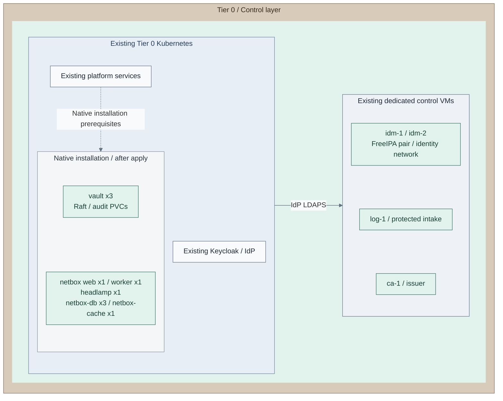

# Stage 6: Secrets

**Related:** [Architecture](../../01-architecture/08-cryptography/08-secrets.md) · [Operations](../../05-operations/03-cryptography/README.md)

Establish the Tier 0 secret service, its audit trail and independent recovery custody.
Then add the inventory and administration tools that support platform operation.
FreeIPA, the issuer and the identity provider already exist.

<a id="figure-control-applications"></a>

## Expected outcome: secrets and operator tools



**IaC:** *Figure: Vault, NetBox and Headlamp join the existing control cluster. Directory, issuer and protected logging
retain their dedicated runtimes.*
Tier 0 [control-application recipe](../../../tier-0/ansible/playbooks/deployment/control-applications.yml),
[product role](../../../tier-0/ansible/roles/control_applications) and
[example inputs](../../../tier-0/ansible/group_vars/control_applications.yml.example)
install the added group after explicit prerequisite gates. The picture shows configured
placement, not a verified live service. Empty Flux application starters are not a
second reconciliation owner for these Helm releases.
Counts follow the [product defaults](../../../tier-0/ansible/roles/control_applications/defaults/main.yml)
and [NetBox web/worker values](../../../tier-0/ansible/roles/control_applications/templates/netbox-values.yml.j2);
the added group contains separate services, not one replicated application.
The [Vault VM alternative](step-1b-vault-vm.md) replaces, rather than duplicates, the cluster Vault instance.
Independent monitoring is a separate [selected integration](procedures/independent-monitoring.md), not an installed workload here.

**Prerequisites:** accepted [Identity](../stage-5-identity/README.md),
service storage/backups and independent recovery inputs.
**Working repository:** `<prefix>-tier-0` (source: `tier-0/`).
**Execution context:** `<prefix>-tier-0/`.

**Automation:** native installation supplies Vault, NetBox and Headlamp. Initialization/unseal and
recovery acceptance remain operator tasks; see [coverage](../../08-reference/implementation-support.md#stage-coverage).
**Design:** [identity](../../01-architecture/09-identity/README.md),
[secrets](../../01-architecture/08-cryptography/README.md) and [operations](../../01-architecture/11-operations/README.md).

<a id="step-1-deploy-identity-federation"></a>

Identity federation and the OIDC provider are established in
[Identity, Steps 12–20](../stage-5-identity/README.md#step-12-select-the-existing-cluster-and-identity-provider-inputs).
This stage integrates secret-service and operator access with that provider.

<a id="main-path"></a>

## Installation route

Follow actions 1-22. Choose one Vault placement; later actions reuse that accepted service and the
existing identity/cluster inputs. The signing service is an optional independent deployment.

| Actions / choice | Result |
| --- | --- |
| [1a / 1b / 1c](#step-1-select-vault-placement-and-seal) | Cluster Vault or dedicated VM; seal selected before initialization |
| [2-8](#step-2-reuse-the-control-application-inputs) | Selected service installed, human ceremony complete, audit/access configured |
| [9-10](#step-9-install-independent-recovery-copies) | Independent scheduled recovery copies and accepted Vault |
| [11b](#step-11-select-an-independent-signing-service) | Optional separate OpenBao signing API |
| [12](#step-12-prepare-the-independent-monitoring-host) | Managed monitor or accepted independent host, outside observed clusters |
| [13-19](#step-13-configure-netbox-and-its-private-inputs) | NetBox, its backup/audit integrations, then Headlamp |
| [20-22](#step-20-install-independent-monitoring-and-alerts) | Independent monitoring, access/recovery acceptance and records |

<a id="step-1-deploy-the-secret-service"></a>
<a id="step-2-deploy-operational-services"></a>

## Step 1: Select Vault placement and seal

Use the [runtime figure](#figure-control-applications) to select **1a: Kubernetes Vault**, or
[**1b: dedicated Vault VM**](step-1b-vault-vm.md). Install only one. The VM option includes its own
TLS, installation, ceremony and native API configuration; after that path rejoin at **action 9**.
Actions 2-8 below are the Kubernetes realization only.

The main seal is Shamir. If selecting [**1c: seal integration**](step-1c-seal-integration.md), qualify and
configure its provider/recovery dependency **before initializing either placement**. It is not a post-install
seal migration. Human custody/approval and unseal shares never become routine Ansible inputs.

## Step 2: Reuse the control-application inputs

Run from **`<prefix>-tier-0/`**:

```bash
cp -n ansible/group_vars/control_applications.yml.example ansible/group_vars/control_applications.yml
```

Edit **`ansible/group_vars/control_applications.yml`**, preserving the accepted Stage 5 identity settings:

| Fields | Set |
| --- | --- |
| `control_applications_components`, `control_applications_vault_phase` | `[vault]`, `install` |
| `control_applications_kubeconfig`, `control_applications_context` | Existing Tier 0 target |
| `control_applications_hosts.vault`, `control_applications_versions.vault` | Stable private DNS name, matching leaf SAN, approved exact chart pin |
| `control_applications_storage_class` | Qualified block storage for separate Raft/audit claims |
| Platform, logging, Traefik and custody acceptance inputs | Only the prerequisites already verified |

The database `prepare`/`backup` setting is ignored for a Vault-only selection. It supplies no Vault snapshots.
Do not select Keycloak again just to add this product. The [product contract](procedures/control-applications.md)
owns optional settings, exact Secret keys and certificate requirements.

## Step 3: Add Vault TLS to the accepted Secret input

Choose **3a: retain the installer-owned encrypted file from Stage 5**, or **3b: existing qualified Secret owner**.
For 3a, run from **`<prefix>-tier-0/`**:

```bash
ansible-vault edit ansible/group_vars/control_applications_secrets.yml
```

Retain accepted entries and add the selected Vault namespace TLS leaf/key/CA. Keep
`control_applications_manage_secrets: true`. No unseal/root-token material belongs in Kubernetes Secrets
or rendered output. For 3b, retain management false and have that owner supply the exact Secrets;
omit the encrypted-file/password arguments from every application command below.

## Step 4: Render the sealed Vault installation

Run from **`<prefix>-tier-0/`**:

```bash
ANSIBLE_CONFIG=ansible/ansible.cfg ansible-playbook -i localhost, ansible/playbooks/deployment/control-applications.yml -e @ansible/group_vars/control_applications_secrets.yml --ask-vault-pass -e control_applications_action=render
```

Inspect **`secrets/control-applications/`**: three servers, separate data/audit claims, TLS retry-join,
private ingress and no bootstrap authority. Rendering does not initialize or unseal Vault.

## Step 5: Install the reviewed sealed service

Run from **`<prefix>-tier-0/`** with the same target and private inputs:

```bash
ANSIBLE_CONFIG=ansible/ansible.cfg ansible-playbook -i localhost, ansible/playbooks/deployment/control-applications.yml -e @ansible/group_vars/control_applications_secrets.yml --ask-vault-pass -e control_applications_action=apply
```

**Expected:** three running server processes, still sealed; normal readiness may fail until the ceremony.
Do not set audit-forwarding or backup/restore acceptance flags yet. Ansible apply has no extra confirmation;
CI supplies its protected Vault password/identity and approves the render before apply.

## Step 6: Perform the authorized initialization and unseal ceremony

On **the authorized operator workstation**, complete [the Kubernetes Vault ceremony](procedures/vault-kubernetes.md#operator-ceremony)
only. The sealed installation from action 5 is already complete; do not install it again.
Verify the TLS route, initialize the first fresh member once, retain encrypted shares/root-token material
outside the platform, unseal the peers with the same cluster custody and verify expected Raft membership.
For a selected alternative seal, use its qualified ceremony instead of Shamir share commands.

**Expected:** verified HTTPS access to the initialized, unsealed service. Retain independent admin/recovery
access before revoking bootstrap authority. The recipe never receives or automates unseal shares.

## Step 7: Set and render scoped audit/SSO configuration

In **Tier 0 `ansible/group_vars/control_applications.yml`**, set `control_applications_vault_phase: configure`,
review `control_applications_vault_policies` and bounded `control_applications_vault_oidc_roles`.
In the **existing encrypted private input**, supply the short-lived configuration token, accepted IdP CA
and `vault` client secret. Select `control_applications_register_clients: true` only if this recipe owns
that exact client registration; otherwise retain its existing owner.

Run **action 4's render command** once with those completed inputs. Inspect the selected policies, roles,
callbacks, audit destinations and existing service identity; no new Vault or realm is created.

## Step 8: Apply and verify audit/SSO configuration

Run **action 5's apply command** from **`<prefix>-tier-0/`** with phase `configure`.
**Expected:** persistent file and stdout audit enabled before policy/OIDC writes; bounded human roles configured.
Generate allowed and denied requests and verify their records at protected intake. The local audit PVC alone
is not remote custody. Test queue/outage behavior and retain independent access during IdP failure.
Only after real delivery passes set `control_applications_vault_audit_forwarding_accepted: true`.

## Step 9: Install independent recovery copies

For **either placement**, select the existing independent `control_recovery` host and its accepted access,
read-only original-input exports and initialized encrypted restic repository. Their custodians retain
repository ID/password, snapshot authentication and recovery authority under the
[recovery-copy contract](../../05-operations/06-resilience/backups/control-applications.md#custody-and-scope).
This recipe installs the scheduler on that host; it does not provision an unspecified recovery VM.

Run from **`<prefix>-tier-0/`**:

```bash
cp -n ansible/group_vars/control_backup.yml.example ansible/group_vars/control_backup.yml
chmod 600 ansible/group_vars/control_backup.yml
```

Edit **Tier 0 `ansible/inventory/hosts.yml`** (`control_recovery`) and
**`ansible/group_vars/control_backup.yml`**: actual host connection, pinned repository/mount, matching
Vault CLI, end-to-end snapshot TLS/auth, source exports, private files, schedule and independent watchdog.
Only enable NetBox media later when its actual consistent read-only view is commissioned.
Run from **`<prefix>-tier-0/`** after the named custody gates:

```bash
ANSIBLE_CONFIG=ansible/ansible.cfg ansible-playbook -i ansible/inventory/hosts.yml ansible/playbooks/maintenance/control-backup.yml -e @ansible/group_vars/control_backup.yml
```

**Expected:** first verified encrypted copy and scheduled native snapshots. Prove an
[isolated Vault restore](../../05-operations/06-resilience/recovery/vault.md) with the original shares,
certificates and credentials. Raft replicas are not backups.

## Step 10: Accept the selected Vault service

For **1a**, set `control_applications_vault_phase: accept` and the verified audit/backup acceptance flags in
**Tier 0 `ansible/group_vars/control_applications.yml`**; use **action 5's apply command**.
For **1b**, use the VM option's `vault-configure.yml` accept pass with its original inputs instead.

**Expected:** initialized/unsealed health, intended voters, audit configuration, policy content and OIDC
bounds checked. Record real allowed/denied login, group removal, IdP outage, one-server loss and independent
restore evidence. The accept pass does not inject destructive failures or perform a live restore.

## Step 11: Select an independent signing service

**11a: skip** if the accepted secret service is sufficient. **11b: add the independent
[OpenBao signing API](step-11b-openbao.md)** only when selected. It uses distinct guests, state, keys,
clients and recovery custody; it does not replace HashiCorp Vault. Complete original-HSM-key qualification,
scoped signing tests and independent recovery, then rejoin at action 12.

<a id="step-2-add-operational-tools"></a>

## Step 12: Prepare the independent monitoring host

Select **12a: managed `mon-1`** or **12b: accepted existing RedHat-family host**, outside observed clusters
and separate from protected receivers. The [monitor runtime figure](procedures/independent-monitoring.md#figure-monitoring-runtime)
introduces this addition. For 12a, edit **the existing Tier 0 foundation inputs**:

| File | Set |
| --- | --- |
| `terraform/deployments/foundation/terraform.tfvars` | Optional `mon-1`, approved EL image, unused VMID, independent placement and OS/history capacity; keep issuer/directory resources |
| `ansible/inventory/hosts.yml` | `mon-1` in `infrastructure_monitoring` and `guests` |
| `ansible/group_vars/foundation.yml` | Its unused reserved management IP; retain the complete existing map |

Run from **`<prefix>-tier-0/`**, with the original foundation environment/state:

```bash
bash scripts/deploy.sh foundation --terraform-only
```

Review a monitor addition only. Do not run the default FreeIPA Ansible recipe to prepare this host.
Apply its common baseline from **Tier 0**:

```bash
ANSIBLE_CONFIG=ansible/ansible.cfg ansible -i ansible/inventory/hosts.yml mon-1 -m ansible.builtin.wait_for_connection -a timeout=300 -e @ansible/group_vars/all.yml -e @ansible/group_vars/foundation.yml
ANSIBLE_CONFIG=ansible/ansible.cfg ansible-playbook -i ansible/inventory/hosts.yml --limit mon-1 "../<prefix>-shared/ansible/playbooks/site.yml" -e @ansible/group_vars/all.yml -e @ansible/group_vars/foundation.yml
```

For **12b**, register the existing host and inventory-adjacent `ansible/inventory/host_vars/<host>.yml`
connection overrides, retaining its original provisioning owner instead of creating another VM/state.
Both paths extend [existing producer forwarding](../stage-2-logging/procedures/sources.md) for OS/audit streams
and verify an event at protected intake. NetBox audit can then use this prepared host; Netdata is installed at action 20.

## Step 13: Configure NetBox and its private inputs

In **Tier 0 `ansible/group_vars/control_applications.yml`**, select `[netbox]`, preserve prior service inputs,
and set its stable DNS/chart pin, live database block class, **separate RWX media class**, accepted IdP
client/callbacks and change-history retention. Choose file or object/WAL database backup before installation.
Keycloak's claim/marker/system identifier cannot be reused for NetBox.

Edit the **same encrypted `control_applications_secrets.yml`** with `ansible-vault edit`:
NetBox TLS, stable configuration key/API peppers, independent superuser (including its fresh v2 `api_key`
and private `api_token`), matching database/replication
and backup TLS, cache TLS/password/native configuration, IdP trust and confidential OIDC secret.
The [product Secret table](procedures/control-applications.md#secrets-and-certificates) is authoritative.
An existing Secret owner remains a valid alternative with the same contract.

## Step 14: Prepare NetBox's database for file backups

For **files**, set `control_applications_backup_files_phase: prepare`, then use **action 4's render command**.
Inspect only NetBox database preparation; run **action 5's apply command** from **Tier 0**.

**Expected:** `netbox-db` Ready on live block claims, actual system identifier reported; NetBox is not installed
by this prepare pass. An **object/WAL** selection skips this NAS-only pass and continues at action 16 with its
qualified plugin, endpoint and scoped credentials.

## Step 15: Commission NetBox's NAS destination

For **files**, obtain its **own** dedicated export, permissions and source marker from the declared
[NAS custodian](../../05-operations/06-resilience/backups/postgresql.md#commission-the-nas).
Keep the database prepared in action 14; do not initialize it again.
Set `control_applications_backup_files.netbox` from the actual claim, handle, system identifier, marker
and schedule. For a new claim, set its `storage.mode: static_nfs` plus `server`, `share` and `size`;
actions 16-17 render/create the retained backup PV/PVC through the accepted NFS CSI driver.
For an accepted existing claim, keep `storage: {mode: existing}` and the exact recorded handle.
After the destination contract is ready, set file-backup acceptance true and phase `backup`.

This external NAS/storage operation supplies no live PostgreSQL mount. Retain NetBox media/cache recovery
separately; database backup does not include media. Scheduled file recovery stops at a completed verified set.

## Step 16: Render the completed NetBox selection

With `[netbox]` and the selected backup path complete, run **action 4's render command** from **Tier 0**.
Inspect database/backup jobs, RWX media, TLS cache, ingress and bounded OIDC settings in the private output.
No accepted Keycloak/Vault installation is repeated.

## Step 17: Install and verify NetBox

Run **action 5's apply command** from **Tier 0** with `[netbox]` selected.
**Expected:** database/backup/cache readiness gates pass before application installation.
Verify real login, denied permissions, database restoration and independently retained media. NetBox is an
inventory consumer, not the source needed to bootstrap its own platform.

## Step 18: Connect NetBox change auditing

Use the **host prepared at action 12**; do not provision another collector. On that host's existing producer
settings add the dedicated `netbox-changes` security file stream for
`/var/lib/netbox-audit/events/*.jsonl`, preserving OS/audit streams. Authorize the exact stream at intake.

Choose **18a: bootstrap a dedicated read-only identity**, or **18b: retain a qualified existing identity**.
Both need protected controller paths for the NetBox CA and token. For 18a the token file must not yet exist.
Run from **`<prefix>-tier-0/`**:

```bash
cp -n ansible/group_vars/netbox_audit.yml.example ansible/group_vars/netbox_audit.yml
read -r -e -p 'Protected read-only NetBox token file: ' NETBOX_AUDIT_TOKEN_FILE
read -r -e -p 'Trusted NetBox CA file: ' NETBOX_AUDIT_CA_FILE
export NETBOX_AUDIT_TOKEN_FILE NETBOX_AUDIT_CA_FILE
```

For **18a**, prepare account inputs from **Tier 0**:

```bash
cp -n ansible/group_vars/netbox_audit_account.yml.example ansible/group_vars/netbox_audit_account.yml
```

Edit **`ansible/group_vars/netbox_audit_account.yml`**: enable the route, select the actual HTTPS endpoint,
dedicated username and future token expiry. Add `netbox_audit_account_password` to the existing encrypted
`control_applications_secrets.yml`; its `netbox/netbox-superuser.api_key` plus `api_token` supply fresh
v2 bootstrap authority. Existing accepted administrator credentials remain supported.
An externally owned Secret setup can supply a separately authorized administrator token through that
encrypted override instead. Run from **Tier 0**:

```bash
ANSIBLE_CONFIG=ansible/ansible.cfg ansible-playbook -i localhost, \
  ansible/playbooks/deployment/netbox-audit-account.yml \
  -e @ansible/group_vars/control_applications_secrets.yml --ask-vault-pass \
  -e @ansible/group_vars/netbox_audit_account.yml
```

**Expected:** view-only `core.objectchange` permission, dedicated nonadministrative reader and private
read-only v2 token file. Preserve that file under recovery custody; reruns do not rotate its token.
This account-bootstrap route supports NetBox 4.5+; the shared precheck prepares declared controller clients
or checks the pre-staged runtime in offline mode.
For **18b**, skip this command and retain the existing qualified credential and its authentication scheme.
Both paths continue with collector configuration below.

Edit **`ansible/group_vars/netbox_audit.yml`**: exact HTTPS API endpoint, retained instance identity,
source retention/polling budget and independent watchdog; use `netbox_audit_auth_scheme: Bearer` for 18a
and acknowledge the verified read-only/forwarding gates.
Install from **Tier 0**:

```bash
read -r -p 'Prepared monitoring inventory host: ' AUDIT_HOST
ANSIBLE_CONFIG=ansible/ansible.cfg ansible-playbook -i ansible/inventory/hosts.yml --limit "localhost,${AUDIT_HOST:?Select the prepared host}" ansible/playbooks/deployment/netbox-audit.yml -e @ansible/group_vars/all.yml -e @ansible/group_vars/foundation.yml -e @ansible/group_vars/netbox_audit.yml
```

For an external host, supply its existing host override last as documented in the [audit contract](procedures/netbox-audit.md).
**Expected:** retained create-only event ledger and timer installed. Verify create/update/delete records at
protected intake and read-only denial. Ordinary application stdout is not the complete change ledger.

## Step 19: Install Headlamp after API SSO acceptance

In **Tier 0 `ansible/group_vars/control_applications.yml`**, select `[headlamp]`, exact IdP client/callback,
existing namespace/group RBAC and `control_applications_headlamp_api_oidc_accepted: true` **only after Stage 5's
API bearer-token and certificate-recovery tests pass**. Supply its matching private client secret and trust
through the same selected Secret owner.

Run **action 4's render command**, inspect scope/callbacks, then **action 5's apply command**.
Verify actual UI allowed/denied login, group removal and outage/recovery. The pod has no cluster-admin grant;
API acceptance alone did not test this UI. Do not repeat the API rollout or install another IdP here.

<a id="step-4-establish-independent-monitoring"></a>

## Step 20: Install independent monitoring and alerts

Use **the same host prepared at action 12**. Review its
[history and alert figures](procedures/independent-monitoring.md#figure-monitoring-history) now.
Create missing local inputs from **`<prefix>-tier-0/`**:

```bash
cp -n ansible/group_vars/infrastructure_monitoring.yml.example ansible/group_vars/infrastructure_monitoring.yml
cp -n ansible/group_vars/infrastructure_monitoring_secrets.yml.example ansible/group_vars/infrastructure_monitoring_secrets.yml
ansible-vault encrypt ansible/group_vars/infrastructure_monitoring_secrets.yml
ansible-vault edit ansible/group_vars/infrastructure_monitoring_secrets.yml
```

For an already encrypted file, use `ansible-vault edit` only. Edit **`infrastructure_monitoring.yml`**:
actual listen/source scope, approved signed Netdata/go.d builds, read-only Proxmox/Redfish targets,
observed source/queue/capacity health rules and accepted independence. Keep metric export disabled until Stage 8.
In the encrypted private file supply exact TLS/reader credentials, exporter digest and independent
notification/dead-man inputs. Complete notification fields **before** rendering; no second preparation loop is needed.

Render from **`<prefix>-tier-0/`**:

```bash
read -r -p 'Prepared monitoring inventory host: ' MONITOR_HOST
ANSIBLE_CONFIG=ansible/ansible.cfg ansible-playbook -i ansible/inventory/hosts.yml --limit "${MONITOR_HOST:?Select the prepared host}" ansible/playbooks/deployment/infrastructure-monitoring.yml -e @ansible/group_vars/all.yml -e @ansible/group_vars/foundation.yml -e @ansible/group_vars/infrastructure_monitoring.yml -e @ansible/group_vars/infrastructure_monitoring_secrets.yml --ask-vault-pass -e infrastructure_monitoring_action=render
```

Review the private rendered configuration. For **12b**, supply that accepted host override last on both
commands. Apply from **the same Tier 0 root**:

```bash
ANSIBLE_CONFIG=ansible/ansible.cfg ansible-playbook -i ansible/inventory/hosts.yml --limit "${MONITOR_HOST:?Select the prepared host}" ansible/playbooks/deployment/infrastructure-monitoring.yml -e @ansible/group_vars/all.yml -e @ansible/group_vars/foundation.yml -e @ansible/group_vars/infrastructure_monitoring.yml -e @ansible/group_vars/infrastructure_monitoring_secrets.yml --ask-vault-pass -e infrastructure_monitoring_action=apply
```

**Expected:** native Netdata history/rules/source jobs, private notifications and detector heartbeat installed.
Now test real source signals and independent cluster/API, queue, evidence-capacity, stale-source and monitor-loss
alerts. No repeated VM provision/baseline is required. Two source boxes or a healthy process alone do not prove alerts.

<a id="step-3-integrate-access-and-recovery"></a>

## Step 21: Accept access and independent recovery

**21a:** use the accepted authentication path, or add [**21b: hardware authentication**](step-21b-hardware-authentication.md)
now that independent recovery exists. Both apply the [service SSO gate](../stage-5-identity/procedures/service-sso.md)
and real allowed/denied/group-removal checks to each installed consumer.

Preserve break-glass access, unseal custody, original inputs, database/media backups, external alerts and
the tested restore route before restricting routine bootstrap credentials. Repeat critical access/alert
checks with IdP, Vault or Tier 1 services unavailable; record actual results rather than rendered intent.

## Step 22: Record the selected services and continue

Record Vault placement/seal, optional signing/authentication, operational tools and backup/restore/alert
evidence in **`<prefix>-architecture/deployments.md`**. Keep ongoing tasks in the linked product runbooks;
first installation is complete, so those runbooks need not restart this stage's resource provisioning.

## Capability available

**Result:** accepted secret access/audit/recovery plus selected inventory, UI and independent monitoring.
Continue with [Stage 7: Delivery](../stage-7-delivery/README.md). Shared Stage 8 diagnosis does not own
Tier 0 alert authority or protected evidence.
