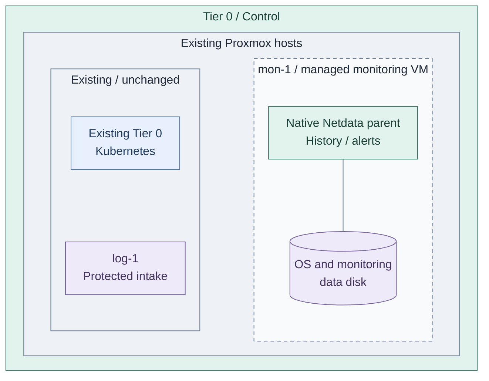
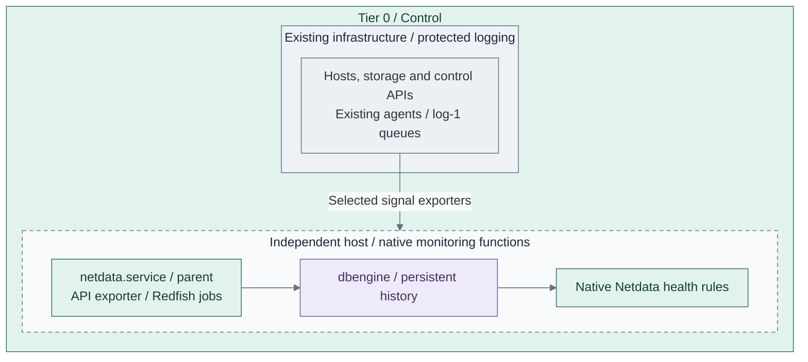
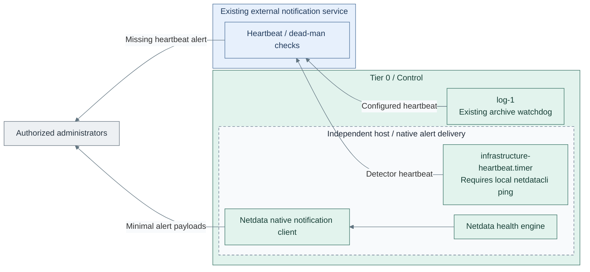

# Independent foundation monitoring

**Stage route:** [Stage 6, Step 2](../README.md#step-2-add-operational-tools) prepares the host;
[Step 4](../README.md#step-4-establish-independent-monitoring) installs monitoring and alerts.
**Return:** complete the corresponding stage step after the checks below.

Add critical health history, diagnostics, rule evaluation and alerts to the existing
protected logging capability. This is the monitoring deployment in Stage 6, not a
prerequisite for the earlier collector.

**Working repository:** `<prefix>-tier-0` (source: `tier-0/`).
**Prerequisites:** accepted [protected logging](../../stage-2-logging/README.md), approved
runtime/storage and independent recovery inputs. Tier 1 Observability is not required.
**Design:** [telemetry composition](../../../01-architecture/24-operations/03-telemetry.md).

## Main path

1. [Prepare the monitoring runtime](#step-1-prepare-the-monitoring-runtime)
2. [Add critical health and history](#step-2-add-critical-health-and-history)
3. [Enable and verify independent alerts](#step-3-enable-and-verify-independent-alerts)

The [dedicated recipe](../../../../tier-0/ansible/playbooks/deployment/infrastructure-monitoring.yml)
installs native Netdata on the managed `mon-1` VM or an accepted existing RedHat-family host, with persistent
history, local health rules and independent notifications. Redfish jobs and a local Proxmox
API exporter keep management credentials in Tier 0. Optional metric export is strictly allowlisted.
The foundation Terraform root provisions the optional VM; this service recipe does not create it
or install agents on hypervisors.

Run all commands below from the **Tier 0 root**, not its `ansible/` subdirectory.
Protected `log-1` and optional `log-2` are rejected as monitoring targets by this recipe.

## Step 1: Prepare the monitoring runtime

Prepare the host now for [NetBox audit collection](netbox-audit.md).
Netdata installation follows at Stage 6 Step 4; audit collection does not require Netdata yet.

Choose **1a: managed VM** below or **1b: accepted existing host**. Both must stay outside
the observed Kubernetes clusters and separate from `log-1`/`log-2`.
An external dead-man service detects loss of the monitor itself; one VM is not HA or
independent of its underlying Proxmox host/storage.

### 1a. Provision the managed monitor

In **`<prefix>-tier-0/`**, enable the commented `mon-1` entries in the existing local inputs:

| File | Edit |
| --- | --- |
| `terraform/deployments/foundation/terraform.tfvars` | Add the optional `mon-1` block; verify free VMID `411`, approved RedHat-family image, placement, `management` network and capacity |
| `ansible/inventory/hosts.yml` | Replace only `infrastructure_monitoring.hosts: {}` with `hosts:` containing `mon-1: {}` |
| `ansible/group_vars/foundation.yml` | Add its reserved `platform_host_ips.mon-1`, initially `10.10.10.60`; keep every issuer/directory address |

Do not pass a monitor-only `platform_host_ips` file to Terraform: its shallow YAML merge would
replace the complete issuer/directory map. Keep all addresses in the existing foundation input.

Use the current examples to copy only these optional entries if older local files lack them.
Set `vm_instances["mon-1"].template_vm_id` explicitly if the shared/root default is not an approved
RedHat-family image; do not inherit the Debian CA image.
The starter is two vCPUs, 4 GiB RAM and one 40 GiB OS/data disk. Terraform manages that disk;
Netdata history and the audit ledger use its filesystem. No separate manual disk preparation is needed.
Review capacity and recovery copies before accepting the host.

Run from **`<prefix>-tier-0/`**, using the same environment/state as the issuer and directory:

```bash
bash scripts/deploy.sh foundation --terraform-only
```

Review the **whole foundation plan**. It should add `mon-1`, without replacing/removing accepted
issuer/directory resources. Preserve their entries and the original
`.terraform/state/foundation/<env>/terraform.tfstate`; do not create monitor-only state or use `-target`.
Retain the original `--env` flag if one was used. This command runs no identity installation.

Wait for its SSH login, then apply the existing Shared OS baseline only to `mon-1`:

Run from **`<prefix>-tier-0/`**.

```bash
ANSIBLE_CONFIG=ansible/ansible.cfg ansible -i ansible/inventory/hosts.yml mon-1 \
  -m ansible.builtin.wait_for_connection -a timeout=300 \
  -e @ansible/group_vars/all.yml -e @ansible/group_vars/foundation.yml
```

```bash
ANSIBLE_CONFIG=ansible/ansible.cfg ansible-playbook -i ansible/inventory/hosts.yml \
  --limit mon-1 "../<prefix>-shared/ansible/playbooks/site.yml" \
  -e @ansible/group_vars/all.yml -e @ansible/group_vars/foundation.yml
```

The Shared path names the sibling repository in the generated collection.
For a named environment, load its `all.<env>.yml` and `foundation.<env>.yml` after the base files.
Verify approved software access and SSH/sudo before audit collection.
Continue with the settings below; do not run `deploy.sh foundation` without `--terraform-only`
to prepare this monitor, because its default Ansible recipe configures FreeIPA.

### 1b. Accept an existing host

Skip VM provisioning when independently managed capacity satisfies the same placement,
storage/recovery and RedHat-family requirements. Register it in `infrastructure_monitoring` and create
`ansible/host_vars/<monitor-host>.yml` with its actual `ansible_host` and SSH/sudo settings.
Retain its existing provisioning/state owner; do not also add it as a new foundation VM.
Verify its baseline and approved software access, then rejoin below.

### Prepare the service inputs

For either host path, complete [logging source Steps 1–2](../../stage-2-logging/procedures/sources.md)
for this host's OS/audit streams before NetBox audit collection. Add it to Tier 0's
`logging_producers`, approve its independent producer identity and verify delivery at protected intake.
The monitoring installer does not enroll or configure these senders.

Create local settings and private inputs without replacing existing files:

Run from **`<prefix>-tier-0/`**.

```bash
umask 077
cp -n ansible/group_vars/infrastructure_monitoring.yml.example ansible/group_vars/infrastructure_monitoring.yml
cp -n ansible/group_vars/infrastructure_monitoring_secrets.yml.example ansible/group_vars/infrastructure_monitoring_secrets.yml
mkdir -p ansible/host_vars
```

Edit in **`<prefix>-tier-0/`**.

- `ansible/inventory/hosts.yml`: Keep the selected host in `infrastructure_monitoring`; preserve other groups.
  Managed `mon-1` uses the foundation IP map; only the existing-host path needs a connection override file.
- `ansible/group_vars/infrastructure_monitoring.yml`: Actual listen address/allowed operator sources, pinned
  packages, Proxmox/Redfish targets and tested health rules.
  Set `infrastructure_monitoring_export_endpoint: ""` until Stage 8's private metric intake exists.
- `ansible/group_vars/infrastructure_monitoring_secrets.yml`: Target credentials, native TLS files,
  notification/watchdog inputs and approved exporter image

Set the outside-cluster and read-only-credential acceptance flags only after verifying
those properties. Encrypt the filled private input file:

Run from **`<prefix>-tier-0/`**.

```bash
ansible-vault encrypt ansible/group_vars/infrastructure_monitoring_secrets.yml
```



**IaC:** Tier 0's [foundation inputs](../../../../tier-0/terraform/deployments/foundation/terraform.tfvars.example)
optionally provision `mon-1` and its disk in the existing foundation state. Tier 0's
[role](../../../../tier-0/ansible/roles/infrastructure_monitoring),
[recipe](../../../../tier-0/ansible/playbooks/deployment/infrastructure-monitoring.yml) and local
inputs own the subsequent service installation on that selected host. The log-host Terraform and cluster
starters provide context only. An accepted existing host is an alternative to the managed VM.

**Result:** a selected runtime that remains available during the required cluster outage.

## Step 2: Add critical health and history



**IaC:** the [native configuration templates](../../../../tier-0/ansible/roles/infrastructure_monitoring/templates)
configure the parent, dbengine history, source jobs and metric bridge. The three monitoring
functions share one Netdata service; they are not three extra VMs or backends.
The existing receiver and cluster recipes do not install these services.

1. Select a small dataset: host/storage/network health, source coverage, receiver queues,
   evidence writes/replication, capacity, certificate expiry and cluster/API availability.
2. Pin the native Netdata and go.d RPM builds from the approved signed repository.
   Add Redfish jobs with file-based credentials and validated TLS. The native Podman module
   creates a loopback-only, digest-pinned Proxmox API exporter. Host-level Proxmox diagnostics
   need separately reviewed host agents. No VictoriaMetrics, vmalert or Alertmanager service
   is installed in this Tier 0 profile. [1][2][3]
3. Review the planned source jobs, reader scope and history settings. Check live signals only after
   Step 3 installs the service. Netdata streaming is separate from OpenTelemetry pipelines.

**Result:** reviewed monitoring inputs, not an installed service. Live diagnostics are verified after apply.

Render the complete selected configuration before changing the host:

For **1b: existing host**, append `-e "@ansible/host_vars/$MONITOR_HOST.yml"` to this render command
and the Step 3 apply command. Managed `mon-1` needs no connection override file.

Run from **`<prefix>-tier-0/`**.

```bash
read -r -p 'Monitoring inventory host: ' MONITOR_HOST
ANSIBLE_CONFIG=ansible/ansible.cfg ansible-playbook -i ansible/inventory/hosts.yml \
  --limit "${MONITOR_HOST:?Select the prepared host}" \
  ansible/playbooks/deployment/infrastructure-monitoring.yml \
  -e @ansible/group_vars/all.yml -e @ansible/group_vars/foundation.yml \
  -e @ansible/group_vars/infrastructure_monitoring.yml \
  -e @ansible/group_vars/infrastructure_monitoring_secrets.yml \
  --ask-vault-pass \
  -e infrastructure_monitoring_action=render
```

Rendering is controller-local; it does not install the pictured services. Review the
private output and complete notification inputs in Step 3 before apply.

## Step 3: Enable and verify independent alerts



**IaC:** the [native heartbeat recipe](../../../../tier-0/ansible/roles/infrastructure_monitoring/tasks/heartbeat.yml)
installs the timer; the role also configures health rules and private `health_alarm_notify.conf`.
The independent heartbeat runs only while `netdatacli ping`
succeeds; it detects monitor loss, not the health of every source. Device/source freshness
rules and delivery tests are required inputs, using the actual observed chart names.
The existing Tier 0 [archive job](../../../../tier-0/ansible/playbooks/deployment/logging-archive.yml)
can call its configured external watchdog; neither recipe installs that external service.
The protected runtime stays on the right; heartbeat and alert traffic travels left
through the external service to administrators outside that service boundary.

1. Configure native Netdata rules and notification routing with independent credentials
   and an approved external notification path. Keep alert payloads
   minimal; notifications do not grant external access to sensitive raw logs.
2. Review the completed notification/watchdog inputs before the apply below. If they changed after
   Step 2, repeat its explicit render command and inspect the new output before installing.
3. Install with the command below, then test live signals and failures. Do not inject failures
   against an uninstalled detector.

After preparing notification/watchdog inputs, install the complete monitoring configuration:

Run from **`<prefix>-tier-0/`**.

```bash
read -r -p 'Monitoring inventory host: ' MONITOR_HOST
ANSIBLE_CONFIG=ansible/ansible.cfg ansible-playbook -i ansible/inventory/hosts.yml \
  --limit "${MONITOR_HOST:?Select the prepared host}" \
  ansible/playbooks/deployment/infrastructure-monitoring.yml \
  -e @ansible/group_vars/all.yml -e @ansible/group_vars/foundation.yml \
  -e @ansible/group_vars/infrastructure_monitoring.yml \
  -e @ansible/group_vars/infrastructure_monitoring_secrets.yml \
  --ask-vault-pass \
  -e infrastructure_monitoring_action=apply
```

After apply, verify sample signals, reader scope and retained history. Test cluster/API failure, missing
sources, stalled evidence writes, capacity thresholds and monitoring-host loss. Repeat without Tier 1,
hosted source control, normal SSO or secret services. Record alert delivery, acknowledgement authority,
recovery and blind spots. The independent heartbeat must detect loss of the local detector.

For **1b: existing host**, append `-e "@ansible/host_vars/$MONITOR_HOST.yml"` to both render/apply
commands so its connection settings override the common inputs. For named environments, load the
approved `all.<env>.yml` and complete `foundation.<env>.yml` after their base files.
Keep the full foundation `platform_host_ips` map; a monitor-only override replaces that map, it does not merge it.
Apply changes the selected host immediately;
it is not a Terraform plan and has no additional confirmation prompt.

**Result:** required foundation failures produce independently delivered alerts.

## IaC locations

| Repository | Path inside that repository | Coverage |
| --- | --- | --- |
| Tier 0 | [ansible/roles/infrastructure_monitoring/](../../../../tier-0/ansible/roles/infrastructure_monitoring) | Native parent, rules, jobs, external heartbeat and optional approved metric bridge |
| Tier 0 | [deployment playbook](../../../../tier-0/ansible/playbooks/deployment/infrastructure-monitoring.yml) | Service installation on the selected host; private rendering, explicit apply |
| Tier 0 | [terraform/deployments/foundation/](../../../../tier-0/terraform/deployments/foundation) | Optional `mon-1` VM/disk alongside retained issuer/directory state |
| Tier 0 | [terraform/deployments/syslog/](../../../../tier-0/terraform/deployments/syslog) | Protected logging resources remain separate |
| Tier 0 | [clusters/tier0/](../../../../tier-0/clusters/tier0) | Project cluster manifests; no monitoring installer |
| Tier 0 | [ansible/playbooks/deployment/foundation-logging.yml](../../../../tier-0/ansible/playbooks/deployment/foundation-logging.yml) | Existing protected log receiver; unchanged by monitoring |
| Shared | [ansible/roles/baseline/](../../../../shared/ansible/roles/baseline) | Common OS preparation, not inventory, state or alert authority |

Return to [Stage 6 acceptance](../README.md#capability-available). Later
[Tier 1 Observability](../../stage-8-observability/README.md) adds shared diagnosis without
taking ownership of foundation alerts or protected evidence. Its
[infrastructure-monitoring step](../../stage-8-observability/step-3-infrastructure-monitoring.md)
expands Netdata diagnostics and Proxmox/BMC coverage; Tier 0 retains local collection,
credentials and critical alerts when Tier 1 is unavailable.

## Input and Runtime Gates

| Input / prerequisite | Required contract |
| --- | --- |
| Managed or accepted existing host | RedHat family, approved signed Netdata repository, local recovery access; outside observed Kubernetes clusters and separate from protected receivers |
| `infrastructure_monitoring_private_files` | Native TLS files, per-BMC passwords, notification config, external heartbeat curl config; kept under `/etc/netdata/private/` |
| Proxmox identities | Fixed targets and read-only `PVEMonitor`-equivalent access; no guest/host power, configuration or mutation privileges |
| BMC identities | Read-only sensor privileges, trusted HTTPS certificates; qualify vendor coverage explicitly |
| Optional export | Exact metric names and approved labels; gRPC to the private Tier 1 metrics NodePort with a metrics-only client certificate |
| Source health rules | Tested missing/stale-source, quorum, storage and capacity alerts; unsupported sensors remain unknown |
| External notification/watchdog | Existing service independent of Tier 1, SSO, Vault and this host; private credentials and tested delivery |
| Dependencies | Ansible `containers.podman` with native Quadlet support, Podman/systemd on the host |

Only the metric bridge's CA/client certificate/key are mounted into its container. BMC and
Proxmox credentials are not bridge inputs. The exporter binds loopback, so Tier 1 cannot
request arbitrary management targets. Export filtering happens before OTLP transfer.
See [infrastructure monitoring](../../stage-8-observability/step-3-infrastructure-monitoring.md) for
coverage and [private intake](../../stage-8-observability/procedures/observability-platform.md#private-cross-cluster-intake)
for the endpoint/firewall contract. Leave metric export disabled until that Stage 8 step.
Protected search-copy export is a separate Stage 8 option, not a Stage 6 prerequisite.

Rendering and source tests do not establish live alert delivery, package/OS compatibility,
vendor sensor completeness, physical isolation or recovery. Record those acceptance results.

## References

Primary sources checked 2026-10-26.

1. [Netdata Redfish jobs and private credential files](https://learn.netdata.cloud/docs/collecting-metrics/collectors/hardware-and-sensors/redfish)
2. [Proxmox VE Prometheus exporter](https://github.com/prometheus-pve/prometheus-pve-exporter)
3. [Native Podman Quadlet module API](https://docs.ansible.com/projects/ansible/latest/collections/containers/podman/podman_container_module.html)
