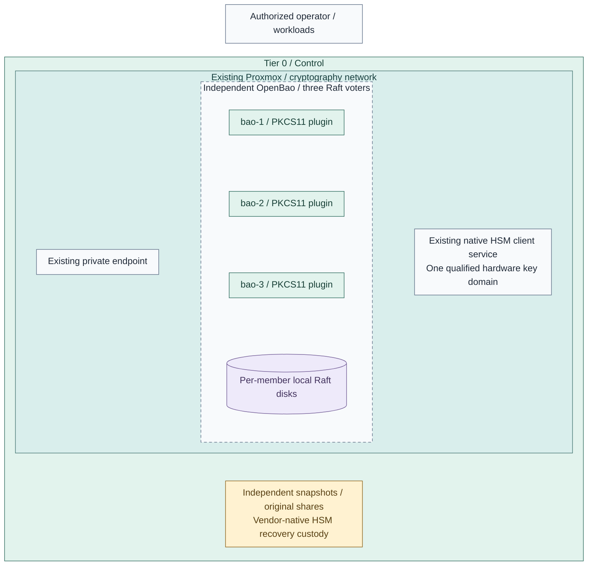

# Step 1d: Optional independent OpenBao signing API

**Working repository:** `<prefix>-tier-0` (source: `tier-0/`).

**Branch from:** [Step 1](README.md#step-1-deploy-the-secret-service), after PKI,
the selected hardware provider, identity and protected logging.
**Change:** Add an independent HSM-backed signing API with separate state and recovery custody.
**Return:** [Stage 6, Step 2](README.md#step-2-add-operational-tools) after signing,
independent recovery and human SSO checks pass.
HashiCorp Vault with Shamir remains the initial secret-service path. This advanced option creates an
independent OpenBao service for applications that need a REST signing API. It never migrates Vault.
An already accepted, independent OpenBao service can enter at action 4 without provisioning guests.
Use `--tags openbao-signing` at action 5 for API-only reconciliation without installing a controller CLI
or recovery executable. Its server owner must already have installed the declared plugin and audit devices.

## Table of contents

- [Prerequisites and boundaries](#prerequisites-and-boundaries)
- [1. Select independent guests and state](#1-select-independent-guests-and-state)
- [2. Supply accepted artifacts and provider configuration](#2-supply-accepted-artifacts-and-provider-configuration)
- [3. Deploy and perform the human ceremony](#3-deploy-and-perform-the-human-ceremony)
- [4. Configure audit and human access](#4-configure-audit-and-human-access)
- [5. Register original HSM keys and workload clients](#5-register-original-hsm-keys-and-workload-clients)
- [6. Accept operation and independent recovery](#6-accept-operation-and-independent-recovery)
- [References](#references)

## Prerequisites and boundaries

| Input | Required acceptance |
| --- | --- |
| Controller | Linux Ansible controller, accepted collections and OpenSSL; setup `openbao-signing` prepares/checks these |
| Runtime | Fresh Alma/Rocky/RHEL x86-64 guests, accepted OS packages, DNS, preissued server TLS and controller CA |
| Network | Restricted API/cluster ports; accepted private endpoint preserving authenticated client source addresses for CIDR checks; no balancer is installed here |
| Hardware | Qualified YubiHSM 2 or PicoHSM devices, original keys and selected local-provider or remoting inputs; action 3 installs the guest client for `openbao` |
| Original keys | Existing non-exportable signing objects, original public PEM files and independently recorded SHA256 DER SPKI pins |
| Custody | Original Shamir shares, independent encrypted snapshots/input exports and vendor-native hardware key recovery |

The native PKCS11 KMS plugin is a separate executable. The installer registers it through OpenBao's
declarative `plugin "kms"` stanza with an executable checksum and absolute library alias; API catalog
registration cannot substitute for this KMS declaration. [1] Versions are pinned in
[role defaults](../../../tier-0/ansible/roles/vault/defaults/main.yml), with explicit accepted artifact paths.
External Keys is a recent stable integration; a stable release is not evidence of an audited hardware
deployment. Release fixes include external-key CSR selection and delegated signing failures. [2][3]

This figure shows the selected three-member realization; it is configuration, not live acceptance.



**IaC:** existing [Vault VM root](../../../tier-0/terraform/deployments/vault/main.tf),
[installer](../../../tier-0/ansible/playbooks/deployment/vault-vm.yml),
[OpenBao tasks](../../../tier-0/ansible/roles/vault/tasks/openbao.yml), and
[API play](../../../tier-0/ansible/playbooks/deployment/openbao-signing.yml).
The three IDs come from the private input below. Hardware, endpoint and independent custody are existing
accepted prerequisites. Raft replicates service state; it does not copy HSM private keys. The single-node
learning choice has one voter and **no HA**. A two-node deployment is rejected by signing acceptance.
This is a placement view: each member uses its local Raft disk and qualified PKCS#11 client;
the [signing sequence](../../01-architecture/08-cryptography/04-usb-hsm.md#request-and-response)
shows authenticated request/result flow. Offline custody has no normal network route.

## 1. Select independent guests and state

Keep the existing Vault environment untouched. Prepare a separate `signing` environment using the same
root and original state authority. Run on the **controller, `<prefix>-tier-0/`**:

```bash
bash scripts/init-local-files.sh --setup vault --env signing
```

| Private input | Edit before planning |
| --- | --- |
| `ansible/inventory/signing.yml` | Separate inventory containing only `bao-1`, `bao-2`, `bao-3` in group `vault`; same SSH/controller settings as the accepted inventory |
| `ansible/group_vars/all.signing.yml` | Distinct domain/hostname decoration for signing |
| `ansible/group_vars/vault.signing.yml` | Complete `platform_host_ips` for all three signing guests; no original Vault hosts |
| `terraform/deployments/vault/terraform.signing.tfvars` | Complete `vm_instances` map for these three names, distinct unused VMIDs, intended placement and storage; `lxc_instances = {}` |
| `ansible/group_vars/openbao_signing.yml` | Copy the [example](../../../tier-0/ansible/group_vars/openbao_signing.yml.example); provide exact artifacts, TLS and provider inputs |

The environment Terraform map replaces the base map; include every selected VM. Use three independent
failure domains when claiming host-loss tolerance. Keep API/cluster addresses distinct from Vault;
reusing port numbers on different isolated guest addresses is valid. The wrapper's `--env signing`
selects independent state; `--inventory` binds both Terraform and Ansible to the signing inventory.

For one learning VM, use one entry consistently in inventory, IP/VM maps and
`openbao_signing_node_ids`, and set `openbao_signing_learning_single: true`.

Live Raft data stays on guest XFS/ext4/Btrfs backed by Proxmox storage. The OS disk is supported by default.
For a dedicated disk, select the existing `vm_instances[*].extra_disks` interface/storage fields and set
`openbao_data_device` to that disk's stable by-id path. The shared guarded `data_volume` role owns formatting
and persistent mounting. Preserve/pin its UUID through `openbao_data_expected_uuid` after commissioning.
NAS storage is independent backup custody, not live Raft storage.

## 2. Supply accepted artifacts and provider configuration

Use the project's [software intake](../stage-1-software-intake/README.md) and PKI procedures. Supply the accepted,
extracted `bao` and `openbao-plugin-kms-pkcs11` executables on the controller and SHA256 of **executable
bytes**, independently verified against the accepted release artifacts. The role verifies hashes before
guest writes, installs native packages, copies TLS privately and renders systemd/HCL configuration.
It does not install an unpinned download or change the existing Vault package repository.

Configure the selected hardware inputs before deployment. Select `openbao_hsm_client_mode: remote` with the
complete [native remoting contract](../stage-3-trust/procedures/pkcs11-remoting.md), or `provider` with the
[native provider contract](../stage-3-trust/step-1b-usb-hsm.md). Hardware servers and key custody must already
be accepted; guest client installation happens after guest creation in action 3. The installer creates
`openbao`, then invokes `hsm_remote` with action `client` or `hsm_provider` with that service identity before
starting OpenBao. Use `existing` only for an already accepted managed client. Set `openbao_pkcs11_library`,
packages and protected client environment to the actual contract. The plugin's `hsm` alias resolves this
absolute library path on every member. Remoting pins physical serial/SPKI and SSH host keys and tests each
backend; supply a per-member client ID/private SSH credential. Native provider/remoting access controls
must restrict `openbao` to its selected objects.
For a local USB provider, assign its device through the signing VM's `usb_devices` Terraform input;
the same physical device cannot also be attached to an HSM gateway VM. The
[VM schema](../../../tier-0/terraform/deployments/vault/variables.tf) owns attachment fields.
PINs remain in private inputs/API storage, never HCL or task output. [1][4]

`token_bound_cidrs` restricts the source OpenBao actually sees. The generic TCP `cluster_endpoint` replaces
the client source with its proxy address and does not satisfy this contract automatically. Use a qualified
source-preserving endpoint (for example, explicitly trusted PROXY-protocol listener/proxy configuration),
or direct verified-TLS member access for learning. Never broaden workload CIDRs to the balancer subnet
to make login succeed. Source preservation and trusted proxy boundaries require acceptance separately
from this installer's direct TLS API/signing checks.

| Profile | Selected API mechanism | Qualification required |
| --- | --- | --- |
| `yubihsm2` / SDK module | `rsa-pss-sha256` / `CKM_RSA_PKCS_PSS`, or `ecdsa-p256-sha256` / `CKM_ECDSA` | Exact SDK, firmware, auth-key permissions, object ID and every selected backend |
| `picohsm-opensc` / OpenSC module | Same two explicitly selected combinations | Exact OpenSC/Pico firmware/card, mechanism support and every selected backend |

These are allowed qualification candidates, not a claim that every device implements both.
The stable plugin documents RSA-PSS and ECDSA mechanisms; this option exposes no AES, PKCS#1 v1.5,
EdDSA or post-quantum API. In particular, generic OpenSC does not establish Pico AES support. [4]

Keep one homogeneous vendor/key domain per selected backend. Yubi wrapped objects and Pico DKEK backups
are vendor-specific custody mechanisms; this installer performs no cross-vendor key transfer.
Distinct Yubi and Pico domains for different uses are supported. A common label/object ID is insufficient:
every key has an original public SPKI pin and must verify a native signature. Where replica serials differ,
leave the shared OpenBao `serial` empty and use an explicitly qualified common `token_label`; remoting
still pins each physical endpoint's serial/SPKI. A fixed `serial` selects only that physical device.
A p11-kit aggregate does not establish reconnect, slot rediscovery or automatic device failover; qualify
those behaviors with this exact plugin/provider and common-label selection. Otherwise treat it as one
selected device and claim no automatic HSM failover. Never qualify identity from the label alone.
Establish the same original key on every failover backend through its native custody
procedure before setting `openbao_signing_provider_accepted: true`.

## 3. Deploy and perform the human ceremony

On the **controller, `<prefix>-tier-0/`**:

```bash
bash scripts/deploy.sh vault --env signing --inventory ansible/inventory/signing.yml --ansible-vars ansible/group_vars/openbao_signing.yml --plan-only
```

Review the complete signing-only VM/state plan. On the **controller, `<prefix>-tier-0/`**, create the guests:

```bash
bash scripts/deploy.sh vault --env signing --inventory ansible/inventory/signing.yml --ansible-vars ansible/group_vars/openbao_signing.yml --terraform-only
```

Then on the **controller, `<prefix>-tier-0/`**, apply baseline, consumer identity, selected native HSM client,
and OpenBao in that order:

```bash
bash scripts/deploy.sh vault --env signing --inventory ansible/inventory/signing.yml --ansible-vars ansible/group_vars/openbao_signing.yml --ansible-only
```

Approved unattended Terraform runs add `--auto-approve`. The installer refuses an existing Vault configuration/data marker,
validates native OpenBao HCL, and checks verified-TLS health, allowing the expected sealed/uninitialized
first state. It never initializes, unseals or regenerates an authority.

On the **controller, `<prefix>-tier-0/`**, provision the accepted controller CLI before the ceremony:

```bash
ANSIBLE_CONFIG=ansible/ansible.cfg ansible-playbook -i ansible/inventory/signing.yml ansible/playbooks/deployment/openbao-signing.yml -e @ansible/group_vars/openbao_signing.yml --tags openbao-artifacts
```

The default destination is `~/.local/bin/bao`; use its absolute path if it is not on `PATH`.
This artifact-only run performs no API reconciliation. Configure
`BAO_ADDR` and `BAO_CACERT` for the **original signing** endpoint. Follow the
[initialization/share-custody ceremony](step-1b-vault-vm.md#operator-bootstrap) using `bao` commands and
this independent service's original shares/root token. Initialize only the first new uninitialized Raft
member, then join/unseal peers with those same shares; inspect `bao operator raft list-peers` for all three
expected node IDs. Never initialize each peer independently. [5]

## 4. Configure audit and human access

In private signing inputs, supply the existing `control_applications_*` contract: signing service URL/CA,
its private bootstrap/admin token, accepted IdP issuer/client secret, exact human policies and OIDC roles.
Use a distinct accepted IdP client for this independent service and its callback URL; do not overwrite
Vault's existing IdP registration. `control_applications_register_clients` stays false unless that explicit
registration is selected. The example intentionally contains no broad human policy.

On the **controller, `<prefix>-tier-0/`**:

```bash
ANSIBLE_CONFIG=ansible/ansible.cfg ansible-playbook -i ansible/inventory/signing.yml ansible/playbooks/deployment/vault-configure.yml -e @ansible/group_vars/openbao_signing.yml
```

OpenBao installs declarative `file` and `stdout` audit devices in HCL on every member; its stable API
refuses audit-device creation. [9] This play verifies those already installed destinations and reuses
native OIDC API reconciliation, with audit file `{{ vault_log_dir }}/audit.log` and stdout forwarding.
Record actual human SSO, denied groups and protected audit delivery separately.
The signing play requires both audit devices before external-key writes. An accepted existing service
must satisfy the same audit paths/contract, or declare its actual `vault_log_dir` explicitly.

## 5. Register original HSM keys and workload clients

Set exact external domain, serial and/or token label, protected PIN, key IDs/labels/mechanisms, original
public PEM paths and SPKI SHA256 pins. Clients supply preissued leaf client certificates, exact key names
and narrow source CIDRs. Private workload keys stay with their original custodians.

On the **controller, `<prefix>-tier-0/`**:

```bash
ANSIBLE_CONFIG=ansible/ansible.cfg ansible-playbook -i ansible/inventory/signing.yml ansible/playbooks/deployment/openbao-signing.yml -e @ansible/group_vars/openbao_signing.yml
```

The play checks version, unsealed health, exact Raft voters/leader and native Autopilot health/failure
tolerance, then registers existing HSM objects, a single exact mount grant and Transit `external-key`
references. It rejects existing software keys, changed mappings and additional key versions. It never
generates/imports private keys or falls back to software signing. Native challenge signatures must verify
against the pinned originals before workload permissions are written. [4][6][7]

Each certificate role receives one dedicated policy, exact `sign/<key>/sha2-256` paths, version 1 and
selected signature parameters only, source CIDRs, 15-minute maximum tokens and no default policy.
Clients authenticate with their own TLS leaf/key at `auth/<cert-mount>/login`, then POST to the allowed
Transit path with base64 `input`, `key_version: "1"`, `prehashed: false`, plus RSA `signature_algorithm: pss`,
`salt_length: hash` or ECDSA `marshaling_algorithm: asn1`. The response is a native `vault:v1:<base64>`
signature, not an artifact packaging/CMS service. [7][8]
Send the pinned key version as a JSON **string**: the native ACL value matcher compares scalar types
exactly, before Transit converts that string to its integer key version.

Existing PINs are redacted by the API. To apply an accepted provider PIN rotation, set
`openbao_signing_rotate_pin: true` for one run, then reset it; token/key identities remain guarded.
Removal is deliberate: deleting an input does not revoke an existing grant/client. Revoke the named
certificate role/policy/grant through the native API during offboarding; grants survive mount recreation. [6]

## 6. Accept operation and independent recovery

- Test actual certificate login, allowed signing, denied other keys/paths, expired/revoked credentials and
  human SSO. Forward audit to independent protected logging; do not log PINs, tokens or private TLS keys.
- With an approved disruption window, fail over every API member and HSM backend in turn; verify the same
  original SPKI/signature, quorum, client retries and failure on missing/wrong keys. Raft health alone
  cannot establish HSM availability or key replication. Lost in-flight requests can have unknown outcomes;
  define client retry semantics and verify reconnection before claiming automatic failover.
  No hardware qualification was performed by this patch.
- Reuse [control recovery](../../05-operations/06-resilience/backups/control-applications.md). Set
  `control_backup_vault_package: ""`, `control_backup_vault_binary: /usr/local/bin/bao`, signing URL/CA and
  the existing scoped snapshot auth. Set `openbao_signing_prepare_backup_cli: true` to provision the exact
  accepted binary on the assigned `control_recovery` host through the signing play; then apply the existing
  `maintenance/control-backup.yml` schedule with its private custody inputs. Use a separate repository/input
  identity from Vault and retain configuration, TLS, original public pins and accepted plugin/client artifacts.
- Restore a matching-version Raft snapshot to an isolated independent target using original Shamir shares
  and the [Vault recovery runbook](../../05-operations/06-resilience/recovery/vault.md) with selected CLI `bao`.
  A snapshot includes encrypted service state and
  mappings, **not HSM private keys**. Recover hardware using its vendor-native original-key backup first;
  verify pinned signatures before cutover. Retain original Vault recovery separately. No automatic migration,
  reinitialization or private-key recovery is attempted.

## References

1. [OpenBao stable declarative KMS plugins](https://openbao.org/docs/configuration/plugins/).
2. [OpenBao stable release notes](https://github.com/openbao/openbao/releases/tag/v2.7.2).
3. [PKCS11 plugin release](https://github.com/openbao/openbao-plugins/releases/tag/kms-pkcs11-v0.2.1).
4. [Stable PKCS11 plugin parameters/mechanisms](https://openbao.org/docs/api/system/external-keys/plugins/pkcs11/).
5. [OpenBao integrated Raft storage](https://openbao.org/docs/concepts/integrated-storage/).
6. [External-key configuration, existing-key mappings and grants](https://openbao.org/docs/api/system/external-keys/).
7. [Native Transit external-key and signing API](https://openbao.org/docs/api/secret/transit/).
8. [Native certificate authentication API](https://openbao.org/docs/api/auth/cert/).
9. [Stable declarative audit devices](https://openbao.org/docs/configuration/audit/).
