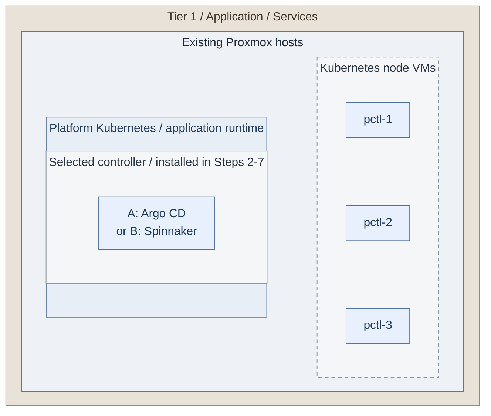

# Stage 7: Delivery

**Related:** [Architecture](../../01-architecture/10-delivery/README.md) · [Operations](../../05-operations/05-delivery.md)

Establish Tier 1 application delivery. Tier 0 already uses Flux from
[Stage 4](../stage-4-kubernetes/README.md); select **A: Argo CD** or **B: Spinnaker**
for Tier 1. GitLab and CI handover belong to [Stage 9](../stage-9-development/README.md).

<a id="figure-platform-runtime"></a>

## Expected outcome: delivery runtime



**IaC:** *Figure: Three platform node VMs provide the runtime. The selected controller has a separate installer in Actions
2-7; node provisioning alone does not install it.*
Tier 1 [node inputs](../../../tier-1/terraform/deployments/kubernetes/terraform.tfvars.example)
and [cluster command](../../../tier-1/scripts/kubernetes-cluster.sh) create the three
starter VMs. The controller runs inside that cluster and is installed separately in Actions 2-7 through the
[delivery recipe](../../../tier-1/ansible/playbooks/deployment/delivery-platform.yml).
The VM group beside the runtime records physical hosting, not another Kubernetes cluster or network hop.

**Prerequisites:** accepted Tier 0 Kubernetes, Identity and Secrets; approved images,
independent bootstrap Git/OCI sources, private DNS/TLS and qualified storage.
Action 1 creates or accepts Tier 1's cluster and its
[foundation gates](../stage-4-kubernetes/procedures/kubernetes.md#cluster-foundation).
The temporary source must work before GitLab or the new registry exists.
**Working repositories:** `<prefix>-tier-1` for delivery and registry;
`<prefix>-tier-2` for optional public edge. Tier 0 owns its existing Flux.
**Execution context:** `<prefix>-tier-1/`.

**Automation:** cluster lifecycle, native Argo CD/Spinnaker and Harbor installers are supplied.
The actions below run their separate installations; TLS/backup commissioning and live acceptance remain explicit.
See [coverage](../../08-reference/implementation-support.md#stage-coverage) for live acceptance boundaries.
**Design:** [controller patterns](../../01-architecture/10-delivery/02-controllers.md).

<a id="main-path"></a>

## Deployment actions

Choose a runtime and controller, install and accept that controller, then select artifact supply.
Each application install uses the accepted runtime; no later action bootstraps that cluster again.

| Action | Choice or result | Next |
| --- | --- | --- |
| 1a / 1b | Create or accept the Tier 1 runtime | 2 |
| 2a / 2b | Argo CD or Spinnaker inputs | 3 |
| 3a / 3b | Existing Secret owner or encrypted bootstrap inputs | 4 |
| 4-7 | Render, review, install and accept the controller | 8 |
| 8a | Supplied Harbor installation | 9-11 |
| 8b | Existing approved registry | 11; skip the Harbor installer |
| 12a / 12b | Optional acceleration and/or private edge pool | 13 after selected options |
| 13 | Record the accepted path | Stage 8 |

<a id="step-1-deploy-shared-delivery-services"></a>
<a id="step-1-create-the-platform-runtime"></a>
<a id="1-create-or-accept-the-tier-1-runtime"></a>

## Step 1: Create or accept the Tier 1 runtime

For **1a: a new cluster**, complete the [platform-cluster lifecycle](procedures/platform-cluster.md)
using Tier 1 inventory, original state and credentials. It gives the saved-plan creation/apply,
credential export and basic-platform commands. This is a separate selected runtime installation,
not part of a controller's Helm apply.

For **1b: an existing cluster**, skip creation. Verify the same CNI, persistent storage, private
ingress, protected logging, physical placement, capacity and independent recovery gates.
Keep the accepted Tier 1 kubeconfig/context for Action 2; no Tier 0 credentials are used.

**Expected:** the three-node starter or accepted equivalent in the [runtime figure](#figure-platform-runtime),
ready for applications. An `init` command alone is not a deployed cluster.

<a id="step-2-select-and-qualify-delivery"></a>
<a id="2-create-and-configure-the-selected-controller"></a>

## Step 2: Create and configure the selected controller

Run from **`<prefix>-tier-1/`**.

```bash
cp -n ansible/group_vars/delivery_platform.yml.example ansible/group_vars/delivery_platform.yml
```

Edit **`<prefix>-tier-1/ansible/group_vars/delivery_platform.yml`**. Keep
`delivery_platform_install_harbor: false`, set the accepted kubeconfig/context, private endpoints,
ingress, OIDC issuer/CA and local CA bundle, then choose:

- **2a: Argo CD** - complete the [controller fields and exact source/destination policy](step-2a-argocd.md#step-1-prepare-the-controller-inputs).
- **2b: Spinnaker** - complete the [native controller, certificate and backup inputs](step-2b-spinnaker.md#step-1-prepare-local-inputs).
  Its independent NAS-file or existing object backup repository and ten leaf identities must be ready before apply.

These pages define the selected product's inputs and boundary. Return here to Action 3 for the
installation commands. The [Argo CD figure](step-2a-argocd.md#figure-argocd-installation) or
[Spinnaker figure](step-2b-spinnaker.md#figure-spinnaker-installation) shows what the run adds.
Retain the approved software pins and bootstrap Git/OCI source; Stage 9 GitLab does not exist yet.


<a id="3-choose-the-secret-owner"></a>

## Step 3: Choose the Secret owner

Both branches continue at Action 4. Use the same branch for render and apply.

**3a: existing Secret controller.** Keep `delivery_platform_manage_secrets: false` and provision
the selected product's [exact namespace/name/key contracts](../../../tier-1/ansible/group_vars/delivery_platform_secrets.yml.example)
through that owner. Use commands **4a** and **6a**.

**3b: encrypted bootstrap inputs.** Create the local private file:

Run from **`<prefix>-tier-1/`**.

```bash
umask 077
mkdir -p secrets
cp -n ansible/group_vars/delivery_platform_secrets.yml.example secrets/delivery-platform.yml
```

In **`<prefix>-tier-1/secrets/delivery-platform.yml`**, retain `delivery_platform_manage_secrets: true`
and fill only the selected product's required credentials, TLS and OIDC values.
Spinnaker preserves its stable dependency-password directory and preissued-keystore password.
Encrypt the completed file:

Run from **`<prefix>-tier-1/`**.

```bash
ansible-vault encrypt secrets/delivery-platform.yml
```

Retain decryption material independently. Use commands **4b** and **6b**; an approved unattended job
supplies an Ansible Vault identity instead of `--ask-vault-pass`. Do not run two Secret owners.


<a id="4-render-the-controller"></a>

## Step 4: Render the controller

The playbook prepares/checks the selected controller libraries and collections before rendering.
Use the accepted controller environment and approved source access; disconnected controllers
pre-stage those dependencies and use `CONTROL_NODE_COLLECTIONS_MODE=check`.

### 4a. Existing Secret owner

Run from **`<prefix>-tier-1/`**.

```bash
ANSIBLE_CONFIG=ansible/ansible.cfg ansible-playbook -i localhost, \
  ansible/playbooks/deployment/delivery-platform.yml \
  -e @ansible/group_vars/delivery_platform.yml -e delivery_platform_action=render
```

### 4b. Encrypted bootstrap inputs

Run from **`<prefix>-tier-1/`**.

```bash
ANSIBLE_CONFIG=ansible/ansible.cfg ansible-playbook -i localhost, \
  ansible/playbooks/deployment/delivery-platform.yml \
  -e @ansible/group_vars/delivery_platform.yml \
  -e @secrets/delivery-platform.yml --ask-vault-pass -e delivery_platform_action=render
```

**Expected:** private values/manifests in `secrets/delivery-platform/`. Render contacts no cluster;
Harbor/Argo chart acquisition still needs approved chart access. Native Spinnaker uses its supplied base.


<a id="5-review-the-controller-output"></a>

## Step 5: Review the controller output

Inspect the selected values/manifests under **`<prefix>-tier-1/secrets/delivery-platform/`**.
Check the Tier 1 destination, pins, TLS/OIDC, namespace authority and persistence against its figure.

For **Spinnaker**, read the complete render checksum:

Run from **`<prefix>-tier-1/`**.

```bash
cat secrets/delivery-platform/spinnaker.sha256
```

Record that value as `delivery_platform_spinnaker_review_sha256` in
`ansible/group_vars/delivery_platform.yml`. Its [output reference](step-2b-spinnaker.md#step-3-render-review-and-install)
explains the included native resources. Do not apply the combined YAML directly.


<a id="6-apply-the-reviewed-controller"></a>

## Step 6: Apply the reviewed controller

Use the same inputs and Secret owner as the render. Ansible changes the cluster immediately;
there is no Terraform-style `yes` prompt.

### 6a. Existing Secret owner

Run from **`<prefix>-tier-1/`**.

```bash
ANSIBLE_CONFIG=ansible/ansible.cfg ansible-playbook -i localhost, \
  ansible/playbooks/deployment/delivery-platform.yml \
  -e @ansible/group_vars/delivery_platform.yml -e delivery_platform_action=apply
```

### 6b. Encrypted bootstrap inputs

Run from **`<prefix>-tier-1/`**.

```bash
ANSIBLE_CONFIG=ansible/ansible.cfg ansible-playbook -i localhost, \
  ansible/playbooks/deployment/delivery-platform.yml \
  -e @ansible/group_vars/delivery_platform.yml \
  -e @secrets/delivery-platform.yml --ask-vault-pass \
  -e delivery_platform_action=apply
```

**Expected:** healthy controller workloads and private HTTPS. Native Spinnaker validates the reviewed
checksum, repository binding, certificates and scoped identities; then commissions/validates backup
storage, provisions SQL/Redis, starts services and verifies a first backup before publishing ingress.
The cluster, ingress, storage provisioner and identity provider remain their existing installations.


<a id="7-accept-controller-authorization-and-recovery"></a>

## Step 7: Accept controller authorization and recovery

Test permitted and denied SSO/direct API access, a bounded application delivery, blocked destinations,
rollback and clean-target recovery. Use [Argo CD acceptance](step-2a-argocd.md#acceptance)
or [Spinnaker acceptance](step-2b-spinnaker.md#step-4-qualify-delivery) for its product checks.
Neither controller receives Tier 0 API credentials.

For newly initialized Spinnaker file repositories, now set `filesystem_initialize: false` under
the existing backup prefix, render again, record the new checksum and reapply using Actions 4-6.
That reconciles the accepted repository; it does not create another one.
Keep the bootstrap Git/image source and recovery administrators until acceptance passes.

<a id="step-3-connect-approved-artifact-supply"></a>
<a id="8-select-and-configure-artifact-supply"></a>

## Step 8: Select and configure artifact supply

Choose **8a: install Harbor** or **8b: accept an existing registry**.

For **8a**, in **`<prefix>-tier-1/ansible/group_vars/delivery_platform.yml`**, set
`delivery_platform_install_harbor: true` and `delivery_platform_controller: none` for this Harbor-only run.
Retain the accepted controller's configuration and ownership; `none` does not uninstall it.
Fill [Harbor's endpoint, storage, identity and Secret contracts](procedures/registry.md#install-harbor),
including all five persistent allocations and the private database password. Register its Keycloak
client and prepare the TLS/OIDC/stable credential map using the Action 3 owner. Continue with 9.
The [Harbor figure](procedures/registry.md#figure-harbor-installation) shows this addition.

For **8b**, retain the existing registry owner and verify its equivalent trust/policy/backup contracts;
skip 9-10 and join 11. A new Stage 9 GitLab instance is not a prerequisite available here.
GitLab's supplied Kubernetes chart does not enable its bundled registry.


<a id="9-render-and-review-harbor"></a>

## Step 9: Render and review Harbor

Use the Action 3 Secret owner. Harbor's database password must be supplied privately even when
Kubernetes Secrets are externally owned. The installer reference lists the [private input contract](procedures/delivery-installer.md#inputs-and-secrets).

### 9a. Existing Secret owner

Run from **`<prefix>-tier-1/`**.

```bash
ANSIBLE_CONFIG=ansible/ansible.cfg ansible-playbook -i localhost, \
  ansible/playbooks/deployment/delivery-platform.yml \
  -e @ansible/group_vars/delivery_platform.yml -e delivery_platform_action=render
```

### 9b. Encrypted bootstrap inputs

Run from **`<prefix>-tier-1/`**.

```bash
ANSIBLE_CONFIG=ansible/ansible.cfg ansible-playbook -i localhost, \
  ansible/playbooks/deployment/delivery-platform.yml \
  -e @ansible/group_vars/delivery_platform.yml \
  -e @secrets/delivery-platform.yml --ask-vault-pass -e delivery_platform_action=render
```

Review `harbor-values.yml`, `harbor-manifests.yml`, storage, OIDC and private credential custody in
`secrets/delivery-platform/`. Helm release state also contains secrets; exclude it from public artifacts.


<a id="10-apply-harbor"></a>

## Step 10: Apply Harbor

Use the same reviewed Harbor-only inputs and Secret owner.

### 10a. Existing Secret owner

Run from **`<prefix>-tier-1/`**.

```bash
ANSIBLE_CONFIG=ansible/ansible.cfg ansible-playbook -i localhost, \
  ansible/playbooks/deployment/delivery-platform.yml \
  -e @ansible/group_vars/delivery_platform.yml -e delivery_platform_action=apply
```

### 10b. Encrypted bootstrap inputs

Run from **`<prefix>-tier-1/`**.

```bash
ANSIBLE_CONFIG=ansible/ansible.cfg ansible-playbook -i localhost, \
  ansible/playbooks/deployment/delivery-platform.yml \
  -e @ansible/group_vars/delivery_platform.yml \
  -e @secrets/delivery-platform.yml --ask-vault-pass \
  -e delivery_platform_action=apply
```

**Expected:** accepted Harbor component health and private HTTPS. This is a single-instance chart
realization with retained data, not an HA claim. No controller reinstall or proxy/cache deployment is needed.


<a id="11-accept-artifact-access-and-recovery"></a>

## Step 11: Accept artifact access and recovery

Push/pull a disposable artifact with the intended runner and consumer identities. Test denied access,
immutable promotion policy and clean-target restore of registry data, database and stable Secrets.
Keep independent bootstrap artifacts until this replacement supply and recovery path work.
The [registry acceptance contract](procedures/registry.md#acceptance) applies to both registry choices.


<a id="12-complete-selected-distribution-and-edge-options"></a>

## Step 12: Complete selected distribution and edge options

- **12a: registry acceleration** is an optional [product integration](procedures/registry.md#select-the-procedure)
  after the registry works. The Harbor installer does not install Dragonfly. Qualify selected clients,
  preheat and fallback separately, then return here.
- **12b: an optional private Tier 2 edge pool** uses the [edge IaC](procedures/edge-proxy.md) for an
  existing approved backend. Complete its listener, TLS and failover checks, then return here.
  Keep public DNS/NAT closed; website publication/certificate renewal belongs to Stage 10.

If neither is selected, continue directly to 13. Private controller APIs require no public edge.


<a id="13-record-acceptance-and-continue"></a>

## Step 13: Record acceptance and continue

Record the selected runtime, controller, registry and completed options in
**`<prefix>-architecture/deployments.md`**. Retain independent configuration/data/key recovery and
live acceptance evidence. Continue with [Stage 8: Observability](../stage-8-observability/README.md).

<a id="step-2-enable-protected-execution"></a>
<a id="step-3-deploy-shared-investigation"></a>
<a id="step-3-deploy-observability"></a>

Runner installation and original-state handover belong to [Stage 9](../stage-9-development/README.md),
after GitLab and Vault job authority exist. This stage transfers no Tier 0 execution authority.
