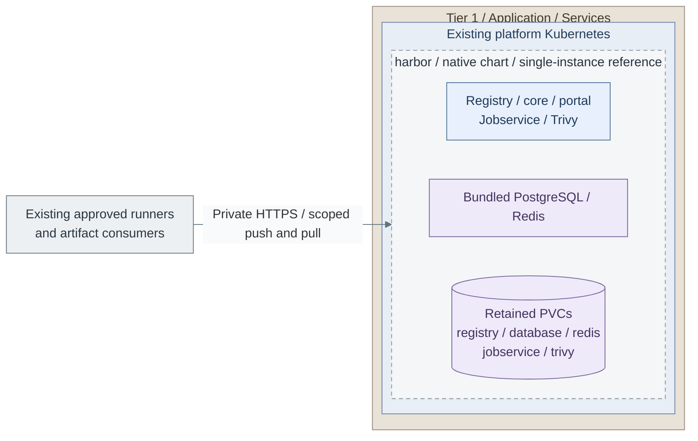

# Deploy the selected registry variant

**Branch from:** [Stage 7, Step 8](../README.md#step-8-select-and-configure-artifact-supply):
8a installs Harbor; 8b accepts an existing registry. Acceleration is selected separately at Step 12a.
**Return:** after configuration, Step 9 for Harbor or Step 11 acceptance for an existing service.

The supplied **8a** path installs an independent Harbor service. Select an already accepted registry
instead when it satisfies the same artifact, access and recovery contract.

<a id="figure-harbor-installation"></a>

## Expected outcome: independent Harbor registry (8a)



**IaC:** *Figure: The independent registry keeps artifacts and bundled database/cache state in retained volumes.
Clients receive scoped push/pull access; single-instance placement does not establish HA or recovery.*
Tier 1's [Harbor task](../../../../tier-1/ansible/roles/delivery_platform/tasks/harbor.yml),
[native values](../../../../tier-1/ansible/roles/delivery_platform/templates/harbor-values.yml.j2) and
[delivery inputs](../../../../tier-1/ansible/group_vars/delivery_platform.yml.example).
Scope: the independent chart release and its five persistent claims on the existing cluster.
Identity, ingress, issued TLS, Secret ownership and independent backup custody are prerequisites.
The chart supplies no Dragonfly deployment or independent backup service.

**Working repository:** `<prefix>-tier-1` (source: `tier-1/`).
The cluster variant uses [clusters/tier1/platform/artifact-registry/](../../../../tier-1/clusters/tier1/platform/artifact-registry);
the integrated source-control variant uses the selected source-control deployment.

**Design:** [artifact supply options A-C](../../../01-architecture/10-delivery/01-artifact-supply.md).
**Prerequisites:** approved runtime, storage, TLS/DNS, identity policy and retained
bootstrap artifacts. **Owner:** Tier 1. The
[native delivery installer](delivery-installer.md) supplies pinned official Harbor
Helm installation; Dragonfly remains a separately selected integration.

This is the OCI extension of [Software intake](../../stage-1-software-intake/README.md#extend-the-capability-later),
not a replacement for its early proxy/cache or RPM/APT repositories. The early
intake path must work without Harbor; registry introduction reuses controlled
upstream access and adds its own artifact authority and storage.

## Table of contents

- [Select the procedure](#select-the-procedure)
- [Prepare inputs](#prepare-inputs)
- [Install Harbor](#install-harbor)
- [Acceptance](#acceptance)
- [References](#references)

<a id="purpose"></a>
<a id="what-a-registry-does"></a>
<a id="gitlab-registry-vs-shared-registry"></a>
<a id="reference-direction"></a>
<a id="harbor-and-dragonfly-roles"></a>

## Select the procedure

| Selected design | Procedure |
| --- | --- |
| A: Integrated registry | Enable/configure the registry in the selected source-control deployment using its supported administrator procedure [1] |
| B: Independent registry | Install the supplied single-instance Harbor Helm realization below; an HA selection needs separately qualified storage/data services [2] |
| C: Registry plus acceleration | Complete B, then integrate distribution clients and any selected preheat workflow; Dragonfly is an example [3] |
| Existing approved service | Verify the same endpoint, policy and recovery requirements without creating another registry |

These are alternatives, not a mandatory GitLab-to-Harbor-to-Dragonfly sequence.
For a new Stage 7 installation, use B or an accepted existing registry. A depends on an already
commissioned GitLab registry; the supplied Stage 9 Kubernetes chart disables its bundled registry.
Installing GitLab later does not implement A automatically. C adds separately commissioned acceleration.
A new Tier 1 cluster reuses the [common cluster procedure](../../stage-4-kubernetes/procedures/kubernetes.md)
with tier-local inputs and state. Do not retire the bootstrap artifact source until
the new path and independent recovery have been accepted.

<a id="what-to-plan"></a>

## Prepare inputs

| Input | Record or configure |
| --- | --- |
| Endpoints | FQDNs, certificate chain and trust for nodes/runners |
| Storage | Artifact data, database/cache dependencies, retention and backup locations |
| Identity | Scoped operator access, project ownership and robot credentials outside Git |
| Promotion | Accepted provenance, scans/signatures and immutable artifact references |
| Distribution | Direct clients or selected acceleration; a fallback path when required |
| Recovery | Product-supported export/restore, independent artifacts and custodian |

Use the selected product's supported installer or project GitOps manifests.
The presence of a platform-cluster skeleton does not install these services.

## Install Harbor

For first installation, select **8a** in [Stage 7 Step 8](../README.md#step-8-select-and-configure-artifact-supply).
Fill the fields, Secrets and Keycloak client below, then return to Step 9's render/review and Step 10's
apply. The main guide owns those commands; this page is the registry's configuration/acceptance contract.

For later reconciliation, retain one release owner and use the [native installer](delivery-installer.md).
Select `delivery_platform_controller: none` for Harbor-only work; it neither uninstalls nor reconfigures
the accepted controller. Keep `delivery_platform_install_harbor: true` for that registry run.
The [Harbor figure](#figure-harbor-installation) defines its selected scope.

| Field in `ansible/group_vars/delivery_platform.yml` | Value |
| --- | --- |
| `delivery_platform_harbor_host` | Actual private registry DNS name |
| `delivery_platform_ingress_class` | Accepted Tier 1 ingress class |
| `delivery_platform_harbor_storage_class` | Qualified persistent class; review all five volume sizes in the role defaults |
| `delivery_platform_oidc_issuer`, `delivery_platform_oidc_ca_pem`, `delivery_platform_ca_path` | Existing issuer and public trust |
| `delivery_platform_harbor_database_password` | Private input only; required even for render |

The native chart installs PostgreSQL, Redis, registry, core, jobservice, portal and
Trivy. This is a single-instance deployment with retained PVCs, not an HA claim.

Provision the [required Secrets](../../../../tier-1/ansible/group_vars/delivery_platform_secrets.yml.example).
`harbor-credentials` contains four independent 16-character keys, a 32-character
CSRF key, a registry password and its matching `harbor_registry_user` htpasswd entry.
Retain the token-signing certificate/private key in `harbor-token` independently.
The bundled database password is a private native chart value; changing it is not
a database password-rotation procedure.

Supply `harbor-oidc/config.json` with native Harbor settings [4]:

```json
{
  "auth_mode": "oidc_auth",
  "oidc_name": "Platform SSO",
  "oidc_endpoint": "https://sso.internal.example.com/realms/platform",
  "oidc_client_id": "harbor",
  "oidc_client_secret": "REPLACE_IN_PRIVATE_SECRET_ONLY",
  "oidc_scope": "openid,profile,email,offline_access",
  "oidc_verify_cert": true,
  "oidc_auto_onboard": false,
  "project_creation_restriction": "adminonly"
}
```

Register callback `https://<harbor-host>/c/oidc/callback`. The core Deployment reads
`CONFIG_OVERWRITE_JSON` from that Secret; the public IdP CA comes from `harbor-ca`.
Configured settings are owned by this environment input, not later UI changes [4].
Existing legacy local users can prevent an authentication-mode switch; qualify that
migration before changing a running registry. Keep the built-in admin for recovery.

Ingress HTTPS and native Harbor component TLS are enabled. Bundled PostgreSQL/Redis
connections stay on cluster-private interfaces; qualify network isolation for those
interfaces. Trivy database updates and replication require approved outbound access.
Back up all persistent volumes, database data and stable Secrets as one recoverable set.

<a id="downstream-platforms"></a>

## Acceptance

1. Push and pull a disposable artifact with the intended runner and consumer identities.
2. Verify unauthorized push/pull is denied and promotion policy behaves as selected.
3. Test a clean consumer, retained bootstrap artifacts and restoration of registry data.
4. For C, verify acceleration and failure behavior separately from registry authority.
5. Record evidence and ongoing retention/restore tasks in project administration.

<a id="read-more"></a>

Return to [Stage 7, Step 11](../README.md#step-11-accept-artifact-access-and-recovery), or use the accepted service for
[image-based Linux](../../stage-9-development/step-15b-image-based-linux.md) and workload delivery.

## References

Sources checked 2026-10-08.

1. [GitLab container registry and administration links](https://docs.gitlab.com/user/packages/container_registry/)
2. [Harbor HA deployment](https://goharbor.io/docs/main/install-config/harbor-ha-helm/)
3. [Dragonfly documentation](https://d7y.io/docs/)
4. [Harbor native configuration and environment ownership](https://goharbor.io/docs/edge/install-config/configure-system-settings-cli/)
