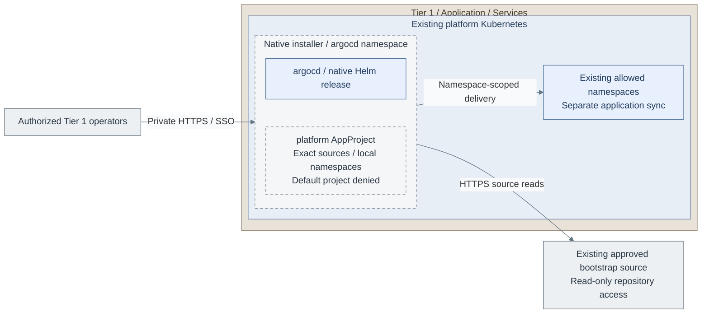

# Step 2a: Argo CD application GitOps

**Working repository:** `<prefix>-tier-1`.
**Branch from:** [Step 2](README.md#step-2-select-and-qualify-delivery).
**Return:** after configuring this choice, [Action 3](README.md#step-3-choose-the-secret-owner);
accept the installed controller at [Action 7](README.md#step-7-accept-controller-authorization-and-recovery).
**Change:** select application GitOps instead of Spinnaker release pipelines.

Install one Argo CD release in the accepted Tier 1 cluster, with explicit repository and namespace policy.
Applications keep their own release and recovery checks after the controller is accepted.

<a id="figure-argocd-installation"></a>

## Expected outcome: scoped application GitOps



**IaC:** *Figure: Argo CD reads approved sources and delivers only into selected local namespaces. The installer
creates its policy; the bounded application and recovery tests establish whether delivery is accepted.*
Tier 1's [controller task](../../../tier-1/ansible/roles/delivery_platform/tasks/argocd.yml),
[native values](../../../tier-1/ansible/roles/delivery_platform/templates/argocd-values.yml.j2) and
[AppProjects](../../../tier-1/ansible/roles/delivery_platform/templates/argocd-projects.yml.j2), selected through
[delivery inputs](../../../tier-1/ansible/group_vars/delivery_platform.yml.example).
Scope: the chart release and its source/destination policy; application sync is a separate accepted operation.
Cluster, ingress, Keycloak, TLS and Secrets already exist. No new cluster or Tier 0 destination is created.

**Prerequisites:** accepted Tier 1 cluster, reviewed controller release, TLS,
independent bootstrap source and Keycloak. This option replaces Spinnaker ownership.

## Contents

- [Step 1: Prepare the controller inputs](#step-1-prepare-the-controller-inputs)
- [Step 2: Restrict sources and destinations](#step-2-restrict-sources-and-destinations)
- [Step 3: Install and verify](#step-3-install-and-verify)
- [Acceptance](#acceptance)
- [Later: Deliver the development platform](#later-deliver-the-development-platform)
- [References](#references)

## Step 1: Prepare the controller inputs

Use the [selected installation figure](#figure-argocd-installation) when checking cluster, source and namespace scope.

Edit the existing `ansible/group_vars/delivery_platform.yml` created in
[Stage 7 Action 2](README.md#step-2-create-and-configure-the-selected-controller):

```yaml
delivery_platform_controller: argocd
delivery_platform_install_harbor: false
```

| Field in the same file | Set before installation |
| --- | --- |
| `delivery_platform_kubeconfig`, `delivery_platform_context` | Existing Tier 1 cluster |
| `delivery_platform_argocd_host`, `delivery_platform_ingress_class` | Actual private DNS name and accepted ingress class |
| `delivery_platform_oidc_issuer`, `delivery_platform_oidc_ca_pem`, `delivery_platform_ca_path` | Existing issuer, public CA PEM and local CA file |
| `delivery_platform_argocd_admin_group`, `delivery_platform_argocd_reader_group` | Exact approved IdP groups |
| `delivery_platform_argocd_repositories`, `delivery_platform_argocd_destinations` | Approved sources and local Tier 1 namespaces only |

Retain the exact centrally pinned chart release, or set a reviewed `delivery_platform_argocd_version` override.
The recipe renders/installs the official Argo Helm chart [1], then configures native
AppProjects. It does not provision Proxmox VMs or a second cluster.

Prepare `argocd-server-tls`, `argocd-secret` and `argocd-oidc` as listed in the
[secret example](../../../tier-1/ansible/group_vars/delivery_platform_secrets.yml.example).
The persistent `argocd-secret` contains a random signing key, bcrypt administrator
password and password-modification timestamp; the chart does not generate a second owner.
The role labels `argocd-oidc` for Argo CD's native Secret reference [5].

Register the existing Keycloak client with callback `https://<argocd-host>/auth/callback`,
group claims and the selected client ID [2]. The native OIDC config uses the supplied
issuer/CA and `$argocd-oidc:clientSecret`. Supply
`delivery_platform_argocd_repository_certificates` as a hostname-to-PEM map for
private Git/chart sources whose CA is outside system trust.
Ingress terminates HTTPS using `argocd-server-tls`; server HTTP is cluster-internal.
Qualify private ingress access, controller workloads and restore before applications.

## Step 2: Restrict sources and destinations

Set exact `delivery_platform_argocd_repositories` and
`delivery_platform_argocd_destinations` namespace lists. The recipe creates a
`platform` AppProject targeting only the local Tier 1 API, disallows cluster-scoped
application resources and empties the default project's permissions [3].
It grants the selected reader group only application reads and the selected Tier 1
administrator group controller administration; unmatched users have no default access.
Those administrators can change controller policy and are trusted Tier 1 principals.
Additional Tier 2 targets require separate reviewed accounts; never register Tier 0.
Use read-only bootstrap repository credentials before Stage 9 GitLab exists.
Test denied sources/destinations and an ordinary user before enabling sync.

## Step 3: Install and verify

Return to [Stage 7 Action 3](README.md#step-3-choose-the-secret-owner) to choose the Secret owner,
then follow Actions 4-6 for render, review and apply. Do not run another installer from this page.
### Acceptance

After the main guide's Step 6 apply succeeds, test SSO with allowed and denied users, rejected
sources/destinations, one bounded application, rollback and independent recovery. Health alone
is insufficient. Do not repeat input creation or installation to run these checks.
Continue with [Action 8 artifact supply](README.md#step-8-select-and-configure-artifact-supply) after acceptance.

### Later: Deliver the development platform

In [Stage 9](../stage-9-development/procedures/gitlab.md), render the authoritative
GitLab/runner values with Ansible. Store reviewed **non-secret** values in the
owning Tier 1 repository. Reference the official chart with the exact tested chart
version in an Application; reference the project values file through Argo CD's
supported multi-source Helm configuration. [4]

Provision required Secrets separately from Vault or approved bootstrap inputs.
Include the rendered runner support manifests under the same application owner.
Preview the manifest diff and sync before enabling automated reconciliation.
Do not maintain a second handwritten copy of the GitLab values template.
For an existing bootstrap-installed release, qualify adoption without uninstalling
it and keep pruning disabled until resource/persistence ownership is accepted.

Record application health, rollback and original-data restore. GitLab outage must
not delete running applications. Flux continues to own Tier 0 independently.
**Return after Stage 9 adoption:** [GitLab acceptance](../stage-9-development/procedures/gitlab.md#acceptance-and-recovery),
then Stage 9's runner path. Do not restart Stage 7 to hand over an already installed release.

## References

Sources checked 2026-10-26.

1. [Official Argo Helm chart][1].
2. [Keycloak OIDC and PKCE][2].
3. [Project boundaries][3].
4. [Helm multi-source value files][4].
5. [Native SSO Secret references][5].

[1]: https://github.com/argoproj/argo-helm/tree/main/charts/argo-cd
[2]: https://argo-cd.readthedocs.io/en/stable/operator-manual/user-management/keycloak/
[3]: https://argo-cd.readthedocs.io/en/stable/user-guide/projects/
[4]: https://argo-cd.readthedocs.io/en/stable/user-guide/multiple_sources/
[5]: https://argo-cd.readthedocs.io/en/stable/operator-manual/user-management/#sensitive-data-and-sso-client-secrets
