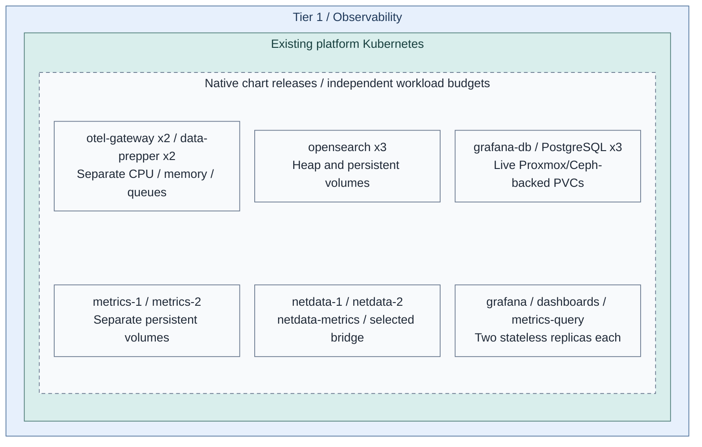
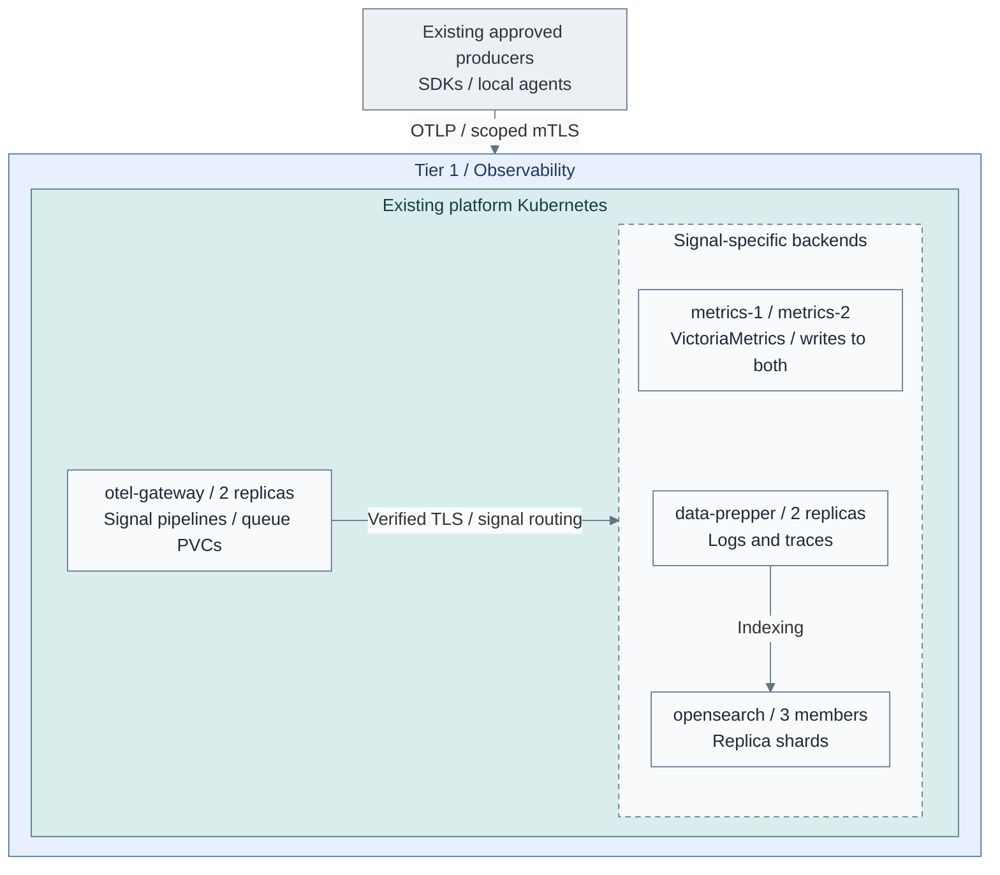
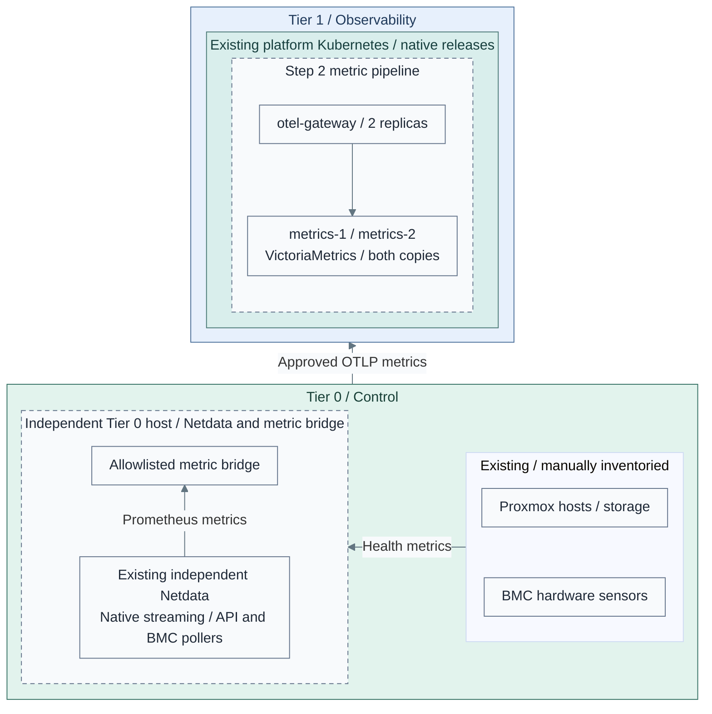
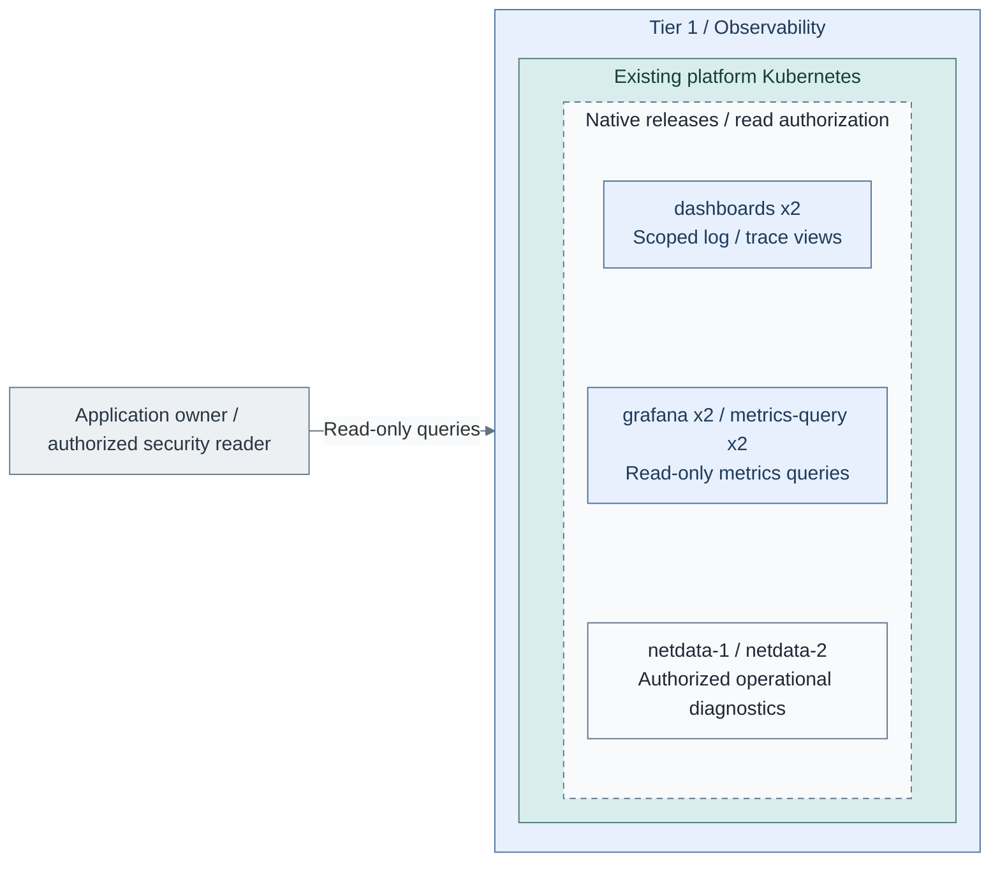

# Stage 8: Observability

**Related:** [Architecture](../../01-architecture/11-operations/03-observability.md) · [Operations](../../05-operations/06-resilience/observability.md)

Deploy operational visibility for **logs, metrics and distributed traces** in the
existing Tier 1 Kubernetes cluster. OpenSearch is included initially, alongside
the telemetry gateways and metrics backend, not postponed to an optional later stack.
Netdata provides live diagnostics for hosts and Kubernetes; infrastructure monitoring
includes Proxmox, hardware sensors, storage and network health, not only applications.

Earlier [Security Logging and Audit](../stage-2-logging/README.md) preserves Tier 0
evidence. Observability adds diagnosis and scoped queries; it cannot modify that evidence
or administer Tier 0.

**Working repositories:** `<prefix>-tier-1` for the signal/query stack;
`<prefix>-tier-0` for infrastructure collection and any approved evidence export.
Tier 0 retains those credentials and original evidence.
**Prerequisites:** accepted [Tier 1 platform runtime](../stage-7-delivery/README.md),
[secrets and recovery access](../stage-6-secrets/README.md),
backend worker capacity, persistent storage/backups and source identities.
Equivalent verified existing services can satisfy these contracts.
**Design:** [signals, placement, independent scaling and availability](../../01-architecture/11-operations/03-observability.md).
**Automation:** the dedicated [Ansible deployment](../../../tier-1/ansible/playbooks/deployment/observability-platform.yml)
renders or applies the [native chart values](../../../tier-1/ansible/roles/observability_platform).
The cluster directory remains an empty integration starter, not a second executor.
**Execution context:** `<prefix>-tier-1/`.

Steps below select the inputs, run the installer and connect sources. Full field/Secret contracts
are in [configuration](procedures/observability-platform.md); live boundaries are in [stage coverage](../../08-reference/implementation-support.md#stage-coverage).

## Main path

Follow Steps 1–4. Choose the runtime and database-backup path before installation.

| Step | Path or option | Continue when |
| --- | --- | --- |
| 1a | [Existing Tier 1 Kubernetes](#step-1-prepare-the-runtime); complete [configuration actions 1–4](procedures/observability-platform.md#inputs-and-execution) | Inputs, trust, storage and SSO are ready for Step 2 |
| 1b | [Dedicated VMs](step-1b-dedicated-vms.md), instead of 1a; native product installation and guarded data disks | Complete its service and recovery checks before rejoining Step 3 |
| 2a | [NAS-file database backups](#step-2-deploy-the-signal-pipelines): prepare database, commission destination, apply full stack | Complete [configuration actions 5–10](procedures/observability-platform.md#install-and-verify), then Step 3 |
| 2b | Existing object/WAL backup destination instead of 2a's NAS preparation | Join [configuration action 8](procedures/observability-platform.md#8-render-the-complete-platform), then finish Step 2 |
| 3 | [Infrastructure monitoring](step-3-infrastructure-monitoring.md) | Tier 0 collection and approved metric export are accepted; go to Step 4 |
| 4a | [Existing application sources and scoped readers](#step-4-publish-and-verify-read-only-views) | Test enrolled sources; Stage 10 adds later applications, not a prerequisite |
| 4b | Optional [protected-log search copies](step-4b-protected-log-search.md), alongside or instead of application-log sources | Approve/export in Tier 0, then return to Step 4 access/recovery checks |

<a id="step-1-prepare-the-investigation-runtime"></a>

## Step 1: Prepare the runtime



**IaC:** Tier 1's [playbook](../../../tier-1/ansible/playbooks/deployment/observability-platform.yml),
[role](../../../tier-1/ansible/roles/observability_platform) and
[inputs](../../../tier-1/ansible/group_vars/observability_platform.yml.example) own these workloads.
The [cluster inputs](../../../tier-1/terraform/deployments/kubernetes/terraform.tfvars.example)
supply the existing runtime. Scope: service runtimes; backup jobs/destinations have
their own selected configuration. This topology is not evidence of live deployment.
The [database backup realization](../../05-operations/06-resilience/backups/postgresql.md) separates
Grafana's live block volumes from its scheduled NAS copies.

1. Reuse the accepted [platform cluster](../stage-7-delivery/procedures/platform-cluster.md).
   If selecting [1b: dedicated VMs](step-1b-dedicated-vms.md), follow that complete alternative instead;
   its VM baseline cannot run the Kubernetes installer in Step 2.
2. Reserve separate gateway, metrics, search, Netdata, processing and UI resources. Protect API/etcd
   capacity; add or size backend workers through the tier-owned cluster inputs when needed.
3. Retain the qualified native operators/charts and select persistent-volume classes.
   Configure topology spread/anti-affinity against physical failure domains, not only VM names.

Create local inputs before Step 2:

Run from **`<prefix>-tier-1/`**.

```bash
umask 077
cp -n ansible/group_vars/observability_platform.yml.example ansible/group_vars/observability_platform.yml
cp -n ansible/group_vars/observability_platform_secrets.yml.example ansible/group_vars/observability_platform_secrets.yml
```

Edit in **`<prefix>-tier-1/`**.

- `ansible/group_vars/observability_platform.yml`: Required site values in the following input fields.
- `ansible/group_vars/observability_platform_secrets.yml`: Follow the private-input/encryption steps below
  for secret values.

Complete [configuration actions 1–4](procedures/observability-platform.md#inputs-and-execution): edit the
kubeconfig/context, physical domains, block storage, private endpoints, IdP clients and source scopes;
then prepare certificates/credentials and encrypt the private input file.
Keep that file even with externally owned Kubernetes Secrets: it also carries the Netdata streaming keys.
Select only real application/projection scopes. For application-only search, omit the example
`kind: projection` scope rather than inventing an unapproved Tier 0 export.

The main path uses official product charts and native CNPG database resources. [1][2][3]
Stage 4 must supply a compatible PostgreSQL operator. Qualify Netdata host access against
the node OS and Pod Security policy. A pod in a guest does not monitor the Proxmox host.
Its two parents use separate namespaces because the chart has fixed configuration names. [4]

The dedicated-VM alternative uses its native Podman/systemd product installer and guarded data disks. It is not
another required installation alongside Kubernetes. Return to Step 3 only after equivalent
signal/query services have been installed and accepted through that alternative.

<a id="step-2-deploy-scoped-ingestion-and-backends"></a>

## Step 2: Deploy the signal pipelines

For the **Kubernetes main path**, complete [configuration actions 5–10](procedures/observability-platform.md#install-and-verify)
in order, using their full commands and acceptance gates:

1. For NAS-file backups, render, review and apply the **database-only `prepare` pass**.
2. Commission the independent NAS backup claim/marker, then change
   `observability_backup_files_phase: backup` in `ansible/group_vars/observability_platform.yml`.
3. For a **new empty search cluster only**, set `observability_search_bootstrap: true`.
   Render, review and apply the full workload set.
4. After the first green search check, set that flag back to `false`, render/review and reapply.

The existing object/WAL backup alternative skips NAS preparation/commissioning and joins at
configuration action 8 with its own accepted backup inputs. Do not switch an existing database's
storage or backup method merely to follow a fresh-install example.

The prepare pass has not installed the pictured gateways/backends. The detailed procedure
contains the exact commands and the backup handoff; do not skip from prepare to source enrollment.

The full pass installs the selected gateways, backends, Netdata, query routing and UIs together.
Step 4 commissions source visibility and reader access; it is not another UI installation.
`observability_action=apply` changes the cluster without Terraform's `yes` prompt.



**IaC:** the [release specification](../../../tier-1/ansible/roles/observability_platform/templates/releases.yml.j2)
declares dependency order; [configuration](procedures/observability-platform.md) maps products to native values,
Secrets, persistence and health gates. The VM baseline remains a separate alternative.
Scope: the Tier 1 ingestion/backends subset, not the UIs or every existing source.
Producers already exist; this step installs no workload agents. Security/audit
submissions still use the accepted direct Tier 0 path from Stage 4, omitted here;
these analytical pipelines do not replace protected logging.

| Workload | Initial availability target | Independent scaling |
| --- | --- | --- |
| Collector gateways | At least two, with bounded persistent exporter queues | Signal throughput, transformations, memory and queue pressure |
| Metrics | Two independent stores with writes to both and tested read failover | Time-series cardinality, sample/query rate, retention and I/O |
| OpenSearch | Three cluster-manager-eligible/data members for the small reference, with replica shards | Heap, shards, indexing/query load and storage; separate manager/data pools as needed |
| Data Prepper | Replicated processing with tested source/queue semantics | Log/trace processing, independent of the search-store node count |
| UIs / query routing | Replicated vmauth, Grafana and Dashboards; Grafana database has three native CNPG instances | Query/session demand, not backend disk capacity |
| Netdata diagnostics | At least two independently persisted parents, child failover and parent synchronization | Host/chart count, streaming rate, history and diagnostic queries |

Require successful service, search-membership/shard and database-backup gates before connecting sources.
The recipe writes metrics to **both** independent stores; a load-balanced write Service would split
the dataset. Log/trace records use one selected search-ingestion pipeline, not one write per search member.
Full source-to-query outage/replay and recovery tests follow in Step 4, after sources are connected.

OpenSearch is a backend; OpenSearch Dashboards is its UI. Grafana queries the read-only
vmauth route, which admits only explicitly promoted, caught-up metrics copies. Native VMUI
is backend administration. Shared application rules and notification services are an additional
selection: no vmalert/Alertmanager release is installed, and Grafana alerting is disabled here.
Tier 0 independent monitoring remains available if this entire cluster fails.

## Step 3: Connect infrastructure monitoring



**IaC:** Tier 1's [role](../../../tier-1/ansible/roles/observability_platform) installs cluster diagnostics.
Tier 0's [monitoring role](../../../tier-0/ansible/roles/infrastructure_monitoring) installs
the independent parent, Redfish/API pollers, critical alerts and optional metric export.
The diagram shows the Kubernetes path; the VM alternative uses its accepted project-owned services.
Proxmox host agents remain a reviewed prerequisite; this recipe does not alter hypervisors.
Scope: the approved Tier 0 metric bridge into Step 2. Tier 1's separate Netdata
children/parents and `netdata-metrics` bridge are installed by the same role,
accounted for in Step 1 and omitted here, together with unchanged search/evidence paths.
The picture follows Netdata host/BMC collection; API-only sources can feed the local
metric bridge directly as described in the guide. Native streaming is not OTLP.
Physical infrastructure is on the right; metric delivery to collectors points left.

1. If not already commissioned, first complete
   [independent Tier 0 monitoring](../stage-6-secrets/procedures/independent-monitoring.md) with export disabled;
   it supplies the parent/pollers/critical-alert path that this step extends.
   Then, in **`<prefix>-tier-0/`**, follow [infrastructure monitoring](step-3-infrastructure-monitoring.md) to register sources,
   select host/API/Redfish/IPMI collectors and prepare read-only Tier 0 identities.
2. Configure native Netdata streams and the explicit metric bridge. Keep Proxmox/BMC
   credentials and critical alerting in Tier 0; Tier 1 receives approved metrics only.
   These are [separate diagnostic domains](../../01-architecture/11-operations/03-observability.md#infrastructure-coverage),
   not duplicate collection of every host or mutual failover parents.
3. Verify source coverage, stale-data alerts, parent failover and physical-host loss.
   Power off Tier 1 and prove [independent monitoring](../stage-6-secrets/procedures/independent-monitoring.md)
   still detects infrastructure failures without its dashboards or normal SSO.

**Result:** platform operators can diagnose infrastructure and applications, without
giving the observability cluster infrastructure-control or protected-archive powers.

<a id="step-3-publish-and-verify-read-only-views"></a>

## Step 4: Publish and verify read-only views



**IaC:** Tier 1 [query values and search policy](../../../tier-1/ansible/roles/observability_platform/templates).
This view shows query interfaces; backend placement and replica counts remain as
defined in Step 2. Readers enter from the left and query Tier 1 only. Tier 0 originals are outside
this query view: no archive mount or write path is granted. Export/redaction remains
separately authorized in Tier 0 before an approved copy reaches OpenSearch.

The diagram and Tier 1 configuration below describe the Kubernetes path. For dedicated VMs,
use the project-owned equivalent intake and reader policies; the same authorization and recovery
checks apply. Option 4b also requires a compatible project-owned projection listener.

1. Select source enrollment: **4a: existing application sources**, **4b: approved Tier 0 evidence copies**,
   or both. For 4b, complete the [approved-copy publisher/exporter](step-4b-protected-log-search.md)
   in **`<prefix>-tier-0/`**. For 4a, enroll approved producers that already exist using the
   [configured private intake](procedures/observability-platform.md#private-cross-cluster-intake).
   Stage 10's [application collection path](../stage-10-lab-environments/step-3c-telemetry.md)
   enrolls future applications; it is not required to finish this stage.
   Keep unenrolled source scopes explicitly unverified; do not claim their coverage yet.
2. In **`<prefix>-tier-1/ansible/group_vars/observability_platform.yml`**, verify each
   `observability_log_scopes` entry and its `reader_backend_roles` against the approved IdP groups.
   The supplied policy grants reads on that scope's index prefix; it does not install custom
   document/field-level reader policies. Tier 0 publication filters approved-copy fields before transfer.
   Any later scope/policy change needs another render/review/apply before its exporter is enabled.
3. Use the registered SSO clients to test Grafana/Dashboards access and an accepted operator route
   to Netdata. Do not expose raw Tier 0 diagnostics or Functions to application readers.
   Dashboard tenants and chart filters are not authorization boundaries.
4. Test direct APIs, combined roles, forged ownership, cross-application access and SSO
   outage. Delete/rebuild a disposable Tier 1 index and prove Tier 0 originals remain unchanged.
   Reindexing never writes back to original evidence.
5. With actual enrolled sources, test worker/physical-host loss, endpoint failure, queue replay,
   search quorum/shards, metric catch-up and clean-target recovery. Keep lagging metrics copies
   out of complete-result routing. Record measured tail loss and RTO before accepting the capability.

An app owner receives an application-log view, not raw Tier 0 archive access.
Authorized security roles may receive broader approved projections, not Tier 0 mutation rights.
Changing or deleting a search copy does not change the original retained log.

## IaC locations

| Repository | Path | Coverage |
| --- | --- | --- |
| Tier 1 | [ansible/roles/observability_platform/](../../../tier-1/ansible/roles/observability_platform) | Native values, scoped intake, backends, Netdata, UIs/database, policy and health gates |
| Tier 1 | [deployment playbook](../../../tier-1/ansible/playbooks/deployment/observability-platform.yml) | Private render/apply entry point; no infrastructure provisioning |
| Tier 1 | [clusters/tier1/platform/observability/](../../../tier-1/clusters/tier1/platform/observability) | Empty controller-integration starter; choose one reconciler |
| Tier 1 | [terraform/deployments/kubernetes/](../../../tier-1/terraform/deployments/kubernetes) | Existing cluster and separately sized workers |
| Tier 1 | [terraform/deployments/observability/](../../../tier-1/terraform/deployments/observability) | Explicit VM alternative only |
| Tier 0 | [protected logging](../stage-2-logging/README.md) | Original evidence and approved export boundary |
| Tier 0 | [logging-export playbook](../../../tier-0/ansible/playbooks/deployment/logging-export.yml) | Scoped native Collector; only approved read-only copies cross into search |
| Tier 0 | [independent monitoring](../stage-6-secrets/procedures/independent-monitoring.md) | Independent Netdata, local pollers/credentials, critical alerts and approved metric export |

## Capability available

**Result:** the [Observability design](../../01-architecture/11-operations/03-observability.md)
provides operational logs, metrics, distributed traces and scoped read-only views,
plus Netdata diagnostics and infrastructure health, with the selected redundancy,
recovery and loss limits demonstrated.
Original security evidence and independent foundation alerts remain Tier 0-owned.

Record deployment and acceptance evidence. Native rendering and configuration validation
establish neither live HA nor failure/recovery acceptance. Accept the projection adapter,
private endpoints, TLS/users, storage/backups and external Tier 0 notifications separately.
Continue with [Stage 9: Development platform](../stage-9-development/README.md)
and later [Stage 10 workload collection](../stage-10-lab-environments/step-3c-telemetry.md). Do not add a second
syslog archive merely because an operational UI needs approved log visibility.

## References

Sources checked 2026-10-26. Exact pins and settings live with the service role.

1. [Official Collector chart](https://github.com/open-telemetry/opentelemetry-helm-charts/tree/main/charts/opentelemetry-collector)
2. [VictoriaMetrics official charts](https://github.com/VictoriaMetrics/helm-charts)
3. [OpenSearch official charts](https://github.com/opensearch-project/helm-charts)
4. [Netdata chart configuration](https://github.com/netdata/helmchart)
