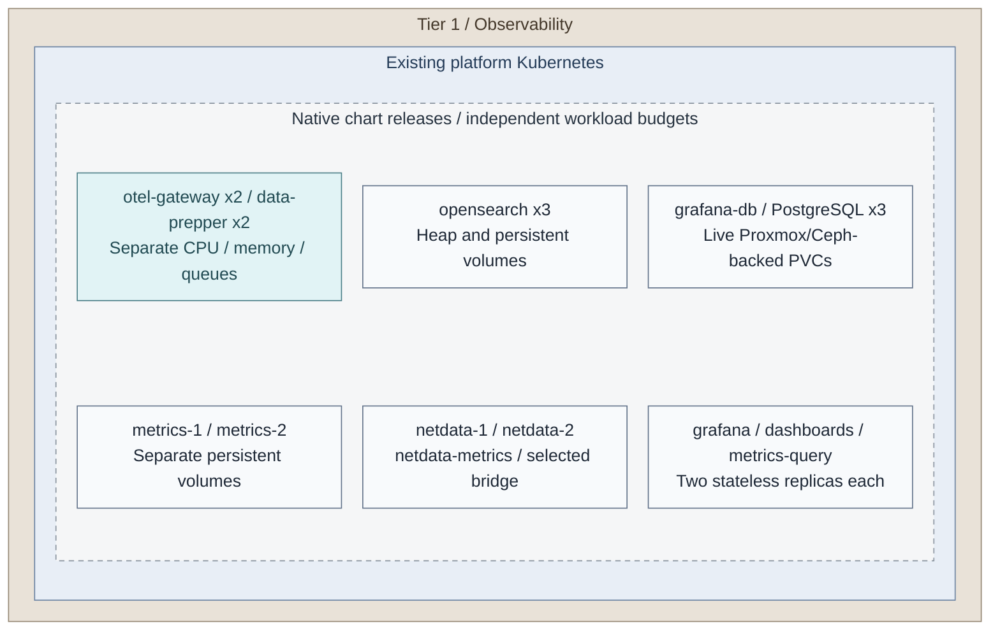
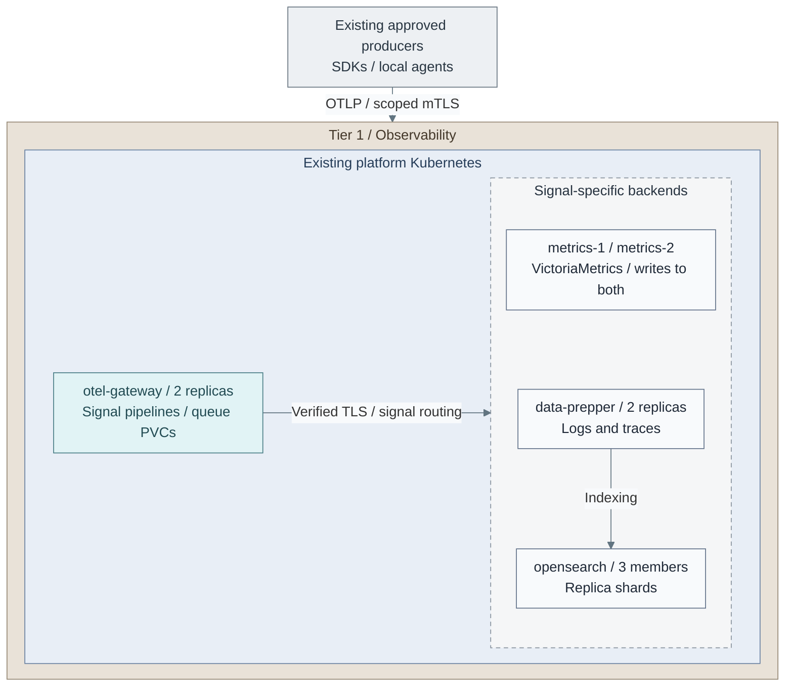
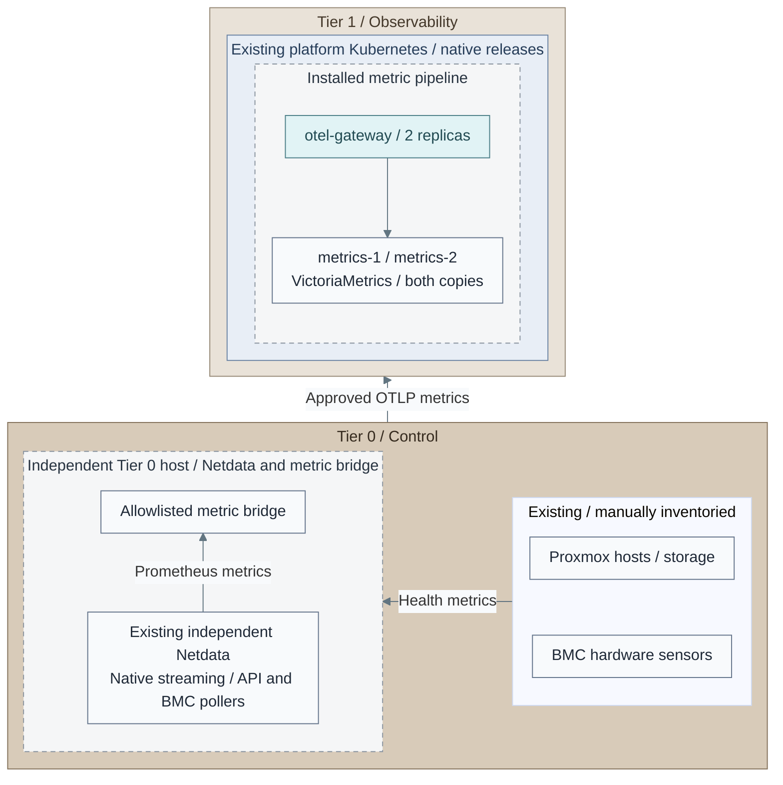
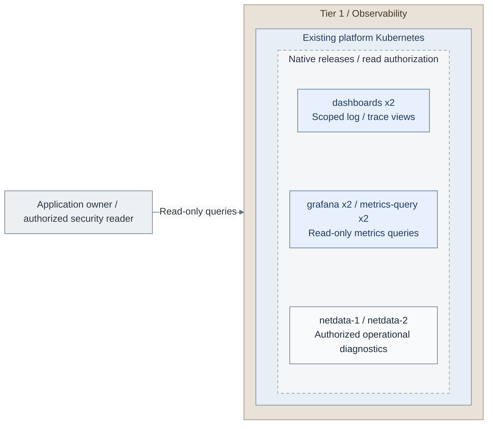

# Stage 8: Observability

**Related:** [Architecture](../../01-architecture/11-operations/03-observability.md) · [Operations](../../05-operations/06-resilience/observability.md)

Deploy operational visibility for **logs, metrics and distributed traces** in the
existing Tier 1 Kubernetes cluster. OpenSearch is included initially, alongside
the telemetry gateways and metrics backend, not postponed to an optional later stack.
Netdata provides live diagnostics for hosts and Kubernetes; infrastructure monitoring
includes Proxmox, hardware sensors, storage and network health, not only applications.

Earlier [Security Logging and Audit](../stage-2-logging/README.md) preserves Tier 0
evidence. Observability adds diagnosis and scoped queries; it cannot modify that evidence
or administer Tier 0.

<a id="figure-observability-runtime"></a>

## Expected outcome: signal and query services



**IaC:** *Figure: The existing Tier 1 cluster hosts separately budgeted signal, diagnostic and query workloads. Live
database volumes and independent backups have different owners and uses.*
Tier 1's [playbook](../../../tier-1/ansible/playbooks/deployment/observability-platform.yml),
[role](../../../tier-1/ansible/roles/observability_platform) and
[inputs](../../../tier-1/ansible/group_vars/observability_platform.yml.example) own these workloads.
The [cluster inputs](../../../tier-1/terraform/deployments/kubernetes/terraform.tfvars.example)
supply the existing runtime. Scope: service runtimes; backup jobs/destinations have
their own selected configuration. This topology is not evidence of live deployment.
The [database backup realization](../../05-operations/06-resilience/backups/postgresql.md) separates
Grafana's live block volumes from its scheduled NAS copies.

**Working repositories:** `<prefix>-tier-1` for the signal/query stack;
`<prefix>-tier-0` for infrastructure collection and any approved evidence export.
Tier 0 retains those credentials and original evidence.
**Prerequisites:** accepted [Tier 1 platform runtime](../stage-7-delivery/README.md),
[secrets and recovery access](../stage-6-secrets/README.md),
backend worker capacity, persistent storage/backups and source identities.
Equivalent verified existing services can satisfy these contracts.
**Design:** [signals, placement, independent scaling and availability](../../01-architecture/11-operations/03-observability.md).
**Automation:** the dedicated [Ansible deployment](../../../tier-1/ansible/playbooks/deployment/observability-platform.yml)
renders or applies the [native chart values](../../../tier-1/ansible/roles/observability_platform).
The cluster directory remains an empty integration starter, not a second executor.
**Execution context:** `<prefix>-tier-1/`.

The numbered actions below own first installation. The [configuration reference](procedures/observability-platform.md)
lists optional fields and exact Secret contracts; [stage coverage](../../08-reference/implementation-support.md#stage-coverage)
distinguishes supplied automation from live acceptance.

<a id="main-path"></a>

## Deployment actions

Follow the Kubernetes actions below in order. **1b** is the complete VM alternative;
its accepted installation rejoins at Action 13. Neither path creates a second cluster.

| Action | Choice or result | Next |
| --- | --- | --- |
| 1a | Reuse the accepted Tier 1 Kubernetes cluster | 2 |
| 1b | [Dedicated VM installation](step-1b-dedicated-vms.md) instead | 13 after that option's service checks |
| 2-5 | Create inputs, set endpoints/storage, prepare Secrets and SSO | 6 |
| 6a | Scheduled NAS-file database backups | 7-9, then 10 |
| 6b | Accepted existing object/WAL database backup destination | 10 |
| 10-12 | Render, install and finish initial search bootstrap | 13 |
| 13 | [Extend existing Tier 0 infrastructure monitoring](step-13-infrastructure-monitoring.md) | 14 |
| 14a | Existing application sources | 15 |
| 14b | Optional [approved protected-log copies](step-14b-protected-log-search.md), with or instead of 14a | 15 |
| 15 | Verify readers, source coverage, failure and recovery | Record acceptance |

<a id="step-1-prepare-the-investigation-runtime"></a>
<a id="step-1-prepare-the-runtime"></a>

<a id="1-select-the-runtime"></a>

## Step 1: Select the runtime

For **1a**, reuse the accepted Tier 1 cluster from Stage 7. Verify worker capacity,
CNI enforcement, private ingress, CNPG and live block storage before the
[signal/query installation](#figure-observability-runtime). Retain the original cluster state;
there is no cluster init/apply in this stage.

For **1b**, complete [dedicated VMs](step-1b-dedicated-vms.md) instead. That command provisions
its guests/data disks and installs the services. After its checks, skip Actions 2-12 and join 13.


<a id="2-create-the-kubernetes-inputs"></a>

## Step 2: Create the Kubernetes inputs

The stage's [runtime figure](#figure-observability-runtime) shows the complete workload scope;
its [pipeline figure](#figure-signal-pipelines) shows signal routing after the full apply.
Action 7's NAS `prepare` pass installs only the database preparation resources.

Source ownership remains in
[`ansible/roles/observability_platform/`](../../../tier-1/ansible/roles/observability_platform).
Run from **`<prefix>-tier-1/`**, using the prepared deployment virtual environment.

```bash
umask 077
cp -n ansible/group_vars/observability_platform.yml.example ansible/group_vars/observability_platform.yml
cp -n ansible/group_vars/observability_platform_secrets.yml.example ansible/group_vars/observability_platform_secrets.yml
```

Existing files are preserved. Keep the two private files separate.


<a id="3-configure-endpoints-capacity-and-storage"></a>

## Step 3: Configure endpoints, capacity and storage

In **`<prefix>-tier-1/`**, edit `ansible/group_vars/observability_platform.yml` using the tables below.
Fill credentials only in `ansible/group_vars/observability_platform_secrets.yml`.
Preserve the reviewed native chart pins.

| First edits | Required value |
| --- | --- |
| `observability_kubeconfig`, `observability_context` | Existing Tier 1 cluster and exact context |
| `observability_storage_class`, `observability_database_storage_class` | Accepted live block classes, not NAS backup storage |
| `observability_topology_key`, `observability_failure_domains` | Actual node label and three independently verified physical domains |
| `observability_grafana_url`, `observability_dashboards_url`, `observability_oidc_issuer` | Actual HTTPS names and existing issuer |
| `observability_log_scopes`, `observability_telemetry_cidrs`, `observability_egress` | Approved source identities, reader roles and exact network permissions |
| `observability_backup_mode`, `observability_backup_files_phase` | NAS main path: `files`, initially `prepare` |


Use the [input reference](procedures/observability-platform.md#inputs-and-execution) for optional fields,
source CIDRs and per-product resource budgets. Select only actual log scopes; omit an unapproved
`kind: projection` example. Keep one release owner. Live database volumes use Proxmox/Ceph-backed
block storage; NAS claims are backups only.


<a id="4-prepare-certificates-and-private-inputs"></a>

## Step 4: Prepare certificates and private inputs

In **`<prefix>-tier-1/`**, edit `ansible/group_vars/observability_platform_secrets.yml`:

1. Set distinct private UUIDs for `observability_netdata_child_key` and `observability_netdata_peer_key`.
2. Choose **4a**: keep `observability_manage_secrets: false` and provision the table's Secrets
   through the existing controller; or **4b**: set it to `true` and fill `observability_secrets` here.
3. Encrypt the completed file with the following command. Retain its decryption/recovery material independently.

Both paths keep this file in the commands below: externally owned Kubernetes Secrets do not
supply the two private Netdata inputs. Do not run both Secret owners.

Run from **`<prefix>-tier-1/`**.

```bash
ansible-vault encrypt ansible/group_vars/observability_platform_secrets.yml
```


Provision the [exact Secret names, keys and trust domains](procedures/observability-platform.md#secrets-and-trust)
through the selected owner before apply. This is the certificate/credential input contract, not another
installer. Retain the encrypted file in every command; both ownership paths need its private Netdata keys.


<a id="5-register-the-two-sso-clients"></a>

## Step 5: Register the two SSO clients

In **Keycloak**, use the existing authorized identity-administration path.
Provision the two confidential IdP clients with exact redirects:
`<observability_dashboards_url>/auth/openid/login` and
`<observability_grafana_url>/login/generic_oauth`. Include the intended client audience and
immutable `sub` plus approved groups in tokens. OpenSearch validates issuer/audience and
the provider TLS CA. Grafana verifies ID-token signatures, uses PKCE and permits only the
configured operator group as `Viewer`; unmatched groups are denied. Grafana's endpoints
follow the selected Keycloak realm; secure `SameSite=Lax` cookies permit OAuth callbacks. [11]
Prepare the client, redirect and group settings from the
[service SSO gate](../stage-5-identity/procedures/service-sso.md) now.
Run its live login/denial, provider-outage, cookie and signing-key-rotation tests in Action 15,
after the UIs exist. Configuration alone is not a live-login test.

<a id="step-2-deploy-scoped-ingestion-and-backends"></a>
<a id="step-2-deploy-the-signal-pipelines"></a>

<a id="6-select-the-database-backup-path"></a>

## Step 6: Select the database-backup path

In **`<prefix>-tier-1/ansible/group_vars/observability_platform.yml`**, choose:

- **6a: NAS files**: `observability_backup_mode: files`, `observability_backup_files_phase: prepare`.
  Set `observability_database_storage_accepted: true` only after qualifying live block storage.
  Leave `observability_search_bootstrap: false`. Continue with 7.
- **6b: existing object/WAL destination**: retain its accepted endpoint, tenant credentials and
  CNPG/Barman integration. Skip 7-9 and continue with 10. Do not switch an existing database's
  storage or backup method merely to follow the fresh NAS example.


<a id="7-render-database-preparation-nas-path"></a>

## Step 7: Render database preparation (NAS path)

Run from **`<prefix>-tier-1/`**.

```bash
ANSIBLE_CONFIG=ansible/ansible.cfg ansible-playbook -i localhost, \
  ansible/playbooks/deployment/observability-platform.yml \
  -e @ansible/group_vars/observability_platform.yml \
  -e @ansible/group_vars/observability_platform_secrets.yml --ask-vault-pass \
  -e observability_action=render
```

Expect private database-preparation output in `secrets/observability-platform/`.
Rendering does not contact Kubernetes.


<a id="8-review-and-apply-database-preparation-nas-path"></a>

## Step 8: Review and apply database preparation (NAS path)

In **`<prefix>-tier-1/`**, review the rendered `grafana-db` resources, live block class,
TLS identities and physical placement. Then apply those same inputs:

```bash
ANSIBLE_CONFIG=ansible/ansible.cfg ansible-playbook -i localhost, \
  ansible/playbooks/deployment/observability-platform.yml \
  -e @ansible/group_vars/observability_platform.yml \
  -e @ansible/group_vars/observability_platform_secrets.yml --ask-vault-pass \
  -e observability_action=apply
```

Expect only `grafana-db`, not the complete signal/query stack. Ansible apply has no
Terraform-style confirmation prompt. For approved unattended jobs, supply an Ansible Vault identity
instead of `--ask-vault-pass`.


<a id="9-bind-the-independent-nas-backup-destination-nas-path"></a>

## Step 9: Bind the independent NAS backup destination (NAS path)

Obtain the dedicated export, permissions and source marker through
[NAS commissioning](../../05-operations/06-resilience/backups/postgresql.md#commission-the-nas),
using `grafana-db` in the selected Tier 1 namespace and the system identifier from action 8.

In **`<prefix>-tier-1/`**, edit `ansible/group_vars/observability_platform.yml`:

- Fill `observability_backup_files.claim`, `volume_handle`, `system_identifier` and `marker`.
- For a new backup claim, add `observability_backup_files.storage` with `mode: static_nfs`,
  `server`, `share` and `size`. The normal render/apply creates its retained, prebound PV/PVC
  through the accepted NFS CSI driver. Retain `{mode: existing}` for an accepted existing claim.
- Set `observability_backup_files_accepted: true` only after those checks pass.
- Change `observability_backup_files_phase` to `backup`.

This selects backup copies on the separate NAS claim. It does not move `grafana-db` there.

The database is already prepared by Action 8. Do not repeat the linked runbook's database
preparation section. NAS export/access and its identity marker remain storage-custodian work;
the application installer prepares or qualifies only the selected cluster-side backup claim.


<a id="10-render-the-full-signal-and-query-stack"></a>

## Step 10: Render the full signal and query stack

<a id="figure-signal-pipelines"></a>



**IaC:** *Figure: Scoped OTLP reaches the gateways. Metrics write to both independent stores; logs and traces pass
through Data Prepper into OpenSearch.*
the [release specification](../../../tier-1/ansible/roles/observability_platform/templates/releases.yml.j2)
declares dependency order; [configuration](procedures/observability-platform.md) maps products to native values,
Secrets, persistence and health gates. The VM baseline remains a separate alternative.
Scope: the Tier 1 ingestion/backends subset, not the UIs or every existing source.
Producers already exist; this step installs no workload agents. Security/audit
submissions still use the accepted direct Tier 0 path from Stage 4, omitted here;
these analytical pipelines do not replace protected logging.


In **`<prefix>-tier-1/`**, finish `ansible/group_vars/observability_platform.yml`:

| Setting | Set only after |
| --- | --- |
| `observability_topology_key`, `observability_failure_domains` | Node labels match independently verified physical-host placement |
| `observability_netdata_host_access_approved: true` | The selected node OS permits the reviewed Netdata host access |
| `observability_network_policy_verified: true` | The CNI enforces the intended isolation |
| `observability_search_kernel_verified: true` | Search nodes satisfy `vm.max_map_count >= 262144` |
| `observability_search_bootstrap: true` | This is the first installation of a new, empty OpenSearch cluster |

For any existing search data, leave the last flag **false**. The first-install setting derives
the initial manager list; discovery uses the release's `opensearch-headless` Service. [13]

Run from **`<prefix>-tier-1/`** with the completed inputs:

```bash
ANSIBLE_CONFIG=ansible/ansible.cfg ansible-playbook -i localhost, \
  ansible/playbooks/deployment/observability-platform.yml \
  -e @ansible/group_vars/observability_platform.yml \
  -e @ansible/group_vars/observability_platform_secrets.yml --ask-vault-pass \
  -e observability_action=render
```

Review the private output: signal routing, scopes, node placement, persistence, ingress and read roles.
It should now include the complete selected platform, not database preparation alone.


<a id="11-apply-the-reviewed-full-stack"></a>

## Step 11: Apply the reviewed full stack

Run from **`<prefix>-tier-1/`**, using the same reviewed inputs:

```bash
ANSIBLE_CONFIG=ansible/ansible.cfg ansible-playbook -i localhost, \
  ansible/playbooks/deployment/observability-platform.yml \
  -e @ansible/group_vars/observability_platform.yml \
  -e @ansible/group_vars/observability_platform_secrets.yml --ask-vault-pass \
  -e observability_action=apply
```

Require successful workload, search membership/shard and database-backup checks.
Investigate a failed gate before continuing; do not re-bootstrap an established search cluster.

The role installs gateways, stores, Netdata, query routing and UIs in dependency order. It also
runs the selected first database backup. Actions 14-15 enroll sources and verify access; they do
not install those products again.


<a id="12-finish-initial-search-bootstrap"></a>

## Step 12: Finish initial search bootstrap

After the first green membership check, in **`<prefix>-tier-1/`**, set
`observability_search_bootstrap: false` in `ansible/group_vars/observability_platform.yml`.
Repeat Step 10's render, review the removal of the initial-manager list, then repeat Step 11's apply.
Require readiness again. Never re-enable the flag for restart, scaling or recovery. [13]

<a id="step-3-connect-infrastructure-monitoring"></a>

<a id="13-extend-infrastructure-collection"></a>

## Step 13: Extend infrastructure collection

<a id="figure-infrastructure-metrics"></a>



**IaC:** *Figure: The independent Tier 0 monitor retains infrastructure credentials and sends only approved metrics to
Tier 1. Its diagnostic streaming and OTLP bridge are distinct interfaces.*
Tier 1's [role](../../../tier-1/ansible/roles/observability_platform) installs cluster diagnostics.
Tier 0's [monitoring role](../../../tier-0/ansible/roles/infrastructure_monitoring) installs
the independent parent, Redfish/API pollers, critical alerts and optional metric export.
The diagram shows the Kubernetes path; the VM alternative uses its accepted project-owned services.
Proxmox host agents remain a reviewed prerequisite; this recipe does not alter hypervisors.
Scope: the approved Tier 0 metric bridge into the accepted signal stack. Tier 1's separate Netdata
children/parents and `netdata-metrics` bridge are installed by the same role,
accounted for in the runtime view and omitted here, together with unchanged search/evidence paths.
The picture follows Netdata host/BMC collection; API-only sources can feed the local
metric bridge directly as described in the guide. Native streaming is not OTLP.
Physical infrastructure is on the right; metric delivery to collectors points left.


Complete [the existing-monitor extension](step-13-infrastructure-monitoring.md). It edits Tier 0's
monitoring inputs, renders and reapplies that accepted service with the approved metric bridge.
Do not create another monitor, reinstall Tier 1 Netdata or restart its first-install search bootstrap.

If Stage 6 monitoring was not selected, its [independent runtime installation](../stage-6-secrets/procedures/independent-monitoring.md)
is a real prerequisite to this extension. Complete it once before proceeding. Proxmox/BMC credentials
and critical alerting remain in Tier 0. Return here after current source metrics and independent alerts work.


<a id="14-enroll-selected-sources"></a>

## Step 14: Enroll selected sources

Choose **14a: existing application sources**, **14b: approved Tier 0 evidence copies**, or both.
For 14a, configure approved producers against the [private intake contract](procedures/observability-platform.md#private-cross-cluster-intake).
For 14b, complete the [approved-copy publisher/exporter](step-14b-protected-log-search.md) in Tier 0.
Both selections rejoin Action 15.

In **`<prefix>-tier-1/ansible/group_vars/observability_platform.yml`**, match each `observability_log_scopes`
entry and its `reader_backend_roles` to approved IdP groups. For the VM alternative, use the accepted
`ansible/group_vars/observability.yml` scope inputs. Reconcile a changed receiver policy before
starting its producer; keep search bootstrap false. The [configuration reference](procedures/observability-platform.md#approved-search-projections)
describes the field/query boundary, not an additional receiver installation.

Stage 10 enrolls future instrumented workloads. It is not a prerequisite to accepting existing
sources here. Mark unconnected scopes unverified instead of claiming their coverage.

<a id="step-3-publish-and-verify-read-only-views"></a>
<a id="step-4-publish-and-verify-read-only-views"></a>

<a id="15-verify-readers-continuity-and-recovery"></a>

## Step 15: Verify readers, continuity and recovery

<a id="figure-query-access"></a>



**IaC:** *Figure: Authorized readers enter the Tier 1 query interfaces from the left. Reader policy controls signal
access; original Tier 0 evidence stays outside this query path.*
Tier 1 [query values and search policy](../../../tier-1/ansible/roles/observability_platform/templates).
This view shows query interfaces; backend placement and replica counts remain as
defined in the runtime view. Readers enter from the left and query Tier 1 only. Tier 0 originals are outside
this query view: no archive mount or write path is granted. Export/redaction remains
separately authorized in Tier 0 before an approved copy reaches OpenSearch.


The UIs and their routing are already installed. Test their configured access now:

1. Verify permitted/denied Grafana and Dashboards SSO users and the accepted operator route to Netdata.
   Run the live [service SSO checks](../stage-5-identity/procedures/service-sso.md); no IdP reinstall is needed.
2. Test direct APIs, combined roles, forged ownership and cross-application access. Dashboard tenants
   and chart filters grant no data authority. Confirm a reader cannot mutate originals or search policy.
3. Send distinguishable source records and verify their scope end to end. Delete/rebuild a disposable
   Tier 1 index and prove Tier 0 originals remain unchanged.
4. Exercise gateway, worker and physical-host loss, bounded queues/replay, search quorum/shards and
   metrics catch-up. Keep lagging metrics copies outside complete-result routing. Record measured loss/RTO.
5. Restore selected history and data on a clean target using the [product recovery contracts](procedures/observability-platform.md#storage-and-recovery).
   Only Grafana database backups are scheduled by this installer; metrics backups, search snapshots
   and retained Netdata history need their selected product integration or a recorded rebuild policy.
6. Power off Tier 1 and prove independent Tier 0 alerts still work without its UIs or normal SSO.

**Result:** scoped operational visibility with tested source coverage and recovery limits.
Record the completed paths in **`<prefix>-architecture/deployments.md`**, retain acceptance evidence
separately, then continue to [Stage 9](../stage-9-development/README.md).

## IaC locations

| Repository | Path | Coverage |
| --- | --- | --- |
| Tier 1 | [ansible/roles/observability_platform/](../../../tier-1/ansible/roles/observability_platform) | Native values, scoped intake, backends, Netdata, UIs/database, policy and health gates |
| Tier 1 | [deployment playbook](../../../tier-1/ansible/playbooks/deployment/observability-platform.yml) | Private render/apply entry point; no infrastructure provisioning |
| Tier 1 | [clusters/tier1/platform/observability/](../../../tier-1/clusters/tier1/platform/observability) | Empty controller-integration starter; choose one reconciler |
| Tier 1 | [terraform/deployments/kubernetes/](../../../tier-1/terraform/deployments/kubernetes) | Existing cluster and separately sized workers |
| Tier 1 | [terraform/deployments/observability/](../../../tier-1/terraform/deployments/observability) | Explicit VM alternative only |
| Tier 0 | [protected logging](../stage-2-logging/README.md) | Original evidence and approved export boundary |
| Tier 0 | [logging-export playbook](../../../tier-0/ansible/playbooks/deployment/logging-export.yml) | Scoped native Collector; only approved read-only copies cross into search |
| Tier 0 | [independent monitoring](../stage-6-secrets/procedures/independent-monitoring.md) | Independent Netdata, local pollers/credentials, critical alerts and approved metric export |

## Capability available

The selected runtime provides logs, metrics, traces and scoped readers after the actions above.
Original evidence and independent alerts remain Tier 0-owned. Rendering and installation checks
alone establish neither live HA nor recovery acceptance.

## References


Primary sources checked 2026-10-26; exact release pins live in role defaults and values.

1. [Official Collector chart](https://github.com/open-telemetry/opentelemetry-helm-charts/tree/main/charts/opentelemetry-collector)
2. [VictoriaMetrics OTLP intake](https://docs.victoriametrics.com/victoriametrics/integrations/opentelemetry/)
3. [vmauth routing and authorization](https://docs.victoriametrics.com/victoriametrics/vmauth/)
4. [Official OpenSearch charts](https://github.com/opensearch-project/helm-charts)
5. [Data Prepper plugin configuration validation](https://github.com/opensearch-project/data-prepper/blob/2.14.1/data-prepper-plugin-framework/src/main/java/org/opensearch/dataprepper/plugin/PluginConfigurationConverter.java)
6. [Netdata chart](https://github.com/netdata/helmchart)
7. [Grafana shared database for availability](https://grafana.com/docs/grafana/latest/setup-grafana/set-up-for-high-availability/)
8. [Barman Cloud plugin object stores](https://cloudnative-pg.io/plugin-barman-cloud/docs/next/object_stores/)
9. [OpenSearch and Dashboards native OIDC](https://docs.opensearch.org/latest/security/authentication-backends/openid-connect/)
10. [Grafana native OAuth/OIDC authorization](https://grafana.com/docs/grafana/latest/setup-grafana/configure-access/configure-authentication/generic-oauth/)
11. [Grafana secure OAuth cookies](https://grafana.com/docs/grafana/latest/setup-grafana/configure-security/configure-security-hardening/)
12. [Netdata native web access controls](https://github.com/netdata/netdata/blob/v2.12.2/src/web/server/README.md)
13. [OpenSearch discovery and cluster formation](https://docs.opensearch.org/latest/tuning-your-cluster/discovery-cluster-formation/settings/)
14. [Kubernetes NetworkPolicy and source/destination translation](https://kubernetes.io/docs/concepts/services-networking/network-policies/#networkpolicy-and-other-networking-features), checked 2026-11-09.
