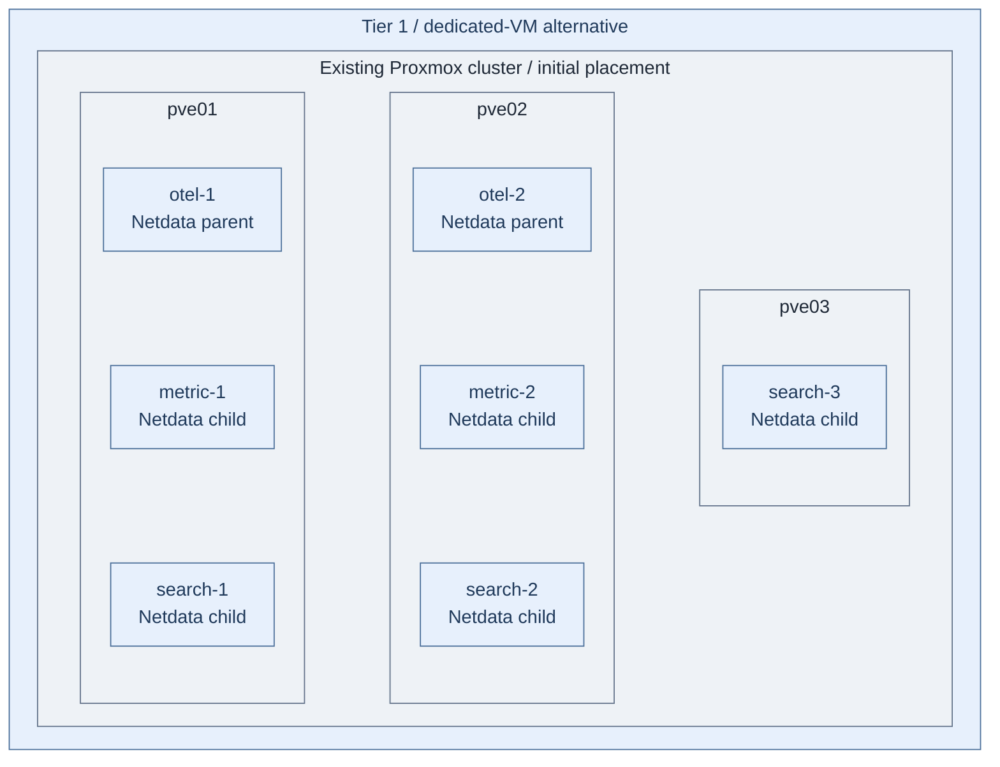

# Step 1b: Dedicated observability VMs

**Normal path:** [Observability in Tier 1 Kubernetes](README.md).
**Change:** use dedicated VMs instead of the Kubernetes workloads.
Do not run Step 2's Kubernetes installer on these VMs.
**Working repository:** `<prefix>-tier-1` (source: `tier-1/`).
**Branch from:** [Step 1](README.md#step-1-prepare-the-runtime).
**Return:** [Step 3](README.md#step-3-connect-infrastructure-monitoring) after this installation
and its checks; this branch replaces Step 2's Kubernetes installer.
**Design:** [signals, scaling and availability](../../01-architecture/11-operations/03-observability.md).

Terraform provisions seven VMs and data disks. Ansible installs native Podman/systemd services,
TLS, authentication, scoped search policy, frontend integration and Tier 1 Netdata diagnostics.
The supported guest platforms
are AlmaLinux, Rocky Linux and RHEL **10** x86_64, with EL9 compatibility using the same package/config
paths. Use approved signed repositories supplying Podman **5.4+**, systemd and cgroup v2.
DNS, issued TLS identities and the accepted Stage 5 Keycloak issuer/clients are prerequisites.
Existing network policy must admit the selected interfaces below.

## Table of contents

- [Step 1: Configure the hosts](#step-1-configure-the-hosts)
- [Step 2: Prepare private identities](#step-2-prepare-private-identities)
- [Step 3: Install the services](#step-3-install-the-services)
- [Step 4: Integrate and accept the services](#step-4-integrate-and-accept-the-services)
- [Existing installations](#existing-installations)
- [References](#references)

<a id="deploy-the-telemetry-host-variant"></a>
<a id="iac-defaults"></a>

## Step 1: Configure the hosts



**IaC:** Tier 1's [VM inputs](../../../tier-1/terraform/deployments/observability/terraform.tfvars.example),
[inventory](../../../tier-1/ansible/inventory/hosts.yml.example) and
[service inputs](../../../tier-1/ansible/group_vars/observability.yml.example) own these guests.
The [deployment playbook](../../../tier-1/ansible/playbooks/deployment/telemetry-hosts.yml) and
[VM role](../../../tier-1/ansible/roles/observability_vm) install their products and mounted persistence.
The [Netdata installer](../../../tier-1/ansible/roles/observability_vm/tasks/netdata.yml),
[streaming configuration](../../../tier-1/ansible/roles/observability_vm/templates/netdata-stream.conf.j2)
and [Collector bridge](../../../tier-1/ansible/roles/observability_vm/templates/collector.yml.j2)
own diagnostics and selected metric export on these same guests.
Scope: the configured VM alternative, with local disks on the illustrated initial hosts;
the figure shows initial placement and Netdata roles, not live deployment or accepted availability.
Other co-located native products are listed below; no new diagnostic VMs are added.

| Runtime | Hosts | Installed services |
| --- | --- | --- |
| Gateways and processing | `otel-1`, `otel-2` | Collector persistent queues, Data Prepper, vmauth query routing and Dashboards |
| Metrics backend | `metric-1`, `metric-2` | Independent VictoriaMetrics stores; each gateway writes to both |
| Search backend | `search-1`, `search-2`, `search-3` | OpenSearch cluster-manager/data/ingest members |
| Metrics frontend | `otel-1` | Grafana, local SQLite database and provisioned metrics datasource |
| Diagnostic parents | `otel-1`, `otel-2` | Independent Netdata history/identity, local collection and authenticated peer streaming |
| Diagnostic children | `metric-1/2`, `search-1/2/3` | Guest collection, local history and both parent destinations |

No additional VM is implied by a frontend or processing service. Separate per-service cgroup budgets
live in the [role defaults](../../../tier-1/ansible/roles/observability_vm/defaults/main.yml).
Grafana is a single persisted instance; SQLite does not provide replicated Grafana availability. [5]
Netdata adds a **2 GiB / one CPU ceiling per parent** and **512 MiB / half a CPU per child**,
separate from Collector, Data Prepper and backend limits. The reference 12 GiB gateway VMs must
retain OS headroom; tune co-located budgets together from measured demand. Each parent retains
up to 8 GiB / seven days of one-tier history; children retain up to 256 MiB / one day, whichever
limit is reached first. Per-guest identity and history persist separately in
`/srv/observability/netdata/lib` and `/srv/observability/netdata/cache` on its existing data disk.

Run from **`<prefix>-tier-1/` on the controller**.

```bash
bash scripts/init-local-files.sh --setup observability
```

Edit the local copies:

| Input | Required selections |
| --- | --- |
| `terraform/deployments/observability/terraform.tfvars` | Approved EL10 template, placement, CPU/RAM, OS disks and one dedicated `scsi1` data disk per guest |
| `ansible/inventory/hosts.yml` | Selected two gateway, two metrics and three search hosts in `observability` |
| `ansible/group_vars/observability.yml` | IP/DNS maps, image digest pins, certificate paths, scope CAs/ports, SSO URLs and private-input path |
| `terraform/common.tfvars` and baseline inputs | Accepted networks/storage classes, package sources, public OS/registry CA trust and access identity |

Images are private, fully qualified `repository@sha256:<digest>` inputs. Mirror the approved versions
listed in the input example; changing a product version needs native configuration qualification.
The Netdata pin follows the Kubernetes path's **v2.12.2** native grammar and official image account
UID/GID `201`; preserve that account contract in the approved mirrored image. [7]
An optional controller-owned containers `auth.json` is copied with mode `0600` for native image pulls.
The Linux alternative uses the `observability` network attachment. Capacity examples are starting
allocations; measure actual queues, cardinality, heap and I/O. Keep the search members on separate
qualified physical failure domains and verify surviving capacity. Counts alone do not establish failover.

Each `scsi1` disk binds to `observability_vm_data_device`:
`/dev/disk/by-id/scsi-0QEMU_QEMU_HARDDISK_drive-scsi1`. Shared's guarded `data_volume` role preserves
recognized filesystems, initializes verified blank storage only, and mounts XFS/ext4 at
`/srv/observability` by UUID. Preserve `observability_vm_data_uuid` host overrides for accepted data.
Missing or conflicting storage requires recovery. Normal installation needs no guest disk commands.

## Step 2: Prepare private identities

Supply absolute controller paths to existing certificate/key files. Each server certificate must
cover its `observability_vm_endpoints` DNS name. Search node certificates also need client-auth usage
and their exact RFC2253 subjects in `observability_vm_search_node_dns`. Supply unencrypted PEM keys
and a separate administrative client identity. Ansible converts the supplied search node and admin
keys to PKCS#8 on the guest, preserving their identities and controller originals. [6]
No CA signing key enters a VM. The administrator key is staged only for the native policy job
and removed in an Ansible `always` block. [2]

Use a separate issuer CA for metrics clients and each log scope. Application scopes accept logs and
traces; projection scopes accept logs only and require [option 4b approval](step-4b-protected-log-search.md).
Select only actual scopes. The shared Kubernetes/VM policy grants scoped SSO groups read access;
Data Prepper can ingest approved indices, not administer Tier 0 evidence.

Create `secrets/observability-vm.yml` under the Tier 1 repository with these private fields. Use
independently generated URL-safe secrets with at least 24 characters. The two bcrypt hashes must
match their corresponding plaintext search passwords; endpoint checks reject mismatches.

```yaml
observability_vm_metrics_auth: {username: metrics-backend, password: REPLACE}
observability_vm_reader_auth: {username: metrics-reader, password: REPLACE}
observability_vm_prepper_auth: {username: collector-ingest, password: REPLACE}
observability_vm_prepper_core_auth: {username: prepper-admin, password: REPLACE}
observability_vm_prepper_search_password: REPLACE
observability_vm_dashboards_search_password: REPLACE
observability_vm_search_user_hashes:
  data-prepper: REPLACE_WITH_BCRYPT
  dashboards-server: REPLACE_WITH_BCRYPT
observability_vm_oidc_grafana_secret: REPLACE
observability_vm_oidc_dashboards_secret: REPLACE
observability_vm_grafana_admin_password: REPLACE
observability_vm_grafana_secret_key: REPLACE
observability_vm_netdata_child_key: REPLACE_WITH_CHILD_UUID
observability_vm_netdata_peer_key: REPLACE_WITH_DIFFERENT_PEER_UUID
```

Keep `observability_vm_private_vars_file` pointing to this file. Encrypt it separately from the
Terraform-readable IP/configuration map. Provide `ANSIBLE_VAULT_PASSWORD_FILE` through the existing
controller secret owner for unattended execution.

Run from **`<prefix>-tier-1/` on the controller**.

```bash
ansible-vault encrypt secrets/observability-vm.yml
```

Register the confidential OIDC clients with the accepted issuer: Grafana's callback is
`<observability_vm_grafana_url>/login/generic_oauth`; Dashboards uses
`<observability_vm_dashboards_url>/auth/openid/login`. Grant the configured Grafana operator group
Viewer access and map search groups
to actual scope readers. The default direct URLs use `otel-1:3000` and `otel-1:5601`; existing accepted
private routing can supply the public names instead. No balancer or VIP is created.

| Listener | Authorized callers |
| --- | --- |
| Gateway `4317` and each scope port | Approved producers with the matching mTLS client CA |
| Gateway `8427` | Metrics readers/Grafana using separate read credentials over TLS |
| Gateway `5601`; `otel-1:3000` | SSO readers over TLS |
| Gateway `21890+` processing ports; `4900` control API | Collectors/service operators only; TLS and separate ingest/control credentials |
| Metrics `8428` | Gateways/query routers only; backend credentials over TLS |
| Search `9200`; transport `9300` | Scoped API users/administrator; search transport peers with node certificates |
| Gateway `19999` | The five Tier 1 children and the other parent; verified TLS plus separate child/peer stream keys |
| Each guest `20000` | Selected diagnostic administrator sources and the local collector only; verified HTTPS |

Update the existing firewall policy for these exact paths before installation. Collector health
listens only on loopback. Data Prepper's control API uses a native PKCS#12 keystore generated from
the supplied server identity, with separate administrative credentials. [3]

Set `observability_vm_netdata_admin_allow_from` to the actual administrator IPv4 addresses or narrow
native final-octet patterns such as `10.20.10.*`, not tenant networks or CIDRs. Netdata is an
administrator diagnostic service, outside the Grafana/Dashboards tenant routes. Its `19999` sockets
permit streaming only; the separate `20000` sockets permit diagnostic reads. Management, MCP and
configuration APIs are not enabled on those sockets. The API and stream access lists follow the
native Netdata grammar, with peer/child sources derived from the seven static inventory IPs. [7][8]

The two private UUID keys authenticate children and parent peers separately. Every child lists both
parents; parents stream to their peer with replication enabled. Retain each guest's persisted GUID;
do not copy another guest's Netdata identity directory. Cloud claiming and telemetry are disabled.
The image runs the native daemon, drops to its `netdata` account and reads this guest's `/proc`,
`/sys` and root filesystem through read-only mounts. Its container uses host network/PID namespaces
and disables SELinux container label separation for those host views. It receives no runtime-control
socket, extra host capabilities, Tier 0 files or infrastructure credentials. Collection enables
native proc, diskspace and cgroup metrics; automatic external plugins, app/process functions,
journal viewing, StatsD and application discovery are disabled. This does not qualify BMC/hypervisor
polling or every privileged host diagnostic. [7]

The Collector on `observability_vm_netdata_scrape_parent` alone scrapes
`/api/v1/allmetrics?format=prometheus&help=no&allhosts=yes` over verified HTTPS. This reuses the
[Kubernetes bridge contract](../../../tier-1/ansible/roles/observability_platform/templates/bridge-values.yml.j2).
`observability_vm_netdata_scrape_metrics` is an exact metric-name allowlist; the example selects the
existing CPU metric. An empty list disables the bridge. Accepted samples enter the existing metrics
pipeline and its persistent writes to both VictoriaMetrics stores. The other parent is not scraped
in parallel. Switching the scrape parent is an explicit configuration change after catch-up checks.

<a id="step-2-provision-the-baseline"></a>

## Step 3: Install the services

For a **new empty cluster only**, set `observability_vm_search_bootstrap: true` in the public input.
Keep it `false` for restarts and restoration with existing data. The role rejects bootstrap against
existing search data and rejects an unbootstrapped empty member.

Run from **`<prefix>-tier-1/` on the controller**.

```bash
bash scripts/deploy.sh observability
```

Review the inline Terraform plan and enter `yes` only for intended changes. `--plan-only` previews
infrastructure without installation; `--auto-approve` is the explicit unattended variant. The normal
command creates disks, waits for guests, applies the existing baseline, verifies storage/identities,
configures products, starts both Netdata parents and the five children, starts backends, applies
scoped search security, then starts gateways/frontends and the selected metric bridge.
Native Quadlets provide boot activation and systemd limits/restarts. [1]
The full seven-host selection is required; partial `--limit` and Ansible check mode are rejected.

After the first successful search installation, change `observability_vm_search_bootstrap` back to
`false` and rerun the same command. This removes the initial-manager list using serial backend
reconciliation with quorum checks. Preserve all existing disks and original state.
Proxmox placement is creation-only; select the existing
[cluster policy](../foundation/proxmox/step-1b-cluster-ha.md#terraform-against-the-cluster) separately.

<a id="step-3-integrate-and-accept-the-services"></a>

## Step 4: Integrate and accept the services

The installer checks verified TLS/API responses, search membership/shard health, service passwords,
query reads, denied query-router imports, seven reachable guest identities on each Netdata parent,
and actual samples for the selected bridge metric names. These are installation checks, not
continuity, source coverage, SSO-session, backup or physical-failure acceptance.

1. Connect approved producers to the gateway DNS endpoints: `4317` for metrics, the selected scope
   port for logs/traces. Authenticate with the corresponding client CA. Test rejection with a wrong
   scope identity; security/audit sources retain their direct Tier 0 path.
2. Send distinguishable metrics to both gateways, verify both independent stores, exercise query
   reads and deny imports/deletes. `observability_vm_metrics_read_members` defaults to `metric-1`;
   promote a second read member only after checking completeness/catch-up. vmauth cannot establish
   freshness from process health. [4]
3. Verify actual log/trace documents, scope-filtered reads, SSO Viewer access and denied mutations.
   Queue sizes bound retained Collector batches; Data Prepper uses in-memory bounded buffers.
   Restarts or failures after receiver acknowledgement can lose buffered events. Measure these limits.
4. Use the existing [VM backup procedure](../../05-operations/06-resilience/backups/virtual-machines.md)
   to retain both OS and data disks, original Terraform state, private inputs and recovery identities.
   Restore independently and test acknowledged-data loss and physical-host failure. No guest NAS
   mount, snapshot scheduler or backup custody is created by this service installer.
5. Verify both parent views show the seven expected guests and that each child's streaming source
   and TLS identity match the inventory. Exercise child reconnection, peer replication, backlog
   catch-up and administrator-versus-tenant network access. Process health and host counts do not
   establish retention completeness or HA. Tier 1 health notifications are disabled; keep independent
   Tier 0 alerts available.
6. Rejoin [Stage 8, Step 3](README.md#step-3-connect-infrastructure-monitoring) for source coverage and
   the existing Tier 0-owned hardware/API metric bridge, then Step 4 reader/recovery checks. Tier 1
   Netdata parents and these seven guest agents are already installed; rejoining needs no second
   Kubernetes installation or project-owned VM installer.

Original security/audit logs remain in Tier 0 `log-1` and optional `log-2`.
This alternative installs no Tier 1 authoritative security archive.

## Existing installations

Do not overwrite live `terraform.tfvars`, inventory, IP maps or state with the new
example. Old `telemetry-1`, `syslog-1`, `logs-1`, `telemetry-ui-1` and
`archive-1` selections remain project-owned until explicitly retired or migrated.

New keys and reused VMIDs/IPs can conflict with existing guests or propose destruction.
Keep old desired state during migration; review a saved plan and use tested state/resource
migration where appropriate. Generator refresh does not migrate existing live hosts.
Retain any locally required networks even though unused starter attachments were removed.


## References

1. [Podman Quadlet/systemd integration](https://docs.podman.io/en/latest/markdown/podman-systemd.unit.5.html)
   (accessed 2026-11-11).
2. [OpenSearch security administration](https://docs.opensearch.org/latest/security/configuration/security-admin/)
   (accessed 2026-11-11).
3. [Data Prepper control API TLS and authentication](https://docs.opensearch.org/latest/data-prepper/managing-data-prepper/core-apis/)
   (accessed 2026-11-11).
4. [VictoriaMetrics vmauth routing](https://docs.victoriametrics.com/vmauth/) (accessed 2026-11-11).
5. [Grafana supported databases](https://grafana.com/docs/grafana/latest/setup-grafana/installation/)
   (accessed 2026-11-11).
6. [Ansible private-key format conversion](https://docs.ansible.com/projects/ansible/latest/collections/community/crypto/openssl_privatekey_convert_module.html)
   (accessed 2026-11-11).
7. [Netdata container host-access contract](https://learn.netdata.cloud/docs/netdata-agent/installation/docker)
   and [pinned image source](https://github.com/netdata/netdata/blob/v2.12.2/packaging/docker/Dockerfile)
   (accessed 2026-11-11).
8. [Netdata native web access controls](https://learn.netdata.cloud/docs/netdata-agent/configuration/securing-agents/web-server-reference)
   and [streaming configuration](https://learn.netdata.cloud/docs/netdata-parents/metrics-centralization-points/configuring-metrics-centralization-points)
   (accessed 2026-11-11).
