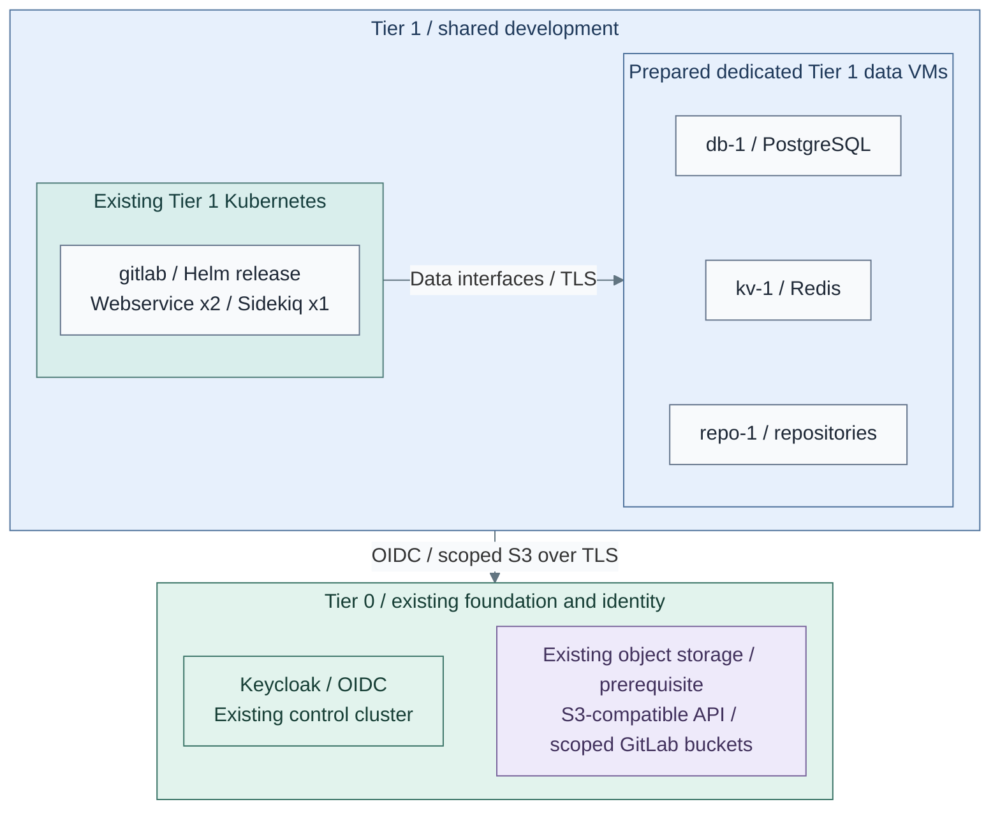
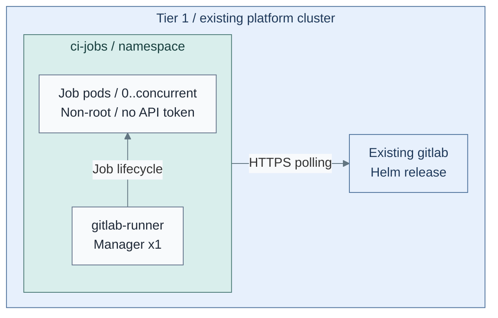
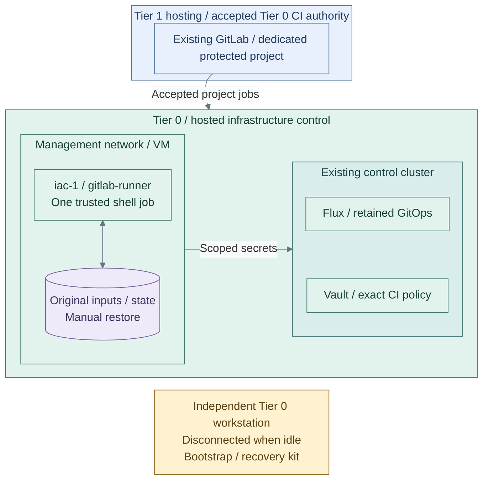

# Stage 9: Development platform

**Related:** [Architecture](../../01-architecture/22-development-platform/README.md) · [Operations](../../05-operations/development-platform/README.md)

Deploy source control and CI, then transfer routine infrastructure execution from
the bootstrap workstation. The reference uses GitLab on Tier 1 Kubernetes,
on-demand Kubernetes job pods and a separate Tier 0 infrastructure runner.

**Prerequisites:** accepted Delivery, Observability, Identity and Secrets; approved Linux images,
data-service DNS/TLS, independent backup destinations and recovery custody.
Step 1 provisions the GitLab data services; they are not a previous stage to find elsewhere.
**Working repositories:** `<prefix>-tier-1` for GitLab/general CI and
`<prefix>-tier-0` for Vault CI policy and the infrastructure runner.
**Automation:** native Helm installation/rendering, a runner VM/role and Vault JWT
policy and dedicated data-service installation are supplied. Storage/PKI commissioning,
live acceptance and automated lab requests remain separate; see
[coverage](../../08-reference/implementation-support.md#stage-coverage).
**Design:** [development platform](../../01-architecture/22-development-platform/README.md).

**Execution context:** `<prefix>-tier-1/`.

Steps 1–2 stay in Tier 1; Steps 3–4 explicitly switch to Tier 0.

## Main path

Follow Steps 1–4. Choose one GitLab placement and one general build runner;
the protected infrastructure runner is a separate required deployment at Step 4.

| Step | Path or option | Continue when |
| --- | --- | --- |
| 1a | Kubernetes GitLab: [data VMs](procedures/data-services.md), [GitLab/SSO](procedures/gitlab.md), then [joint backup checks](procedures/data-services.md#backups-and-recovery) | Source control and recovery are accepted; go to Step 2 |
| 1b | [Source-control VM](step-1b-source-control-vm.md), instead of 1a | Complete its project-supplied SSO and backup/restore integration, then Step 2 |
| 1c | Optional [delivery-controller ownership](procedures/gitlab.md#delivery-ownership) for 1a, instead of direct Ansible apply | Choose before chart apply; rejoin Step 1 backup/SSO checks after adoption |
| 2a | [Kubernetes job runners](procedures/kubernetes-runners.md) | Accept bounded jobs and cleanup before Step 3 |
| 2b | [Podman build runner](step-2b-podman-runner.md), instead of 2a | Accept the same isolation boundary, then Step 3 |
| 2c | Optional [image-based Linux](step-2c-image-based-linux.md) after the selected runner | Qualify image build, protected publication and rollback, then Step 3 |
| 3 | [Vault CI authorization](procedures/vault-ci.md#configure-exact-job-authority), after [direct-CI trust](procedures/infrastructure-runner.md#step-1-accept-direct-ci-trust) | Policies exist; real privileged job tests wait for Step 4's runner |
| 4 | [Install the infrastructure runner](procedures/infrastructure-runner.md), [place/test Vault credentials](procedures/vault-ci.md#place-scoped-credentials), then [transfer original state](procedures/handover.md) | One state writer, protected jobs and independent recovery are accepted before Stage 10 |

## Step 1: Deploy source control and SSO

1. Use **1a: Kubernetes GitLab** for the main path, or complete
   [1b: source-control VM](step-1b-source-control-vm.md) instead and rejoin at Step 2.
   Do not run the Kubernetes/data-VM installers for that VM alternative.
2. For 1a, complete the [data-service provisioning and chart handoff](procedures/data-services.md#provision-the-vms):
   create `db-1`, `kv-1`, `repo-1` from an approved **EL9** image; commission TLS,
   existing object-storage tenant access and independent host backups. Stop after the chart-input handoff.
   Toolbox backup tests come after GitLab installation; no toolbox exists yet.
3. In **`<prefix>-tier-1/`**, complete [GitLab installation](procedures/gitlab.md):
   register the IdP client, prepare the complete Secret map, render/review and install with one release owner.
   Direct Ansible is the supplied bootstrap path. Select **1c** before apply if using the accepted
   Argo CD/Spinnaker owner; complete its stated integration instead of running a second reconciler.
4. Now run the [joint application backup and restore checks](procedures/data-services.md#backups-and-recovery),
   including toolbox, repositories, objects, configuration and Secrets. Accept SSO/denials and clone/push
   before creating ordinary users or moving source histories into the service.

Tier 1 owns its data and scoped credentials. The existing storage owner retains
administration of the object endpoint; this stage installs no storage gateway.
Within **1a**, choose [existing tenant buckets](procedures/data-services.md#4a-existing-tenant-buckets-and-keys)
or [Ceph account provisioning](procedures/data-services.md#optional-ceph-account-provisioning)
before data-service apply. The latter manages accounts on an existing RGW; it does not deploy RGW.

**IaC:** Tier 1 [inputs](../../../tier-1/ansible/group_vars/development_platform.yml.example),
[recipe](../../../tier-1/ansible/playbooks/deployment/development-platform.yml)
and [values template](../../../tier-1/ansible/roles/development_platform/templates/gitlab-values.yml.j2).
The GitLab box aggregates the native chart; its labels highlight web/worker scale,
not a complete pod inventory. The dedicated data VMs are prepared by the separate
[data-service recipe](procedures/data-services.md); this step then installs GitLab.
The selected object-storage service already exists and supplies tenant credentials,
never storage-admin authority. This stage deploys no storage VM or gateway.
A NAS file mount cannot replace the chart's object API requirement.
Accept SSO, scoped membership, clone/push and
backup/restore before ordinary use.

**Result:** accepted source control with SSO and independently recoverable data.

## Step 2: Add on-demand build execution

Choose **2a: Kubernetes runners** or **2b: Podman runner** before installing a runner.

For **2a**, follow these actions:

1. Complete [Kubernetes runner installation](procedures/kubernetes-runners.md):
   create the GitLab runner identity/Secrets before apply, select `[runners]` in
   **`<prefix>-tier-1/ansible/group_vars/development_platform.yml`**, then render/review and install.
   This reconciles runners only; it does not reinstall or remove GitLab.
2. Run a bounded job and verify its pod, image restrictions, denied Tier 0/API access and cleanup.
   One manager creates ephemeral job pods; no worker-VM autoscaler is installed.

For **2b**, complete [Podman runner installation](step-2b-podman-runner.md) and the same trust/isolation
checks instead. Both paths rejoin at **Step 3**.
If selecting [2c: image-based Linux](step-2c-image-based-linux.md), complete it after the runner's
bounded-job checks and before Step 3. It adds image lifecycle, not another runner.
Use the accepted Stage 7 registry or an independently commissioned GitLab registry;
the Kubernetes GitLab chart does not enable its bundled registry.

**IaC:** Tier 1 [runner values](../../../tier-1/ansible/roles/development_platform/templates/runner-values.yml.j2)
and [identity/network policy](../../../tier-1/ansible/roles/development_platform/templates/runner-support.yml.j2).
Jobs have no Tier 0 credentials. Test actual policy enforcement, denied API access
and cleanup after failure. Untrusted builds may require dedicated nodes or clusters.

**Result:** bounded build jobs run without infrastructure credentials.

## Step 3: Authorize CI through Vault

**Execution context:** `<prefix>-tier-0/`.

1. Record the [direct-CI trust decision](procedures/infrastructure-runner.md#step-1-accept-direct-ci-trust)
   **before** creating infrastructure secret authority. This trusts the dedicated project,
   GitLab administrators and administrators able to alter its hosting as Tier 0 authorities.
2. In **GitLab**, create the private infrastructure project and protect its selected branch.
   Record its real numeric project/namespace IDs; generic example IDs cannot authorize it.
3. In **`<prefix>-tier-0/`**, complete
   [Vault auth-policy configuration](procedures/vault-ci.md#configure-exact-job-authority)
   with those exact claims, planned `iac-1` source CIDRs and independently authorized Vault administration.
   Retain the original auth-root state and independent Vault recovery.

Tier 0 creates the `gitlab-ci` JWT backend and exact project/namespace/protected-branch roles.
Prepare the scoped credential handoff now; job-token/denial tests and credential use follow
in Step 4, once the protected runner exists. Never run those privileged tests on general build runners.
Human SSO uses Keycloak; CI uses GitLab-signed ID tokens. These are separate
issuers and authorization paths.

**IaC:** Tier 0 [CI auth root](../../../tier-0/terraform/deployments/ci-auth)
and [inputs](../../../tier-0/terraform/deployments/ci-auth/terraform.tfvars.example).
The root creates policies, not Vault or secret values. Test denied audiences,
projects and branches before storing infrastructure credentials in the permitted path.

**Result:** the exact infrastructure project/branch has a bounded Vault policy;
its real runner authentication and denied-job checks remain gated in Step 4.

## Step 4: Hand over infrastructure execution

Direct CI explicitly trusts the dedicated project, GitLab administrators and
administrators able to alter its hosting at Tier 0. General projects and delivery
controllers remain unprivileged. This differs from independently authorized requests.

**IaC:** Tier 0 [runner root](../../../tier-0/terraform/deployments/infrastructure-runner),
[installation](../../../tier-0/ansible/playbooks/deployment/infrastructure-runner.yml)
and [CI example](../../../tier-0/ci/gitlab-iac.yml.example).
Follow [runner preparation](procedures/infrastructure-runner.md), then
[original-state handover](procedures/handover.md). The workstation is outside the
hosted runtime, not outside Tier 0 trust; it is online while operating.

1. From **`<prefix>-tier-0/`**, [install and qualify `iac-1`](procedures/infrastructure-runner.md)
   for the private project created in Step 3. Protect the project runner server-side; install and
   trust the required Terraform, Vault, Ansible and Git tools before attempting jobs.
2. Complete [scoped credential placement](procedures/vault-ci.md#place-scoped-credentials) and
   [real job authorization tests](procedures/vault-ci.md#prove-authorization) using `iac-1`.
   Prove accepted and denied project/ref/audience/source cases before enabling infrastructure apply.
3. Follow [original-state handover](procedures/handover.md): stop `boot-1` writes before taking the final
   state copy; restore the **original** collection, ignored inputs and state; configure the protected
   pipeline; review its plan;
   then authorize that pipeline's manual apply job. An empty checkout is not a restored deployment.
4. Verify audit delivery, key cleanup and independent recovery with GitLab/Vault/SSO unavailable.
   Retain recovery custody before restricting bootstrap credentials, with one writer per state root.

**Result:** the dedicated runner applies reviewed plans against the original state;
the independent workstation remains available for recovery.

## Capability available

GitLab provides SSO-backed source control, general CI uses the selected Kubernetes or Podman runner,
and reviewed IaC uses the explicitly trusted Tier 0 path. Accept handover only
after state continuity, denied-job checks, secret cleanup, logging and independent
recovery are demonstrated. Continue with [Stage 10: Lab environments](../stage-10-lab-environments/README.md).
